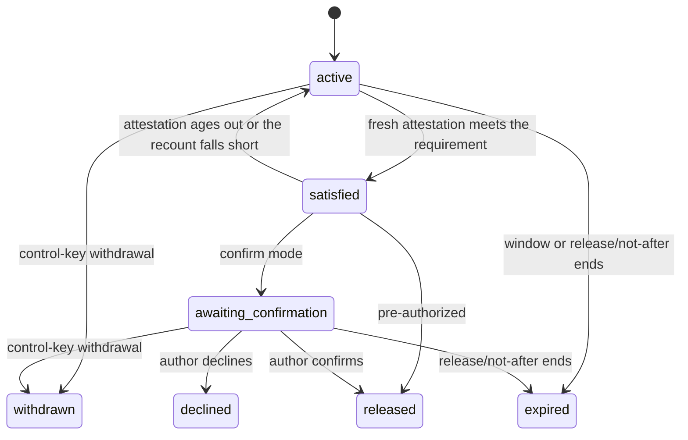

# Whisper Social-Signal Exchange and Threshold Bootstrap

Based on:
- `doc/project/20-memos/orbiplex-whisper.md`
- `doc/project/20-memos/orbiplex-anon.md`
- `doc/project/30-stories/story-005-whisper-rumor-intake.md`

Related:
- `doc/project/40-proposals/078-weak-signal-harvester.md`
- `doc/project/40-proposals/079-cross-federation-alliance.md`
- `doc/project/30-stories/story-014-dormant-contest-entry.md` (acceptance story
  for [dormant-fact resonance](#dormant-fact-resonance-2026-10-27))

## Status

Proposed (Draft)

## Date

2026-03-23

## Executive Summary

This proposal defines the v1 shape of `Orbiplex Whisper` as a privacy-bounded
social-signal exchange layer for rumors, early pattern detection, and later
association bootstrap.

The key decisions are:

1. Whisper exchanges weak social signals rather than confirmed facts.
2. Whisper must keep rumor semantics explicit through the whole flow.
3. Whisper performs local redaction and user-approved rewriting before publication.
4. Anti-Sybil controls in v1 should be budget- and policy-based, not semantic
   duplicate detection.
5. Threshold crossing should lead to a deterministic bootstrap proposal rather than
   automatic human enrollment.
6. Onion-like or relay-based anonymity should live behind a separate outbound
   privacy capability and be requested by Whisper through routing intent rather
   than embedded into Whisper itself.
7. Whisper also carries bounded `trace` statements about artifact creation,
   dispatch, receipt, or possession. A trace defaults to digest-only disclosure;
   inline content requires explicit consent and remains a claim rather than a
   receipt or attestation.

## Context and Problem Statement

Orbiplex currently has room-oriented answer exchange, procurement flows, archival
thinking, and growing support for provenance-rich artifacts. What is still missing
is a bounded way for nodes to share socially meaningful weak signals such as:

- "people in different places may be experiencing the same organizational abuse",
- "users may be hitting the same harmful moderation pattern",
- "a dignity or safety issue may be distributed rather than isolated",
- "ambulance refusal followed by severe complications may be repeating as a systemic emergency-care failure rather than as isolated bad luck",
- "independent inventors in different countries appear to be converging on the same technical approach without prior contact",
- "several communities have independently bootstrapped structurally similar solutions to an unmet need".

The second class of signal — idea convergence — is as important as the first.
Where problem signals serve early detection and collective response, idea signals
serve co-creation: connecting people who have independently arrived at a similar idea
before their paths diverge irrecoverably. Both polarities deserve first-class support.

Without an explicit social-signal layer, nodes either:

- keep such signals entirely local and fail to correlate them,
- or improvise ad hoc messaging that risks oversharing, weak provenance, and
  accidental rumor amplification.

The system needs a middle layer:

- weaker than evidence,
- stronger than private intuition,
- bounded enough to be privacy-aware,
- and explicit enough to support thresholding and association bootstrap.

## Goals

- Define `Whisper` as a distinct protocol family for rumor-style signal exchange.
- Keep rumor semantics explicit and never flatten them into evidence by accident.
- Make local redaction and user approval part of the publication path.
- Support interest registration and threshold detection without premature disclosure.
- Support deterministic association bootstrap after critical mass is reached.
- Keep transport-level anonymity modular through an outbound privacy capability.

## Non-Goals

- This proposal does not define full evidentiary case management.
- This proposal does not define final governance or adjudication procedures.
- This proposal does not define semantic duplicate detection for rumors in v1.
- This proposal does not require onion-style transport for every Whisper message.
- This proposal does not define the full relay/privacy provider contract beyond its
  boundary with Whisper.
- This proposal does not define source-corpus harvesting from documents, mail,
  or configured feeds. Weak Signal Harvester (Proposal 078) is the upstream
  discovery tool that may prepare reviewed local findings before Whisper intake.

## Decision

Orbiplex should treat `Whisper` as a dedicated social-signal exchange layer with the
following v1 lifecycle:

1. local rumor intake
2. local redaction and idiolect reduction
3. user approval of the sanitized result
4. `whisper-signal` publication
5. optional `whisper-interest` registration on receiving nodes
6. `whisper-threshold-reached`
7. `association-room-proposal`
8. explicit local human opt-in into the next-stage room or process

Transport anonymity remains a separate concern:

- `Whisper` expresses routing intent and privacy posture,
- Node egress resolves that posture through any installed outbound privacy or relay
  capability,
- Node decides whether the requested posture can be satisfied, degraded, or must
  fail.

## Proposed Model

### Message classes

The Whisper protocol family has two first-class message classes with different
semantics:

- **social signal** — `whisper-signal.v1`, whose `signal/polarity` is `problem`
  or `idea`; it may participate in correlation, thresholding, and association
  bootstrap;
- **trace statement** — `whisper-trace.v1`, a bounded provenance assertion that
  an artifact was created, handed to a transport, received, or held at a stated
  time. It never participates in social-signal thresholding.

`public-gossip.v1` remains a separate explicit public publication contract. It
is not a Whisper message class and is not silently produced from either a signal
or a trace.

A trace is weaker than an `execution-receipt.v1`, delivery receipt, or
attestation. Its enclosing signature identifies who made the assertion; it does
not prove that the asserted event happened. An optional `evidence/refs` list may
point to independently verifiable receipts or attestations without duplicating
their payloads.

Trace disclosure has two modes:

- `digest-only` is the default and carries artifact digest, byte length, and
  optional media/schema metadata;
- `digest-and-content` additionally carries bounded base64 bytes and requires a
  `consent/ref` validated by the authoring host before publication.

Digest-only disclosure is data minimization, not anonymity. A digest of
predictable or low-entropy material can still support guessing and
cross-context correlation. Classification, recipient, and disclosure policy
therefore apply to both modes, not only to inline content.

For `digest-and-content`, the referenced consent or authorization fact must bind
the exact artifact digest, disclosure scope, author or represented subject, and
validity window. When content contains data about several people, local policy
may require authority from all relevant subjects or refuse inline disclosure.
The reference string alone grants no authority. The v1 wire cap is 32 KiB;
host/federation policy may lower but not raise it.

V1 deliberately does not define a network-visible consent artifact. The
`consent/ref` is a sender-local audit handle and need not be remotely
dereferenceable; it should not disclose a participant id or private policy
record. A federation that later needs portable consent evidence must define a
separate signed contract rather than reinterpret this opaque reference.

The schema requires SHA-256 and a declared byte length. The implementation must
decode inline bytes, enforce the host cap, and compare both byte length and digest
before accepting or publishing the trace. A public relay can validate the
contract and signature, but cannot infer that an opaque consent reference names a
valid local decision; that authority remains on the sender's host.

### 0. Signal polarity

A `whisper-signal` carries one of two fundamental polarities:

- **`problem`** — the signal describes a distributed harm, failure, or dignity risk.
  The lifecycle goal is early correlation and, where critical mass is reached,
  collective response or protective action. The signal grade expresses protective
  risk and urgency. Emergency assistance
  paths may be triggered.
- **`idea`** — the signal describes a convergent idea, creative discovery, or
  emerging approach that multiple people or groups appear to have independently
  reached. The lifecycle goal is to propose co-creation or collaboration between
  parties who have not yet found one another. The signal grade expresses convergence
  strength, co-creation potential, or urgency of matching interested participants. Emergency
  protocols are never triggered.

`signal/polarity` is a mandatory field on `whisper-signal.v1`. The two polarities
share the same lifecycle but differ in urgency, redaction posture, and the nature of
the resulting association room:

- problem → support, coordination, or protective response room,
- idea → co-creation or collaboration room.

### 1. Rumor semantics remain explicit

Whisper artifacts are not evidence artifacts.

The protocol must preserve a lower epistemic class such as:

- rumor,
- weak signal,
- correlated signal,
- only later, if procedurally justified, confirmed case.

This is a semantic safety boundary. The system must not let a rumor become
"confirmed" merely because many nodes repeated it.

### 2. Local redaction before publication

The raw text entered by a user or operator should remain local by default.

A local Weak Signal Harvester (Proposal 078) may prepare candidate findings from
documents, mail, or other configured sources before this step. Such findings are
not Whisper artifacts. They enter Whisper only after local import, grouping,
review, and explicit user/operator action. The Harvester must not publish
`whisper-signal.v1` directly.

Before publication, Whisper should run a bounded local workflow for:

- anonymization,
- paraphrase,
- idiolect flattening,
- privacy and risk review.

The output of that workflow should be user-reviewed and user-accepted before any
network-facing artifact is emitted.

Protective anonymization in this workflow is aimed at people and protected local contexts. It should not blindly erase names of companies, hospitals, ambulance operators, or other institutions when those entities are plausibly part of the harmful pattern and do not require protection.

When a local helper such as `Monus` prepared the draft, downstream policy should
still be able to distinguish user-authored, operator-observed, Monus-derived, and
Monus-plus-Sensorium-derived signals.

For role semantics, the outgoing `whisper-signal` should preserve both:

- `sender/node-id` for the infrastructure actor carrying the publication, and
- a pseudonymous authored role through `rumor/nym`, attached `nym-certificate`,
  and `nym` signature over the outgoing artifact body.

When Whisper uses the nym path, the backing `participant-id` should remain on the
local or issuing side of the boundary rather than being disclosed in the
wire-level `whisper-signal` artifact itself.

### 3. Bounded anti-Sybil controls in v1

The v1 baseline should use simpler controls instead of semantic dedup:

- rumor budgets per author scope and time window,
- forwarding budgets,
- derived-nym depth limits,
- hop TTL,
- optional deterministic `signal/similarity-key` for fixture-grade or explicitly
  policy-defined thresholding,
- trust- and policy-aware thresholding.

This proposal explicitly rejects hard semantic duplicate gating for v1, because:

- semantic equivalence is expensive and ambiguous,
- false positives would be operationally harmful,
- the system first needs clean contracts for rumor classification, budgets, and
  disclosure scope.

### 4. Interest without disclosure

Receiving nodes should be able to say:

- "this may matter locally"
- "I am interested in further correlation"

without revealing the underlying person, case, or internal notes.

This lets the system correlate signals before identities are exposed.

### 5. Deterministic threshold bootstrap

When critical mass is reached, the system should not:

- automatically merge people into a room,
- or choose a bootstrap authority ad hoc.

Instead, participating nodes should deterministically derive a small bootstrap set
that publishes an `association-room-proposal` with:

- initial room policy,
- disclosure assumptions,
- bootstrap expiry,
- and moderation or witness expectations.

For Agora M4, the first threshold function is deliberately narrow: at least two
distinct eligible nodes publish public/federated `whisper-signal.v1` records with
the same `topic/class` and deterministic `signal/similarity-key` within a bounded
time window. This is an implementation smoke rule, not a claim that production
Whisper has semantic duplicate detection.

Threshold and proposal records are public meta-signals, not public gossip.
`whisper-threshold-reached.v1` means that a projection or issuer claims a
policy-defined correlation was observed. `association-room-proposal.v1` means
that a redacted/bootstrap-only coordination surface is proposed. Neither record
publishes the underlying social narrative; `public-gossip.v1` is a separate,
later publication step requiring explicit human, collective, or policy authority.
That publication step may be independent of Whisper, or it may follow opt-in
association. An `association-room-proposal` is therefore a possible precursor to
public gossip, not a required precondition.

The signer roles are intentionally split. A source `whisper-signal.v1` is signed
by the source nym or other admitted author. A derived
`whisper-threshold-reached.v1` or `association-room-proposal.v1` is signed by a
projection authority, because it is a claim about a projection result rather than
a firsthand social statement. The first implementation may use one projection
node or delegated projection key, but the protocol should remain compatible with
future static or reputation-selected committee authorities that attach inline
selection and quorum proofs.

### 6. Explicit consent gate

Threshold crossing may justify a next-stage room, but not silent enrollment.

Humans must remain opt-in at the point where:

- more information is disclosed,
- identities are correlated more directly,
- or a dedicated room is joined.

## Distribution and Local Storage

A whisper is a content artifact; *how* it reaches receivers is a separate
question. This proposal freezes two coequal distribution mechanisms and
one local storage rule.

### Agora as one distribution surface

A whisper MAY be published as a first-class Agora record (proposal 035)
with:

- `record/kind = "whisper"`,
- `content/schema = "whisper-signal.v1"`,
- `author/participant-id` carrying the `rumor/nym` as a
  `nym:did:key:...` identity (proposal 035 §2 invariant 9),
- `author/nym-proof` carrying inline-first `nym-certificate.v1` material
  sufficient to verify the current nym without remote lookup, plus optional refs
  for longer lineage, audit, or reputation history,
- envelope `signature` produced by the nym's private key,
- ingest admitted by the attestation gate (proposal 041) with the nym
  certificate accepted as the attestation artifact under the topic's
  configured ingest mode.

When a whisper travels on Agora, identity, authorship, timing, the
canonical record identifier, and the signature live in the **envelope**,
not in the `whisper-signal.v1` content body. This mirrors the
envelope-vs-content reconciliation applied to `resource-opinion.v1` in
proposal 026 §2.

| Concern | Where it lives |
|---|---|
| pseudonymous author identity | envelope `author/participant-id` = `nym:did:key:...` |
| nym authorization binding | envelope `author/nym-proof` with inline-first certificate material and optional refs |
| authoring timestamp | envelope `authored/at` |
| canonical signal identifier | envelope `record/id` |
| signature over canonical bytes | envelope `signature` (Ed25519 by the nym key) |
| topic routing | envelope `topic/key` (conventionally `ai.orbiplex.whispers/<topic-class>` for public/federated whispers; `private/<name>` for direct-only INAC artefacts that must never be carried by Agora) |
| whisper semantics | content body validated by `whisper-signal.v1` |

Agora distribution is appropriate when:

- the whisper's `disclosure/scope` is `federation-scoped`,
  `cross-federation`, or `public-aggregate-only`,
- the author wants addressable subject-index presence under a public
  topic,
- the relay operators' ingest policies (proposal 041 §4–§5) match the
  whisper's risk and routing posture.

For `cross-federation` disclosure, Proposal 079's `alliance-policy.v1` may be
one local admission input. It does not replace Whisper's own author,
disclosure, redaction, or publication checks, and it does not transfer Seed
Directory or Agora authority.

Agora distribution is NOT appropriate for whispers whose
`disclosure/scope` is `private-correlation`; those SHOULD travel via
direct node-to-node exchange.

This is a **SHOULD, not a MUST**, by design. On public Agora
deployments the semantics of `private-correlation` are incompatible
with Agora's publication properties (public topic enumeration,
subject-index presence, per-topic digest), and any such deployment
SHOULD refuse these whispers at ingest. A closed / intra-organization
federation (e.g. a corporate deployment whose Agora relay is
authenticated, non-public, and governed by its own ingest policy) MAY
choose to carry `private-correlation` whispers internally, because the
exposure surface of such a relay is already narrowed to the
organization. The rule is therefore scoped to disclosure semantics,
not mechanically to the `agora-record.v1` envelope — operators of
non-public federations are trusted to decide.

### Direct node-to-node exchange as the second distribution surface

A whisper MAY travel directly between participating nodes without
touching an Agora relay. The **wire format remains the same
`agora-record.v1` envelope**, so canonicalization, signature rules, and
self-verification are identical; only the transport and the addressable
scope differ:

- transport: node-to-node authenticated channel realized through the
  outbound privacy capability (see "Transport Boundary" below),
- scope: the receiving set is determined by direct node selection or
  by interest registration (`whisper-interest.v1`), not by public
  topic subscription,
- retention: governed by each receiver's local Memarium policy; there
  is no shared substrate to enforce uniform retention across
  receivers.

Direct exchange is appropriate when:

- `disclosure/scope = "private-correlation"`,
- routing requires `hard-fail` anonymity and no Agora relay can
  guarantee it,
- the whisper is an early pattern probe that has not yet crossed any
  threshold that would justify durable public presence.

### Interest discovery and bounded private dissemination

For `private-correlation` whispers, Agora-discovered topic interest is
**eligibility, not delivery entitlement**.

An Agora topic interest record may say that a node is willing and able to
receive private whispers for a topic class via INAC or another acceptable
private exchange path. It MUST NOT imply that every matching private
whisper must be delivered to that node. The origin node is responsible
only for **bounded initial dissemination** under local egress policy.

A node selecting recipients for a private whisper SHOULD choose a small,
policy-bounded set using criteria such as:

- topic-class compatibility,
- accepted `disclosure/scope`,
- private transport support,
- local egress budget,
- declared intake capacity,
- node or operator assurance,
- diversity across federation, jurisdiction, operator class, or
  reputation band,
- deterministic epoch sampling, so popular topics do not always route
  to the same receivers.

Wider awareness SHOULD be achieved by thresholded aggregate artifacts
and consent-gated follow-up, not by raw private-signal fan-out. A million
nodes expressing general interest in a popular topic therefore does not
create a million-message delivery obligation.

### Holder-assisted redistribution

A node that receives and stores a private whisper MAY later act as an
additional holder and redistributor, but only when all of the following
are true:

- the signed whisper and local Memarium policy allow forwarding or
  custodial redelivery,
- the receiving operator explicitly enables holder availability for the
  relevant class of whisper,
- the node publishes only a bounded availability signal to Agora, not
  the private whisper itself,
- the node enforces the same disclosure, routing, budget, consent, and
  audit constraints that applied to the origin node.

The holder availability signal is a discovery hint, not a public shadow
copy of the whisper. It SHOULD avoid raw `signal/text`, raw keywords,
case-specific timestamps, and other reconstructive metadata. A safe v1
shape should be closer to:

- topic class or coarse topic family,
- accepted private transport profile,
- disclosure scope accepted by the holder,
- capacity and rate limits,
- assurance / relay / witness class,
- optional opaque availability token for correlation with direct
  follow-up.

Publishing holder availability for a private whisper is itself a
disclosure act. Public Agora deployments SHOULD treat per-signal holder
availability as sensitive and may refuse it unless it is sufficiently
coarse, delayed, thresholded, or explicitly authorized by the whisper's
policy. Closed / intra-organization federations MAY use more specific
holder availability beacons when their ingress and visibility policies
make that exposure acceptable.

Holder-assisted redistribution does not require an Agora availability
record. A trusted node MAY contact a peer directly over INAC and offer a
private whisper transfer using a bounded topic hint such as "I hold a
private whisper for topic class X under disclosure scope Y". The peer
MAY then request the artefact, ignore the offer, or ask for operator
review before requesting it.

This offer/request/transfer path is independent of the whisper's origin:
the held whisper may have been authored locally, received directly,
received through a trusted relay, restored from Memarium custody, or
obtained from a later holder. What matters is the signed artefact, its
forwarding policy, local holder policy, and the receiver's intake policy.

Receiver decision policy MAY be:

- **default policy** — deterministic local rules request or refuse the
  offered whisper automatically,
- **operator approval** — the node notifies the operator and requests
  only after explicit approval,
- **advisory automation** — an Inquirium-backed local advisory model evaluates
  the offer against policy and recommends or triggers a request, subject to
  configured autonomy limits and audit logging.

The offer itself MUST NOT contain raw `signal/text`, raw keywords, or
other reconstructive metadata. It should be no more specific than the
minimum needed for the peer to decide whether to request the artefact.

The same whisper MAY move between distribution surfaces over time:
what starts as direct node-to-node exchange and later crosses a
threshold (§5) MAY be republished to Agora as `whisper-durable`
(record kind registered in proposal 035 §3), with the transition
gated by the explicit consent step (§6).

### Memarium as local storage

Regardless of distribution surface, the **local storage of a whisper**
— both authored and received — is the node's Memarium (proposal 036).
Memarium carries:

- the signed `agora-record.v1` envelope byte-identically (requirements-014
  NFR-004), so the whisper remains verifiable and reshippable whether
  it first traveled via Agora or directly,
- the action trace for the whisper's lifecycle (draft, redaction,
  approval, publication, forwarding, interest counting, threshold
  detection),
- the privacy policies that determine whether the whisper can be
  replayed, forwarded, or exposed outside the node.

Memarium is the authoritative local archive; Agora (where used) is a
replicated publication surface. A whisper never stored in Memarium
never existed from the local node's perspective. A whisper stored in
Memarium remains replayable for the custodial redelivery flow
(proposal 040) subject to the node's current retention and disclosure
policy; the author's consent and the receiving relay's current
ingest policy both remain authoritative at each reship.

### Assessment Exposure Profile

**Partial local continuation, 2026-10-24; separate from the existing M4
qualification.** The [P026 local checkpoint](026-resource-opinions-and-discussion-surfaces.md#local-pilot-evidence-checkpoint-2026-10-24)
records the bounded common-view implementation and its real local host/browser
acceptance. The runtime fixture preserves rumor-shaped credibility/rejection
fields on a generic open resource reference. It does not qualify a new standalone
rumor-overlay schema or the full Whisper curation and propagation workflow.
Rumor credibility/rejection judgments already use `resource-opinion.v1` with
rumor-specific fields. They therefore select the shared
[P026 exposure contract](026-resource-opinions-and-discussion-surfaces.md#6-assessment-exposure-and-sealed-rounds),
not a second Whisper voting or privacy engine. The existing rumor subject key and
`opinion/subject-kind = rumor` identify the binding; canonical kind/id validation
and the admitted rumor overlay must agree with the opinion body contract.

The local profile withholds other people's credibility ratings, rationales,
counts and popularity ordering at the host read boundary until the viewer's
accepted judgment, explicit skip or local encounter window. Curation UI, Agent,
search, notifications and SSE consume that viewer-bound projection; ordinary
rumor arrival and peer-assessment arrival are distinct events. An inbox may
count admissible rumors, but must not disguise hidden assessment activity as
new rumor activity. Raw public relay access remains outside this local guarantee.

Whisper's spread thresholds, anti-spam suppression, budgets and source-diversity
rules continue operating independently. Hiding ratings neither delays urgent
protection nor turns missing ratings into zero credibility. Protective notices
use admitted exception contracts, never a sender's self-assigned safety flag.
An optional sealed assessment round uses P026's signed barrier and outcomes;
it does not hold rumor transmission pending quorum or certify social independence.

### Operator-mediated rumor curation

A node that subscribes to public whispers (Agora) or accepts private
whispers (direct node-to-node) accumulates received rumors in Memarium
as part of the normal ingest path. Memarium is append-only from the
envelope's perspective — a received whisper envelope is never
retroactively mutated or deleted — but the node's local curation state
for that envelope **is** a mutable projection, stored as separate
Memarium facts keyed by the received record's id.

The node surfaces accumulated rumors to the operator through a local
inbox-style view (e.g. "you have 5 new whispers"). For each rumor the
operator can apply one of the curation verdicts:

The inbox/notification distinction is shared with Proposal 057
(`057-user-and-operator-notifications.md`): whispers create local attention
items, while the inbox is only a projection over those items.

- **credibility rating** on a 1..5 scale,
- **mark as spam**,
- **mark as policy-violating** (e.g. abusive, illegal, off-topic for
  this node's federation posture).

Each verdict is expressed as a `resource-opinion.v1` (proposal 026)
whose envelope `record/about` references the rumor's `record/id` —
the same identity under which the whisper is addressable in Agora
and in Memarium. This keeps rumor curation inside the same opinion
mechanism that the substrate already uses for resources, proposals,
and identities; no separate "rumor review" schema is introduced.

This curation target is the rumor record, not a person or other resource
mentioned in the rumor. Country-scoped resource namespaces and compact
related-resource references follow [P026 §1.1–1.2](026-resource-opinions-and-discussion-surfaces.md#11-country-scoped-identifier-namespaces);
they do not change the rumor's epistemic class or disclosure policy.

The concrete mapping (per `rumor-opinion.overlay.v1` defined in
proposal 026 §2.4) is:

- **credibility rating** → `opinion/subject-kind: "rumor"` plus
  `rumor/credibility` integer in `1..5`. The core `opinion/rating`
  field is left unused for rumor curation; credibility is a
  kind-specific dimension orthogonal to the substrate-wide rating
  scale.
- **mark as spam** → `opinion/subject-kind: "rumor"` plus
  `rumor/rejection-reason: "spam"`.
- **mark as policy-violating** → `opinion/subject-kind: "rumor"`
  plus `rumor/rejection-reason: "policy-violation"` (or one of the
  more specific enum values `abusive`, `off-topic`, `duplicate`,
  `fabricated` when the operator chooses a narrower reason).

A single curation opinion MAY combine a credibility score and a
rejection reason, and MAY additionally carry `opinion/text` when the
operator wants to justify the verdict.

Default propagation effect of a verdict, applied by the node's own
outbound policy (not by the protocol):

- **rated**: does not alter propagation; rating is a first-class
  opinion that other nodes may or may not consume through the Agora
  opinion topic for that record,
- **spam**: the envelope is retained locally for audit but is **not**
  rebroadcast, not forwarded via holder-assisted redistribution
  (§Holder-assisted redistribution), and is excluded from threshold
  counting on this node,
- **policy-violating**: same outbound suppression as spam, and
  additionally the node's curation opinion is published so that
  peers relying on this node's judgement can discount the rumor.

The curation opinion itself is an ordinary Agora record and follows
the disclosure and signing rules of proposal 026; it does **not**
inherit the original whisper's `disclosure/scope`. An operator
reviewing a `private-correlation` whisper can still publish a public
"this is spam" opinion about its record id without leaking the
whisper body, because the opinion targets the id, not the content.

No protocol-level deletion of the original whisper is required.
Suppression is a local propagation decision; the verifiable envelope
and its curation verdicts coexist in Memarium as separate facts on
the same timeline.

## M4 Acceptance Scenario

Agora M4 uses Story-005 as the first full public/federated Whisper smoke:

```text
node A user -> sanitized public/federated whisper signal -> node C Agora relay
node B user -> similar sanitized public/federated whisper signal -> node C Agora relay
node C relay -> replay-fed Whisper projection -> threshold -> association-room proposal
```

The smoke proves only the disclosure-safe public/federated path. A
`private-correlation` whisper submitted to the public relay path must be rejected
or held out of Agora, because private whispers belong to direct exchange, INAC, or
another bounded private transport path, with local Memarium custody. Matrix may be
used later as an optional private transport adapter, but Matrix rooms are not part
of the Whisper or INAC domain model. The threshold result may create an
`association-room-proposal`, but it must not enroll humans automatically.
It also must not be treated as `public-gossip.v1`; it is only a coordination
record until a separate publication decision exists. Public gossip can still be
published independently on the public weak-signal path; the proposal lifecycle is
not a mandatory prerequisite.

## Transport Boundary with Outbound Privacy Capabilities

`Whisper` should not own onion routing or relay topology.

Instead, a `whisper-signal` may carry routing intent such as:

- anonymity requested,
- anonymity required,
- maximum hop count,
- acceptable relay classes.

Node then resolves that intent through some outbound privacy capability if
available. `Orbiplex Anon` is one possible provider of that capability, but
Whisper should not need to know that module by name.

The v1 behavior should support at least:

- `soft-fail`: anonymous routing preferred, but non-anonymous transport may still be
  used if policy allows,
- `hard-fail`: anonymous routing required, and the rumor must not be sent if the
  requested posture cannot be satisfied.

This keeps protocol meaning separate from transport realization.

The planned integration point is AD transport selection, not a Whisper-owned
sender. [S010 Anon](../60-solutions/010-anon/010-anon.md#ad-privacy-integration-planned-direction)
owns the implementation guidance and `S010-001`–`S010-003` tracker for privacy
requirements, metadata limits, route refusal and acceptance. Existing AD/INAC
Whisper delivery does not prove anonymous delivery. Required anonymity must
remain a pre-send gate across retries and fallback, including when the requested
provider is unavailable.

Acute personal emergencies detected through local Sensorium should still prefer a
local help-mode or emergency-assistance path. Whisper is for correlation-worthy
distributed patterns, not as the default first response to a likely cardiac arrest
or comparable collapse.

Advisory companion: Proposal 077 (Swarm Broadcast Assistance) defines the
assistance path that Whisper deliberately is not — a scoped, user-initiated
broadcast for help — and, together with
`doc/project/20-memos/whisper-corpus-composition.md`, how a Whisper-born
association room may later hire collective expertise.

## Candidate Artifacts

The likely first contract family is:

1. `whisper-signal.v1`
2. `whisper-trace.v1`
3. `whisper-interest.v1`
4. `whisper-threshold-reached.v1`
5. `association-room-proposal.v1`

`whisper-signal.v1` is a **content-body schema** for the Agora record
envelope (proposal 035) and for the same envelope used in direct
node-to-node exchange (see "Distribution and Local Storage"). The
content body carries whisper-level semantics only:

- `signal/polarity` (`problem` | `idea`),
- `epistemic/class`, `signal/text`, `topic/class`, `context/facets`,
- optional `signal/similarity-key` for deterministic threshold smoke and explicit
  policy-defined matching,
- `confidence`, `disclosure/scope`, `signal/grade`, source attribution,
- routing intent (`routing/profile`, `routing/failure-mode`,
  `forwarding/max-hops`, ...).

Identity and authorization that the pre-reconciliation sketch carried
inside the content body move to the enclosing envelope:

- `rumor/nym` → envelope `author/participant-id` as
  `nym:did:key:...`,
- attached `nym-certificate` → envelope `author/nym-proof` carrying
  inline-first certificate material, with optional refs for longer lineage,
  audit, or reputation history,
- nym signature over the body → envelope `signature` over the full
  canonical envelope bytes (Ed25519 by the nym key).

This keeps `whisper-signal.v1` a small portable shape independent of
whether the whisper travels on Agora or directly between nodes, and
prevents the signing domain from being split across two artifacts.

`whisper-trace.v1` uses the same envelope split. The content body carries the
trace kind, author-asserted occurrence time, artifact descriptor, disclosure
mode, consent reference when inline bytes are present, optional causal/evidence
refs, and routing posture. Envelope identity, signature, publication time, and
topic routing remain outside the body. Public/federated traces use
`record/kind = "whisper-trace"`, `content/schema = "whisper-trace.v1"`, and the
conventional topic prefix
`ai.orbiplex.whisper-traces/<trace-kind>`; private/direct traces use Artifact
Delivery and INAC rather than a public Agora topic. The separate record kind is
intentional: Agora projections can exclude trace statements from social-signal
similarity and threshold processing without inspecting the content body.

`whisper-interest.v1` should not mirror that pattern. It remains a node-scoped
local-interest declaration:

- counted and evaluated per participating node,
- carrying `interested/node-id` rather than a participant or nym author,
- and suitable for threshold coordination without turning local readiness into a
  pseudonymous transport-facing identity.

Later additions may include:

- `whisper-topic-interest.v1`
- `whisper-holder-availability.v1`
- `whisper-disclosure-request.v1`
- `whisper-disclosure-decision.v1`
- `whisper-forward.v1`

At least one of those early contracts should also preserve whether the signal was
directly user-authored, operator-observed, or prepared by a local helper such as
`Monus`, so that downstream policy can distinguish user-authored rumors from
monitor-derived ones. If Sensorium materially informed the draft through `Monus`,
that should remain visible as well.

## Trade-offs

1. Whisper vs generic messaging:
   - Benefit: cleaner semantics and safer handling of rumors.
   - Cost: one more protocol family and lifecycle to maintain.
2. Local redaction and approval vs direct publication:
   - Benefit: stronger privacy and less idiolect leakage.
   - Cost: more friction before publication.
3. Budget-based anti-Sybil controls vs semantic dedup:
   - Benefit: implementable now, easier to reason about.
   - Cost: allows some near-duplicate rumors through.
4. Separate `Anon` module vs embedded onion routing:
   - Benefit: cleaner layering and broader reuse.
   - Cost: routing policy becomes a cross-module contract.
5. Deterministic bootstrap vs central coordinator:
   - Benefit: more federated and less monopolistic.
   - Cost: more care needed in threshold and quorum design.
6. Trace statements vs receipts:
   - Benefit: nodes can cheaply disclose content-addressed provenance without
     exposing content or requiring a full workflow receipt.
   - Cost: consumers must preserve the distinction between a signed assertion
     and independently verified evidence.

## Resolved Questions

1. `idea` signals use the same threshold function as `problem` signals in v1.
   This keeps the threshold contract deterministic and avoids a second policy
   surface before production evidence shows a need for divergence.
2. The M4 threshold rule remains the production baseline for v1: two distinct
   eligible nodes with the same `topic/class` and `signal/similarity-key` inside
   a bounded time window. Trust-tier weighting and source-diversity constraints
   are later overlays, not v1 requirements.
3. Rumor nyms and derived forwarding nyms are deterministic per rumor context.
   This gives stable correlation inside one rumor context without introducing
   global cross-context linkage.
4. `whisper-threshold-reached` includes aggregate statistics only. Bounded
   witness references are omitted from the public threshold artifact to minimize
   correlation and disclosure risk.
5. Sensitive rumor classes fail closed for rebroadcast unless a suitable
   outbound privacy capability is present. Classification and redaction are not
   enough by themselves for those classes.
6. Whisper emits threshold and association proposal artifacts. Association-room
   lifecycle, enrollment, moderation, transcript/case management, and later
   room runtime belong to a specialized association/room layer.
7. Curation verdicts are expressed as `resource-opinion.v1` with
   `opinion/subject-kind: "rumor"` plus the `rumor-opinion.overlay.v1`
   fields (`rumor/credibility` in `1..5`; `rumor/rejection-reason`
   as a closed enum). No new opinion subtype is introduced. The default v1
   propagation policy suppresses after K independent trusted-peer spam verdicts,
   where K and trusted-peer scope are local policy parameters.
8. Artifact traces use a separate `whisper-trace.v1` content contract rather
   than a third `signal/polarity`. They are excluded from threshold and
   association projections. Digest-only is the default; inline content requires
   sender-host validation of `consent/ref`, a hard byte cap, and digest/size
   verification.

## Open Questions

None for the v1/M4 hard-MVP slice. Future production deployments may reopen
threshold weighting, source diversity, witness-reference disclosure, and richer
association-room lifecycle policy as post-MVP questions.

## Assessment Exposure Tracker

| ID | Task | Status | Dependencies | Completion gate |
|---|---|---|---|---|
| P013-AE-001 | Bind rumor curation to the common local gate | partial | P026-005/006/007; P057-014 | Reuse the opinion subject key, overlay validation and host projection for curation, Agent, search and attention paths. Retain fixtures proving peer scores/counts/order cannot leak while ordinary rumor delivery, propagation suppression and urgent protection still work. No new rumor-review store or client-only hiding; feed joint evidence into P026-008. The 2026-10-24 P026 local checkpoint proves withholding and later rendering of rumor extension fields through the shared view. Standalone overlay admission and the complete real Whisper curation/Agent/attention/propagation matrix remain outside that qualification; existing M4 evidence is unchanged. Review run 01 requalifies bounded rumor fields through the common view; complete Whisper workflow scope remains unchanged. |
| P013-AE-002 | Optional sealed rumor-assessment profile | todo | P026-010/011 | Select an admitted round/opener policy and reuse the four Agora kinds; test missing reveal, duplicates, partial history and independent propagation. This is separate from local-gate completion and not an alpha dependency. |

## Next Actions

1. Keep v1 schemas for `whisper-signal`, `whisper-interest`,
   `whisper-threshold-reached`, and `association-room-proposal` synchronized with
   the implementation schema gate.
2. Add one implementation-facing solution component for `Whisper`.
3. Add one implementation-facing solution component for an outbound privacy
   provider such as `Anon`.
4. Define the local Node service contract for Inquirium/model-assisted redaction
   and user approval workflows.
5. Revisit production threshold policy and derived-nym rules after M4 proves the
   deterministic two-node smoke rule.
6. Decide whether a future local module such as `Orbiplex Monus` should be allowed
   to prepare semi-automatic or automatic Whisper drafts from wellbeing-weighted
   local signals.
7. Keep `whisper-signal.v1.schema.json` as a content-body-only schema
   (with `signal/id`, `created-at`, `rumor/nym`, `auth/nym-signature`,
   and `author/nym-proof` living in the enclosing `agora-record.v1`
   envelope per the Distribution section), mirroring the content-body-only shape
   already applied to `resource-opinion.v1.schema.json` for proposal 026.
8. Register `whisper` as a recognized `record/kind` and
   `whisper-signal.v1` as a recognized `content/schema` in the Agora
   relay reference implementation; register
   `ai.orbiplex.whispers/<topic-class>` as the conventional
   public/federated topic-key prefix, and reserve `private/<name>`
   for direct-only INAC artefacts outside Agora.
9. Define the direct node-to-node exchange contract as a thin binding
   over the same `agora-record.v1` envelope, consuming the outbound
   privacy capability for transport and the attestation gate for
   peer admission, with Memarium as the sole persistent store on both
   ends.
10. Wire operator-mediated rumor curation
    (§Operator-mediated rumor curation) into the Node UI whisper
    inbox: per-rumor actions for `rumor/credibility` (1..5),
    `rumor/rejection-reason: spam`, and
    `rumor/rejection-reason: policy-violation`; each action emits a
    `resource-opinion.v1` with `opinion/subject-kind: "rumor"`
    targeting the rumor's `record/id`, persisted as a Memarium fact
    and routed through the node's normal opinion publication path.
    Outbound propagation policy consumes the local verdicts as
    suppression inputs (any `rumor/rejection-reason` present → no
    rebroadcast, no holder-assisted redistribution, excluded from
    threshold counting).
11. Publish `rumor-opinion.overlay.v1.schema.json` as a standalone
    overlay artifact validating the `rumor/*` namespace
    (`rumor/credibility`, `rumor/rejection-reason`), and add a
    worked example pair under
    `doc/schemas/examples/`: one pure-credibility verdict (no
    text, `rumor/credibility: 2`) and one spam verdict
    (`rumor/rejection-reason: "spam"` plus short justification in
    `opinion/text`).
12. Add a bounded `whisper-trace.v1` authoring path that validates consent before
    `digest-and-content`, verifies the exact inline bytes against digest and
    size, signs the ordinary envelope, and routes through Agora or AD/INAC by
    disclosure posture. Keep trace records out of social-signal thresholding.
    Implement in this order: pure decode/digest/size validation; sender-host
    consent resolution; Agora kind/schema and disclosure admission; AD/INAC
    private acceptance; operator/user authoring and inspection; carrier smoke
    tests. No phase introduces a trace-specific transport.

    **Completed on 2026-07-13.** The reference runtime now implements the pure
    integrity/privacy rules, exact sender-host consent binding for inline
    disclosure, strict Agora ingress and a metadata-only projection, private
    AD/INAC acceptance, bounded authoring/inspection UI, and a Story-005 carrier
    smoke covering public plus private traces. The runtime stores no inline trace
    content in either Whisper or Agora trace read models. It also atomically
    reserves idempotency keys, rejects concurrent duplicate side effects,
    bounds full trace JSON and extensions independently of the 32 KiB inline
    artifact cap, prunes the local metadata read model after 30 days by default,
    and verifies in smoke that public and private traces use their declared
    Agora and INAC carriers without private projection leakage.

## Contextual participant-source authorship (2026-10-25)

The accepted [P015 contextual profile](015-nym-certificates-and-renewal-baseline/contextual-whisper-authorship.md)
introduces v2 signals and aggregate threshold/proposal artifacts. It counts
council-admitted participant sources within one rumor context and epoch, with
no fallback to a source node, author string or record/about. This is a new
qualification; historical node-counting M4 results remain unchanged. Runtime
Gate A (certification) and Gate B (ordinary host authoring) remain pending.

## Dormant-Fact Resonance (2026-10-27)

Status: proposed post-MVP feature; no runtime claim. This section owns the
feature and its grouping task `P013-DFR-000`. Mechanism tasks stay in the
documents that own each mechanism. The acceptance scenario is
[Story 014](../30-stories/story-014-dormant-contest-entry.md).

### Summary

People record ordinary facts without any social tension, such as "I sent my
poem to a contest". Such a fact is neither a rumor nor an opinion. It may gain
social significance later, when other people publish a rumor that the fact
corroborates. Dormant-fact resonance lets a node discover that connection
without publishing the fact or any query derived from its details:

1. the fact is kept as a neutral personal record in Memarium;
2. a local job generalizes it to terms of a closed decorrelation vocabulary;
3. once per epoch, the node pulls complete coarse topic buckets from rumor
   relays;
4. the node scores pulled rumors against the full private fact, locally;
5. the participant decides whether the rumor concerns the fact, and any
   disclosure uses the existing Whisper paths.

The guiding rule: bring shared questions to private memory rather than send
private memory out as questions.

### Context and Problem

- **Fact.** Memarium can hold such records today, but personal facts have no
  per-fact time horizon
  ([P036](036-memarium.md#fact-retention-horizons-and-personal-records-2026-10-27)),
  and nothing connects a later rumor to an earlier record.
- **Inference.** Publishing every fact as a rumor adds noise and discloses
  personal history. Push delivery requires the network to know who is
  interested. Queries built from free keywords of a rare fact are fingerprints,
  and digests of low-entropy fields such as institution and date can be
  reversed by dictionary, as S022 already notes for derived data.
- **Background, not verified in this repository.** The pattern resembles
  information escrow (Ayres and Unkovic, 2012) and Callisto-style matching,
  where a privately held report gains meaning when an independent report
  matches it. Exposure-notification key download and BIP157/158 client-side
  block filters illustrate that the safest query is a download of public data
  that is matched locally.

### Model

| Layer | Owner | Resolution | Content | Leaves the node |
|---|---|---|---|---|
| 0. Personal record | Memarium ([P036-007](036-memarium.md#fact-retention-horizons-and-personal-records-2026-10-27)) | full | kind, counterparty, times, title, attachments, retention horizon | never through this feature |
| 1. Interest profile | Harvester ([P078-011](078-weak-signal-harvester.md#memarium-dormant-fact-profile-2026-10-27)) | coarse | vocabulary term ids derived from current records | never |
| 2. Pull plan | Whisper (`P013-DFR-002`) | bucket | per-epoch real terms, decoys, windows, byte budget | term ids, window ids, cursors |
| 3. Local match | Harvester ([P078-012](078-weak-signal-harvester.md#memarium-dormant-fact-profile-2026-10-27)) | full | scores, explanations, link-candidate findings | never |
| 4. Decision | Memarium and notifications ([P036-008](036-memarium.md#fact-retention-horizons-and-personal-records-2026-10-27), [P057-015](057-user-and-operator-notifications.md#tracking)) | full | confirmed, rejected or deferred link | never |
| 5. Disclosure | Whisper with Story 005, P015 and P070 | chosen by the participant | related rumor, interest, room participation | only after an explicit act |

#### Decorrelation Vocabulary

Whisper owns the semantics of `topic/class`; the vocabulary makes a coarse,
shared subset of it explicit. `whisper-decorrelation-vocabulary.v1`
(`P013-DFR-001`) is a JSON document validated by JSON Schema, versioned, and
digested over its JCS form. JSON matches P091 configuration files, the schema
gate and the existing canonical digests. It is a node-scoped
[P091 setting](091-file-backed-configuration-and-explainable-composition.md#p013-decorrelation-vocabulary-consumer):

- **Factory source.** The Node distribution ships a versioned vocabulary as
  the factory source of the setting. An upgrade replaces that source, never
  local layers.
- **Local layers.** Operators and power users override it through ordinary
  P091 layers. The vocabulary is an identified collection keyed by term id with
  keyed composition. A layer may add terms; change labels, aliases or parents;
  and retire a term through an explicit `term/status` of `retired`, because
  `null` deletes nothing. A layer may also declare an empty base to build an
  entirely own vocabulary. Each layer names the factory version it was written
  against. After an upgrade, overrides of vanished terms produce a typed
  diagnostic rather than a silent drop.
- **Stable bindings.** A local layer cannot change the topic key of an
  existing term id; that is refused, and a new id must be used instead. Local
  term ids carry a local namespace prefix such as `local.`, so a later factory
  term cannot collide with them.
- **Application.** A changed resolution applies at the next epoch boundary,
  and the pull plan records the `resolution/id` it used. An unavailable
  resolution stops pull planning instead of falling back to a stale copy.

Each term has an id, labels, aliases, an optional parent, its Agora topic key
under the `ai.orbiplex.whispers/` prefix (P046) and its origin (`factory` or
`local`; a federation-provided layer may follow later). Factory terms also carry
a coarse population hint and a flag stating whether they meet the cardinality
floor for pull plans.

Customization has privacy consequences that the contract makes explicit:

- The resolved vocabulary, its version and its digest stay local. They never
  appear in pull requests or rumor records, because the digest of a customized
  vocabulary would be a fingerprint. Rumors carry only the term id in
  `topic/class`.
- Local terms have no trusted population hint, so they are unrated. Pull plans
  exclude unrated terms unless the operator admits them explicitly after a
  warning that such pulls may identify the node. In pull-all mode the
  restriction is moot.
- Decoys are drawn only from rated terms.
- Authoring with a local term warns that readers who use the factory
  vocabulary will not pull that bucket.

The same resolution serves both sides:

- Authors label a rumor's `topic/class` with one term and keep the specific
  details in `signal/text`, `context/facets` and `signal/similarity-key`. The
  burden of specificity sits with the rumor, not with its readers.
- Readers select term ids only. A local model may help choose ids but never
  emits free-text queries. A term below the floor is replaced by its parent.

#### Pull Plan and Buckets

The pull plan (`P013-DFR-002`) is recomputed at epoch boundaries, not when a
fact is written. It contains a bounded number of real terms and decoys sampled
from the population hints, so every plan has the same shape. The node pulls
complete `(term, window)` slices through the Agora listing extended by
[P035-016](035-agora-topic-addressed-record-relay.md#decorrelated-bucket-pull-2026-10-27).
An oversized bucket is split by time window or by vocabulary child, never by a
private facet. When the whole Whisper prefix fits the budget, the node pulls
everything and expresses no interest at all (P035-017).

#### Conjunctions on the Wire

Story 014 asks whether terms may be combined with AND. The v1 default is a
union of single terms, with conjunctions applied locally after the pull:

- in a bucket pull, AND saves bandwidth only if the relay filters inside the
  buckets, and that requires sending the conjunction;
- a conjunction denotes a smaller population than each of its terms, and the
  same conjunction repeated across epochs eases intersection attacks;
- a pre-composed vocabulary term that denotes an intersection is an ordinary
  term with its own floor, so that option remains available.

`P013-DFR-005` measures OR-only against pre-composed conjunction terms on a
fixture corpus and records the decision here.

#### Decisions and Disclosure

A match is a hypothesis of relevance, recorded as a `weak-signal-finding.v1`
candidate. It is not evidence and never counts toward a threshold. The
participant confirms it, rejects it for this rumor or for the whole rumor
context, or defers it. Memarium records the decision once, and both the record
view and the rumor view project it. A confirmed link appears in a local "My
rumors" view (`P013-DFR-003`) beside the participant's own rumors.

Every further step is an ordinary disclosure: a related rumor authored through
the Story 005 redaction flow under the P015 contextual profile
(`P013-DFR-004`), an interest registration, or joining an association room and
sharing material there (`P013-DFR-006`). A related rumor inherits the
`topic/class` and `signal/similarity-key` of the rumor it relates to, so it
joins that rumor context and counts as one more source, never more.

### Invariants

1. During discovery, no fact text, fine facet, attachment, path or digest of
   fact fields leaves the node.
2. The interest expression is epoch-bound and independent of the time a fact
   is recorded.
3. Discovery fetches complete slices. It never requests individual records
   selected by a local match.
4. Dormant facts never derive Agora topic-interest records
   (see "Interest discovery and bounded private dissemination"); those records
   are public eligibility statements.
5. Matches are findings for review, never threshold input.
6. Derived artifacts (terms, plans, scores, link candidates) expire no later
   than their source record.
7. Each disclosure is a separate explicit act through an existing path with
   its own authorship, classification and consent controls.

### Trade-offs

- Coarse terms raise privacy and recall but cost bandwidth and local work;
  budgets and the pull-all threshold make that cost explicit.
- Epoch cadence delays discovery by hours or days. That suits weak signals;
  this is not an emergency path.
- The vocabulary becomes a coordination point. A poor vocabulary fragments
  correlation, local customization can split readers from authors, and
  mislabeled rumors land in buckets that readers may not pull.
- Relays still learn coarse interests and their timing; decoys spend bandwidth
  to blur them.
- Authoring a related rumor reveals the participant's membership in that rumor
  context to the contextual-authorship issuer, as already accepted by P015.

### Failure Modes and Mitigations

| Failure | Effect | Mitigation |
|---|---|---|
| A rare or local term identifies a participant | A relay links a node to a niche subject | Cardinality floor, parent fallback, unrated local terms excluded by default, pull-all mode |
| A stable term set across epochs | Intersection fingerprint | Bounded plan size, decoys, slow plan change |
| Distinguishable decoys | Real interests exposed | Decoys sampled from rated population hints with identical fetch behaviour |
| Vocabulary digest sent on the wire | Customized nodes become unique | Version and digest stay local; records carry term ids only |
| Alert fatigue | The participant ignores or disables the feature | Score threshold, batched notices, per-epoch cap, suppression after rejection |
| Spurious model-assisted link | False alarm | Findings are advisory, explanations are shown, confirmation is required |
| Crafted bait rumor | Elicits disclosures | Nothing is sent on a match; Story 005 redaction; relay and source labels shown |
| Expired record still matched | Retention violated | Derived artifacts expire with their source; the matcher reads only current records |
| The assistant records facts silently | Covert memory | Capture is an inert proposal executed by the host after acceptance (P066-DFR-003) |

### Open Questions

1. Population hints: how factory and later federation vocabularies estimate
   them without surveilling readers, and how often they are revised.
2. Cardinality floor values, the default epoch length and the pull-all
   threshold.
3. The conjunction rule, pending `P013-DFR-005`.
4. Whether sources joined through an explicit relation should weigh
   differently from independent discovery in production thresholds.

### Dormant-Fact Resonance Tracker

All rows are post-MVP `todo`. Mechanism rows close on their own evidence in
their owning documents; the grouping row closes only on the composed Story 014
run.

| ID | Task | Status | Depends on | Completion gate |
|---|---|---|---|---|
| P013-DFR-000 | Story 014 grouped acceptance | todo | P013-DFR-001–006; [P036-004–008](036-memarium.md#fact-retention-horizons-and-personal-records-2026-10-27); [P078-010–013](078-weak-signal-harvester.md#implementation-tracker); [P035-016–017](035-agora-topic-addressed-record-relay.md#decorrelated-bucket-pull-2026-10-27); [P057-015–016](057-user-and-operator-notifications.md#tracking); [P066-DFR-001–004](066-inquirium-assistant-channel.md#dormant-fact-capture-and-rumor-suggestions-2026-10-27); [P015 Gates A and B](015-nym-certificates-and-renewal-baseline/contextual-whisper-authorship.md#next-actions-and-acceptance) | One retained [Story 014](../30-stories/story-014-dormant-contest-entry.md) run on its fixture profile, over a SQLite relay and a mirror, proves S014-A1 to S014-A11. It includes canary scans of every egress surface and durable AD copy, and the not-related, expiry, below-floor, mislabeled, local-term and pull-all variants. |
| P013-DFR-001 | Freeze the decorrelation vocabulary | todo | P091; P046 | `whisper-decorrelation-vocabulary.v1` JSON Schema and a factory JSON shipped with the Node distribution. A P091 descriptor provides keyed composition, explicit retirement, an empty-base replacement and immutable id-to-topic-key bindings; local ids are namespaced. Typed diagnostics follow factory upgrades, resolutions apply at epoch boundaries, and no vocabulary version or digest appears on the wire. Authoring and pulling validate against the same resolution; golden fixtures cover each rule. |
| P013-DFR-002 | Epoch pull plan and scheduled bucket pull | todo | P013-DFR-001; P078-011; P035-016–017; S020 | `whisper-pull-plan.local.v1` per epoch, one entry abstraction whose local `origin` is `need`, `decoy` or `cover` ([P013-CIM-001](#cooperative-interest-masking-2026-10-27)): a bounded real-term count, decoys from rated terms, a byte budget and pull-all when eligible volume fits. An S020 job pulls complete slices from configured relays and mirrors into the local rumor store. Tests prove independence from fact-write timing and indistinguishable decoy fetches. |
| P013-DFR-003 | "My rumors" view and rumor-side link projection | todo | P036-008; P095 | A local view lists authored rumors and rumors confirmed as concerning the participant's records, with threshold, proposal, room and curation state. The received-rumor curation view shows link decisions keyed by `record/id`. Link data never enters outbound propagation. |
| P013-DFR-004 | Related-rumor authoring | todo | P015 Gate B; Story 005 | The v2 signal carries a bounded `signal/related-to` list, set only by an explicit author action. A related draft inherits `topic/class` and `signal/similarity-key`, so its context digest matches. The relation adds no weight beyond one source, and derivation rules prevent counting a rumor's own derived records. |
| P013-DFR-005 | Decide the wire conjunction rule | todo | P013-DFR-001; P078-011–012 | A fixture-corpus comparison of OR-only and pre-composed conjunction terms reports local match recall and precision, bytes per epoch and an estimated anonymity-set size per query. The decision is recorded in this section; OR-only remains the default until then. |
| P013-DFR-006 | Association-room handoff with work sharing | todo | P070; S018; P036-007 | After opt-in, the Room handoff offers pasted text, a linked message thread and external links. Sharing a Memarium attachment requires explicit per-share declassification and shows the Room audience; external links carry an outside-guarantees warning. Joining a room shares nothing automatically. |

## Author Disclosure Conditions (2026-10-27)

Status: proposed post-MVP feature; no runtime claim. This section owns the
feature and its tracker. The acceptance scenario is the
[author disclosure condition variant of Story 014](../30-stories/story-014-dormant-contest-entry.md#variant-author-disclosure-condition).

### Summary

An author may make wider disclosure of a rumor conditional: "do not show this
content beyond the correlators I chose until at least N other qualified sources
report the same matter". The condition is part of the author's consent. It is
signed together with the rumor and binds every node that holds the material;
it is not a hint to a server.

Four separations carry the design:

1. **Same matter is a context.** Reports count together only when they share a
   `topic/class` and a `signal/similarity-key` derived by a versioned grouping
   rule from a correlation descriptor that the author approved. The counter
   compares identifiers; it does not interpret meaning.
2. **Sources, not copies.** Counting uses P015 contextual sources per epoch.
   Copies, forwards and republications by one source count once.
3. **Release is verifiable.** A release publishes a payload that was redacted
   for the release audience when the rumor was authored. It requires a fresh
   attestation by an admitted counting authority and, by default, the author's
   final confirmation.
4. **Disclosure is not coordination.** The disclosure condition answers "when
   may this content be shown?". The coordination threshold of section 5
   answers "when should joint action be proposed?". The two never imply each
   other.

### Context and Problem

- **Fact.** Section 5 defines a coordination threshold that leads to an
  association-room proposal, and section 6 an explicit consent gate. Neither
  lets an author define when content may reach wider audiences.
- **Fact.** S011 Layer 7 resolved that `whisper-durable.v1` carries aggregates
  and a content-addressed reference, and that text redacted under one scope is
  never re-published under another.
- **Fact.** P015 counts council-admitted participant sources per context and
  epoch. `source/ref` is derived per participant, context and epoch, so
  distinctness is defined only within one epoch, and contributions stop
  counting after revocation or epoch end.
- **Inference.** A number alone is not a condition. Without an exact criterion
  of which reports count together, a node could reach the threshold by
  widening the matter. If a semantic similarity score could move a report into
  a group, it would change when a consent executes, not only how well search
  works.

### Roles and Payloads

| Role | Holds before release | May | Must not |
|---|---|---|---|
| Author node | Protected signal, release payload, condition control key | Narrow or withdraw the condition, confirm or decline a release | — |
| Correlator (custodian) | Correlation payload; the release payload only in held custody | Match locally, propose context joins, pass the descriptor to the counting authority | Disclose protected material outside the correlation scope |
| Counting authority | Protected signal and condition; signals of the context | Count sources and attest | Count anything other than the condition's context |
| Recipient | Released record | Verify the release offline | Treat the count as evidence of truth |

The material is split into two payloads:

- **Correlation payload.** The protected v2 signal with `disclosure/scope =
  private-correlation`, the embedded condition and the correlation
  descriptor. Its text may be minimal. It travels only to the correlators the
  author named, and its forwarding budget admits no other holder.
- **Release payload.** `whisper-release-payload.v1`, redacted through the
  Story 005 flow for the declared release audience when the rumor is authored,
  signed by the author's nym and committed by digest in the condition. Custody
  is `withheld` (the author node keeps it) or `held-under-obligation` (a
  custodian keeps it). This honours S011: a release publishes text that was
  redacted for its audience.

The control key is a fresh key pair generated for one condition and kept in the
Pseudonym Vault. It signs amendments, withdrawal and confirmations, so the
condition remains controllable after the rumor nym rotates, without linking
the condition to the participant.

### Same Matter: Descriptor, Grouping Rule and Key

The author approves a `whisper-correlation-descriptor.v1`: a grouping rule
plus typed, normalized fields, rendered as a sentence the author can judge.
An illustrative descriptor, not a frozen field list:

| Field | Value |
|---|---|
| Grouping rule | `contest-assessment/v1` |
| Organizer | Organizer O, identified by its website domain |
| Event | Contest K, identified by its canonical page URL |
| Edition | `2026` |
| Issue kind | `assessment-integrity-doubt` |
| Rendering | "Doubts about how entries were assessed in the 2026 edition of contest K organized by O." |

Grouping rules live in the decorrelation vocabulary document beside its terms
([P013-DFR-001](#dormant-fact-resonance-2026-10-27)) and reach nodes the same
way: a factory JSON source with local P091 layers. Each rule has an id, a
version, applicable terms, a closed field list with admissible identifier types
(domain, canonical URL, registry id, normalized text, closed enums), the
canonicalization and a rendering template. A local rule produces keys that
other nodes do not derive, and the UI says so.

The similarity key is the domain-separated digest of the normalized
descriptor:

```text
signal/similarity-key = "gk1:" || base64url(sha256(JCS([
  "orbiplex.whisper.grouping.v1", rule-id, rule-version, normalized-fields
])))
```

Changing a rule's normalization or field set requires a new version. The
condition binds the rule id, version and digest, so no node can substitute a
broader rule.

Breadth is the author's decision. `contest/v1` counts any report about the
contest; `contest-assessment/v1` counts only doubts about assessment, and
excludes, for example, payout or form problems. The key is the outcome of
agreeing on meaning, not a mechanism that discovers it: two different
descriptors remain different after hashing.

### Ambiguous Reports: Proposals, Not Merges

People describe one event differently: an official name, a colloquial name, or
no name at all. Correlators may look for such candidates, and a model may help,
but its output is a proposal:

1. When the condition's join policy is `keyed-and-confirmed-joins`, a
   correlator may send a content-free `whisper-context-join-proposal.v1` to the
   candidate's author through that signal's reply path. It shows only the
   rendered target descriptor, never other rumors.
2. The candidate's author accepts by authoring a related signal in the target
   context (P013-DFR-004). The keyed counting rule then counts it.

No node merges contexts on its own, and no similarity score opens an embargo.
Under the default join policy `keyed-only`, only reports that derive the same
key count.

### Counting Rule

For each epoch `e` of the window, the counting authority computes the number of
distinct `source/ref` values among admitted signals that:

- carry the condition's context digest and were admitted in epoch `e`;
- had certificates valid at their authenticated publication time (P015);
- belong to sources that are not revoked under a status no older than
  300 seconds.

Copies, forwards and republications of one source count once. Counts of
different epochs are never summed.

- **N means other sources.** In the protected signal's epoch, the author's
  `source/ref` is known from the protected signal's certificate and is
  excluded exactly; the requirement is N. In each later epoch of the window the
  author's source cannot be recognized, so the requirement is N + 1.
- **Window.** `count/window-epochs` whole epochs starting with the protected
  signal's epoch. The proposed bound is 13 epochs, about 91 days under the
  production seven-day profile.
- **Limitation.** Reports that trickle in across epochs do not satisfy the
  condition unless one epoch alone reaches the requirement. Longer counting
  needs a longer-epoch profile (the issuer then retains bindings longer) or a
  cryptographic cross-epoch linkage.
- **Meaning.** Distinct sources are a consent trigger. They do not show that
  the reports are true.

### Attestation and Verification

The condition names exactly one counting authority in v1: the projection
authority that federation policy admits for the contextual profile and context
(the P015 role C). Committees with quorum proofs may follow, as section 5
already anticipates.

`whisper-disclosure-attestation.v1`, signed by that authority, binds:

- the condition digest and the protected signal reference;
- the context digest, the epoch and the counting basis
  (`author-epoch-exact` or `later-epoch-conservative`);
- the required and observed counts;
- the status revisions used and the evaluation time;
- a commitment over the sorted evidence entries. An entry holds the
  `source/ref`, certificate digest, signal digest and admission-proof digest.
  It holds no content, and the entries themselves go only to the author and
  the named custodian.

A releasing node verifies, in order:

1. the protected signal: nym signature, contextual certificate and
   publication proof;
2. the embedded condition and its control key;
3. the attestation: an admitted authority, a binding to the condition and
   context, an epoch inside the window, an observed count that meets the basis,
   status freshness at evaluation, and an age at release time no greater than
   `attestation/max-age-seconds` (proposed at most 900);
4. the amendments: none withdraws the condition or narrows it below this
   release;
5. in confirm mode, the author's confirmation of this attestation and
   audience;
6. the release payload: its digest equals the condition's commitment, and its
   nym signature verifies against the certificate valid at the protected
   signal's publication;
7. the audience: it equals, or is narrower than, the declared audience.

Evidence that recipients can re-verify without trusting the counting authority
remains to be designed in `P013-ADC-004`.

### Release

- **Modes.** `confirm` is the default. The author node retrieves the
  attestation by condition id through the private exchange path it used to
  submit the protected signal, so the authority stores no route to the author.
  The author sees a prompt and signs `whisper-disclosure-confirmation.v1` with
  the control key, or declines. `pre-authorized` executes on a fresh
  attestation without another prompt, only until `release/not-after`, and
  notifies the author afterwards.
- **Record.** `whisper-disclosure-release.v1` embeds the release payload, the
  condition reference, the attestation and, in confirm mode, the confirmation.
  The releasing node signs it. Its id is derived from the condition digest,
  the attestation digest and the audience, so retries are idempotent and one
  condition yields at most one release per audience.
- **Audiences.** A closed set: `association-room` (P070), `federation-scoped`
  and `cross-federation`. Agora audiences require registering the record kind
  and content schema.
- **Releasing party.** The author node in withheld custody, the custodian in
  held custody. A counting authority that is also the custodian concentrates
  trust; confirm mode keeps the author's final word.
- **Irreversibility.** A release cannot be recalled. Revocations after a
  release change the current annotation, as P015 does for first emissions, but
  not the released record.

The release discloses only the release payload, plus the rendered criterion and
the attested count unless the author chose to omit the criterion. The author's
identity, private records, attachments and source materials are never release
items. Any of them requires a separate consent.

### Amendments and Withdrawal

`whisper-disclosure-amendment.v1` is signed with the control key and can only
narrow the condition: raise N, shorten the window, narrow the audience, switch
`pre-authorized` to `confirm`, or withdraw. A wider condition requires a new
condition on a new protected signal. Custodians apply amendments before every
release decision. Withdrawal also erases a held release payload.

### Custody Obligations

Correlators advertise the custody profile `whisper-embargo-custody:v1`, and an
author selects correlators only among them. A custodian:

- labels protected material through `classification.v1`, so the existing
  egress guards refuse it;
- never includes it in Agora records, topic or subject query responses,
  aggregate notices, holder availability beacons, redistribution offers, room
  frames, notification previews, exports, logs or remote model egress;
- may use it for local matching and context-join proposals, and may pass the
  descriptor to the counting authority;
- erases its custody copy at release, withdrawal, expiry or
  `release/not-after`.

These are policy obligations backed by audit, not cryptography.

### Coordination Independence

- Disclosure conditions and coordination thresholds have separate state and
  separate artifacts. `coordination/participation` defaults to `excluded`: a
  protected signal then feeds no public threshold or proposal record. With
  `allowed`, a room proposal can form while the content stays embargoed for
  wider audiences, as in the Story 014 variant.
- A room is a release audience only when the condition names it. Room
  membership alone grants nothing.
- The author can always disclose their own material by a new, explicit act.
  The condition binds custodians and automation, not the author.

### Optional Public Notice

With `descriptor/visibility = public-notice`, the author node publishes a
content-free `whisper-correlation-notice.v1`, signed by the author's nym, in
the vocabulary bucket of its `topic/class`. It carries the rendered descriptor,
the grouping rule, the similarity key, N and an expiry. Dormant-fact readers
can then find the matter, and their authors can join by keyed derivation. The
notice is itself a disclosure that the matter exists, and the author's editor
says so. The default is `correlators-only`.

### Confidentiality from Correlators

In the basic variant a correlator can read what it holds and is obliged not to
disclose it. Withheld custody keeps the release payload at the author node
until release, but needs that node at release time. A variant in which no node
can read the protected material before N sources exist, for example threshold
or escrow-style encryption, is a separate cryptographic mechanism
(`P013-ADC-009`). Disclosure policy alone cannot provide it.

### Condition States



### Invariants

1. Before release, protected material leaves the author node only toward the
   named correlators and the counting authority.
2. No correlator discloses protected material through any surface listed under
   custody obligations.
3. Group membership follows the context digest only. No semantic score
   changes it.
4. One source counts once per epoch; epochs are never summed.
5. A release requires a fresh attestation by the named authority and, in
   confirm mode, the author's confirmation.
6. A release publishes only the pre-redacted release payload to the declared
   audience.
7. Amendments only narrow.
8. Disclosure conditions and coordination thresholds are independent.
9. Release records state that distinct sources are not evidence of truth.

### Trade-offs

- Per-epoch counting is exact and unlinkable, but misses reports that trickle
  in over several epochs.
- Confirm mode preserves the author's agency, but an absent author blocks the
  release. Pre-authorized mode releases in the author's absence, but trusts
  custodians and the authority more.
- Withheld custody exposes less, but needs the author node at release.
- A single counting authority is a trust concentration. Evidence commitments,
  confirm mode and later committees reduce it.
- Keyed-only counting avoids false merges, but reaches N more slowly than
  confirmed joins.
- A public notice speeds discovery, but reveals that the matter exists.

### Failure Modes and Mitigations

| Failure | Effect | Mitigation |
|---|---|---|
| A correlator leaks protected material | Disclosure without consent | Custody profile, classification guards, audit; withheld custody; sealed variant later |
| A node widens the matter to reach N | Early release | Rule id, version and digest bound in the condition; joins need the candidate author's act |
| One source republishes or is forwarded | Inflated count | Distinct `source/ref` per epoch |
| The author republishes in a later epoch | Self-triggered release | N + 1 outside the author's epoch |
| Coordinated fake sources | Release triggered by a group | Council admission of sources (P015), an author-chosen N, confirm mode |
| The authority attests a false count | Release on a false basis | Evidence commitment and entries for the author and custodian; confirm mode; committees later |
| A stale attestation is used | Release after revocations | Status freshness at evaluation and a maximum age at release |
| The author is unreachable | Release blocked | Expiry; pre-authorized mode as an explicit choice |
| Release retried or duplicated | Double publication | Deterministic release id, one release per audience |
| A protected signal feeds a public threshold | The matter is exposed | `coordination/participation` defaults to `excluded` |

### Open Questions

1. Multi-epoch accumulation: a longer-epoch profile with longer issuer
   retention, or a cryptographic cross-epoch linkage.
2. Evidence that recipients can re-verify without trusting the counting
   authority, and committee attestation.
3. Defaults and bounds: maximum N, window length, attestation age and the
   pre-authorized horizon.
4. Whether release records should carry the evidence commitment publicly.
5. How a confirm-mode author stays reachable without exposing a route to the
   counting authority, beyond pulling over the private exchange path.

### Author Disclosure Condition Tracker

All rows are post-MVP `todo` unless marked otherwise. The grouping row closes
only on the composed Story 014 variant run.

| ID | Task | Status | Depends on | Completion gate |
|---|---|---|---|---|
| P013-ADC-000 | Story 014 disclosure-condition variant acceptance | todo | P013-ADC-001–008; [P057-017](057-user-and-operator-notifications.md#tracking); [P015 Gates A and B](015-nym-certificates-and-renewal-baseline/contextual-whisper-authorship.md#next-actions-and-acceptance); P013-DFR-001, P013-DFR-004 | One retained run of the [variant](../30-stories/story-014-dormant-contest-entry.md#variant-author-disclosure-condition) proves S014-A12–A15. It scans correlator query endpoints, Agora, AD copies, notifications and logs for canaries, and covers the duplicate, later-epoch, withdrawal, stale-attestation and declined-confirmation paths. |
| P013-ADC-001 | Freeze the disclosure condition contract | todo | P015 v2 signal | `whisper-disclosure-condition.v1` embedded in the protected v2 signal under the nym signature, `whisper-release-payload.v1` and `whisper-disclosure-amendment.v1`. The contract covers the control key, N as other sources with bounds, the epoch window, join policy, coordination participation, closed audiences and modes, custody, authority and freshness bounds. Golden fixtures; negative fixtures for widening amendments, unknown fields and expired conditions. |
| P013-ADC-002 | Grouping rules, descriptors and similarity keys | todo | P013-DFR-001 | Grouping rules in the vocabulary document with typed fields, canonicalization and rendering templates; `whisper-correlation-descriptor.v1`; the domain-separated key derivation with golden vectors; a version bump on every normalization change; warnings for local rules; the breadth choice rendered for the author. |
| P013-ADC-003 | Correlator custody obligations | todo | P013-ADC-001; S018 | The `whisper-embargo-custody:v1` profile and its advertisement; classification-based refusal on every listed egress surface; bounded custody retention; a canary test for each surface. |
| P013-ADC-004 | Counting and attestation | todo | P013-ADC-001; P015 Gate B; direct exchange (Next Actions 9) | Per-epoch counting with exact author exclusion and the N + 1 rule; status freshness; publication-time evidence for privately carried v2 signals from the counting authority's durable admission receipt; `whisper-disclosure-attestation.v1` with its evidence commitment; one verifier library for custodians, author nodes and recipients; a design note on independently verifiable evidence. |
| P013-ADC-005 | Release execution | todo | P013-ADC-003–004; P070 | `whisper-disclosure-confirmation.v1` and `whisper-disclosure-release.v1`; confirm and pre-authorized modes; a deterministic release id and one release per condition and audience; amendment and withdrawal checks before every release; delivery to rooms and Agora with kind registration; payload digest verification. |
| P013-ADC-006 | Context-join proposals | todo | P013-ADC-002; P013-DFR-004 | Content-free `whisper-context-join-proposal.v1` from correlators to candidate authors, only under `keyed-and-confirmed-joins`; acceptance authors a related signal in the target context; model output stays advisory. A fixture proves that no context merges without the candidate author's act. |
| P013-ADC-007 | Optional public correlation notice | todo | P013-ADC-002; P013-DFR-002 | `whisper-correlation-notice.v1`, signed by the author's nym, in the term bucket; content-free with an expiry; dormant-fact readers can match and join; the editor warns that a notice discloses the matter's existence. |
| P013-ADC-008 | Author condition editor and status | todo | P013-ADC-001–002; P013-DFR-003; P057-017 | An editor for N, rule breadth with its rendering, window, audience, mode, custody, correlators, notice and coordination participation; condition state and count progress in "My rumors"; confirm prompts through P057-017; amendments and withdrawal. |
| P013-ADC-009 | Sealed pre-threshold confidentiality | deferred | P013-ADC-004; cryptographic review | A mechanism in which no correlator can read protected material before N sources exist, for example threshold or escrow-style encryption. It needs a separate, proposal-grade review. |

## Cooperative Interest Masking (2026-10-27)

Status: proposed post-MVP feature; no runtime claim. It extends the
[dormant-fact pull plan](#dormant-fact-resonance-2026-10-27) and adds no
transport.

### Summary

A relay that serves bucket pulls learns which node reads which coarse topic,
and when. Local decoys blur that, but a node with a real interest can remain
the only stable reader of a term over many epochs. Cooperative interest masking
lets a node ask selected peers to "also pull X" for a bounded period. It never
asks them to "pull X for me": every participant performs its own ordinary pull,
keeps its own response and reports nothing back. This is neither brokering nor
onion routing.

The promise is bounded. Reads become a weaker indicator of interest. The
mechanism does not hide the reader's address or identity, and it does not make
it impossible to learn who is really interested.

### Context and Problem

- **Fact.** The epoch pull plan (P013-DFR-002) mixes real terms with decoys
  sampled from rated vocabulary terms, and pulls complete slices.
- **Inference.** Independent decoys are uncorrelated across nodes and rotate.
  A real interest persists, so across epochs the persistent reader of a term
  stands out. Cooperative cover adds other persistent readers of the same term.
- **Constraint.** A helper learns what it is asked to read. Requests therefore
  mix real and decoy terms and carry no motive, so that knowledge stays
  ambiguous.
- **Constraint.** Artifact Delivery leaves durable state (S023). Using it is not
  traceless; it needs a dedicated retention profile before exposure.

### One Plan, Three Origins

Following the reusable-data-abstraction rule of `node:DEV-GUIDELINES.md`, the
DFR plan becomes the general `whisper-pull-plan.local.v1` rather than gaining a
parallel structure. It has one entry abstraction:

| Field | Meaning |
|---|---|
| `term` | A rated vocabulary term id |
| `window` | The epoch and its pull window |
| `origin` | `need` (interest profile), `decoy` (local draw) or `cover` (accepted request) |
| `origin/ref` | The local source: profile revision, draw id or request id |
| `expires-at` | The end of the entry's validity |

`origin` is local data. The executor ignores it, the relay never sees it, and
diagnostics show only aggregate counts per origin. One executor serves every
entry: the same relays and mirrors, endpoints, headers, pagination, complete
download, retry budget and storage path. A cover pull never aborts early and
never carries a marker. Its results enter the ordinary local rumor store under
ordinary retention, and whether they were useful is reported to no one.

### Cover Requests

`whisper-cover-request.v1` is deliberately small:

| Field | Meaning |
|---|---|
| `schema` | Constant schema id |
| `request/id` | A random 128-bit id; the idempotency key per sender |
| `cover/terms` | 1–8 rated factory vocabulary term ids |
| `cover/from-epoch` | The first covered epoch |
| `cover/epochs` | 1–8 whole epochs |
| `schedule/rule` | The shared timing rule, `cover-schedule/v1` |

The schema has `additionalProperties: false` and a 2 KiB bound. It deliberately
omits a motive, a real-or-decoy marker, the initiator's profile, a result
route, forwarding fields, URLs or addresses, and any vocabulary version or
digest.

- **Composition.** The initiator builds requests from its plan by a rule that
  includes real terms only probabilistically and also sends requests with no
  real term. Every term is drawn from the same rated distribution as local
  decoys.
- **No own signature.** Authenticity comes from the authenticated peer session
  and AD admission, so a helper holds no transferable signed proof of what the
  initiator asked. Whether INAC session authentication actually has that
  property must be verified (`P013-CIM-002`); if not, the claim narrows.
- **No cancellation.** Requests expire. A cancellation sent when a real need
  ends would itself reveal the need.
- **No recursion.** A helper never forwards a request, and the schema has no
  field that could ask it to.

### Delivery Through Artifact Delivery

```text
Node A cover component
  -> whisper-cover-request.v1
  -> Artifact Delivery A (private route, inac-direct)
  -> INAC over an authenticated peer session
  -> Artifact Delivery B (admission)
  -> cover component B (single authoritative acceptor):
     local consent, budget, validity, deduplication, prior execution
  -> B's pull plan and S020 job, at a locally drawn time
  -> ordinary Agora topic read; results stay at B
```

AD is the component interface and `inac-direct` the carrier, per S023 and
`node:DEV-GUIDELINES.md`. Delivery authority is not control authority. The
acceptor checks consent, budget, validity and prior execution before any state
change, and it refuses generically, without telling the sender why.

AD records deliveries and admissions durably, and AD does not store arbitrary
artifacts in Memarium. The absence of a Memarium entry therefore does not mean
the absence of data on disk. Before runtime exposure this consumer requires the
[minimal-trace delivery profile](../60-solutions/023-artifact-delivery/023-artifact-delivery.md#minimal-trace-delivery-profile)
(`S023-001`, `S023-002`). Validity and retention are different things: an
expired request is not an erased request.

### Shared Timing

Under `cover-schedule/v1`, every participant, the initiator included, draws for
each plan entry and epoch an independent uniform offset within the epoch's pull
window and fetches at that time. Entries of every origin follow the same rule,
so a real interest produces no "interested first" or "interested last"
pattern. The window bounds and any additional jitter are profile values, tuned
by `P013-CIM-007`.

### Multi-Epoch Cover

A request covers whole epochs, and a helper keeps an accepted term for the
whole period. The initiator keeps its helper set for a term stable during the
term's cover period. It starts cover together with the need and keeps it after
the need ends (tail padding). Helpers and terms rotate only by rules evaluated
on multi-epoch histories (`P013-CIM-007`), because drawing new helpers for every
read can leave the interested node as the only constant reader.

### Participation and Budgets

Participation is voluntary and bounded by P091 settings:

- initiation and acceptance are separate settings, both off by default;
- acceptance admits senders from `contacts`, an `allowlist` or `advertised`
  peers;
- limits cover active cover terms, bytes per epoch, request duration in epochs
  and requests per sender per epoch;
- helper selection reuses AD recipient selectors: explicit node lists, or
  `capability-many` with `max/nodes` against peers advertising
  `whisper.cover.v1`. Advertising participation is itself a disclosure and is
  opt-in.

A helper accepts only rated vocabulary terms: no arbitrary addresses, no
recursion, and no obligation beyond the request's expiry.

### Not Memory, Not Support

Cover and decoy entries never enter the interest profile, Memarium personal
records or link-candidate claims. A cover pull creates no rumor, no
confirmation and no source counted toward a coordination threshold or an author
disclosure condition. The mechanism masks observable behaviour; it does not
falsify personal memory or reports.

### Effect Recovery Classes

| Effect | Class | Owner | Point of no return |
|---|---|---|---|
| Sending a cover request | `irreversible-external` | Initiator cover component through AD | AD hands the bytes to INAC |
| Accepting a request into the plan | `transactional-withheld` | Helper cover component | The plan commit |
| A cover pull | `irreversible-external` | Whisper pull job | The relay observes the read |

### Effectiveness Must Be Measured

`P013-CIM-007` compares cooperative cover with independent decoys at the same
byte budget, on multi-epoch histories, against three adversaries:

1. relays that see node, term and time;
2. relays together with helpers that reveal the requests they received;
3. a federation-wide passive observer.

Metrics include how accurately real interests per node can be inferred, the
rank of true terms and the number of epochs until identification, across helper
counts, request mixes, durations and timing parameters. The documentation may
claim only what these measurements show.

### Invariants

1. Each participant pulls for itself; nothing is relayed to the initiator.
2. `origin` never leaves the node and never changes how a pull is executed.
3. Requests carry no motive, no marker and no forwarding instruction.
4. All participants follow the same timing rule.
5. Acceptance follows local consent and budgets; delivery grants no control.
6. Requests expire, are never cancelled and never recurse.
7. Cover never becomes interest, memory, a rumor or a counted source.
8. Runtime exposure requires the minimal-trace delivery profile.

### Trade-offs

- Cover costs bandwidth that independent decoys could also spend. Its value
  must be demonstrated on equal budgets.
- Helpers learn request contents. Mixing makes that knowledge ambiguous, not
  absent.
- Stable helper sets help against persistence analysis but concentrate
  knowledge in fewer helpers.
- Tail padding prolongs cost after a need ends.

### Failure Modes and Mitigations

| Failure | Effect | Mitigation |
|---|---|---|
| A helper reveals requests to an observer | The initiator's candidate terms are exposed | Mixed requests without motive, no portable signature, evaluation with colluding helpers |
| A cover pull behaves differently | Cover is recognizable | One executor, complete download, no markers, the shared timing rule |
| Rotating helpers every read | The interested node remains the only constant reader | Stable sets per cover period, tail padding, history-based rotation rules |
| Requests used for amplification | Load on relays or helpers | Rated terms only, per-sender and per-epoch budgets, no recursion |
| Durable AD traces | Requests reconstructable from disk | Minimal-trace profile with scheduled purge |
| Cancellation timing | Reveals the end of a need | No cancellation; expiry only |

### Open Questions

1. Default request mix, helper count and cover duration, pending
   `P013-CIM-007`.
2. Whether a deniable request carrier is available on every private-safe
   adapter, or only on INAC sessions.
3. Whether helpers should also pad their own acceptance so that refusal under
   load does not reveal their capacity.

### Cooperative Interest Masking Tracker

All rows are post-MVP `todo`. The grouping row closes on the composed run and
the measured claim.

| ID | Task | Status | Depends on | Completion gate |
|---|---|---|---|---|
| P013-CIM-000 | Cooperative masking acceptance and bounded claim | todo | P013-CIM-001–008; [S023-001–002](../60-solutions/023-artifact-delivery/023-artifact-delivery.md#minimal-trace-delivery-profile) | A retained three-node run (initiator, two helpers, relay with a mirror) shows identical pull behaviour across origins, expiry without cancellation and purged traces; the claim in this section is restated from `P013-CIM-007` results. |
| P013-CIM-001 | Generalize the pull plan | todo | P013-DFR-002 | `whisper-pull-plan.local.v1` with one origin-tagged entry abstraction and one executor; origin never leaves the node; fixtures prove identical requests, pagination and completion for every origin. |
| P013-CIM-002 | Freeze the cover request contract | todo | P013-DFR-001 | `whisper-cover-request.v1` with closed fields and bounds; the composition rule, including requests without real terms; no own signature, no cancellation and no forwarding fields. Verify whether the INAC session gives helpers no transferable proof; negative fixtures for extra fields and unrated terms. |
| P013-CIM-003 | Shared timing rule | todo | P013-CIM-001; S020 | `cover-schedule/v1` with independent uniform offsets per entry and epoch from a CSPRNG for all origins and the initiator; profile parameters; order-statistic tests showing no stable first or last reader. |
| P013-CIM-004 | Helper acceptor | todo | P013-CIM-002; S023-001; P091 | One authoritative AD acceptor that checks consent, sender class, budgets, validity, deduplication and prior execution before any state change. It refuses generically, follows a transition table and keeps bounded state purged at expiry, and its tests cover refusal, replay and bounded growth. |
| P013-CIM-005 | Initiator helper selection and multi-epoch maintenance | todo | P013-CIM-002; S023 selectors | Stable helper sets per cover period, tail padding and rotation rules; reuse of AD recipient selectors and the `whisper.cover.v1` advertisement; P091 initiation settings. |
| P013-CIM-006 | Separation from memory and social signals | todo | P013-CIM-001 | Fixtures prove that cover and decoy entries never reach the interest profile, Memarium personal records, link candidates, thresholds or disclosure-condition counts. |
| P013-CIM-007 | Effectiveness evaluation | todo | P013-CIM-001–005 | A multi-epoch simulation comparing cooperative cover with independent decoys at equal byte budgets against the three adversaries; parameter sweeps; a recorded bounded claim and recommended defaults. |
| P013-CIM-008 | Operator settings and readiness | todo | P013-CIM-004–005; P091 | Initiation and acceptance settings, budgets and aggregate load per origin in readiness; diagnostics without request contents or sender lists. |

## Long-Lived Rumors and Historical Authorship (2026-10-27)

Status: proposed post-MVP clarification and feature; no runtime claim.

### Summary

Nym certificates live at most 24 hours, yet a rumor may need to meet its twin a
year later. A short certificate need not mean a short-lived statement. The
design separates historical authorship, current admission, the counting window
and the author's consent. Certificates are not lengthened to make rumors live
longer.

### Context and Problem

- **Fact.** P035 requires a currently valid `nym-authorship-proof.v1` at
  ingest. The proof is part of the signed canonical bytes, while
  `relay/received-at` is relay metadata outside the author's signature.
- **Fact.** P041 refuses `nym_certificate_expired`, and redelivery ships a
  byte-identical envelope that is evaluated against the current policy.
- **Fact.** This proposal stores the signed envelope byte-identically in
  Memarium with its lifecycle trace and privacy policy. No rule deletes it
  because its author's certificate expired.
- **Fact.** P015 keeps contributions after natural certificate expiry at the
  counting authority, and proves publication time with verified Matrix PDUs or
  an allowlisted relay's signed admission receipt.
- **Inference.** A gate that demands current validity refuses an old envelope,
  redelivery included. Replacing `author/nym-proof` would change the signed
  bytes and the `record/id`, so renewing the author's authority and preserving
  the original publication are separate operations.
- **Fact.** Story 014's 10-minute epochs and 2-minute certificates are fixture
  parameters, not production lifetimes, and that story tests a dormant fact
  followed by a rumor, not two rumors a year apart.

### Four Periods

| Period | Question it answers | Owner |
|---|---|---|
| Nym certificate validity | May this nym perform a new operation now? | P015 |
| Retention of the rumor and its verification material | How long do we keep this historical statement and the means to check its origin? | Memarium (P036) and the local rumor store |
| Correlation and counting horizon | How far apart in time may reports be linked and counted toward one threshold? | This proposal (pull windows, disclosure-condition windows) |
| Consent validity | Does the author still permit disclosure, contact or association? | Conditions, interests and room consents |

No period is derived from another. A counting horizon may not exceed the
retention of the evidence it counts, and recognizing a link between two rumors
is not the same as counting them as two qualified sources in one epoch.

### Historical Admission Evidence

- **Receipt at first admission.** The admitting relay, or the counting
  authority for private carriage, issues an
  [`agora-admission-receipt.v1`](035-agora-topic-addressed-record-relay.md#portable-admission-receipts-2026-10-27).
  It binds the record id, the author-byte digest, the nym certificate digest
  and issuing council, the verification outcome, the gate policy, the relay
  identity and the acceptance time, and the relay signs it as an explicitly
  admitted time authority. A verified Matrix PDU is an equivalent proof under
  P015. This generalizes the P015 publication-time evidence rather than adding
  a second format.
- **Storage.** Nodes keep receipts beside the envelope bytes in Memarium, under
  the same retention.
- **Historical verification.** "Was authorized then" means: verify the
  signature; verify the nym proof against the certificate validity window at
  the receipt's acceptance time, within five seconds of skew; verify that the
  receipt signer is an admitted time authority; and evaluate revocation by its
  effective time. The verifier returns two separate facts: historical validity
  and current status. Neither `authored/at` nor a bare `relay/received-at`
  suffices. RFC 3161 timestamping is a comparable general technique; it is not
  an Orbiplex feature.
- **Admission after expiry.** A gate may enable historical admission for
  archival or redelivery topics
  ([P041-001](041-agora-ingest-attestation.md#historical-nym-admission-2026-10-27)).
  The default remains refusal.
- **No automatic recount.** Historical admission makes an old rumor verifiable
  and storable; it does not make it count again. Counting follows its own
  horizon.

### Meeting a Twin After a Year

**Variant 1: re-contact (proposed default).**

- The author's own node treats its authored rumors as dormant records in
  dormant-fact matching ([P078-014](078-weak-signal-harvester.md#implementation-tracker)).
  A new rumor that matches an old one produces a notice to the author.
- The author may author a new related signal under a fresh nym in the current
  epoch. By default it is not linked to the old record. An explicit `reaffirms`
  relation, which reveals that both come from the same author, is a separate,
  warned choice.
- A third-party holder of the old rumor can reach its author only through a
  `contact/ref` the rumor carries; otherwise the match stays local.
- The cost is explicit: an unavailable author yields no current confirmation.

**Variant 2: cumulative long-horizon counting (deferred research).** Counting
across many epochs needs case-scoped distinctness or continuity that prevents
one person under successive nyms from counting as several sources, without a
public stable identifier. Candidates are issuer-retained case bindings for the
case horizon, which lengthen issuer retention, or rate-limited blind tokens per
participant and case. Consent must cover the whole horizon explicitly. This is
the same gap as the first open question of
[author disclosure conditions](#author-disclosure-conditions-2026-10-27).

### Long-Lived Rumor Tracker

| ID | Task | Status | Depends on | Completion gate |
|---|---|---|---|---|
| P013-LLR-000 | Controlled-clock twin acceptance | todo | P013-LLR-001–004; P035-019; P041-001; P078-014 | A rumor admitted at T with a receipt; after its certificate expires, redelivery at T + 1 year is accepted by a historical-mode relay and refused by a strict relay with `nym_certificate_expired`. A twin at T + 1 year is matched on the author's node, and the author reaffirms in the current epoch. The old rumor is not counted toward the current threshold, and disclosure conditions are unaffected. |
| P013-LLR-001 | Four-period contract | todo | P015; P036-004 | Each period has a named field or policy and an owner; the consistency rules are fixed; an audit of existing contracts finds and corrects conflations, such as counting horizons longer than retention. |
| P013-LLR-002 | Historical verifier | todo | P035-019; P015 | One library for relays, custodians and counting authorities with separate historical-validity and current-status outputs. Golden vectors cover revocation before and after admission, skew and unknown time authorities. |
| P013-LLR-003 | Admission evidence in Memarium | todo | P035-019; P036 | Receipts are stored beside envelope bytes under the same retention; redelivery carries them beside, never inside, the signed bytes. |
| P013-LLR-004 | Re-contact for authored rumors | todo | P078-014; P013-DFR-004; P057-015 | A notice when a new rumor matches an old authored one; a new related signal that is unlinked by default; an optional, warned `reaffirms` relation. |
| P013-LLR-005 | Long-horizon distinct-source counting | deferred | P013-ADC-004; cryptographic review | Case-scoped distinctness or continuity across epochs without a public stable identifier, with explicit consent duration; a proposal-grade review before any runtime work. |
