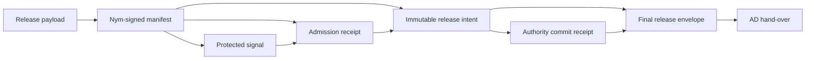

# Author Disclosure Conditions {#author-disclosure-conditions}

Created: 2026-10-27. Revised: 2026-10-28.

Based on: [P013 domain map](../013-whisper-social-signal-exchange.md).

Status: proposed post-MVP feature; no runtime claim. This section owns the
feature and its tracker. The acceptance scenario is the
[author disclosure condition variant of Story 014](../../30-stories/story-014-dormant-contest-entry.md#variant-author-disclosure-condition).

## Summary {#summary}

An author may make wider disclosure of a rumor conditional: "do not show this
content beyond the correlators and counting authority I chose until at least N other qualified sources
report the same matter". The condition is part of the author's consent. It is
bound by a separately nym-signed release manifest and referenced by the protected
rumor. It binds every admitted holder; it is not a hint to a server.

Four separations carry the design:

1. **Same matter is a context.** Reports count together only when they share a
   `topic/class` and a `signal/similarity-key` derived by a versioned grouping
   rule from a correlation descriptor that the author approved. The counter
   compares identifiers; it does not interpret meaning.
2. **Sources, not copies.** Counting uses P015 contextual sources per epoch.
   Copies, forwards and republications by one source count once.
3. **Release is verifiable.** A release publishes a payload that was redacted
   for the release audience when the rumor was authored. It requires a release
   commit accepted by the admitted counting authority, which orders it against
   withdrawal and counts sources at that point, and, by default, the author's
   final confirmation.
4. **Disclosure is not coordination.** The disclosure condition answers "when
   may this content be shown?". The coordination threshold of section 5
   answers "when should joint action be proposed?". The two never imply each
   other.

## Context and Problem {#context-and-problem}

- **Fact.** Section 5 defines a coordination threshold that leads to an
  association-room proposal, and section 6 an explicit consent gate. Neither
  lets an author define when content may reach wider audiences.
- **Fact.** [Whisper implementation Layer 7](../../60-solutions/011-whisper/011-whisper-impl.md#layer-7-threshold-detection-and-durable-promotion) resolved that `whisper-durable.v1` carries aggregates
  and a content-addressed reference, and that text redacted under one scope is
  never re-published under another.
- **Fact.** P015 counts council-admitted participant sources per context and
  epoch. `source/ref` is derived per participant, context and epoch, so
  distinctness is defined only within one epoch, and contributions stop
  counting after revocation or epoch end.
- **Inference.** A number alone is not a condition. Without an exact criterion
  of which reports count together, a node could reach the threshold by
  widening the matter. If a semantic similarity score could move a report into
  a group, it would change when a consent executes, not only how well search
  works.

## Roles and Payloads {#roles-and-payloads}

| Role | Holds before release | May | Must not |
|---|---|---|---|
| Author node | Protected signal, release payload, control key (the case continuity key) | Narrow or withdraw the condition, confirm or decline a release | — |
| Correlator (custodian) | Correlation payload; the release payload only in held custody | Match locally, propose context joins, pass the descriptor to the counting authority | Disclose protected material outside the correlation scope |
| Counting authority | Protected signal and condition; signals of the context | Count sources, attest, and order case events including release commits, as the case status authority | Count anything other than the condition's context, or accept a commit out of order |
| Recipient | Released record | Verify the release offline | Treat the count as evidence of truth |

The material is split into two payloads and an independently verifiable manifest:

- **Correlation payload.** The protected v2 signal with `disclosure/scope =
  private-correlation`, the correlation descriptor and the manifest digest.
  Authorized holders are exactly the author-named correlators **union** the
  named counting authority, including when these are different nodes. Each
  holder has a role-specific use, delivery grant and retention obligation.
  Hop/forwarding budgets bound transport; they never grant recipient authority.
- **Release payload.** `whisper-release-payload.v1`, redacted through Story 005
  for the declared release audience at authoring. It has no signature of its
  own; its digest is committed in the manifest. Custody is `withheld` (author
  node) or `held-under-obligation` (a named custodian). This honours S011's
  prohibition on reusing text under a different disclosure scope.
- **Release manifest.** `whisper-embargo-manifest.v1` carries the original
  `whisper-embargo-condition.v1`, the release-payload digest, the case continuity
  public-key commitment, the counting/status authority and the approved public
  metadata policy (count/proof required, rendered criterion optional). A nym signature covers its domain-separated
  canonical bytes. Its auxiliary signing use must be explicitly permitted by
  the P015-005 profile; possession of a nym key alone does not permit it.

The manifest is created first. It includes neither the protected signal's body
nor its record id: the signal then commits the signed manifest's digest, and
P035-019's signed admission receipt binds **both** that signal's `record/id`
and the manifest digest after verifying the complete private publication.
There is no reverse manifest-to-signal hash dependency and no field-stripping
from a signed Agora envelope. The receiver can verify the author's manifest
and the authority's claim about admission without seeing the protected body;
it cannot independently verify that hidden body's signature or semantics.
The construction order is acyclic:



Arrows mean "must exist before constructing", not permission to disclose. The
protected signal is absent from the recipient package. The final envelope does
not influence the commit receipt's preimage.

The public form of the condition must itself be safe for the consented audience:
private facets stay in the correlation payload, with only authorized opaque
commitments and a redacted criterion in the manifest. A plain hash of a
low-entropy private descriptor is not confidentiality; it must not be exported
as a supposed redaction. ADC-001 must freeze the bounded public proof fields
and their privacy review before runtime work.

The control key is the
[case continuity key](long-lived-rumors.md#case-continuity-key-and-case-bound-succession), owned by
P013-LLR-006 and stored by S026. One fresh key per case signs amendments,
withdrawal, confirmations and case-bound succession. The anchor and manifest
must commit the same key and authority. The key does not identify the participant;
its uses can link actions inside the case. All such actions follow the
[case state](long-lived-rumors.md#case-state-and-currency) contract.

In v1 one case anchor has **zero or one original embargo condition**. If present,
the anchor binds it at creation and its counting authority is the case status
authority. Narrowing amendments keep the original condition digest and its
release slots. A wider condition needs a new protected anchor and a new case,
with new consent and no automatic public link; it neither withdraws the old
condition nor inherits its permissions. Adding an embargo to a previously
unconditioned case likewise requires a new anchor. The editor shows both cases
and offers a separate withdrawal of the old one.

## Same Matter: Descriptor, Grouping Rule and Key {#same-matter-descriptor-grouping-rule-and-key}

The author approves a `whisper-correlation-descriptor.v1`: a grouping rule
plus typed, normalized fields, rendered as a sentence the author can judge.
An illustrative descriptor, not a frozen field list:

| Field | Value |
|---|---|
| Grouping rule | `contest-assessment/v1` |
| Organizer | Organizer O, identified by its website domain |
| Event | Contest K, identified by its canonical page URL |
| Edition | `2026` |
| Issue kind | `assessment-integrity-doubt` |
| Rendering | "Doubts about how entries were assessed in the 2026 edition of contest K organized by O." |

Grouping rules live in the decorrelation vocabulary document beside its terms
([P013-DFR-001](../013-whisper-social-signal-exchange.md#dormant-fact-resonance-2026-10-27)) and reach nodes the same
way: a factory JSON source with local P091 layers. Each rule has an id, a
version, applicable terms, a closed field list with admissible identifier types
(domain, canonical URL, registry id, normalized text, closed enums), the
canonicalization and a rendering template. A local rule produces keys that
other nodes do not derive, and the UI says so.

The similarity key is the domain-separated digest of the normalized
descriptor:

```text
signal/similarity-key = "gk1:" || base64url(sha256(JCS([
  "orbiplex.whisper.grouping.v1", rule-id, rule-version, normalized-fields
])))
```

Changing a rule's normalization or field set requires a new version. The
condition binds the rule id, version and digest, so no node can substitute a
broader rule.

Breadth is the author's decision. `contest/v1` counts any report about the
contest; `contest-assessment/v1` counts only doubts about assessment, and
excludes, for example, payout or form problems. The key is the outcome of
agreeing on meaning, not a mechanism that discovers it: two different
descriptors remain different after hashing.

## Ambiguous Reports: Proposals, Not Merges {#ambiguous-reports-proposals-not-merges}

People describe one event differently: an official name, a colloquial name, or
no name at all. Correlators may look for such candidates, and a model may help,
but its output is a proposal:

1. When the condition's join policy is `keyed-and-confirmed-joins`, a
   correlator may send a content-free `whisper-context-join-proposal.v1` to the
   candidate's author through that signal's reply path. It shows only the
   rendered target descriptor, never other rumors.
2. The candidate's author accepts by authoring a related signal in the target
   context (P013-DFR-004). The keyed counting rule then counts it.

No node merges contexts on its own, and no similarity score opens an embargo.
Under the default join policy `keyed-only`, only reports that derive the same
key count.

## Counting Rule {#counting-rule}

For each epoch `e` of the window, the counting authority computes the number of
distinct `source/ref` values among admitted signals that:

- carry the condition's context digest and were admitted in epoch `e`;
- had certificates valid at their authenticated publication time (P015);
- belong to sources that are not revoked under a status no older than
  300 seconds.

Copies, forwards and republications of one source count once. Counts of
different epochs are never summed.

- **N means other sources.** In the protected signal's epoch, the author's
  `source/ref` is known from the protected signal's certificate and is
  excluded exactly; the requirement is N. In each later epoch of the window the
  author's source cannot be excluded reliably, so the requirement is N + 1
  **even if the author never publishes in that epoch**. This conservative rule
  can therefore require one extra genuinely other source. The UI shows both N
  and this effective threshold. Succession does not change the counter: it
  proves consent of key holders, not participant-source equivalence. A possible
  handover of the case is a separate reason not to infer that equivalence from
  succession, not the reason for the N + 1 bound. Exact exclusion would need a
  source-equivalence attestation from the issuer, which remains open
  (`P013-LLR-005`).
- **Window.** `count/window-epochs` whole epochs starting with the protected
  signal's epoch. The proposed bound is 13 epochs, about 91 days under the
  production seven-day profile.
- **Limitation.** Reports that trickle in across epochs do not satisfy the
  condition unless one epoch alone reaches the requirement. Longer counting
  needs a longer-epoch profile (the issuer then retains bindings longer) or a
  cryptographic cross-epoch linkage.
- **Meaning.** Distinct sources are a consent trigger. They do not show that
  the reports are true.

## Attestation and Verification {#attestation-and-verification}

The condition names exactly one counting authority in v1: the projection
authority that federation policy admits for the contextual profile and context
(the P015 role C). Committees with quorum proofs may follow, as section 5
already anticipates.

`whisper-embargo-attestation.v1`, signed by that authority, binds:

- the condition digest and the protected signal reference;
- the context digest, the epoch and the counting basis
  (`author-epoch-exact` or `later-epoch-conservative`);
- the required and observed counts;
- the status revisions used and the evaluation time;
- a commitment over the sorted evidence entries. An entry holds the
  `source/ref`, certificate digest, signal digest and admission-proof digest.
  It holds no content, and the entries themselves go only to the author and
  the named custodian.

Verification has two entry paths sharing the same bounded verifier library:

1. A protected holder verifies the complete signal, nym signature, contextual
   certificate and publication/admission proof, including the signal-to-manifest
   binding. A recipient instead verifies the separately signed manifest, its
   explicit P015 scope and the admitted authority's receipt binding it to the
   protected publication. No retrieval of the protected signal is required.
2. Both verify the original condition, key commitment and any accepted narrowing
   amendments needed to establish consent at the commit point. Requests and
   acceptances included in the public package use closed, content-free bodies;
   private status/contact data cannot be smuggled into this proof chain.
3. The triggering attestation binds the condition/context, authority and an epoch
   inside the window. It may prompt the author while no older than
   `attestation/max-age-seconds` (proposed at most 900), but never authorizes
   publication alone.
4. In confirm mode, the accepted author's confirmation binds the exact audience,
   original condition and triggering attestation and was unexpired at commit.
5. The signed commit receipt binds the immutable release-intent digest, logical
   release id, canonical audience digest, executor, hand-over deadline, commit
   revision, observed count and source-status revision. It attests that consent
   and the count passed at that point.
6. The intent's payload matches the manifest commitment; its audience is an
   explicitly consented descriptor, no wider than the current condition. The
   final Agora envelope verifies normally, including its content-addressed id.

Recipients need no current case status to verify an already committed release.
This proves a historical authorization at commit, not current authority or the
truth of the rumors. Missing required proof prevents successful verification rather
than fetching private text as a fallback. Certificates and proof references must
be supplied inline or in the authorized offline package within declared limits.

Freshness and consent are measured at one named point, the commit point: the
case authority's acceptance of the release commit. The authority counts at that
moment under a source status no older than 300 seconds, so the source basis of
a release is at most 300 seconds old at its commit point, not counting the
five-second skew tolerance of P015. A revocation that has not yet reached that
status may not stop the release, and the acceptance claims are bounded
accordingly. The bound concerns the commit point only. When the bytes later
reach AD the basis may be older; the hand-over deadline limits that gap without
a recount, and a withdrawal accepted after the commit does not cancel the
committed release.

Evidence that recipients can re-verify without trusting the counting authority
remains to be designed in `P013-ADC-004`.

## Release {#release}

The case authority commits one logical act of disclosure. Artifact Delivery
carries out its delivery and never decides domain consent/counts again. The
commit is not an INAC capability: AD still enforces its recipient, transport
authority, expiry and budget contracts. A delivery refusal neither cancels the
accepted commit nor frees its slot.

- **Modes.** `confirm` is the default. The author node retrieves the
  attestation by condition id through the private exchange path it used to
  submit the protected signal, so the authority stores no route to the author.
  The author sees a prompt and signs `whisper-embargo-confirmation.v1` with
  the control key, or declines. The confirmation is a case event that binds
  the condition, the audience, the triggering attestation and a short
  `confirmation/not-after`. In `pre-authorized` mode there is no prompt: the
  condition itself authorizes commits until `release/not-after`, and the author
  is notified afterwards.
- **Commit point.** The executor, which is the releasing party, prepares the
  immutable `whisper-embargo-release-intent.v1` and submits a
  `whisper-release-commit.v1` request with a fresh
  `request/id` to the case authority. For a case with a disclosure condition
  that authority must be the counting authority. The request binds:
  - the release-intent digest, covering the exact payload and recipient proof
    package prepared so far, **excluding** the future commit receipt and final
    Agora envelope/signature;
  - the canonical audience descriptor and its digest, not only its class;
  - the executor's identity and frozen delivery route;
  - `commit/hand-over-by`, a short deadline for the first hand-over to AD
    (proposed at most 15 minutes and never after `release/not-after`).

  The authority accepts the request in one durable transaction only if the
  case and condition are active, no earlier commit holds the slot for
  `(original condition digest, canonical audience descriptor digest)`, the
  confirmation is accepted and unexpired (in confirm mode), neither the counting
  window nor `release/not-after` has ended, and its own count under a source
  status no older than 300 seconds meets the requirement. Its acceptance is the
  commit receipt. Refusal never reactivates a withdrawn or expired condition.
  A retryable refusal leaves an otherwise active condition active; confirm mode
  needs a new confirmation for a later triggering attestation.
- **Withdrawal versus release.** The order of durable acceptance by the case
  authority decides. A withdrawal accepted before a commit refuses that
  commit. A withdrawal accepted after a commit does not cancel the committed
  release for its audience, even while its bytes have not yet been handed to
  AD; otherwise consent would have to be checked again between commit and
  hand-over. It ends every other and every later release. A withdrawal takes
  effect when the authority accepts it, not when it is signed, and the author's
  editor shows that point.
- **Record.** `whisper-embargo-release.v1` contains the immutable intent and
  commit receipt, with the releasing node's normal Agora signature. The receipt
  commits the intent, not the final receipt-bearing envelope, avoiding a hash
  cycle. Its `release/id` is a domain-separated digest of the original condition
  digest and canonical audience digest; it is distinct from Agora's
  content-addressed `record/id`. The executor freezes and journals the final
  envelope bytes before the first AD submission and reuses them on every retry.
  All final-envelope metadata except the receipt is fixed in the intent; its
  construction from the stored intent and receipt is deterministic in Phase 1.
  A crash before journal completion cannot choose a fresh timestamp/nonce or
  different payload when recovering that envelope.
- **Audiences.** Closed classes are `association-room` (P070),
  `federation-scoped` and `cross-federation`. The canonical descriptor names the
  concrete room plus consented history-access policy revision, or exact
  federation/topic/access scope. It excludes delivery routes. Two routes to the
  same room consume one slot; two rooms have separate slots **only if consent
  permits both descriptors**. Executor and route are frozen separately in the
  intent. Membership alone cannot widen the audience or historical access.
  Agora audiences require registering the record kind and content schema.
- **Releasing party.** The author node in withheld custody, the custodian in
  held custody. A counting authority that is also the custodian concentrates
  trust; confirm mode keeps the author's final word.
- **Irreversibility.** A release cannot be recalled. Revocations after a
  release change the current annotation, as P015 does for first emissions, but
  not the released record.

The executor journals each execution phase, including the intent and the
deterministic AD delivery id before submission, as P035-001 requires. Recovery
after a crash depends on the phase reached:

| Phase | Recovery |
|---|---|
| Commit requested, outcome unknown | Read the outcome by `request/id` or resubmit the same request. An accepted commit is recovered unchanged, even if a withdrawal was accepted after it; the authority neither counts again nor reserves a second slot. A refused request may be followed by a new request with a new id |
| Commit accepted | Hand the committed bytes to AD with the frozen delivery id before `commit/hand-over-by`, without a new domain-consent/count decision or different bytes; ordinary AD admission still applies. If the deadline passes and AD confirms that no submission exists, request `release-abandoned`; the slot stays consumed, and a later disclosure to that audience needs a new condition |
| Released for delivery, outcome unknown | Keep the bytes and the delivery id, and reconcile the same operation through AD status and readback as in P035-001; never prepare an alternative publication |
| Delivery confirmed | Retries only repeat the same, already executed operation |

Release for delivery is the moment from which AD may start sending on its own,
that is, AD's durable acceptance of the submission. It is a conservative
boundary of control over the disclosure, not proof that any recipient has read
the content. Execution therefore keeps three states: commit accepted, released
for delivery and delivery confirmed. The local journal is
`transactional-withheld`; the commit is `irreversible-external` toward the case
authority, because it fixes consent and the release slot; release for delivery
is `irreversible-external` toward the audience. A recipient that sees two
different intents or final envelopes for one logical `release/id` treats them as
equivocation: it keeps the first
and flags the conflict. Under the one-slot rule this indicates a faulty or
malicious executor.

The closed release surface is the approved pre-redacted payload, the explicitly
approved criterion/count metadata and the minimal verification package described
above. Participant identity, private facets, source lists, original attachments and
contact routes are excluded. Proof metadata can still link a nym or case, so the
editor previews that disclosure too. Every additional field needs explicit
consent and a contract-level privacy review; an evidence digest is not a license
to publish its private preimage.

## Amendments and Withdrawal {#amendments-and-withdrawal}

`whisper-embargo-amendment.v1` is signed with the control key and can only
narrow the condition: raise N, shorten the window, narrow the audience, switch
`pre-authorized` to `confirm`, or withdraw. A wider condition requires a new
condition on a new anchor and a new case under the one-anchor rule above.
It does not implicitly withdraw the old condition. Amendments and withdrawal are case
requests, and the case authority's acceptance gives them their place in the
order ([case state](long-lived-rumors.md#case-state-and-currency)). A withdrawal takes effect when
the authority durably accepts it and is ordered against release commits as
described under Release; it erases unused held payload copies. Already committed
execution bytes remain subject to their bounded journal/AD recovery obligations.

## Custody Obligations {#custody-obligations}

Every protected holder, including a separate counting authority, advertises the
custody profile `whisper-embargo-custody:v1`. The author selects all protected
holders from that admitted set. A custodian:

- labels protected material through `classification.v1`, so the existing
  egress guards refuse it;
- never includes it in Agora records, topic or subject query responses,
  aggregate notices, holder availability beacons, redistribution offers, room
  frames, notification previews, exports, logs or remote model egress;
- uses it only for its admitted role: correlators match and propose joins; the
  counting authority admits and counts. AD/INAC checks the named holder set as
  well as transport budgets, including a separate correlator/authority fixture;
- erases unused custody copies at release, withdrawal, expiry or
  `release/not-after`. Bytes already committed for execution are retained only
  until bounded hand-over/reconciliation completes; they cannot feed a new slot.

These are policy obligations backed by audit, not cryptography.

## Coordination Independence {#coordination-independence}

- Disclosure conditions and coordination thresholds have separate state and
  separate artifacts. `coordination/participation` defaults to `excluded`: a
  protected signal then feeds no public threshold or proposal record. With
  `allowed`, a room proposal can form while the content stays embargoed for
  wider audiences, as in the Story 014 variant.
- A room is a release audience only when the condition names it. Room
  membership alone grants nothing.
- The author can always disclose their own material by a new, explicit act.
  The condition binds custodians and automation, not the author.

## Optional Public Notice {#optional-public-notice}

With `descriptor/visibility = public-notice`, the author node publishes a
content-free `whisper-correlation-notice.v1`, signed by the author's nym, in
the vocabulary bucket of its `topic/class`. A notice is a publication of its
own kind, so P015-005 must authorize its exact publication tuple explicitly
([signature uses](long-lived-rumors.md#signature-uses-and-certificate-scope)). It carries the rendered descriptor,
the grouping rule, the similarity key, N and an expiry. Dormant-fact readers
can then find the matter, and their authors can join by keyed derivation. The
notice has a public `record/id`. Related authoring targets that id with
`target/kind = whisper-correlation-notice`, never the hidden signal id. Matching
uses the grouping key; no public reverse pointer to the protected signal is
required or synthesized. The notice is itself a disclosure that the matter exists, and the author's editor
says so. The default is `correlators-only`.

## Confidentiality from Correlators {#confidentiality-from-correlators}

In the basic variant a correlator can read what it holds and is obliged not to
disclose it. Withheld custody keeps the release payload at the author node
until release, but needs that node at release time. A variant in which no node
can read the protected material before N sources exist, for example threshold
or escrow-style encryption, is a separate cryptographic mechanism
(`P013-ADC-009`). Disclosure policy alone cannot provide it.

## Condition, Proposal and Execution States {#condition-proposal-and-execution-states}

These are three different projections, not one persistent case enum. The
condition is `active`, `withdrawn` or `expired`; the case status additionally
handles closure/conflict under LLR. `satisfied` is a **derived, temporary
attestation predicate**, not a stored `whisper-case-status.v1` state or a reserved
slot. A declined proposal ends only that prompt. The condition stays active,
but the same proposal is durably suppressed across restart; another prompt
requires an explicit author retry or a consented re-prompt policy with a new
attestation and a bounded cooldown. Without that policy, no automatic re-prompt.

The diagram shows the proposal evaluation and one audience's execution. Before
commit, withdrawal or expiry applies from every waiting state, also in
pre-authorized mode. After commit, condition changes do not undo that slot.

```mermaid
stateDiagram-v2
    [*] --> active
    active --> satisfied: usable attestation (derived predicate)
    satisfied --> awaiting_confirmation: confirm mode
    satisfied --> committed: pre-authorized and authority accepts
    satisfied --> active: stale attestation or retryable refusal
    satisfied --> withdrawn: withdrawal accepted before commit
    satisfied --> expired: counting window or release deadline ends
    awaiting_confirmation --> committed: valid confirmation and authority accepts
    awaiting_confirmation --> active: stale confirmation or retryable refusal
    awaiting_confirmation --> declined: decline this proposal
    declined --> active: prompt suppressed; condition still active
    active --> withdrawn: withdrawal accepted
    active --> expired: counting window or release deadline ends
    awaiting_confirmation --> withdrawn: withdrawal accepted before commit
    awaiting_confirmation --> expired: counting window or release deadline ends
    committed --> released_for_delivery: AD accepts frozen bytes by hand-over deadline
    released_for_delivery --> delivery_confirmed: delivery confirmed
    committed --> abandoned: deadline passed and AD proves no submission
```



## Invariants {#invariants}

1. Before release, protected material leaves the author node only toward the
   named correlators and the counting authority.
2. No correlator discloses protected material through any surface listed under
   custody obligations.
3. Group membership follows the context digest only. No semantic score
   changes it.
4. One source counts once per epoch; epochs are never summed.
5. A release requires a commit accepted by the case authority, which counts
   at the commit point, and, in confirm mode, the author's confirmation. AD
   carries out the delivery of a committed release and never decides consent
   again.
6. A release exposes only the pre-redacted payload, approved criterion/count
   metadata and minimal public verification package to its consented audience;
   neither correlation text nor private facets/source lists/contact routes leak.
7. Amendments only narrow.
8. Disclosure conditions and coordination thresholds are independent.
9. Release records state that distinct sources are not evidence of truth.

## Trade-offs {#trade-offs}

- Per-epoch counting is exact and unlinkable, but misses reports that trickle
  in over several epochs. Later epochs require N + 1 even without the author;
  this deliberately trades recall for not accidentally counting the author.
- Confirm mode preserves the author's agency, but an absent author blocks the
  release. Pre-authorized mode releases in the author's absence, but trusts
  custodians and the authority more.
- Withheld custody exposes less, but needs the author node at release.
- A single counting authority is a trust concentration. Evidence commitments,
  confirm mode and later committees reduce it.
- Keyed-only counting avoids false merges, but reaches N more slowly than
  confirmed joins.
- A public notice speeds discovery, but reveals that the matter exists.

## Failure Modes and Mitigations {#failure-modes-and-mitigations}

| Failure | Effect | Mitigation |
|---|---|---|
| A correlator leaks protected material | Disclosure without consent | Custody profile, classification guards, audit; withheld custody; sealed variant later |
| A node widens the matter to reach N | Early release | Rule id, version and digest bound in the condition; joins need the candidate author's act |
| One source republishes or is forwarded | Inflated count | Distinct `source/ref` per epoch |
| The author republishes in a later epoch | Self-triggered release | N + 1 outside the author's epoch |
| Coordinated fake sources | Release triggered by a group | Council admission of sources (P015), an author-chosen N, confirm mode |
| The authority attests a false count | Release on a false basis | Evidence commitment and entries for the author and custodian; confirm mode; committees later |
| Release on an outdated count | Release after revocations | The authority counts at the commit point under a source status no older than 300 seconds; the residual staleness is stated |
| Withdrawal and release race | Release against current consent | The order of durable acceptance by the case authority decides; a later withdrawal does not cancel a committed release |
| Competing valid requests | A valid case frozen as conflicted | Requests are ordered by durable acceptance; only contradictory accepted histories are conflicts |
| The author is unreachable | Release blocked | Expiry; pre-authorized mode as an explicit choice |
| Crash, lost response or retry during release | A second, stale or re-decided publication | One commit slot per original condition and canonical audience digest; outcomes stored by `request/id`; recovery by phase: the same commit after a lost response, the same bytes and delivery id after the commit, reconciliation after release for delivery |
| A protected signal feeds a public threshold | The matter is exposed | `coordination/participation` defaults to `excluded` |

## Open Questions {#open-questions}

1. Multi-epoch accumulation: a longer-epoch profile with longer issuer
   retention, or a cryptographic cross-epoch linkage.
2. Evidence that recipients can re-verify without trusting the counting
   authority, and committee attestation.
3. Defaults and bounds: maximum N, window length, attestation age and the
   pre-authorized horizon.
4. Bounded size and custody of the public verification package. In this v1
   design the signed attestation/count and its fixed-size evidence commitment
   are required public proof; evidence entries remain private. A count-hiding
   proof would be a different, separately reviewed profile.
5. How a confirm-mode author stays reachable without exposing a route to the
   counting authority, beyond pulling over the private exchange path.

## Author Disclosure Condition Tracker {#author-disclosure-condition-tracker}

All rows are post-MVP `todo` unless marked otherwise. The grouping row closes
only on the composed Story 014 variant run.

| ID | Task | Status | Depends on | Completion gate |
|---|---|---|---|---|
| P013-ADC-000 | Story 014 disclosure-condition variant acceptance | todo | P013-ADC-001–008; P057-017; P015 Gates A and B; P015-005; P013-PEX-001; P013-DFR-001–004; P013-DFR-006 | One retained run of the [variant](../../30-stories/story-014-dormant-contest-entry.md#variant-author-disclosure-condition) proves S014-A12–A21 and its assertion-to-task matrix. Canary scans cover queries, Agora, AD copies, notifications and logs. Required cases include receiver verification without private-body retrieval, separate correlator and counting authority, two rooms versus two routes, later-epoch author present/absent, both commit/withdrawal orders, pre-authorized expiry, declined-prompt suppression, lost commit response and restart before AD hand-over. |
| P013-ADC-001 | Freeze embargo manifest and condition contracts | todo | P015 v2 signal; P015-005; P013-LLR-006; P035-019 | `whisper-embargo-manifest.v1`, `whisper-embargo-condition.v1`, `whisper-release-payload.v1` and `whisper-embargo-amendment.v1`; acyclic manifest -> protected signal -> admission receipt construction, one anchor/at most one original condition, identical key/authority commitments and closed public proof fields. Preserve original condition identity through narrowing; widening creates a new case without silently withdrawing the old. Explicit authorized holder set; role-bound custody; per-descriptor consent. Golden and refusal fixtures cover offline verification without protected text, forbidden proof fields, substituted manifest/payload/authority, widening, unknown fields and expiry. LLR-006 owns the key contract; this row consumes it. |
| P013-ADC-002 | Grouping rules, descriptors and similarity keys | todo | P013-DFR-001 | Grouping rules in the vocabulary document with typed fields, canonicalization and rendering templates; `whisper-correlation-descriptor.v1`; the domain-separated key derivation with golden vectors; a version bump on every normalization change; warnings for local rules; the breadth choice rendered for the author. |
| P013-ADC-003 | Correlator custody obligations | todo | P013-ADC-001; S018 | The `whisper-embargo-custody:v1` profile and its advertisement; classification-based refusal on every listed egress surface; bounded custody retention; a canary test for each surface. |
| P013-ADC-004 | Counting and attestation | todo | P013-ADC-001; P015 Gate B; P013-PEX-001 | Per-epoch counting with exact original-epoch exclusion and conservative N + 1 thereafter, with author-present and author-absent fixtures and UI effective-threshold explanation. `whisper-embargo-attestation.v1`, status freshness, publication receipt and counting at commit. Share bounded primitives between full-private and detached-public verifier paths; recipient verification never fetches protected text and explicitly trusts the admitted counter. Independently verifiable counts remain a separate open design. |
| P013-ADC-005 | Release execution | todo | P013-ADC-003–004; P013-LLR-008; P070 | `whisper-embargo-confirmation.v1`, `whisper-embargo-release-intent.v1`, `whisper-release-commit.v1` and `whisper-embargo-release.v1`. Receipt binds pre-commit intent, not its own final envelope. Slot/logical release id binds original condition and canonical audience digests; Agora record/id remains content-addressed. Same room/two routes uses one slot; two consented rooms use two; unauthorized room refuses. Atomic count/consent/slot acceptance, both commit/withdrawal orders, pre-authorized withdrawal/expiry after attestation, per-request outcomes, exact-byte replay, lost reply and crash before AD hand-over; AD unknown never means absent. Abandonment leaves the slot consumed. Offline recipient package verifies without the protected signal; closure evidence follows Story 014. |
| P013-ADC-006 | Context-join proposals | todo | P013-ADC-002; P013-DFR-004 | Content-free `whisper-context-join-proposal.v1` from correlators to candidate authors, only under `keyed-and-confirmed-joins`; acceptance authors a related signal in the target context; model output stays advisory. A fixture proves that no context merges without the candidate author's act. |
| P013-ADC-007 | Optional public correlation notice | todo | P013-ADC-002; P013-DFR-002; P015-005 | `whisper-correlation-notice.v1` is signed under an explicitly admitted publication tuple, content-free, expiring and discoverable through the term bucket. The editor warns about disclosure of the matter. Related signals point to the public notice record/id with a closed target kind; no hidden signal id is required or leaked. Tests refuse wrong kind/schema/topic/scope tuples and verify a notice-only reader can author a related signal. |
| P013-ADC-008 | Author condition editor and status | todo | P013-ADC-001–002; P013-DFR-003; P057-017 | Render N and its effective epoch threshold, public criterion and proof disclosure, window, concrete audiences, mode, authorized holders, notice and coordination participation. Keep condition, proposal and per-slot execution states separate. Declining suppresses that proposal across restart; no renewed prompt without an explicit retry or consented bounded policy. Show widening as a new independent case and withdrawal as effective only after authority acceptance. |
| P013-ADC-009 | Sealed pre-threshold confidentiality | deferred | P013-ADC-004; cryptographic review | A mechanism in which no correlator can read protected material before N sources exist, for example threshold or escrow-style encryption. It needs a separate, proposal-grade review. |
