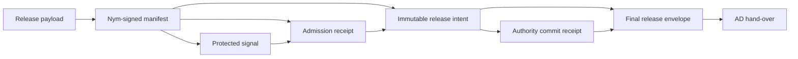

# Author Disclosure Conditions {#author-disclosure-conditions}

Created: 2026-10-27. Revised: 2026-10-28.

Based on: [P013 domain map](../013-whisper-social-signal-exchange.md).

Status: proposed post-MVP feature; no runtime claim. This section owns the
feature and its tracker. The acceptance scenario is the
[author disclosure condition variant of Story 014](../../30-stories/story-014-dormant-contest-entry.md#variant-author-disclosure-condition).

## Summary {#summary}

An author may make wider disclosure of a rumor conditional: "do not show this
content beyond the correlators and counting authority I chose until at least N other qualified sources
report the same matter". The condition is part of the author's consent. It is
bound by a separately nym-signed release manifest and referenced by the protected
rumor. It binds every admitted holder; it is not a hint to a server.

Four separations carry the design:

1. **Same matter is a context.** Reports count together only when they share a
   `topic/class` and a `signal/similarity-key` derived by a versioned grouping
   rule from a correlation descriptor that the author approved. The counter
   compares identifiers; it does not interpret meaning.
2. **Sources, not copies.** Counting uses P015 contextual sources per epoch.
   Copies, forwards and republications by one source count once.
3. **Release is verifiable.** A release publishes a payload that was redacted
   for the release audience when the rumor was authored. It requires a release
   commit accepted by the admitted counting authority, which orders it against
   withdrawal and counts sources at that point, and, by default, the author's
   final confirmation.
4. **Disclosure is not coordination.** The disclosure condition answers "when
   may this content be shown?". The coordination threshold of section 5
   answers "when should joint action be proposed?". The two never imply each
   other.

## Context and Problem {#context-and-problem}

- **Fact.** Section 5 defines a coordination threshold that leads to an
  association-room proposal, and section 6 an explicit consent gate. Neither
  lets an author define when content may reach wider audiences.
- **Fact.** [Whisper implementation Layer 7](../../60-solutions/011-whisper/011-whisper-impl.md#layer-7-threshold-detection-and-durable-promotion) resolved that `whisper-durable.v1` carries aggregates
  and a content-addressed reference, and that text redacted under one scope is
  never re-published under another.
- **Fact.** P015 counts council-admitted participant sources per context and
  epoch. `source/ref` is derived per participant, context and epoch, so
  distinctness is defined only within one epoch, and contributions stop
  counting after revocation or epoch end.
- **Inference.** A number alone is not a condition. Without an exact criterion
  of which reports count together, a node could reach the threshold by
  widening the matter. If a semantic similarity score could move a report into
  a group, it would change when a consent executes, not only how well search
  works.

## Roles and Payloads {#roles-and-payloads}

| Role | Holds before release | May | Must not |
|---|---|---|---|
| Author node | Protected signal, release payload, control key (the case continuity key) | Narrow or withdraw the condition, confirm or decline a release | — |
| Correlator (custodian) | Correlation payload; the release payload only in held custody | Match locally, propose context joins, pass the descriptor to the counting authority | Disclose protected material outside the correlation scope |
| Counting authority | Protected signal and condition; signals of the context | Count sources, attest, and order case events including release commits, as the case status authority | Count anything other than the condition's context, or accept a commit out of order |
| Recipient | Released record | Verify the release offline | Treat the count as evidence of truth |

The material is split into two payloads and an independently verifiable manifest:

- **Correlation payload.** The protected v2 signal with `disclosure/scope =
  private-correlation`, the correlation descriptor and the manifest digest.
  Authorized holders are exactly the author-named correlators **union** the
  named counting authority, including when these are different nodes. Each
  holder has a role-specific use, delivery grant and retention obligation.
  Hop/forwarding budgets bound transport; they never grant recipient authority.
- **Release payload.** `whisper-release-payload.v1`, redacted through Story 005
  for the declared release audience at authoring. It has no signature of its
  own; its digest is committed in the manifest. Custody is `withheld` (author
  node) or `held-under-obligation` (a named custodian). This honours S011's
  prohibition on reusing text under a different disclosure scope.
- **Release manifest.** `whisper-embargo-manifest.v1` carries the original
  `whisper-embargo-condition.v1`, the release-payload digest, the case continuity
  public-key commitment, `case/not-after`, the counting/status authority and the
  approved public metadata policy (count/proof required, rendered criterion
  optional). A nym signature covers its domain-separated canonical bytes.
  Its auxiliary signing use must be explicitly permitted by
  the P015-005 profile; possession of a nym key alone does not permit it.

The manifest is created first. It includes neither the protected signal's body
nor its record id: the signal then commits the signed manifest's digest, and
P035-019's detached admission receipt binds the digest of the exact **signed**
author bytes and the manifest digest after verifying the complete private
publication. The private `record/id` excludes the signature and is forbidden in
the public receipt, URLs, logs, metric labels and traces: it would allow a
dictionary to confirm guessed low-entropy content.
There is no reverse manifest-to-signal hash dependency and no field-stripping
from a signed Agora envelope. The receiver can verify the author's manifest
and the authority's claim about admission without seeing the protected body;
it cannot independently verify that hidden body's signature or semantics.
The construction order is acyclic:



Arrows mean "must exist before constructing", not permission to disclose. The
protected signal is absent from the recipient package. The final envelope does
not influence the commit receipt's preimage.

The public form of the condition must itself be safe for the consented audience:
private facets stay in the correlation payload, with only authorized opaque
commitments and a redacted criterion in the manifest. A plain hash of a
low-entropy private descriptor is not confidentiality; it must not be exported
as a supposed redaction. ADC-001 must freeze the bounded public proof fields
and their privacy review before runtime work.

The control key is the
[case continuity key](long-lived-rumors.md#case-continuity-key-and-case-bound-succession), owned by
P013-LLR-006 and stored by S026. One fresh key per case signs amendments,
withdrawal, confirmations and case-bound succession. The anchor and manifest
must commit the same key, authority and case lifetime. P035-019's admission
profile verifies that equality before attesting the binding; a receipt over
two digests alone must not imply that an unchecked case binding was verified.
The manifest and that receipt can then serve as the detached anchor proof in
[LLR's portable succession profile](long-lived-rumors.md#portable-case-succession-verification),
when their disclosure is permitted to that audience. This reuses existing ADC
material; it neither requires an embargo for every case nor exposes the private
signal. The key does not identify the participant;
its uses can link actions inside the case. All such actions follow the
[case state](long-lived-rumors.md#case-state-and-currency) contract.

In v1 one case anchor has **zero or one original embargo condition**. If present,
the anchor binds it at creation and its counting authority is the case status
authority. Narrowing amendments keep the original condition digest and its
release slots. A wider condition needs a new protected anchor and a new case,
with new consent and no automatic public link; it neither withdraws the old
condition nor inherits its permissions. Adding an embargo to a previously
unconditioned case likewise requires a new anchor. The editor shows both cases
and offers a separate withdrawal of the old one.

## Same Matter: Descriptor, Grouping Rule and Key {#same-matter-descriptor-grouping-rule-and-key}

The author approves a `whisper-correlation-descriptor.v1`: a grouping rule
plus typed, normalized fields, rendered as a sentence the author can judge.
An illustrative descriptor, not a frozen field list:

| Field | Value |
|---|---|
| Grouping rule | `contest-assessment/v1` |
| Organizer | Organizer O, identified by its website domain |
| Event | Contest K, identified by its canonical page URL |
| Edition | `2026` |
| Issue kind | `assessment-integrity-doubt` |
| Rendering | "Doubts about how entries were assessed in the 2026 edition of contest K organized by O." |

Grouping rules live in the decorrelation vocabulary document beside its terms
([P013-DFR-001](../013-whisper-social-signal-exchange.md#dormant-fact-resonance-2026-10-27)) and reach nodes the same
way: a factory JSON source with local P091 layers. Each rule has an id, a
version, applicable terms, a closed field list with admissible identifier types
(domain, canonical URL, registry id, normalized text, closed enums), the
canonicalization and a rendering template. A local rule produces keys that
other nodes do not derive, and the UI says so.

The similarity key is the domain-separated digest of the normalized
descriptor:

```text
signal/similarity-key = "gk1:" || base64url(sha256(JCS([
  "orbiplex.whisper.grouping.v1", rule-id, rule-version, normalized-fields
])))
```

Changing a rule's normalization or field set requires a new version. The
condition binds the rule id, version and digest, so no node can substitute a
broader rule.

Breadth is the author's decision. `contest/v1` counts any report about the
contest; `contest-assessment/v1` counts only doubts about assessment, and
excludes, for example, payout or form problems. The key is the outcome of
agreeing on meaning, not a mechanism that discovers it: two different
descriptors remain different after hashing.

## Ambiguous Reports: Proposals, Not Merges {#ambiguous-reports-proposals-not-merges}

People describe one event differently: an official name, a colloquial name, or
no name at all. Correlators may look for such candidates, and a model may help,
but its output is a proposal:

1. When the condition's join policy is `keyed-and-confirmed-joins`, a
   correlator may send a content-free `whisper-context-join-proposal.v1` to the
   candidate's author through that signal's reply path. It shows only the
   rendered target descriptor, never other rumors.
2. The candidate's author accepts by authoring a related signal in the target
   context (P013-DFR-004). The keyed counting rule then counts it.

No node merges contexts on its own, and no similarity score opens an embargo.
Under the default join policy `keyed-only`, only reports that derive the same
key count.

## Counting Rule {#counting-rule}

For each epoch `e` of the window, the counting authority computes the number of
distinct `source/ref` values among admitted signals that:

- carry the condition's context digest and were admitted in epoch `e`;
- had certificates valid at their authenticated publication time (P015);
- belong to sources that are not revoked under a status no older than
  300 seconds.

Copies, forwards and republications of one source count once. Counts of
different epochs are never summed.

- **N means other sources.** In the protected signal's epoch, the author's
  `source/ref` is known from the protected signal's certificate and is
  excluded exactly; the requirement is N. In each later epoch of the window the
  author's source cannot be excluded reliably, so the requirement is N + 1
  **even if the author never publishes in that epoch**. This conservative rule
  can therefore require one extra genuinely other source. The UI shows both N
  and this effective threshold. Succession does not change the counter: it
  proves consent of key holders, not participant-source equivalence. A possible
  handover of the case is a separate reason not to infer that equivalence from
  succession, not the reason for the N + 1 bound. Exact exclusion would need a
  source-equivalence attestation from the issuer, which remains open
  (`P013-LLR-005`).
- **Window.** `count/window-epochs` whole epochs starting with the protected
  signal's epoch. The proposed bound is 13 epochs, about 91 days under the
  production seven-day profile.
- **Limitation.** Reports that trickle in across epochs do not satisfy the
  condition unless one epoch alone reaches the requirement. Longer counting
  needs a longer-epoch profile (the issuer then retains bindings longer) or a
  cryptographic cross-epoch linkage.
- **Meaning.** Distinct sources are a consent trigger. They do not show that
  the reports are true.

## Attestation and Verification {#attestation-and-verification}

The condition names exactly one counting authority in v1: the projection
authority that federation policy admits for the contextual profile and context
(the P015 role C). Committees with quorum proofs may follow, as section 5
already anticipates.

`whisper-embargo-attestation.v1`, signed by that authority, binds:

- the condition digest and the protected signal reference;
- the context digest, the epoch and the counting basis
  (`author-epoch-exact` or `later-epoch-conservative`);
- the required and observed counts;
- the status revisions used and the evaluation time;
- a commitment over the sorted evidence entries. An entry holds the
  `source/ref`, certificate digest, signal digest and admission-proof digest.
  It holds no content, and the entries themselves go only to the author and
  the named custodian.

Verification has two entry paths sharing the same bounded verifier library:

1. A protected holder verifies the complete signal, nym signature, contextual
   certificate and publication/admission proof, including the signal-to-manifest
   binding. A recipient instead verifies the separately signed manifest, its
   explicit P015 scope and the admitted authority's receipt binding it to the
   protected publication. No retrieval of the protected signal is required.
2. Both verify the original condition, key commitment and any accepted narrowing
   amendments needed to establish consent at the commit point. Requests and
   acceptances included in the public package use closed, content-free bodies;
   private status/contact data cannot be smuggled into this proof chain.
3. The triggering attestation binds the condition/context, authority and an epoch
   inside the window. It may prompt the author while no older than
   `attestation/max-age-seconds` (proposed at most 900), but never authorizes
   publication alone.
4. In confirm mode, the accepted author's confirmation binds the exact audience,
   original condition and triggering attestation and was unexpired at commit.
5. The signed commit receipt binds the immutable release-intent digest, logical
   release id, canonical audience digest, executor, hand-over deadline, commit
   revision, observed count and source-status revision. It attests that consent
   and the count passed at that point.
6. The intent's payload matches the manifest commitment; its audience is an
   explicitly consented descriptor, no wider than the current condition. The
   final Agora envelope verifies normally, including its content-addressed id.

Recipients need no current case status to verify an already committed release.
This proves a historical authorization at commit, not current authority or the
truth of the rumors. Missing required proof prevents successful verification rather
than fetching private text as a fallback. Certificates and proof references must
be supplied inline or in the authorized offline package within declared limits.

Freshness and consent are measured at one named point, the commit point: the
case authority's acceptance of the release commit. The authority counts at that
moment under a source status no older than 300 seconds, so the source basis of
a release is at most 300 seconds old at its commit point, not counting the
five-second skew tolerance of P015. A revocation that has not yet reached that
status may not stop the release, and the acceptance claims are bounded
accordingly. The bound concerns the commit point only. When the bytes later
reach AD the basis may be older; the hand-over deadline limits that gap without
a recount, and a withdrawal accepted after the commit does not cancel the
committed release.

Evidence that recipients can re-verify without trusting the counting authority
remains to be designed in `P013-ADC-004`.

## Release {#release}

The case authority commits one logical act of disclosure. Artifact Delivery
carries out its delivery and never decides domain consent/counts again. The
commit is not an INAC capability: AD still enforces its recipient, transport
authority, expiry and budget contracts. A delivery refusal neither cancels the
accepted commit nor frees its slot.

- **Modes.** `confirm` is the default. The author node retrieves the
  attestation by condition id through the private exchange path it used to
  submit the protected signal, so the authority stores no route to the author.
  The author sees a prompt and signs `whisper-embargo-confirmation.v1` with
  the control key, or declines. The confirmation is a case event that binds
  the condition, the audience, the triggering attestation and a short
  `confirmation/not-after`. In `pre-authorized` mode there is no prompt: the
  condition itself authorizes commits until `release/not-after`, and the author
  is notified afterwards.
- **Commit point.** The executor, which is the releasing party, prepares the
  immutable `whisper-embargo-release-intent.v1` and submits a
  `whisper-release-commit.v1` request with a fresh
  `request/id` to the case authority. For a case with a disclosure condition
  that authority must be the counting authority. The request binds:
  - the release-intent digest, covering the exact payload and recipient proof
    package prepared so far, **excluding** the future commit receipt and final
    Agora envelope/signature;
  - the canonical audience descriptor and its digest, not only its class;
  - the executor's identity and frozen delivery route;
  - `commit/hand-over-by`, a short deadline for the first hand-over to AD
    (proposed at most 15 minutes and never after `release/not-after`).

  The authority accepts the request in one durable transaction only if the
  case and condition are active, no earlier commit holds the slot for
  `(original condition digest, canonical audience descriptor digest)`, the
  confirmation is accepted and unexpired (in confirm mode), neither the counting
  window nor `release/not-after` has ended, and its own count under a source
  status no older than 300 seconds meets the requirement. Its acceptance is the
  commit receipt. Refusal never reactivates a withdrawn or expired condition.
  A retryable refusal leaves an otherwise active condition active; confirm mode
  needs a new confirmation for a later triggering attestation.
- **Withdrawal versus release.** The order of durable acceptance by the case
  authority decides. A withdrawal accepted before a commit refuses that
  commit. A withdrawal accepted after a commit does not cancel the committed
  release for its audience, even while its bytes have not yet been handed to
  AD; otherwise consent would have to be checked again between commit and
  hand-over. It ends every other and every later release. A withdrawal takes
  effect when the authority accepts it, not when it is signed, and the author's
  editor shows that point.
- **Record.** `whisper-embargo-release.v1` contains the immutable intent and
  commit receipt, with the releasing node's normal Agora signature. The receipt
  commits the intent, not the final receipt-bearing envelope, avoiding a hash
  cycle. Its `release/id` is a domain-separated digest of the original condition
  digest and canonical audience digest; it is distinct from Agora's
  content-addressed `record/id`. The executor freezes and journals the final
  envelope bytes before the first AD submission and reuses them on every retry.
  All final-envelope metadata except the receipt is fixed in the intent; its
  construction from the stored intent and receipt is deterministic in Phase 1.
  A crash before journal completion cannot choose a fresh timestamp/nonce or
  different payload when recovering that envelope.
- **Audiences.** Closed classes are `association-room` (P070),
  `federation-scoped` and `cross-federation`. The canonical descriptor names the
  concrete room plus consented history-access policy revision, or exact
  federation/topic/access scope. It excludes delivery routes. Two routes to the
  same room consume one slot; two rooms have separate slots **only if consent
  permits both descriptors**. Executor and route are frozen separately in the
  intent. Membership alone cannot widen the audience or historical access.
  Agora audiences require registering the record kind and content schema.
- **Releasing party.** The author node in withheld custody, the custodian in
  held custody. A counting authority that is also the custodian concentrates
  trust; confirm mode keeps the author's final word.
- **Irreversibility.** A release cannot be recalled. Revocations after a
  release change the current annotation, as P015 does for first emissions, but
  not the released record.

The executor journals each execution phase, including the intent and the
deterministic AD delivery id before submission, as P035-001 requires. Recovery
after a crash depends on the phase reached:

| Phase | Recovery |
|---|---|
| Commit requested, outcome unknown | Read the outcome by `request/id` or resubmit the same request. An accepted commit is recovered unchanged, even if a withdrawal was accepted after it; the authority neither counts again nor reserves a second slot. A refused request may be followed by a new request with a new id |
| Commit accepted | Hand the committed bytes to AD with the frozen delivery id before `commit/hand-over-by`, without a new domain-consent/count decision or different bytes; ordinary AD admission still applies. If the deadline passes and AD confirms that no submission exists, request `release-abandoned`; the slot stays consumed, and a later disclosure to that audience needs a new condition |
| Released for delivery, outcome unknown | Keep the bytes and the delivery id, and reconcile the same operation through AD status and readback as in P035-001; never prepare an alternative publication |
| Delivery confirmed | Retries only repeat the same, already executed operation |

Release for delivery is the moment from which AD may start sending on its own,
that is, AD's durable acceptance of the submission. It is a conservative
boundary of control over the disclosure, not proof that any recipient has read
the content. Execution therefore keeps three states: commit accepted, released
for delivery and delivery confirmed. The local journal is
`transactional-withheld`; the commit is `irreversible-external` toward the case
authority, because it fixes consent and the release slot; release for delivery
is `irreversible-external` toward the audience. A recipient that sees two
different intents or final envelopes for one logical `release/id` treats them as
equivocation: it keeps the first
and flags the conflict. Under the one-slot rule this indicates a faulty or
malicious executor.

The closed release surface is the approved pre-redacted payload, the explicitly
approved criterion/count metadata and the minimal verification package described
above. Participant identity, private facets, source lists, original attachments and
contact routes are excluded. Proof metadata can still link a nym or case, so the
editor previews that disclosure too. Every additional field needs explicit
consent and a contract-level privacy review; an evidence digest is not a license
to publish its private preimage.

## Amendments and Withdrawal {#amendments-and-withdrawal}

`whisper-embargo-amendment.v1` is signed with the control key and can only
narrow the condition: raise N, shorten the window, narrow the audience, switch
`pre-authorized` to `confirm`, or withdraw. A wider condition requires a new
condition on a new anchor and a new case under the one-anchor rule above.
It does not implicitly withdraw the old condition. Amendments and withdrawal are case
requests, and the case authority's acceptance gives them their place in the
order ([case state](long-lived-rumors.md#case-state-and-currency)). A withdrawal takes effect when
the authority durably accepts it and is ordered against release commits as
described under Release; it erases unused held payload copies. Already committed
execution bytes remain subject to their bounded journal/AD recovery obligations.

## Custody Obligations {#custody-obligations}

Every protected holder, including a separate counting authority, advertises the
custody profile `whisper-embargo-custody:v1`. The author selects all protected
holders from that admitted set. A custodian:

- labels protected material through `classification.v1`, so the existing
  egress guards refuse it;
- never includes it in Agora records, topic or subject query responses,
  aggregate notices, holder availability beacons, redistribution offers, room
  frames, notification previews, exports, logs or remote model egress;
- uses it only for its admitted role: correlators match and propose joins; the
  counting authority admits and counts. AD/INAC checks the named holder set as
  well as transport budgets, including a separate correlator/authority fixture;
- erases unused custody copies at release, withdrawal, expiry or
  `release/not-after`. Bytes already committed for execution are retained only
  until bounded hand-over/reconciliation completes; they cannot feed a new slot.

These are policy obligations backed by audit, not cryptography.

## Coordination Independence {#coordination-independence}

- Disclosure conditions and coordination thresholds have separate state and
  separate artifacts. `coordination/participation` defaults to `excluded`: a
  protected signal then feeds no public threshold or proposal record. With
  `allowed`, a room proposal can form while the content stays embargoed for
  wider audiences, as in the Story 014 variant.
- A room is a release audience only when the condition names it. Room
  membership alone grants nothing.
- The author can always disclose their own material by a new, explicit act.
  The condition binds custodians and automation, not the author.

## Optional Public Notice {#optional-public-notice}

With `descriptor/visibility = public-notice`, the author node publishes a
content-free `whisper-correlation-notice.v1`, signed by the author's nym, in
the vocabulary bucket of its `topic/class`. A notice is a publication of its
own kind, so P015-005 must authorize its exact publication tuple explicitly
([signature uses](long-lived-rumors.md#signature-uses-and-certificate-scope)). It carries the rendered descriptor,
the grouping rule, the similarity key, N and an expiry. Dormant-fact readers
can then find the matter, and their authors can join by keyed derivation. The
notice has a public `record/id`. Related authoring targets that id with
`target/kind = whisper-correlation-notice`, never the hidden signal id. Matching
uses the grouping key; no public reverse pointer to the protected signal is
required or synthesized. The notice is itself a disclosure that the matter exists, and the author's editor
says so. The default is `correlators-only`.

## Confidentiality from Correlators {#confidentiality-from-correlators}

In the basic variant a correlator can read what it holds and is obliged not to
disclose it. Withheld custody keeps the release payload at the author node
until release, but needs that node at release time. A variant in which no node
can read the protected material before N sources exist, for example threshold
or escrow-style encryption, is a separate cryptographic mechanism
(`P013-ADC-009`). Disclosure policy alone cannot provide it.

## Condition, Proposal and Execution States {#condition-proposal-and-execution-states}

These are three different projections, not one persistent case enum. The
condition is `active`, `withdrawn` or `expired`; the case status additionally
handles closure/conflict under LLR. `satisfied` is a **derived, temporary
attestation predicate**, not a stored `whisper-case-status.v1` state or a reserved
slot. A declined proposal ends only that prompt. The condition stays active,
but the same proposal is durably suppressed across restart; another prompt
requires an explicit author retry or a consented re-prompt policy with a new
attestation and a bounded cooldown. Without that policy, no automatic re-prompt.

The diagram shows the proposal evaluation and one audience's execution. Before
commit, withdrawal or expiry applies from every waiting state, also in
pre-authorized mode. After commit, condition changes do not undo that slot.

```mermaid
stateDiagram-v2
    [*] --> active
    active --> satisfied: usable attestation (derived predicate)
    satisfied --> awaiting_confirmation: confirm mode
    satisfied --> committed: pre-authorized and authority accepts
    satisfied --> active: stale attestation or retryable refusal
    satisfied --> withdrawn: withdrawal accepted before commit
    satisfied --> expired: counting window or release deadline ends
    awaiting_confirmation --> committed: valid confirmation and authority accepts
    awaiting_confirmation --> active: stale confirmation or retryable refusal
    awaiting_confirmation --> declined: decline this proposal
    declined --> active: prompt suppressed; condition still active
    active --> withdrawn: withdrawal accepted
    active --> expired: counting window or release deadline ends
    awaiting_confirmation --> withdrawn: withdrawal accepted before commit
    awaiting_confirmation --> expired: counting window or release deadline ends
    committed --> released_for_delivery: AD accepts frozen bytes by hand-over deadline
    released_for_delivery --> delivery_confirmed: delivery confirmed
    committed --> abandoned: deadline passed and AD proves no submission
```



## Invariants {#invariants}

1. Before release, protected material leaves the author node only toward the
   named correlators and the counting authority.
2. No correlator discloses protected material through any surface listed under
   custody obligations.
3. Group membership follows the context digest only. No semantic score
   changes it.
4. One source counts once per epoch; epochs are never summed.
5. A release requires a commit accepted by the case authority, which counts
   at the commit point, and, in confirm mode, the author's confirmation. AD
   carries out the delivery of a committed release and never decides consent
   again.
6. A release exposes only the pre-redacted payload, approved criterion/count
   metadata and minimal public verification package to its consented audience;
   neither correlation text nor private facets/source lists/contact routes leak.
7. Amendments only narrow.
8. Disclosure conditions and coordination thresholds are independent.
9. Release records state that distinct sources are not evidence of truth.

## Trade-offs {#trade-offs}

- Per-epoch counting is exact and unlinkable, but misses reports that trickle
  in over several epochs. Later epochs require N + 1 even without the author;
  this deliberately trades recall for not accidentally counting the author.
- Confirm mode preserves the author's agency, but an absent author blocks the
  release. Pre-authorized mode releases in the author's absence, but trusts
  custodians and the authority more.
- Withheld custody exposes less, but needs the author node at release.
- A single counting authority is a trust concentration. Evidence commitments,
  confirm mode and later committees reduce it.
- Keyed-only counting avoids false merges, but reaches N more slowly than
  confirmed joins.
- A public notice speeds discovery, but reveals that the matter exists.

## Failure Modes and Mitigations {#failure-modes-and-mitigations}

| Failure | Effect | Mitigation |
|---|---|---|
| A correlator leaks protected material | Disclosure without consent | Custody profile, classification guards, audit; withheld custody; sealed variant later |
| A node widens the matter to reach N | Early release | Rule id, version and digest bound in the condition; joins need the candidate author's act |
| One source republishes or is forwarded | Inflated count | Distinct `source/ref` per epoch |
| The author republishes in a later epoch | Self-triggered release | N + 1 outside the author's epoch |
| Coordinated fake sources | Release triggered by a group | Council admission of sources (P015), an author-chosen N, confirm mode |
| The authority attests a false count | Release on a false basis | Evidence commitment and entries for the author and custodian; confirm mode; committees later |
| Release on an outdated count | Release after revocations | The authority counts at the commit point under a source status no older than 300 seconds; the residual staleness is stated |
| Withdrawal and release race | Release against current consent | The order of durable acceptance by the case authority decides; a later withdrawal does not cancel a committed release |
| Competing valid requests | A valid case frozen as conflicted | Requests are ordered by durable acceptance; only contradictory accepted histories are conflicts |
| The author is unreachable | Release blocked | Expiry; pre-authorized mode as an explicit choice |
| Crash, lost response or retry during release | A second, stale or re-decided publication | One commit slot per original condition and canonical audience digest; outcomes stored by `request/id`; recovery by phase: the same commit after a lost response, the same bytes and delivery id after the commit, reconciliation after release for delivery |
| A protected signal feeds a public threshold | The matter is exposed | `coordination/participation` defaults to `excluded` |

## Open Questions {#open-questions}

1. Multi-epoch accumulation: a longer-epoch profile with longer issuer
   retention, or a cryptographic cross-epoch linkage.
2. Evidence that recipients can re-verify without trusting the counting
   authority, and committee attestation.
3. Defaults and bounds: maximum N, window length, attestation age and the
   pre-authorized horizon.
4. Bounded size and custody of the public verification package. In this v1
   design the signed attestation/count and its fixed-size evidence commitment
   are required public proof; evidence entries remain private. A count-hiding
   proof would be a different, separately reviewed profile.
5. How a confirm-mode author stays reachable without exposing a route to the
   counting authority, beyond pulling over the private exchange path.

## Implementation Recommendations {#implementation-recommendations}

Follow the [shared-mechanism dispositions](../013-whisper-social-signal-exchange.md#implementation-reuse).
The following are internal value shapes, not new wire schemas or completed APIs:

```text
ContextEpoch = (profile_digest, issuer, context_digest, epoch)
Contribution = (context_epoch, source_ref, record_id,
                certificate_digest, admission_proof_digest)
CountBasis = (context_epoch, source_status_revision, source_status_digest,
              evaluated_at, eligible_sources, evidence_commitment)
ReleaseSlot = (original_condition_digest, canonical_audience_digest)
PreparedRelease = (release_id, intent_digest, commit_receipt_digest,
                   envelope_bytes, envelope_digest, delivery_id, hand_over_by)
```

Keep `eligible_sources` and its evidence private. One bounded map from
`source_ref` to eligible contributions serves both contextual coordination and
disclosure counting, within one `ContextEpoch`. Never count map entries from
different epochs or issuers together. Evaluate admission evidence and the P015
current-source rules before deduplicating; repeated copies add no source, and
natural certificate expiry does not erase a contribution admitted while valid.
If one source has several eligible records, choose a deterministic representative
for its evidence entry by canonical record-id ordering, without discarding the
other retained evidence. A revoked or otherwise ineligible record cannot replace
an eligible representative. Rebuild and incremental updates must agree.

`evaluate_epoch_sources` yields either a complete, revision-bound basis over its
pinned locally admitted view or an explicit unavailable/incomplete result, never
a guessed zero. Completeness here does not claim knowledge of all reports in the
federation. Coordination uses
its own participation filter and emission latch. `evaluate_disclosure_condition`
uses the same source evaluator over the condition's admitted holder view, then
excludes the exact author source in the original epoch, or compares the full
later-epoch set against checked `N + 1`. The count supplies no publication right.
The authority re-evaluates it at release commit under the same source-status
revision fence as eligibility; the triggering attestation is not a cached permit.

Use two typed proof inputs: `FullPrivateAnchor` and `DetachedManifestAdmission`.
They have different trust claims and meet only after their own signature, scope
and binding checks. The shared tail checks the condition, accepted narrowing,
confirmation if required, intent, commit receipt, audience and payload binding.
The public path consumes only the bounded offline proof package and never calls
a private-body loader. P035 owns the receipt carrier and verification adapter;
ADC adds its manifest-binding profile rather than a second receipt format.

Release execution uses the [LLR case owner](long-lived-rumors.md#implementation-recommendations):
one acceptance reserves `ReleaseSlot` and binds the evaluated source basis and
intent. The executor then freezes the final envelope and its delivery identity
before AD hand-over. Recovery reads the saved phase: recover an unknown commit
outcome by request id, finish the committed envelope once, or resubmit the saved
bytes to AD. It never recounts to replace an accepted commit or reuses its slot.
No cryptography, key-provider call or network I/O belongs inside the SQL write
transaction; signature preparation and result exposure must preserve the atomic
acceptance boundary and be covered by crash fixtures.

ADC-004/005 must exercise duplicate/forwarded records, representative replacement,
source revocation, natural certificate expiry, missing status, both epoch bases,
two consented rooms, one room over two routes, and commit/withdrawal in both
orders. A permutation/replay fixture must produce the same eligible-source set
and evidence commitment from the same admitted inputs. Historical M4 counting
and ids stay unchanged.

## Lean Release Model Before Durable ADC Enablement {#lean-release-model}

**Model gate qualified, 2026-11-16; ADC-005 remains `todo`.** LLR-011 now has
an implemented [owner component](long-lived-rumors.md#long-lived-rumor-tracker)
with separately qualified source-pinned offline owner tests. The
[Node report](https://github.com/diapod/node/blob/master/docs/audits/P013-ADC-011-LEAN-RELEASE-2026-11-16.md)
pins 73 checked theorems, 35 executable vectors, 4,096 generated model steps and
18 existing Rust case-law tests. It uses the reviewed
[S027-009-06 discipline](../../60-solutions/027-messaging-middleware/027-messaging-middleware.md#lean-delivery-pilot)
while preserving separate domain laws. The subsequent LLR-011 gate qualifies
its implemented owner-decision subset and fenced writes; complete executor/AD
composition, comparison and submission/readback remain ADC-005.

ADC-001/004's freeze for this model covers current authority/count/confirmation,
canonical audience and exact request/head/intent identities, permitted narrowing
and half-open deadlines. It does not close their schemas or runtime rows.
The model's request capacity of 64 is a finite proof/test profile, not product
policy. Historical qualifications, alpha scope and public readiness are unchanged.

### Model and implementation boundary

Reuse the existing `whisper-core::case` transitions and `ReleaseOrder` as
implementation references, and the LLR-008 owner/outcome store as the target
integration seam. Model the full relevant composition, not only the two release
flags: accepted head, original condition and permitted narrowing, confirmation,
per-audience slots, immutable intents, exact request outcomes and the phase of
AD hand-over. `satisfied` remains derived; condition, prompt and execution are
separate state axes. Time, current source basis and authenticated commands are
explicit inputs. No new wire schema, store, authority or delivery loop is implied.

The model must distinguish durable acceptance, lost reply, recovery and an
unknown AD outcome. Define atomic acceptance and exact retained outcomes as
explicit owner obligations, not claims that Lean has verified SQLite or the
network. Counts consume ADC-004's scope-bound eligible-source contract; they
do not prove source independence, truth or cryptographic security. Keep finite
capacity, deadline and revision refusals visible. Persisted negative knowledge
and terminal states cannot be replaced with an empty active case on recovery.

### Required claims and acceptance

| Claim | Required proof or witness |
|---|---|
| Consent is checked at acceptance | A fresh commit requires the currently applicable condition, count basis, authority, audience and timely confirmation when required. An earlier `satisfied` observation alone is insufficient. |
| Withdrawal has one order | Accepted withdrawal before a fresh commit prevents that commit. Withdrawal after a commit preserves that exact accepted slot/outcome while preventing new releases. Both orders have reachable witnesses, including a lost commit reply. |
| Narrowing cannot widen consent | Accepted amendments shrink the set of permitted fresh releases while preserving original condition identity and accepted slots. Raising N, shortening windows, narrowing audiences and switching to confirm are covered. |
| Slots belong to concrete audiences | At most one intent is accepted per original-condition/canonical-audience pair. Two routes to one room share a slot; distinct consented rooms can have distinct slots; an unconsented room refuses. |
| Recovery preserves identity | Matching request replay returns the same outcome without recounting or a second reservation; changed bytes under that request key refuse. Restart/response loss cannot choose another payload, envelope or delivery identity. |
| Handoff cannot manufacture a second disclosure | A first hand-over requires a committed exact intent within its deadline and ordinary AD admission. Unknown outcome is not absence. Abandonment requires the specified evidence and leaves the slot consumed; retries preserve the accepted delivery identity. |
| Unrelated control does not replace the successor | Amendment, withdrawal and release operations preserve the current successor; terminal/conflicted case state never silently returns to active. |

P013-ADC-011 closes on checked claims over reachable histories, executable
positive/refusal witnesses, explicit assumptions and a source/symbol/fixture map
using the S027 pilot discipline. Cover confirm and pre-authorized modes, expiry
between attestation and acceptance, both commit/withdrawal orders, two rooms/two
routes, changed request bytes, lost responses and restart before AD hand-over.
Use concrete counterexamples or distinguishing executable traces for removed
audience, withdrawal and replay guards; proof-search failure alone is inconclusive.
Do not force noncommuting operations into permutation-invariant laws.

Reuse existing Rust vectors for already implemented shared laws. Comparison
with new Rust was outside this original model gate. LLR-011 subsequently
qualified its fresh owner-decision subset and real fenced writes; ADC-005
execution/handoff comparison remains open. Their acceptance must compare the pinned model and Rust
on bounded generated traces and inject crashes at the actual owner boundaries:
before/after acceptance, before reply exposure and around AD submission/readback.
All effect authorization and privacy gates remain in force. Neither proof of the
model nor matching vectors qualify signature checks, storage atomicity, real
delivery, metadata non-disclosure or social independence.

Freeze ADC-001/004 preconditions with this model before enabling durable control
operations. LLR-011 then implements owner transitions; ADC-005 composes release
execution and closes only after that owner integration. The formal gate depends
on contract freezes, not completion of those downstream runtime tasks. This
avoids an ADC-005/LLR-011 implementation cycle. S027-009-06 is a prior method
review, not a new authority dependency. If the pilot cannot establish a useful
bounded method, record a scoped decision before changing this sequence; never
silently waive a proof gate or expand it to the whole protocol.

## ADC-005 accepted continuation (2026-11-17) {#adc-execution-continuation}

Accepted design; implementation is in progress and ADC-005 remains `todo`.
This continuation supersedes the earlier recipient-manifest, public commit
receipt, AD delivery-id and abandonment descriptions where they conflict. The
dated ADC-011/LLR-011 qualifications remain evidence for their pinned contracts,
not qualification of these revised semantics.

### Private origin, audience proof and public commit

The private manifest M retains all original audiences. Each audience A gets a
separate author-signed M_A containing only its exact P070 descriptor, condition
projection, admitted executors, continuity key, fixed counting authority and case
horizon. M contains a secret random 256-bit nonce; its domain-separated hiding
commitment C_M is the common original identity. Registration verifies a bijection
between M's audience set and the prepared M_A set. S026 freezes all or none; the
protected signal does not distribute M_A to every correlator.

One approved release payload has one separately salted commitment C_P, common to
all audiences of this condition. The author or admitted custodian retains its
opening until release. Different payloads require a new case. The public package
opens C_P but not C_M. It carries neither other audiences nor their count,
dictionary-testable aliases, private source identifiers or protected body.

The public intent binds C_M, C_P, M_A, the audience, executor, handover deadline,
safe package digest and public envelope metadata. A hiding commitment binds the
private execution descriptor (component, idempotency key, route and exact plan).
`Intent.proof` must not be an ordinary digest of low-entropy count facts. Release
identity is H(release-domain, C_M, canonical-audience-descriptor), independent of
route and distinct from the final content-addressed Agora record id.

ADC-004 owns a separate public commit statement and signer domain. It binds the
public intent and effective audience restrictions, reports satisfied and its
time, and carries no case/source revision, exact observed count, private
Acceptance or input digest. Private outcome and exact public bytes commit
together; no candidate signature is disclosed before fence completion. The
recipient verifies author consent for A directly, trusting the admitted counter
for count, freshness, ordering and effective narrowing. Full history is not a
portable completeness proof. Cross-room correlation through C_M and timing is
an explicit residual disclosure.

M_A's counting authority equals the registered authority and commit signer for
the complete case. A different configured signer is dependency loss, not a new
domain decision. Ordinary key retirement must honor the case hold. Loss of the
key prevents new signed decisions; it does not revoke historical commitments.
Author/nym succession does not change this authority. Authority rotation or
delegation is a separate proposal, outside ADC-005. Offline receivers cannot
discover omitted revocations and assume uncompromised pinned-key custody.

### Time, settlement and owner resources

Freeze 60 s minimum handoff, 60 s reply margin, 900 s settlement window, 5 s
preparation budget and three stale cycles in the admitted case policy. Registration
requires request TTL 125..900 s and release_end + 900 <= case/not-after. The
executor selects min(request/not-after - 60, release_end); the prepared reply
must survive handoverBy + 60. Static shortage is Never; a shorter available
transport/preparer lease is dependency unavailability. Recheck owner time after
guard acquisition. The core still requires now < handoverBy: the 60 s host
policy only narrows admitted commits. Neither value guarantees delivery.

Each accepted commit reserves one further command result and finite physical
resources for that slot's accepted abandonment, independently of ordinary quota
and the first-withdrawal reserve. Bad claims cannot consume that reserve.
The executor separately reserves its final-envelope and settlement journal space.

The source fence is a non-writing BEGIN IMMEDIATE guard implemented by the relay
schema owner. Acquire within 250 ms, reread time, validate the exact pin and
deadlines, commit the case through its final fence, then release. Pin scope is
the admitted local index even for Synapse; ingestion delay consumes the signed
300 s freshness budget. A pin includes installation/file identity, scope,
revision and status digest; copies, restore and file-replacing maintenance need
readmission. No source acquisition, signing or sealing runs under this guard.

EvaluationStale is a transport deferral, not a case result. Durably invalidate
the undisclosed candidate before reevaluating identical bytes. A bounded record
retains request id/digest conflict binding and stale count across restart until
request expiry plus replay margin. Each stale cycle charges operation_count but
not max_commands_per_case; after the third, return exhausted without evaluation.
New request ids still charge the shared operation budget. This deliberately
revises the previous frozen-candidate recovery rule, never a committed result.

### Executor and accountable abandonment

`whisper-case-service::executor::ReleaseExecutor` is the planned journal owner,
using the existing fenced Store in role adc-executor and projections keyed by
adc-execution:release-id. Prepared bytes use existing case object/event/blob
mechanics and protected custody, not a second authority or transport retry loop.
Owner slots become Committed or Abandoned; unknown, released, delivered and
tombstoned are executor observations. Terminal executor outcomes include commit
rejected, commit-outcome-lost and unresolved-at-closure. If the exact response
lease is lost, do not mint another reply or guess the slot receipt.

AD assigns its delivery id only at admission. Freeze (component, idempotency key)
before commit. Before the deadline, exact KnownAbsent allows the same prepared
bytes to be submitted; Unknown/Unavailable do not. At/after the deadline, one
complete-history AD transaction serializes exact absence, deadline and tombstone
against admission. Tombstones cannot be GC'd merely after deadline+skew: without
a durable anti-rollback premise that would reopen the identity. Bounded capacity
blocks new work; namespace retirement must continue refusing old submissions.

Abandonment changes the owner core, not only host policy. An accepted claim
requires Active, the slot's executor signature, exact intent/receipt/submission
binding, owner time at/after handoverBy and a Committed slot. The owner trusts the
executor's report after its local tombstone; it does not query the remote AD or
counter. Extend the existing abandonment command/domain with those bindings,
tombstone time and coverage marker. Journal its signed bytes before transmission.
The claim promises no execution and reports local absence; it is not proof that
nobody obtained the content. Slot consumption is irreversible.

Authentication, saved replay and id-conflict checks precede independent binding
and phase checks. Only a sole early-time failure yields NotYetValid/retry-at,
without signed case result or prepare entry. Bind the slot receipt, not current
head: unrelated amendment and withdrawal preserve it. Closure freezes owner
slots and new abandonment becomes Terminal/Never; local AD history can still
resolve transport facts without reopening the case. Expired request bytes do
not revive. Tombstone plus unknown settlement always replays the recorded claim,
never hands the payload to AD.

### Dependency and qualification ownership

P015-011 supplies finite prepared-output retention. A scoped child of P015-005
must qualify the required publication/manifest tuples and actual issuance, not
silently close its whole parent. ADC-001 owns M/M_A, registration bijection and
intent contracts; ADC-004 owns actual counting, attestation and public commit;
ADC-003 owns holder obligations and every egress canary. ADC-005 consumes those
gates, P070 descriptors, P035 admission and the revised ADC-011/LLR-011 model and
owner. A schema or arithmetic helper alone closes none of these parents.

First complete a diagnostic end-to-end path, then a fresh pinned qualification.
Retain separate evidence for model laws, real owners and the 2x2 matrix (Agora
SQLite/Synapse by withheld/held-under-obligation). Compare model to actual Rust,
with independent specification vectors, mutation witnesses and axiom audit.
Measure commit-to-AD, settlement, guard hold and stale incidence. Model results
prove neither cryptography nor filesystem crash recovery. No inference/VM,
installation or pull; unavailable native Synapse means not-run and ADC-005 todo.
full_candidate_qualified=false and release_ready=false throughout this slice.

## ADC-001 exact public-consent retention checkpoint (2026-11-17)

The existing Node original port now supplies the exact authenticated single-audience
manifest set as well as its compact basis. Actual full/detached P035 admission and
the complete M/M_A/certificate-use verifier precede freezing those bytes. The
registration owner rechecks signature and basis consistency, then retains the
canonical manifests and release-id/digest map in its existing fenced prepare/final
blob graph. Raw signed manifests are not independent certificate/profile authority.
Unsupported original adapters refuse before reserving a registration candidate.

Recovery uses the saved set without source acquisition or certificate renewal;
exact replay and first withdrawal preserve it with live ports disabled. Private
M, payload and secret openings are not copied into this public-consent storage.
Owner inspection remains privileged, not a public inventory of other audiences.
The experimental record marker changes to `public-consent.v1`; incompatible
pre-enable records refuse rather than acquiring an invented legacy meaning.

This is development component coverage, not clean-source/runtime qualification.
Public intent admission, protected execution openings, atomic retention/exposure
of the public statement with the private result, source/key/payload holds, actual
issuance, executor/cold receiver and all four runtime cells remain open.
ADC-001/004/005 and global/public readiness are unchanged. See the
[Node owner contract](https://github.com/diapod/node/blob/master/whisper-case-service/ADC.md#exact-public-consent-in-owner-registration-2026-11-17).
Historical qualification bytes and scope remain unchanged.

## ADC-004 public statement contract checkpoint (2026-11-17)

`whisper-release-commit-statement.v1` is now the bounded single-audience public
contract, with its own reserved signer domain and prepared authority-control
selector. It binds the public intent and effective restrictions; it does not
export private Acceptance, source/owner revisions, exact counts or private proof
identities. The same scalar narrowing law and independent audience binding
preserve the author's restrictions. Canonical signed fixtures and actual host
signer checks refuse changed authority, public/private field substitution,
generic signing and external callers. No authority rotation or default grant
is introduced.

See `node:whisper-core/DISCLOSURE.md` and `node:whisper-case-service/ADC.md`.
These are contract/crypto/signing component checks. Frozen public input admission,
atomic public/private result retention and post-fence exposure/replay remain open;
a signed candidate alone proves no owner commit, author admission or count truth.
The existing prototype intent/receipt must not be exported. ADC-004/005 stay todo,
with custody, release executor/AD closure, cold receiver and all four runtime cells
still unqualified. Historical model/runtime evidence is unchanged.

## ADC-004 local source-count component checkpoint (2026-11-17)

The explicitly adopted `node:whisper-intake::adc::LocalAdcCounter` now composes
actual contextual SQLite admission/complete inventory with the existing shared
contribution evaluator and real case-owner source barrier. It excludes the exact
original source only in its original epoch, applies the existing conservative
N+1 decision later, and retains historical certificate admission. Missing/future/
stale evidence never becomes a guessed zero or a new freshness clock.

The canonical private `whisper-adc-source-evaluation.local.v1` descriptor freezes
exact request/facts, evidence, scope/epoch, finite validity and installed source
pin. It is bounded to 4096 bytes and passes Schema Gate; it is neither a public
count proof nor a portable authority token. Recovered owner candidates revalidate
that pin without recounting. Actual full/detached component histories cover
publication races, saved preparation/reopen and unchanged final replay.

See `node:whisper-intake/ADC.md` for ownership, boundaries and refusal cases.
These are development checks under synthetic credential/clock policy, not a
clean-source campaign or full ADC-004 qualification. Actual auxiliary issuance,
source/key/payload holds and runtime egress, public count/commit statement, AD
closure, executor/cold receiver and all four runtime cells remain open. ADC-004
and ADC-005 stay todo; historical evidence and readiness are unchanged.

## ADC source-owner consent retention checkpoint (2026-11-17)

The existing S026 AuthorWorkflow now retains complete M/M_A consent in one
bounded, purpose-separated encrypted blob and one fenced owner update. The
operation checks the actual source signature/certificate/scope, original binding,
case authority/horizon and complete audience bijection. Exact retry preserves
first bytes and original time; historical read grants no current release right.
Blob references survive actual PEX registration preparation and short requester
expiry. Wrong scope/gate, changed consent, failed writes and missing material
refuse without substituting a new set. No source body or public hold receipt is
introduced. See `node:whisper-case-service/ADC.md` for the component contract.

These are development component checks, not a new retained campaign. Actual
vault/operational leases, protected source/payload holds, atomic source signing,
runtime egress composition, real P015 issuance, ADC-004 count/public statement,
AD closure, executor and all four runtime cells remain open. ADC-001/003/004/005
stay todo; no historical qualification or public readiness is renewed.

## ADC-001/005 private/public contract development checkpoint (2026-11-17)

The new `whisper-embargo-original.v1` contains private M; the separate signed
`whisper-embargo-audience-manifest.v1` carries one M_A. These do not change the
qualified P035/LLR `whisper-embargo-manifest.v1` contract or signing preimage.
Closed `whisper-release-execution.v1` and `whisper-release-intent.v1` separate
private execution identity/route/plan from public release evidence. P070 owns
`room-release-audience.v1`: room identity plus an exact history-policy digest,
without routes. The nested consumers share its schema and Rust descriptor.

Domain-separated commitments bind private origin, exact payload and execution
using independent 256-bit openings; public intent has no unsalted private proof
alias. M_A has its own nonce and signature domain. Complete registration checks
require every consented audience exactly once, exact common/header/condition
bindings, actual signatures and P015 scope. Current revocations, original-anchor
verification, protected preparation and durable registration remain separate.
The wrappers do not make those missing facts true by parsing.

A new exact auxiliary use must occur in both profile and certificate:
`(whisper-release, whisper-embargo-audience-manifest.v1, exact topic/key,
single-audience, embargo-audience-manifest)`. No default gains that tuple. The
actual authoring function checks current signing window, fresh status, revocations
and signer before signing, then verifies the returned signature. Old manifest
and publication grants cannot substitute. P015-005-ADC retains the real issuer
composition and qualification gate; the whole P015-005 is not closed here.

Canonical schemas/mirrors and refusal fixtures cover private-field injection,
unknown routes, scope, signature/domain, nonce, bijection and identity bindings.
See `node:whisper-core/DISCLOSURE.md` for exact preimages, caps and reproduction.
This component does not replace the current owner's private prototype intent,
install a real ADC-004 evaluator, freeze an atomic S026 output, or qualify public
commit attestation, custody, AD closure, executor/cold receiver or any runtime
matrix cell. ADC-001/004/005 remain todo; historical evidence is unchanged.

## ADC-004/005 real relay barrier development checkpoint (2026-11-17)

The file-backed SQLite relay provides explicit host source adoption, a durable
private inventory pin and an RAII IMMEDIATE writer barrier. The pin binds the
adopted instance/installation, actual file, scope revision and status digest.
It shares the complete inventory and existing revision check; it grants neither
count authority, inventory completeness nor a renewed signed status lease.
The one acquisition budget (at most 250 ms) covers mutex and SQLite waiting,
with current-pin checks afterwards. The composing case owner samples its final
time only after acquisition and retains the token through commit/fence.

Relay schema 7 preserves one installation identity and refuses missing/corrupt
metadata rather than reminting it. Verified reopen requires fresh explicit host
adoption; unchanged files can retain their pin. Copy/restore or maintenance by
file/directory replacement requires readmission. This local mechanism assumes
cooperating maintenance, not protection from privileged in-place full DB rollback.
It fences the local index for both Agora carriers, not the Synapse homeserver.

Development signed-source tests pass 69 contextual SQLite cases, with one
controlled child helper ignored by the ordinary runner; external writers, WAL
readers, timeout/cleanup, replacement, restart and process death are covered.
Relay migration/descriptor suites and all-target Clippy pass. Owner ADC fixtures
still use a synthetic evaluator. Actual ADC-004 count/original composition,
M/M_A, custody, public proofs, AD atomic closure, executor and all four runtime
cells remain open. ADC-004/005 stay todo. No formal campaign, model/VM or new
runtime qualification was performed; historical evidence is unchanged.

## ADC-001/005 actual original-port checkpoint (2026-11-17)

The Node `AdmittedAdcOriginal` now verifies the actual proven P035 registration
observation, M/M_A bijection and exact original source certificate before
freezing the existing ordered-owner basis. Canonical audience descriptors derive
route-independent release IDs. The bounded private
`whisper-adc-original-basis.local.v1` descriptor binds the exact admission/original
and complete manifest set through Schema Gate; it is neither a custody hold nor
the public recipient proof.

Actual full/detached owner fixtures register through this port, reopen without
live original/count adapters, replay the exact original registration and accept
the first withdrawal from frozen state. Missing/changed/forged consent, foreign
anchors and unavailable timing/completeness refuse. These component checks do
not install the daemon's ADC execution path or qualify private source retention.

S026 atomic source preparation/holds, real P015 issuance, ADC-004 count/public
statement, AD close, executor and all four runtime cells remain open. Parent
ADC-001/004/005 statuses and historical qualifications are unchanged.

## ADC-001/005 signed original-source binding checkpoint (2026-11-17)

The optional `disclosure/original` field carries C_M in signed protected signal
v2/v3 and the separate detached anchor manifest. Both require the complete case
commitment. P035 checks their exact equality before detached admission; the
existing receipt commits the signed objects without adding a manifest list or
private opening. An ordinary source without C_M cannot acquire ADC retrospectively.

The independently verified historical anchor carries C_M, the original source
certificate digest/epoch and receipt acceptance time. The registered owner retains
these claims; ordinary snapshot/input preimages remain unchanged. The original
verifier binds that source to M and the complete exact M_A bijection. Historical
publication-time validity is separate from current permission to sign or count.

Actual full/detached producer-to-anchor tests and snapshot refusal/roundtrip checks
exercise this component. Source custody, S026 atomic preparation, real scoped
issuance, installed original/count adapters, public commit, AD closure, executor
and all four runtime cells remain open. ADC-001/004/005 stay `todo`; this checkpoint
does not replace historical ADC-011/LLR-011 qualification or promote readiness.

## ADC-005 source-barrier and stale-recovery development checkpoint (2026-11-17)

The case owner now separates publication predicates from acquisition of an
RAII source barrier. Missing adapter support refuses. Signing/reply preparation
are outside it; final time, retained pin and lease checks follow acquisition.
The token lives through Store commit and its final fence. Full evaluation is
not rerun under the barrier or when recovering a pending candidate. The owner
supplies a 250 ms acquisition budget; real relay enforcement and durable
instance/installation/file/scope/revision pins remain ADC-004 work.

Stale publication atomically deletes its candidate, records a bounded technical
cycle/digest binding and charges the shared operation window. It changes no
accepted head or signed outcome and cannot use settlement reserves. Restart
preserves the three-cycle limit and cross-operation request-ID conflict checks.
Cleanup failure blocks the owner until verified reopen. The same bytes can
be reevaluated only after durable invalidation; the fourth stale-cycle attempt
does not evaluate. Saved final results retain exact replay. Technical history
uses existing finite Store limits and the case/replay horizon.

Typed local workflow responses and relay diagnostics distinguish transient
`evaluation-stale` from terminal `evaluation-stale-exhausted`; neither is a
signed case result. Five new component histories cover acquisition delay,
fence lifetime, missing guard, cycles/restart/conflicts/budgets and cleanup
failure. Their source pin/lock is synthetic, not real relay qualification.
The inspected signer audit receives no signature or raw control. ADC-004
adapters, privacy proofs and actual execution remain open; ADC-005 stays todo.

The private snapshot now requires a guarded-publication contract marker. Older
strict readers refuse the new shape; new readers do not upgrade old prototypes
by default. Diagnostic regression passed 17,699 model/Rust comparisons, twelve
independent histories and 330 scoped Rust tests, including 35 signed ADC owner
histories (one existing exporter ignored). The marker-bearing owner suite
passed again directly, 35/35; two focused daemon adapter tests passed. Schemas
and source mirrors include positive local errors and negative case-result
fixtures. No full runtime, new retained campaign or readiness claim is made.

## ADC-005 frozen-registration development checkpoint (2026-11-17)

The existing case owner now has an explicit host composition entry,
`register_adc`, which freezes the independently verified original, finite
release policy and empty projection with registration. Ordinary registration
does not authorize a later ADC retrofit. Pending registration recovers its
exact policy/proof; restart or configuration changes do not renew it. The
private pre-enable snapshot requires the policy, with no guessed migration.
Default settlement/TTL checks run before preparation or signing. The current
short-clock component fixtures explicitly choose a shorter test profile; they
are not evidence for the default 60/60/900-second runtime profile.

Static handoff/reply shortfalls are retained permanent refusals; a shorter
actual response lease is unavailable, not a consent refusal. A fresh final
time and the actual sealed lease are checked before publication, using the
registered TTL/horizon. First withdrawal needs no live count/original adapter.
This shares the existing owner/candidate/Store/fence machinery. It does not
qualify M/M_A admission, remote policy disclosure, the relay guard, real
ADC-004 adapters, stale-cycle recovery or release execution. ADC-005 remains
todo and all historical qualification scope remains unchanged.

Diagnostic checks passed 17,699 model/Rust comparisons, twelve independent
specification histories and 324 scoped Rust tests, including 30 named ADC
fixtures. One existing exporter remains ignored; the new strict policy
roundtrip test passed separately. The runner requires the exact reviewed
execution-name inventory, with missing/duplicate/substituted/ignored controls.
Core/owner all-target Clippy and global retention checks pass. No new formal
campaign, retained qualification or release-readiness claim is introduced.

## ADC-005 executor-claim development checkpoint (2026-11-17)

The current pre-enable v1 request replaces remote-AD evaluation for abandonment
with the executor's signed exact intent/receipt/submission claim, tombstone time
and coverage binding. The owner authenticates an admitted actor independently
of the supplied slot fields, then applies the revised active/committed/deadline
law. It trusts the executor report; a coverage digest is not independent proof
of AD absence. Owner phases are only committed/abandoned. Current private intent
fields are not yet the recipient-safe public intent required by ADC-001.

Valid early claims return a typed time deferral without candidate, result or
operation charge, even at full ordinary quota. Bad binding is a retained refusal
before that deferral. Expired bytes do not revive and future issue time is
included in retry-at. The original slot receipt survives author withdrawal or
amendment; closure freezes new claims and exact saved results remain replayable.
The local operator workflow schemas v1/v2 preserve an explicit retry-at, without
minting a signed case result. Full executor/remote deferral handling remains an
execution integration obligation.

The model separates owner settlement from executor closure. Exact absent AD
history proposes closure; only an exact completed closure establishes a local
tombstone. Settlement and tombstone stickiness lift to finite histories, and
concrete guard mutations cover receipt, authenticated actor and tombstone.
Development checks cover 102 audited theorems, 53 named vectors and 4096 trace
steps; actual axiom union is propext/Quot.sound. The actual Rust decision adapter
covers 17,699 comparisons and twelve independent expected histories. The scoped
Rust entry passes 318 tests including 24 signed ADC fixtures, with one existing
exporter ignored; the daemon retry-at projection test passes for both local
workflow versions. All-target core/owner and daemon-library Clippy pass. These are
current worktree checks, not a new clean-source retained qualification or proof
of crypto, AD closure, custody or filesystem recovery. Historical ADC-011/LLR-011
evidence retains its pins/scope; ADC-005 remains todo.

## ADC-005 native environment checkpoint (2026-11-17) {#adc-native-environment}

The resumed implementation uses integrated Node `d13029149` / Orbidocs
`871068e3` as its base. P015-011's finite-authoring retention gate is now done
in its separately qualified scope; ADC consumes that contract rather than
reimplementing it. ADC's own source-custody use still needs qualification.

An initial pure host-policy implementation lives in
`node:whisper-core/src/case/adc_policy.rs`, with eight offline contract tests.
Defaults are 60 s minimum handoff, 60 s reply margin, 900 s settlement window,
5 s preparation budget and three stale cycles. Registration arithmetic requires
TTL 125..900 s and `release_end + settlement_window <= case/not-after`.
The executor chooses handover no later than request expiry minus reply margin.
Static handoff/reply shortage is Never; shortening only by the available reply
preparer is dependency unavailability. Canonical result schema and Node mirror
carry `adc-handoff-window-short` and `adc-reply-window-short`; transport
`evaluation-stale` is not a case-result reason.

The host-policy helpers are not yet installed in the owner. Policy snapshots,
revalidation after guard acquisition, durable stale
accounting, revised owner/executor models and actual release composition remain
open. This checkpoint does not promote ADC-001/004/005 or supersede the qualified
historical LLR-011 behavior. Time arithmetic is not a promise of delivery.

The owner component correction reserves one command result for each
committed slot and checks that capacity before preparing a new commit. Ordinary
commands cannot spend it; valid settlement survives a full command/operation
budget and restart without accumulating preparations on signer failures. The
owner's admitted principal is retained independently of its replaceable signer:
fresh mismatched-signer decisions are unavailable, while exact history remains
readable. Three added actual-owner fixtures cover these boundaries. At that checkpoint the synthetic abandonment port and old model were still in
use. The executor-claim component above supersedes those boundaries; the full
runtime remains open.
The diagnostic comparison entry passes 15,636 model/Rust comparisons, eight
independent specification histories and 304 scoped component tests, including
18 ADC owner fixtures. No new clean-source qualification or formal evidence
campaign is claimed; previous qualifiers and proofs retain their scope.

The storage-quota extension adds a finite fenced hold per accepted slot,
consumed only by its settlement or released by closure. Even terminal writes
preserve other holds. Object/event/byte quota, exact pending-basis readback,
rollback and process-kill boundaries are tested in the existing Store. Format
two preserves verified no-hold v1 facts/head preimages during a metadata-only
upgrade; active holds use a distinct root domain and predecessors refuse them.
This is quota protection, not disk preallocation or a claim against physical
I/O failure. It does not install registration policy, revise abandonment/model
laws or qualify execution. The diagnostic entry passes 15,636 model/Rust steps,
eight independent specification histories and 312 scoped Rust tests, including
19 ADC fixtures; one existing exporter remains ignored. The ordinary-path
read-only observer recognizes both store formats, with 37 scoped Python tests.
Historical qualifiers retain their source pins and bytes. See the current
[Node checkpoint](https://github.com/diapod/node/blob/master/whisper-case-service/ADC.md).

Implementation checkpoint, not release execution qualification. The current
Node launcher has an explicit `--native-only` gate and a read-only JSON preflight
in `tools/matrix-fixture/synapse/native_preflight.py`. ADC qualification requires
bare-metal Linux, a local Unix-socket Docker engine and both exact profile images
already installed. macOS refuses before Docker or fixture-state writes; missing
virtualization detection, containers and uncertain observations fail closed.
The launcher and Compose services prohibit automatic pulls. Missing software or
images need a separate operator decision.

The measured macOS result is `not-run/virtualized-runtime`. Seven new gate tests
and 23 existing fixture-setup tests pass offline without a service. This closes
only the environment-gate implementation fragment. It does not qualify Synapse,
payload custody, public proofs, owner revisions or release execution. The matrix
axes remain Agora carrier (SQLite/Synapse) and custody (withheld/held-under-obligation).
ADC-005 stays `todo` while required Synapse runtime cells are `not-run`; historical
P035 evidence is not a substitute. The preceding stage-0 evidence is unchanged.

## Pre-executor stage-0 corrections (2026-11-16) {#pre-executor-stage0}

Before ADC-005 enablement, correct the model/owner/AD prerequisites. The current
model permits exact authoritative AD absence to restore unknown to committed
strictly before handover expiry. Only the same accepted intent and execution
identity may then be handed over. At/after expiry absence permits abandonment;
unknown/unavailable never implies absence, and admission cannot be undone.
Confirmations are stored per canonical audience and admitted only in confirm
mode. Narrowing pre-authorized to confirm therefore requires fresh confirmation.
Permanent withdrawn, occupied-slot and expired refusal codes have retry Never.
Original retained registration verification is independent of live evaluation;
a first withdrawal cannot require the current counter or AD service.

AD reuses its existing exact input/first-plan bindings for the release schema,
refusing changed bytes under the same component/idempotency key. Volatile history
cannot establish absence; ADC enablement requires complete durable SQLite.
Missing historical binding or incomplete recovery is unavailable, not permission
for another execution. Deadline/admission/absence serialization remains an ADC-005
integration gate, not a theorem about the pure model.

Independent specification vectors cover recovery-table obligations and explicit
state edges in addition to model/Rust equality. Model-only executor witnesses do
not qualify the absent runtime executor. Historical ADC-011 and LLR-011 reports
retain their exact bytes and original scope; see
`node:docs/audits/P013-ADC-STAGE0-2026-11-16.md` for corrections and current tests.
ADC-005 remains todo until real ADC-004, source custody and executor acceptance.

## Optional Confidential Affiliation Review {#confidential-affiliation-review}

Proposed post-MVP addition (2026-11-04), independently tracked as P013-ADC-010.
The [P015 profile](../015-nym-certificates-and-renewal-baseline.md#confidential-affiliation-attestation)
owns the proof and privacy contract. Whisper consumes a scoped finding, not the
author-to-participant mapping. This profile is optional for each signal author;
it is not a prerequisite for ADC-000 or existing alpha/MVP gates.

During `confirm`, the releasing author may inspect other signals or affiliation
results only within their separately authorized view. Being asked to confirm a
release grants no access to other authors' protected bodies, root identities or
assessment inputs. The subject author of each checked signal must consent before
assessment and separately authorize who may see which result fields. The
releasing author's request for context cannot supply that consent on their behalf.

The purpose is to support a human decision about this payload and audience, not
to certify absence of bait. Display `relationship-confirmed`,
`not-found-in-scope`, `indeterminate` and the local `not-assessed` state with their
P015 meanings and coverage/time limits. No badge means no conclusion, not
independence; declining assessment carries no penalty. No finding automatically
changes eligibility, source counts, rankings or publication rights. Any future
counting policy would need its own explicit proposal and acceptance, not a UI rule.

For example, a confirmed employment relationship to the institution may describe
both an interested spokesperson and a whistleblower with direct knowledge. The
interface must not label either as deceptive. It may help the releasing author
decide to proceed or decline under the existing confirmation contract. Absence
of affiliation evidence does not make a coordinated trap safe.

Reuse ADC-008's editor/view, P015-007/008's verifier and result semantics, existing
classification/redaction and authorization owners, and P013-PEX-001 for private
exchange. Host-side read admission precedes projection; UI, Agent, exports,
notifications and other clients must consume the same authorized projection.
Do not add an Agora-indexed affiliation record or public proof field to the
embargo manifest/release. The assessment result has its own narrower recipients;
consent to release the rumor never widens access to that result.

Public labels are excluded from this first profile: even a minimal flag can
identify the sole employee in a small group. Show only authorized granularity;
otherwise withhold the result without exposing a sensitive reason. Respect
P015 expiry, accepted withdrawal and correction through the existing lifecycle
owners. An old signed finding is historical evidence, not a permanent live badge;
already disclosed information cannot be made unseen. Never revive an erased
issuer mapping to refresh a result.

The main trade-off is useful context versus an additional disclosure and trust
concentration. The initial supported relationship/evidence scope and assessor
recusal policy remain P015-007 open decisions. This profile does not introduce
cryptographic protection against the assessor itself, nor does it resolve
collusion or psychological intent. Safe context review remains possible without
affiliation assessment, using material already shared with the deciding author.

## Author Disclosure Condition Tracker {#author-disclosure-condition-tracker}

P035-019 freezes the minimum `whisper-embargo-manifest.v1` proof input before
this runtime: exact authorized publication-use tuple, certified nym key, profile
and certificate digests, case continuity-key digest, canonical public authority
principal and bounded `case/not-after`. P015-005 owns issuance authorization;
LLR-006 owns the case key. The manifest precedes the signal, whose private fields
must match; the receipt attests those checks. This prerequisite does not close
ADC-001's condition/release/amendment contracts or any ADC execution gate.
P035-019 qualified that synthetic detached producer and cold OS-isolated
inspection on 2026-10-29. The witness attestation remains distinct from an
independent hidden-body check; see
`node:docs/audits/ACCEPTANCE-P035-019-2026-10-29.md` for the bounded claim.

All rows are post-MVP `todo` unless marked otherwise. The grouping row closes
only on the composed Story 014 variant run.

ADC-001/005 also freeze and qualify the embargo row of the
[portable verification matrix](../013-whisper-social-signal-exchange.md#portable-verification-profiles):
minimum public proof, exact bindings, numerical byte/item/depth/work limits and
disclosure policy. ADC-005's completion requires a producer/consumer test with
all allowed proof bytes carried, independently admitted local trust and a
network-denying resolver whose fetch counter remains zero. Reuse P032's common
law fixtures and compare evidence-access/accounting helpers with LLR-009 at
whichever implementation lands second. That is a convergence checkpoint, not
an execution dependency of ADC-005 on LLR-009.

| ID | Task | Status | Depends on | Completion gate |
|---|---|---|---|---|
| P013-ADC-000 | Story 014 disclosure-condition variant acceptance | todo | P013-ADC-001–008; P057-017; P015 Gates A and B; P015-005; P013-PEX-001; P013-DFR-001–004; P013-DFR-006 | One retained run of the [variant](../../30-stories/story-014-dormant-contest-entry.md#variant-author-disclosure-condition) proves S014-A12–A21 and its assertion-to-task matrix. Canary scans cover queries, Agora, AD copies, notifications and logs. Required cases include receiver verification without private-body retrieval, separate correlator and counting authority, two rooms versus two routes, later-epoch author present/absent, both commit/withdrawal orders, pre-authorized expiry, declined-prompt suppression, lost commit response and restart before AD hand-over. |
| P013-ADC-001 | Freeze embargo manifest and condition contracts | todo | P015 v2 signal; P015-005; P013-LLR-006; P035-019 | Private and single-audience manifest contracts, `whisper-embargo-condition.v1`, `whisper-release-payload.v1` and amendment through `whisper-case-adc-request.v1`; apply the [accepted continuation](#adc-execution-continuation), including hiding commitments and registration bijection; acyclic manifest -> protected signal -> admission receipt construction, one anchor/at most one original condition, identical key/authority/case-lifetime commitments and closed public proof fields. P035 admission verifies their equality, supporting LLR-009's detached anchor proof without a new signature carrier. Preserve original condition identity through narrowing; widening creates a new case without silently withdrawing the old. Explicit authorized holder set; role-bound custody; per-descriptor consent. Golden and refusal fixtures cover offline verification without protected text, forbidden proof fields, substituted manifest/payload/authority/case lifetime, widening, unknown fields and expiry. LLR-006 owns the key contract; this row consumes it. |
| P013-ADC-002 | Grouping rules, descriptors and similarity keys | todo | P013-DFR-001 | Grouping rules in the vocabulary document with typed fields, canonicalization and rendering templates; `whisper-correlation-descriptor.v1`; the domain-separated key derivation with golden vectors; a version bump on every normalization change; warnings for local rules; the breadth choice rendered for the author. Reuse one vocabulary-bound normalization/key function for authoring, notice creation and holder validation; display rendering never feeds the hash, and semantic-model suggestions never bypass author approval. |
| P013-ADC-003 | Correlator custody obligations | todo | P013-ADC-001; S018 | The `whisper-embargo-custody:v1` profile and its advertisement; classification-based refusal on every listed egress surface; bounded custody retention; a canary test for each surface. |
| P013-ADC-004 | Counting and attestation | todo | P013-ADC-001; P015 Gate B; P013-PEX-001 | Per-epoch counting with exact original-epoch exclusion and conservative N + 1 thereafter, with author-present and author-absent fixtures and UI effective-threshold explanation. `whisper-embargo-attestation.v1` for proposal evidence, separate `whisper-release-commit-statement.v1` and restricted signer domain for the public committed result, status freshness, publication receipt and counting at commit. The statement contract/signing component is implemented; actual atomic owner publication and full runtime qualification remain required. Share bounded primitives between full-private and detached-public verifier paths; recipient verification never fetches protected text and explicitly trusts the admitted counter. Independently verifiable counts remain a separate open design. Reuse the contextual contribution evaluator with separate coordination/disclosure policies; qualify permutation/replay parity, duplicate sources and evidence-representative replacement without altering M4. |
| P013-ADC-005-00 | Model, owner and AD prerequisite corrections | done | P013-ADC-011; P013-LLR-011 | Repair exact-absence recovery, audience confirmations, terminal refusal classes, independent retained-original verification and exact AD submission identity; independently specified expected outcomes, axiom audit, actual owner and AD concurrency/restart tests. See [stage-0 scope](#pre-executor-stage0). 80 audited model theorems, 40 vectors, 15636 comparisons including eight independent expected histories, 293 core/owner and 176 AD tests. Executor and full ADC-005 acceptance remain open. |
| P013-ADC-005 | Release execution | todo | P013-ADC-003–004; P013-ADC-011; P013-LLR-011; P070 | Apply the [accepted continuation](#adc-execution-continuation): confirmation/commit/abandonment use `whisper-case-adc-request.v1`, with separate public intent, public commit statement and release contracts. Revise ADC-011/LLR-011 semantics and requalify; historical gates do not transfer. Public statement binds pre-commit intent, not its own final envelope or private owner revision. Qualify all four runtime cells, reserves, exact reply loss and bounded stale recovery. Slot/logical release id binds original condition and canonical audience digests; Agora record/id remains content-addressed. Same room/two routes uses one slot; two consented rooms use two; unauthorized room refuses. Atomic count/consent/slot acceptance, both commit/withdrawal orders, pre-authorized withdrawal/expiry after attestation, per-request outcomes, exact-byte replay, lost reply and crash before AD hand-over; AD unknown never means absent. Abandonment leaves the slot consumed. Offline recipient package verifies without the protected signal; closure evidence follows Story 014. Use LLR-008's acceptance owner; P013-LLR-011 owns durable enablement of these control operations and the shared prepared-output recovery laws; no parallel embargo case database or AD retry loop. After the ADC-011 model gate, compare new Rust behavior against the pinned model and qualify actual owner/AD crash boundaries; model proof alone does not close this row. |
| P013-ADC-006 | Context-join proposals | todo | P013-ADC-002; P013-DFR-004 | Content-free `whisper-context-join-proposal.v1` from correlators to candidate authors, only under `keyed-and-confirmed-joins`; acceptance authors a related signal in the target context; model output stays advisory. A fixture proves that no context merges without the candidate author's act. |
| P013-ADC-007 | Optional public correlation notice | todo | P013-ADC-002; P013-DFR-002; P015-005 | `whisper-correlation-notice.v1` is signed under an explicitly admitted publication tuple, content-free, expiring and discoverable through the term bucket. The editor warns about disclosure of the matter. Related signals point to the public notice record/id with a closed target kind; no hidden signal id is required or leaked. Tests refuse wrong kind/schema/topic/scope tuples and verify a notice-only reader can author a related signal. |
| P013-ADC-008 | Author condition editor and status | todo | P013-ADC-001–002; P013-DFR-003; P057-017 | Render N and its effective epoch threshold, public criterion and proof disclosure, window, concrete audiences, mode, authorized holders, notice and coordination participation. Keep condition, proposal and per-slot execution states separate. Declining suppresses that proposal across restart; no renewed prompt without an explicit retry or consented bounded policy. Show widening as a new independent case and withdrawal as effective only after authority acceptance. |
| P013-ADC-009 | Sealed pre-threshold confidentiality | deferred | P013-ADC-004; cryptographic review | A mechanism in which no correlator can read protected material before N sources exist, for example threshold or escrow-style encryption. It needs a separate, proposal-grade review. |
| P013-ADC-010 | Optional private affiliation context at disclosure confirmation | todo | P015-007–008; P013-ADC-008; P013-PEX-001 | Reuse the bounded result verifier and one host-authorized projection for UI/Agent and other consumers. Acceptance includes separate consent by the checked author, no-consent/unavailable paths with no penalty, no access to protected peer bodies, employee-as-whistleblower and employee-as-interested-party cases without an intent verdict, limited coverage/expiry, swapped-result refusal, small-group identification risk and no leakage through Agora, release proof, exports, logs or notifications. Existing counts and release authority stay identical with the feature absent, refused or unavailable; authorized context informs only the human confirmation decision. Offline synthetic fixtures qualify semantics without claiming live affiliation verification; private delivery composes the separately qualified P015-008 path. |
| P013-ADC-011 | Lean release-ordering model before ADC-005/LLR-011 / Whisper domain owner | done | S027-009-06 pilot review; P013-ADC-001/004 contract freezes; P013-LLR-008 contract | Meet the [model gate](#lean-release-model): reviewed executable state/assumption map, checked reachable-history proofs for consent/order/narrowing/slots/replay/handoff/successor preservation, positive witnesses and guard-mutation counterexamples. Reuse S027 proof discipline and existing case laws without sharing domain authority. Pin contracts, model/toolchain and existing Rust fixtures; the subsequent LLR-011 owner comparison/qualification is separate, and ADC-005 executor/AD qualification remains open. No dependency on their completed runtime, no alpha expansion and no change to historical qualification. |
