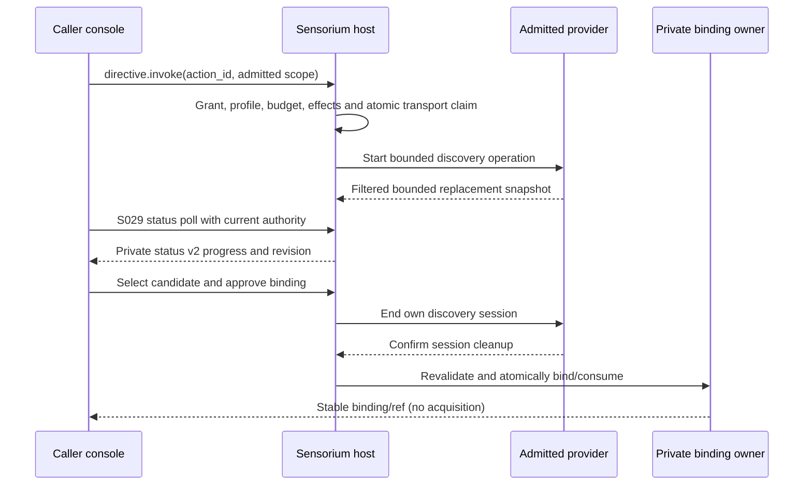

# Proposal 045: Sensorium as a Local Enaction Stratum

Based on:
- `doc/normative/20-vision/en/VISION.en.md`
- `doc/normative/40-constitution/en/CONSTITUTION.en.md`
- `doc/normative/50-constitutional-ops/en/AUTONOMY-LEVELS.en.md`
- `doc/normative/50-constitutional-ops/en/EMERGENCY-ACTIVATION-CRITERIA.en.md`
- `doc/project/20-memos/orbiplex-monus.md`
- `doc/project/20-memos/emergency-signal-v1-invariants.md`
- `doc/project/30-stories/story-009-bielik-blog-arca.md`
- `doc/project/40-proposals/013-whisper-social-signal-exchange.md`
- `doc/project/40-proposals/019-supervised-local-http-json-middleware-executor.md`
- `doc/project/40-proposals/022-monus-as-host-granted-local-observation-middleware.md`
- `doc/project/40-proposals/078-weak-signal-harvester.md`
- `doc/project/60-solutions/000-node/000-node.md`
- `doc/project/60-solutions/009-monus/009-monus.md`

Related configuration work (proposed):

[Proposal 091: File-backed Configuration and Explainable Composition](091-file-backed-configuration-and-explainable-composition.md).
P091 inventories Sensorium's module-local configuration sources and plans shared,
owner-validated consumption. Observation/directive admission and signed action
authority remain Sensorium responsibilities; an editable setting cannot replace
them. Broader adoption is tracked by P091-001b/010a/015, not a reopened hard-MVP gate.

Related connector work (proposed):

[Proposal 096: Sensorium BrainFlow Connector](096-sensorium-brainflow-connector.md)
defines one reusable acquisition package, versioned model profiles and independently
supervised device instances. P096-003 creation/restoration and P096-004's pinned
catalogue/private binding path are implemented; acquisition lifecycle, consent
and hardware qualification retain their gates. Its class is `health-wearable`: non-invasive
physiological measurement with sensitive-personal data. "Invasive" in the
connector policy taxonomy refers to privacy/access, not an implanted EEG device;
this proposal does not promote that connector class's implementation status.

## Status

Accepted / hard-MVP implemented.

The current implementation status is owned by
`doc/project/60-solutions/030-sensorium/030-sensorium.md`. The hard-MVP slice is
complete for Sensorium Core admission/query, directive invocation, audit-only
outcomes, internal connector dispatch, the supervised Sensorium OS reference
connector, action-catalog sidecar authorization, and deferred Sensorium actions.

The remaining local Agora observation publication/subscription bus is a
post-MVP integration layer. The runtime already records `publish_topics`
metadata and exposes read surfaces; Sensorium MVP does not require Sensorium to
become a public or federated publication authority. Deliberate local and
cross-node exposure of bounded enacted representations is implemented
separately by Proposal 082 and Solution 046; it does not federate Sensorium's
local observation topics.

The [local device discovery continuation](#local-device-discovery-continuation)
is a planned, post-MVP extension. It does not reopen the completed directive or
connector-dispatch slice, register available actions, or qualify device access.

## Date

2026-04-18

## Executive Summary

Sensorium already appears in the Orbiplex corpus as the Node's layer of contact
with reality. The Vision describes it as the layer of adapters to the world:
public-network readers, environmental sensors, microphones, cameras, GPS,
weather, energy, safety signals, and other signal sources. The Constitution
defines it as the organ that provides signals grounding intelligence in reality
and limiting narrative or model drift.

Other documents already assume this role:

- emergency operations describe a `sensorium -> evaluation -> activation`
  pipeline,
- autonomy levels treat sensorium event logging and aggregation as routine
  bounded node activities,
- `emergency-signal.v1` accepts `source/type = sensorium`,
- Monus can consume Sensorium-derived summaries when preparing local concern
  drafts,
- Whisper preserves `monus-sensorium-derived` provenance when local observations
  materially shaped an outgoing social signal,
- story 009 treats Sensorium as connector access to external sources such as
  arXiv, GitHub repositories, mailing lists, and news feeds,
- the Node solution already allows a sensorium provider to attach as a
  Node-scoped role through explicit protocol and API contracts.

This proposal makes that implied layer explicit, while widening the name of the
layer from observation to enaction: Sensorium admits observations, but it also
mediates intentional directives and the audit/outcome records through which a
node acts in the world without losing policy, traceability, or consent.

The core maxim is:

> Sensorium is not a grand connector specification. It is a thin stratum for
> local enaction, where complexity lives in connectors and Sensorium normalizes
> only the minimal exchange contract for observations, directives, diagnostics,
> and artifacts.

Sensorium should therefore be implemented first as a supervised local module or
Node-attached component in the spirit of proposal 019. It should expose boring,
bounded host-granted capabilities for observation submission, directive
invocation, query, summary, status, and audit. It should not become a universal
ontology of the outside world, a transport authority, a surveillance platform,
or a replacement for domain modules such as Monus, Whisper, Arca, or emergency
evaluation.

## Problem

The system needs contact with external reality, but "connectors to the world" can
become an unbounded design sink. If every connector type forces a new global
protocol, Sensorium becomes too large before the Node can use it. If every
consumer speaks directly to each connector, Monus, Arca, emergency evaluation,
and future modules all acquire duplicated adapter logic and uneven policy
checks.

The design tension is:

- connectors are necessarily messy because the outside world is messy,
- consumers need stable local observations, not raw connector-specific chaos,
- the Node must retain consent, minimization, audit, and capability boundaries,
- the protocol core should not absorb every sensor, API, OS integration, or data
  feed shape.

Without a thin Sensorium stratum, the system is pulled toward one of two bad
forms:

1. a large `SENSORIUM-CONNECTOR-SPEC` that tries to standardize every possible
   connector class too early;
2. ad-hoc side channels where each module reads local files, shells out, calls
   external APIs, or watches devices under its own private policy.

Both forms complect connector mechanics with domain reasoning.

## Decision

### Ontological Preamble

Sensorium is the node's organ of contact with reality. Contact is not
unidirectional: every act of observation has a physical and informational
footprint (a camera indicator LED, a Bluetooth presence beacon, a network
probe, a disk access timestamp), and every directive has an observational
aspect (the result of a `git push` is itself news about the world). The four
lanes defined below — directive, observation, diagnostic, artifact — are a
classification of **intent and grant class**, not a claim about causality
or directionality. A single connector may legitimately span several lanes;
a purely observational grant still commits the operator to whatever
incidental effects the connector declares it cannot avoid.

**This proposal explicitly rejects the input-organ / output-organ split.**
Treating perception and action as two separate sub-systems is a Cartesian
relic that enactivist cognitive science (Varela, Thompson, Rosch) has
repeatedly shown to misdescribe how organisms actually engage with the
world. An organism's sensorimotor surface is one coupled loop, not two
plumbing systems meeting in the middle. Orbiplex Sensorium honors this:
it is a **sensorimotor organ**, where perception and action form a single
contact surface with the world.

**Intentional action is therefore a first-class Sensorium function, not
a concession, not an escape hatch, and not a secondary lane bolted onto a
primarily perceptual component.** A connector that performs a `git push`,
emits a Bluetooth beacon, toggles a GPIO pin, or executes an allowed shell
command is exercising the same organ as a connector that reads GitHub
releases or watches a file — the organ of contact with the world.
Story-009 should therefore be read in two layers: its Phase 1 research
path is observation-only Sensorium consumption, while commit/push belongs
to an explicit Arca-mediated OS directive path with narrower grants.

What the directive lane buys is not raw capacity to affect the world:
capacity-to-act is inherent to an organ of contact; permission-to-act is
always grant-bound and policy-mediated. The directive lane therefore
provides a **sharper grant and audit regime**: directive grants are
narrower than observation grants, require explicit allowlist entries, and
every directive emits a corresponding audit outcome. Successful directives
that produce facts about the world may also emit linked observations that
close the sensorimotor loop — the act itself becomes news about the world.

This framing follows the project's broader commitment to honoring the
mechanics of the world rather than pretending processes are cleanly
separable, while still holding contract boundaries firm where they
protect the operator.

### Stratum Definition

Define Sensorium v1 as a **local enaction stratum**:

- connectors own adaptation from concrete external systems into local
  observations,
- Sensorium owns admission, minimal normalization, local policy enforcement,
  traceability, and queryable read models,
- consumers such as Monus, Arca, emergency evaluation, and local agents consume
  host-granted Sensorium capabilities,
- network publication remains outside Sensorium and is handled by the appropriate
  protocol layer.

The implementation architecture is:

- `sensorium-core` is the Node-attached Sensorium Core component that owns
  admission, normalization, policy, read models, and the consumer-facing
  capability surface; in the current Node implementation this core is a Rust
  organ integrated into the daemon, while older Python `sensorium-core` code is
  only a retired reference,
- every Sensorium connector is a separate middleware module registered with the
  host as `module_role: "sensorium-connector"`,
- connectors communicate through the standard middleware init/report,
  host-capability, `local-input-invoke.v1`, and `peer-message-invoke.v1`
  envelopes,
- Sensorium does not define or own a second plugin API for connectors.

### Nomenclature: Core, Connector, Action, Package

Sensorium terminology intentionally separates the stable organ from the
replaceable adapters around it.

| Term | Meaning |
| --- | --- |
| Sensorium organ | The node's local sensorimotor contact surface with the world: observation, directive mediation, diagnostics, artifacts, policy, audit, and minimal normalization. |
| Sensorium Core / `sensorium-core` | The mediator and contract boundary of the organ. It exposes public Sensorium capabilities such as `sensorium.directive.invoke`, admits observations, resolves action ids, selects connectors, records outcomes, and hides connector implementation details from consumers. |
| Sensorium connector | A separate middleware module that adapts one class of external contact to Sensorium. It is not a plugin loaded by `sensorium-core`; it is a daemon-hosted middleware participant reached through the standard host capability dispatch layer. |
| Sensorium OS connector / `sensorium-os` | One concrete connector middleware for allowlisted operating-system actions. A deployment may replace it or create another connector with a different `module_id`, `connector_id`, action catalog, and implementation. |
| Connector action | A declarative entry in a connector's action catalog, for example `story009.review.publish`. An action is not a middleware module; it is an operation exposed by a connector and mediated by `sensorium-core`. |
| Middleware package | An installable artifact that may carry connector code, scripts, action declarations, UI fragments, and config fragments. A package can extend a connector without becoming the organ itself. |

This naming matters for authority. Consumers such as Arca, Dator, Monus, or a
role module do not depend on "the OS connector" as an object. They depend on a
Sensorium capability and an action contract. `sensorium-core` maps that contract
to a concrete connector under operator policy. That lets an operator replace
`sensorium-os` with another connector implementation, or run several connector
modules with different names and grants, without changing consumer code.

This is also distinct from `json_e` / `json_e_flow`. JSON-e Flow is an executor
backend and a concrete flow config is treated as one operational middleware
component. It is not a Sensorium organ and it does not mediate connector
selection. A JSON-e Flow may call `sensorium.directive.invoke`, but then it is
just another consumer of the Sensorium Core boundary.

This is not a compromise. It follows the same stratification Orbiplex already
uses for autonomous units of local work: supervised middleware, explicit grants,
module reports, readiness, shutdown, restart counters, and audit traces.
Connector isolation is a feature, not overhead to be hidden.

Sensorium composition uses two existing Orbiplex primitives rather than a new
pipeline engine:

1. **Point-to-point capability invocation** for connector -> `sensorium-core`
   admission. This is request/response and pull-shaped: a connector submits a
   candidate observation, or `sensorium-core` invokes a reactive connector with a
   directive.
2. **Local Agora topic publication** for `sensorium-core` -> consumers
   distribution. This is push-shaped: after admission, `sensorium-core`
   republishes the normalized observation to a local Agora topic such as
   `local/sensorium/observations/{signal-kind}` so Monus, Arca, emergency evaluation, UI, and
   future consumers can subscribe without coupling to the connector.

This makes Sensorium a **mediated bus**, not a Rack/Express/Ring-style
interceptor chain. The daemon's middleware "chains" are request lifecycle stages
inside the daemon; domain composition is explicit and capability-routed. A
pipeline exists only when a module intentionally builds one, as Arca does for
workflow steps.

Topology summary:

```text
Connector middleware modules
  sensorium.github.releases
  sensorium.arxiv.search
  sensorium.os.action
        |
        |  directive/result lanes over middleware invoke envelopes
        |  observation submit over host capability bridge
        v
+---------------------------------------------------------------+
| sensorium-core middleware                                     |
|                                                               |
|  mediated admission pipeline                                  |
|  validate -> redact -> policy-gate -> admit/quarantine/reject |
|           -> store -> publish                                 |
+---------------------------------------------------------------+
        |
        | admitted observations only
        v
+---------------------------------------------------------------+
| local Agora bus                                                |
|  local/sensorium/observations/{signal-kind}                   |
|  local ACL + retention + SSE subscription                     |
+---------------------------------------------------------------+
        |
        | pull query or push subscription
        v
  Monus        Arca        emergency-eval        UI        future consumers

Invariant: consumers never call connector modules directly.
```

## Goals

- Keep Sensorium local-first and capability-bound.
- Put connector complexity at the edge, not in the core Sensorium contract.
- Provide a small common observation shape usable by multiple local consumers.
- Preserve provenance: connector id, source reference, confidence, sensitivity,
  and policy.
- Make observation ingestion and query auditable.
- Support both human-facing summaries and machine-facing structured observations.
- Allow generalized connectors where useful, including an OS connector,
  without giving them ambient unrestricted power.

## Non-Goals

- Define a full taxonomy of all connector types.
- Define a network-wide Sensorium federation protocol in v1.
- Make Sensorium a transport or publication authority.
- Let Sensorium directly publish `whisper-signal.v1`, `agora-record.v1`, or
  emergency activation artifacts.
- Replace Monus signal weighting, Whisper publication, Arca orchestration, or
  emergency evaluation.
- Give connectors unrestricted shell, filesystem, camera, microphone, network, or
  memory access.
- Freeze one global ontology for external reality.
- Define a Sensorium-specific plugin API parallel to the existing middleware
  extension surface.

## Out of Scope for v1

The following items are intentionally outside the v1 acceptance boundary:

- mandatory OS connector support on every node,
- invasive connector classes such as microphone, camera, health/wearable,
  location, private inbox, or browser-history readers,
- federated Sensorium read-through to a neighboring node,
- a Seed Directory-backed connector class registry,
- streaming transport as a requirement,
- an in-process plugin system for Sensorium connectors,
- runtime addition of OS allowlist entries without an operator-signed
  configuration change,
- and treating the v1 schemas as immutable forever; additive evolution remains
  possible through explicit versioning and compatibility rules.

## Proposed Model

### 1. Layer Split

The v1 stack is:

```text
External world
  -> Connector middleware module
  -> Standard middleware invoke / host capability envelopes
  -> Sensorium admission and minimal normalization
  -> Local Agora topic publication
  -> Local Sensorium observation store/read model
  -> Pull queries and push subscriptions for Monus / Arca / emergency evaluation / UI
  -> Optional downstream protocol layer
```

The key boundary is between connector and Sensorium:

- the connector knows how to talk to arXiv, GitHub, a local microphone, an OS
  command allowlist, a wearable, a weather endpoint, or a local file watcher;
- Sensorium only knows that an admitted observation has a source, time, kind,
  confidence, sensitivity, provenance, and policy, with subject and summary
  present when they carry useful meaning.
- consumers never route to connectors directly; they route to `sensorium-core`,
  which selects and invokes connector modules when active observation is needed.

### 2. Connector Responsibility

A connector is responsible for:

- concrete integration with one external source or source family,
- authentication to that source if needed,
- polling, streaming, scraping, shelling out, device reading, or API calling,
- transforming raw source output into a small observation candidate,
- attaching connector-local evidence references,
- classifying sensitivity before submission,
- applying source-specific pre-redaction before Sensorium admission when possible,
- surfacing health and last-observed status,
- registering itself through middleware init/report as
  `module_role: "sensorium-connector"` with connector metadata.

Connector-side redaction is useful but never authoritative. It is a source adapter
optimization: the connector may know that one source field is always unsafe to
emit. Sensorium still owns admission-time redaction, quarantine, rejection, and
the final policy visible to consumers.

A connector module report should declare at least:

- `module_role: "sensorium-connector"`,
- `connector_class`,
- `connector_sensitivity_baseline`,
- offered `action_id` values for action-oriented connectors,
- offered `signal_kind` values for source-specific observation connectors,
- the connector-facing capability names the host may grant,
- and `connector_incidental_effects`: a declared, operator-visible list of
  footprint effects that the connector cannot avoid while active, even when
  only an observation-lane grant is in use. Typical entries are
  `camera-indicator-led`, `bluetooth-presence-beacon`, `network-probe-traffic`,
  `disk-access-timestamp-update`, and `radio-emission`. This field makes the
  ontological preamble concrete: it is the connector's honest declaration
  that contact is not free. The host UI surfaces these effects at grant
  time, and admission audit records retain them for after-the-fact review.

The role marker is for discovery and routing. Capability names remain the unit of
grant and authorization. Incidental-effect declarations are neither a grant
nor a capability — they are a transparency contract that binds the host UI
and the audit trail.

Connectors MAY be specialized, for example:

- `sensorium.github.releases`,
- `sensorium.arxiv.search`,
- `sensorium.weather.local`,
- `sensorium.microphone.alarm`,
- `sensorium.wearable.heart-rate`.

Connectors MAY also be generalized when the operator can define a safe bounded
dictionary of actions. The primary example is an OS connector.

### 3. Connector I/O Lanes

The Unix `stdin` / `stdout` / `stderr` split is a useful inspiration for
connector design, but the Sensorium contract should model **logical lanes**, not
process streams. A connector may run as a process, local HTTP service, in-process
adapter, queue consumer, or future streaming worker. The common contract is the
shape of exchange, not the transport mechanics.

These lanes are carried by the standard middleware peer/local-input envelopes and
host-capability calls. They are not a new Sensorium transport.

A reactive connector SHOULD expose up to four logical lanes:

1. **Directive lane** — host or Sensorium instructions to the connector. This is
   the `stdin`-inspired lane: action id, filters, query, observation window,
   timeout, byte budget, redaction profile, and policy constraints.
2. **Observation lane** — normal structured output. This is the `stdout`-inspired
   lane: JSON observations, summaries, timelines, or other data that can be
   represented as text-shaped JSON.
3. **Diagnostic lane** — structured errors, warnings, partial-failure notices,
   retry hints, and degradation reports. This is the `stderr`-inspired lane, but
   it remains JSON and is not mixed with observations.
4. **Artifact lane** — optional raw or binary outputs, such as audio snippets,
   images, raw telemetry, HTML captures, dumps, or source payloads. These SHOULD
   be returned by reference rather than inline when they are large, sensitive, or
   not naturally JSON-shaped.

This split keeps three facts separate:

- what the connector was asked to do,
- what it observed about the world,
- and what happened inside the connector while trying to observe it.

For example:

```json
{
  "schema": "sensorium-connector-directive.v1",
  "invocation/id": "inv:local:01J...",
  "connector/id": "sensorium.os.action",
  "action/id": "git_recent_commits",
  "params": {
    "limit": 20
  },
  "budget": {
    "timeout_ms": 5000,
    "max_output_bytes": 65536
  },
  "policy": {
    "allow_artifacts": false,
    "redaction_profile": "default"
  }
}
```

A connector response may contain observations, diagnostics, artifacts, or a
combination of those lanes:

```json
{
  "schema": "sensorium-connector-result.v1",
  "invocation/id": "inv:local:01J...",
  "status": "partial",
  "observations": [
    {
      "schema": "sensorium-observation.v1",
      "schema/v": 1,
      "connector/id": "sensorium.github.releases",
      "signal/kind": "release",
      "subject/kind": "github-repository",
      "subject/id": "speakleash/bielik",
      "summary": {
        "lang": "en",
        "text": "A new Bielik release candidate was observed."
      }
    }
  ],
  "diagnostics": [
    {
      "level": "warning",
      "kind": "rate-limit-near",
      "message": "GitHub API budget is close to exhaustion.",
      "retry_after_sec": 900
    }
  ],
  "artifacts": [
    {
      "artifact/ref": "orbiplex:blob:sha256:...",
      "media_type": "application/json",
      "role": "raw-source-response",
      "sensitivity/class": "public"
    }
  ]
}
```

The lane-level invariants are:

- diagnostics are not observations,
- raw artifacts are evidence or source material, not normalized observations by
  default,
- every directive should carry an invocation id, timeout, and output budget,
- every directive action must be finite and timeout-governed; Sensorium
  connectors, including the OS connector, must not use directive execution to
  host long-lived daemons, watchers, subscriptions, model workers, or open-ended
  streams. Long-running behavior belongs in a separately supervised middleware
  module or connector; a directive may only invoke a bounded command that
  samples, checks, transforms, or triggers one action and then returns.
  Asynchrony, threads, watchers, queues, caches, and streaming are allowed
  behind the invoked script boundary, but the directive boundary must linearize
  them into one bounded invocation result,
- a directive that needs longer work may use the explicit deferred-operation
  extension from Proposal 055: the initial invocation still returns quickly with
  an operation handle, while the host owns retry cadence, expiry, cancellation,
  and final timeout policy. Deferred mode is not the default sync contract,
- every artifact should carry media type, sensitivity class, and preferably a
  content-addressed reference,
- partial success is valid: observations may coexist with diagnostics,
- a connector may emit an operational observation that a submitted action result
  was invalid, but that observation must be a normal admitted world/control fact
  (for example `ai.orbiplex.sensorium/action-invalid`), not a replacement for
  the structured diagnostic or the directive outcome,
- the directive lane never bypasses host-granted capability policy.

The v1 lane mapping is:

- directive lane: `local-input-invoke.v1` or `peer-message-invoke.v1` dispatched
  by `sensorium-core` to a connector module,
- observation lane: `sensorium.observe.submit` host capability call from the
  connector to `sensorium-core`,
- diagnostic lane: a structured field in the same invoke or submit response,
  never mixed into the observation list,
- artifact lane: reference to a host-owned artifact store entry, such as the
  existing module artifact write surface (`POST /v1/module/artifact/write`).

The lane mapping covers connector -> `sensorium-core` communication. It does not
define consumer fan-out. Consumer fan-out is handled after admission through
pull queries and local Agora topic subscriptions.

### 4. Generalized OS Connector

An OS connector MAY expose a whitelist such as:

```json
{
  "actions": {
    "git_recent_commits": {
      "argv": ["git", "log", "--oneline", "-n", "{limit}"],
      "cwd_policy": "configured-repository",
      "params": {
        "limit": { "type": "integer", "minimum": 1, "maximum": 50 }
      }
    },
    "disk_free": {
      "argv": ["df", "-h", "{path}"],
      "params": {
        "path": { "type": "string", "enum": ["/", "/var", "/tmp"] }
      }
    }
  }
}
```

The connector MUST treat this as `action -> argv`, not as raw arbitrary shell
strings. A safe OS connector should enforce:

- an explicit action allowlist,
- typed parameter validation,
- no shell interpolation by default,
- timeout,
- output byte cap,
- stderr capture policy,
- working-directory allowlist,
- environment allowlist,
- redaction rules,
- per-consumer capability grants,
- and audit events for every invocation.

No action may be added, removed, or changed at runtime without an operator-signed
configuration change. A distribution may ship a reference OS connector,
but it remains an optional concrete connector to the local operating system, not
a built-in Sensorium privilege and not a requirement for Sensorium MVP.

This gives operators a practical adapter to local reality without turning
Sensorium into ambient shell access.

### Directive Invocation Contract

Consumers such as Arca, Dator, or local agents that need to use a Sensorium
connector for intentional action do not address connectors directly and do
not hold connector-level capabilities. They address `sensorium-core` through
one mediated capability, by `action_id`, with typed parameters.

#### Invocation path

```
consumer (Arca / Dator / agent)
   │  capability: sensorium.directive.invoke
   ▼
sensorium-core
   │  grant check, parameter schema validation, allowlist resolution
   │  (local-input-invoke or peer-message-invoke)
   ▼
target connector (e.g. sensorium.connector.os,
                  sensorium.connector.git)
   │  typed execution
   ▼
sensorium-core
   │  emits audit outcome; optionally emits world-fact observation
   ▼
result to caller, carrying outcome/id and observation/ids
```

`sensorium-core` mediates every directive. Consumers never talk to a
specific connector module and never discover `connector_id` values. This
keeps policy enforcement, audit, and outcome/observation linkage in one place, and
lets the operator replace a connector implementation without touching any
consumer.

#### Addressing model

- `action_id` is a flat, globally enumerable string managed by the operator
  in the signed allowlist configuration (dotted notation recommended:
  `os.process.spawn-read-only`, `git.push`, `bluetooth.beacon.emit`),
- `connector_id` is implementation metadata held by `sensorium-core` and
  never exposed to consumers,
- the allowlist entry binds an `action_id` to a `connector_id`, a typed
  parameter schema, and execution limits,
- consumers discover available actions through `sensorium.directive.list`,
  which returns only those the caller may invoke together with their
  parameter schemas (a HATEOAS-shaped discovery surface).

Consumer-side capability grants are scoped against `action_id` patterns
(for example `sensorium.directive.invoke` scoped to `os.process.*` for an Arca
workflow run), not against `connector_id`.

#### Directive envelope and result

The directive envelope, the result envelope returned to the caller, and the
audit-only outcome record are defined as v1 schemas:

- `doc/schemas/sensorium-directive.v1.schema.json`
- `doc/schemas/sensorium-directive-result.v1.schema.json`
- `doc/schemas/sensorium-directive-outcome.v1.schema.json`

These files retain `"x-dia-status": "draft"` as schema metadata independently
of this proposal's accepted hard-MVP status. They are the
implementation-facing v1 schemas for Sensorium directive invocation, caller
results, and audit-only outcomes.

Request envelope (`sensorium-directive.v1`), semantic summary:

- `schema` — tag `sensorium-directive.v1`.
- `schema/v` — schema version, currently `1`.
- `directive/id` — opaque identifier assigned by the issuer (ULID
  recommended); threads the request to its outcome and any observations.
- `directive/issued_at` — RFC 3339 timestamp.
- `issuer` — identity of the invoking party. `participant/did:key` is the
  sovereign participant axis; `module_id` identifies the local module when
  applicable; `node_id` MAY identify the local node context. At least one of
  `participant/did:key` or `module_id` is required.
- `issuer_delegation` — optional proposal-032 `DelegationProof` for proxy-key
  signing. In v1, sub-delegation chains are not supported; `max_chain_depth`,
  when present, MUST be `0`. If `issuer_delegation` is present, the directive
  signature MUST be produced by `issuer_delegation.proxy_key`, and
  `issuer_delegation.principal_key` MUST derive to `issuer.participant/did:key`.
  Verifiers MUST normalize `issuer.participant/did:key` to the
  `participant:did:key:...` canonical form before comparing it to the
  participant derived from `issuer_delegation.principal_key`.
- `signature` — optional Ed25519 signature over the canonical directive
  payload. It is required by schema when `issuer_delegation` is present.
- `idempotency/key` — optional caller-provided key used with issuer and
  `action_id` to make async/retryable directive retries safe.
- `action_id` — public, operator-allowlisted action identifier
  (dotted notation, e.g. `os.process.spawn-read-only`, `git.push`). Consumers
  address actions by `action_id`, never by `connector_id`.
- `parameters` — typed per `action_id`, validated by `sensorium-core`
  against the allowlist entry's parameter schema before dispatch. No
  raw command strings, script bodies, or SQL.
- `evidence/inputs` — optional artifact references using the minimal
  artifact-lane contract below.
- `timing.timeout_ms` and `timing.mode` — bounded duration.
  `timing.timeout_ms` is the directive-level deadline enforced by
  `sensorium-core`: it covers the interval from directive admission through
  connector dispatch and execution to final outcome recording. The
  operator-signed action allowlist MUST define `default_timeout_ms` and
  `max_timeout_ms`; `sensorium-core` MUST reject or clamp requests exceeding
  `max_timeout_ms`. On expiry, exactly one
  `sensorium-directive-outcome.v1` is written with
  `outcome/status: "timed_out"` and
  `policy/decision.decision: "timeout"`.
- `deadline_at` — optional absolute RFC 3339 deadline propagated from the
  caller's enclosing workflow or service dispatch. When present,
  `sensorium-core` and the connector enforce the smaller of the local
  timeout/max-timeout and the remaining time until `deadline_at`. This prevents
  asymmetric traces where the role module, Sensorium outcome, and connector
  execution report different timeout boundaries for the same directive.
  `sync` returns final status; `async` returns `status: "admitted"` and the
  caller reconciles completion through the audit outcome and optional linked
  observations filtered by `correlation/id`.
- `correlation/id` — optional opaque thread through a higher-level plan
  (Arca workflow run step, Dator task dispatch, agent plan).

Result envelope (`sensorium-directive-result.v1`), semantic summary:

- `schema` — tag `sensorium-directive-result.v1`.
- `schema/v` — schema version, currently `1`.
- `directive/id` — echo of the request.
- `correlation/id` — optional echo of the request correlation id.
- `status` — `admitted` | `completed` | `failed` | `timed_out` |
  `rejected`.
- `result` — typed per `action_id` against the allowlist entry's
  result schema; absent or null for `rejected` and async `admitted`.
- `outcome/id` — **always present**; identifier of the
  `sensorium-directive-outcome.v1` audit record (see Loop closure
  invariant below). Outcome records are audit-only and never reach
  Agora topics.
- `observation/ids` — always present; empty list means no world-fact
  observation has been produced, one element is the ordinary case, many
  elements represent multi-emit directives.
- `artifacts` — references to produced artifacts.
- `diagnostics` — optional connector hints (info/warn/error).

Outcome record (`sensorium-directive-outcome.v1`), semantic summary:

- `schema` — tag `sensorium-directive-outcome.v1`.
- `schema/v` — schema version, currently `1`.
- `outcome/id` — audit outcome identifier; exactly one per directive.
- `directive/id` — id of the originating directive.
- `outcome/status` — `admitted` | `completed` | `failed` |
  `timed_out` | `rejected`.
- `outcome/recorded_at` — time at which `sensorium-core` wrote the audit
  record.
- `directive/signature_digest` — optional `sha256:...` digest of the
  originating directive signature bytes, preserving audit linkage without
  duplicating the full signature in every outcome record.
- `action_id`, `issuer`, `connector/id`, and `connector/kind` — dispatch
  context; connector fields may be absent when rejection happened before
  connector selection.
- `connector/dispatched_at` — optional time at which `sensorium-core`
  dispatched the directive to the selected connector.
- `connector/responded_at` — optional time at which `sensorium-core`
  received the terminal connector response; absent when timeout happens before
  a response arrives.
- `started_at`, `completed_at`, and `duration_ms` — optional connector or
  execution telemetry. These are not source/instrument event times; facts
  discovered in the world belong in linked `sensorium-observation.v1` records.
- `policy/decision` — compact reason/retryability summary; `decision` is one
  of `admit`, `reject`, `timeout`, or `fail`.
- `retry/attempts` — number of execution attempts made for this outcome.
- `issuer_delegation` — optional proof copied from the originating directive
  when proxy-key signing was used.
- `audit/store` — optional host-owned audit sink reference; outcomes are
  retrieved through restricted `sensorium.audit.*` capabilities.
- `observation/ids` — zero or more linked observations produced by the directive.
- `artifacts` and `diagnostics` — references and structured diagnostic hints,
  never a replacement for the audit status.

Key modeling decisions:

- **Parameters are typed per `action_id`**, validated by `sensorium-core`
  against the schema held in the allowlist entry before the connector is
  invoked. No field is a raw command string or a free-form script body. An
  action like `os.process.spawn-read-only` takes structured arguments; there is no
  `command: "rsync -avz ..."` escape hatch.
- **`evidence/inputs`** passes large inputs by artifact reference rather
  than inline, aligning with the artifact lane.
- **Issuer delegation follows proposal 032.** `issuer_delegation` is an inline
  `DelegationProof` and is excluded from the surrounding directive signature
  payload. The proof carries its own `principal_signature`; the surrounding
  directive signature is verified with `proxy_key`. Sensorium treats the proof
  as open-world data for forward compatibility, but verifies only the
  proposal-032 compact proof payload fields.
- **`correlation/id`** threads directives through Arca workflow runs,
  Dator task dispatches, or agent plans, so the audit trail preserves
  causal chains.
- **Sync vs async is a `timing.mode` flag**, not a separate endpoint.
  `async` returns `status: "admitted"` immediately together with an
  `outcome/id`. Completion is recorded in the host-owned audit trail; if
  the directive also produces a world-fact observation, consumers with
  suitable grants may observe the linked `sensorium-observation.v1` through
  `local/sensorium/observations/{signal-kind}` filtered by `correlation/id`.
- **`outcome/id` is mandatory; `observation/ids` is always a list.** Every
  directive produces exactly one `sensorium-directive-outcome.v1` audit
  record (see Loop closure invariant below); only directives whose
  execution produces a fact about the world also produce one or more
  linked `sensorium-observation.v1` records. Rejected-at-admission
  directives carry `outcome/id` and an empty `observation/ids` list;
  completed directives that touch the world carry one or more observation ids.

#### Connector-side declaration

Connectors declare invocable actions in their module report, alongside
observations they emit without prompting:

```json
{
  "module_role": "sensorium-connector",
  "connector_class": "OS",
  "connector_sensitivity_baseline": "high",
  "connector_incidental_effects": [
    "disk-access-timestamp-update",
    "network-emission"
  ],
  "actions": [
    {
      "action_id": "os.process.spawn-read-only",
      "parameters_schema": { "$ref": "schemas/os.process.spawn-read-only.params.v1.json" },
      "result_schema":     { "$ref": "schemas/os.process.spawn-read-only.result.v1.json" },
      "emits_observation_kind": "git/fetch-result",
      "default_timeout_ms": 30000,
      "max_timeout_ms": 300000,
      "execution_mode_support": "sync-only",
      "deferred_profile": {
        "preferred_retry_after_seconds": 15,
        "preferred_max_ttl_seconds": 1800
      },
      "requires_grant": "sensorium.directive.invoke:os.process.spawn-read-only",
      "artifact_outputs": ["stdout", "stderr"],
      "reentrancy": "parallel"
    }
  ],
  "observations": [
    {
      "signal_kind":   "filesystem/change",
      "signal_family": "filesystem/change",
      "emits_without_directive": true
    }
  ]
}
```

The `actions` block is a **proposal** from the connector. It does not
become invocable until the operator promotes matching entries into the
signed allowlist; the module report alone grants nothing. This keeps the
allowlist the single authority over what the node may actually do to the
world, and keeps connector authors honest about what they are offering.

`execution_mode_support` is an operator-approved action property, not a caller
preference. The safe default is `sync-only`; `timing.mode = "async"` is rejected
before dispatch unless the signed allowlist entry says `either` or `async-only`.
`deferred_profile` carries connector/action hints only. The host still clamps
retry cadence and maximum lifetime through its deferred-operation policy.

#### Loop closure invariant

Every directive — whether it completes, fails, times out, or is rejected
at admission — results in **exactly one `sensorium-directive-outcome.v1`**
record written to the audit trail, with matching `correlation/id` and an
appropriate `outcome/status` (`completed`, `failed`, `timed_out`,
`rejected`). `sensorium-directive-outcome.v1` records are **not**
published to local Agora topics and are not reachable through
consumer-facing subscription surfaces; they are reachable only through
host-owned audit capabilities.

Directives whose execution produces one or more facts about the world
additionally emit `sensorium-observation.v1` records, linked to the
outcome by `correlation/id` and by mutual `directive/id`, `outcome/id`,
and `observation/ids` references. Only `sensorium-observation.v1`
reaches `local/sensorium/observations/{signal-kind}` topics.

The directive result envelope returned to the caller always carries
`outcome/id` and `observation/ids`; the latter is empty unless the
directive produced world-fact observations. This is how the
enactive loop closes without conflating ontological categories: the
act itself is recorded as an audit outcome, and the consequence in the
world — when there is one — is recorded as an observation.

#### Artifact-lane minimal contract

Sensorium v1 does not define a full artifact store. It only defines the
reference shape that directive, result, outcome, and observation envelopes may
use when a value is too large, binary, or policy-sensitive to embed inline.

The minimal artifact reference is:

```json
{
  "artifact/id": "sha256:...",
  "role": "stdout",
  "media_type": "application/json",
  "size_bytes": 1234
}
```

Rules:

- `artifact/id` is either `sha256:...` or `memarium-blob:...`.
- `role` is one of `stdout`, `stderr`, `produced-file`, or `raw-capture`.
- `media_type` and `size_bytes` are optional hints.
- The artifact content is stored and governed outside the envelope; the
  envelope only carries an auditable reference.

#### Hard rails

- Consumers MUST NOT select `connector_id`; only `action_id` is a public
  handle.
- `action_id` entries MUST NOT be added, removed, or changed at runtime
  without an operator-signed allowlist update.
- A single `action_id` MUST NOT accept a raw shell string, raw script
  body, or raw SQL as a parameter. If a shell-runner shape is genuinely
  required, the action takes a `script_id` referring to a signed,
  stored script in the host-owned module store.
- Every directive, regardless of outcome, MUST emit exactly one
  `sensorium-directive-outcome.v1` audit record. No silent execution.
- `sensorium-directive-outcome.v1` MUST NOT be published to the local
  Agora bus. Outcome records are reachable only through host-owned
  audit capabilities.

### 5. Sensorium Responsibility

Sensorium is responsible for:

- admitting or rejecting connector-submitted observation candidates,
- assigning stable local observation identifiers,
- enforcing local policy gates,
- normalizing into the minimal observation contract,
- storing recent observations or forwarding them to Memarium under policy,
- deriving read models such as timelines, topic summaries, and connector status,
- exposing host-granted query and summary capabilities,
- recording local topic metadata for admitted observations and, in the post-MVP
  subscription-bus layer, publishing them to local Agora topics under policy,
- emitting audit records for admission, rejection, query, and redaction.

Sensorium SHOULD NOT embed connector-specific parsers in its core. If a source
requires special parsing, that logic belongs in the connector.

#### Connector discovery and routing

`sensorium-core` discovers connectors through middleware role registration. It
does not own a connector plugin registry and does not load connector code.

The daemon remains the source of active module reports. `sensorium-core` asks the
host for modules whose report declares `module_role: "sensorium-connector"` and
then routes directives to those modules through the same invoke envelopes used by
other supervised middleware flows.

Consumers such as Monus, Arca, emergency evaluation, and UI code MUST NOT bypass
`sensorium-core` to invoke connectors directly. Their stable dependency is the
Sensorium capability surface, not the connector fleet.

This module discovery is distinct from planned local **device discovery**:
finding a registered connector is not scanning external devices. The latter
uses the same mediated directive boundary and has its own bounded authority,
private candidates and qualification gates below.

#### Mediated admission and local bus distribution

The left side of Sensorium is mediated and ordered:

```text
connector -> sensorium.observe.submit -> validate -> redact -> policy-gate
  -> admit/quarantine/reject -> store -> publish
```

Those phases may short-circuit. Rejection and quarantine are valid results and
must produce diagnostics and audit records.

The right side is a local event bus:

```text
sensorium-core -> Agora local topic: local/sensorium/observations/{signal-kind}
  -> Monus / Arca / emergency-eval / UI / future consumers
```

After admission, `sensorium-core` SHOULD republish the normalized observation on
a local Agora topic. The recommended default topic shape is:

```text
local/sensorium/observations/{signal-kind}
```

The `local/` prefix follows proposal 046 and is part of the contract:
Sensorium observation topics are node-local bus topics and MUST NOT be
federated by default.

For example:

```text
local/sensorium/observations/github-release
local/sensorium/observations/arxiv-paper
local/sensorium/observations/feed-item
```

Topic ACL, retention, and subscription policy MUST derive from the admitted
observation's `admission.consumer_scopes`, sensitivity class, and connector
class. Public release-feed observations and health/wearable observations should
not share the same retention or ACL merely because both are Sensorium records.
Local Sensorium topics MUST NOT be federated by default. Cross-node read-through
is implemented by [Proposal 082](082-sensorium-interfaces.md) as an explicitly
published, exact-resource Sensorium Interface over authenticated direct-peer
pull-batch. It is not topic federation or observation replication.

One shared `local/sensorium/observations` topic with subscriber-side filtering remains
possible, but is not the recommended default because retention and policy differ
too much between connector classes.

#### Local Agora loopback cost

Using Agora as the local Sensorium bus does not currently mean an in-process
shortcut. In the current Node shape, Agora v1 is a separate supervised process
and Sensorium is another supervised component. A single admitted observation may
therefore cross loopback more than once:

```text
sensorium-core process
  -> HTTP loopback to daemon host capability bridge
  -> HTTP loopback to agora-service
  -> agora-core inside agora-service
  -> relay backend
```

If signing is performed through a separate host capability, the full path may
also include a signing round-trip before ingest. This is acceptable for the
observation lane because an admitted observation is already a durable,
policy-gated fact that may pay for signing, canonicalization, persistence, and
audit.

The optimization rule is:

- do not fight loopback for low-frequency observations,
- do not send diagnostics through Agora,
- do not send raw high-frequency samples through Agora,
- batch observation ingest before considering transport changes,
- consider Unix domain sockets or another local transport optimization only as a
  separate proposal after measurements show the need,
- do not embed `agora-core` inside Sensorium merely to avoid loopback.

Embedding Agora inside Sensorium would collapse the boundary this proposal is
trying to preserve. Sensorium should not need to know Agora signing domains,
backend details, relay internals, or storage mechanics. It publishes admitted
facts through the host-owned capability surface and lets the host route to the
current Agora implementation.

#### Redaction authority

Sensorium is authoritative for the final admitted observation. The connector may
submit a pre-redacted candidate or a redaction hint, but Sensorium decides:

- whether the candidate can be admitted as-is,
- whether it must be transformed into a redacted observation,
- whether it must be quarantined for operator or policy review,
- or whether it must be rejected with diagnostics.

If a connector cannot redact a candidate and Sensorium has no policy for the
candidate's sensitivity class, Sensorium MUST fail closed. The default outcome is
quarantine when the payload can be safely retained locally without consumer
access; otherwise the outcome is rejection with a diagnostic record. Quarantined
observations are not visible to Monus, Arca, Whisper, emergency evaluation, or
other consumers until a policy grants release.

### 6. Minimal Observation Contract

The initial contract is intentionally boring. The `sensorium-observation.v1`
schema lives in:

- `doc/schemas/sensorium-observation.v1.schema.json`

It carries `"x-dia-status": "draft"` because proposal 045 remains draft, but
the schema itself is the v1 implementation contract for admitted local
observations.

Example shape:

```json
{
  "schema": "sensorium-observation.v1",
  "schema/v": 1,
  "observation/id": "obs:local:01J...",
  "invocation/id": "inv:local:01J...",
  "directive/id": "drv_01JGABCD...",
  "outcome/id": "dout_01JG...",
  "correlation/id": "arca-workflow-run-...-step-3",
  "connector/id": "sensorium.github.releases",
  "connector/kind": "public-network-reader",
  "observed/at": "2026-04-18T10:00:00Z",
  "connector/submitted_at": "2026-04-18T10:00:01Z",
  "ingested/at": "2026-04-18T10:00:02Z",
  "signal/kind": "release",
  "subject/kind": "github-repository",
  "subject/id": "speakleash/bielik",
  "summary": {
    "lang": "en",
    "text": "A new Bielik release candidate was observed."
  },
  "confidence": {
    "class": "high",
    "rationale": "Observed from the upstream repository release feed."
  },
  "freshness": {
    "ttl_sec": 86400
  },
  "sensitivity": {
    "class": "public",
    "redaction": "none"
  },
  "source/ref": {
    "kind": "url",
    "value": "https://github.com/speakleash/bielik/releases"
  },
  "evidence/refs": [],
  "policy/hints": {
    "shareable": false,
    "memarium_admit_hint": true,
    "requested_consumer_scopes": ["monus.read", "arca.read"]
  },
  "admission": {
    "status": "admitted",
    "redaction_status": "not-needed",
    "memarium_admit": true,
    "consumer_scopes": ["monus.read", "arca.read"],
    "store": {
      "record/id": "module-store:sensorium:obs:local:01J...",
      "ttl_sec": 86400
    },
    "publish_topics": ["local/sensorium/observations/release"]
  }
}
```

The shape is not meant to be a universal ontology. It is a common local envelope
for observations. Domain-specific payloads MAY be attached later, but consumers
should be able to make basic policy decisions from the envelope alone.

`summary`, `subject/kind`, and `subject/id` are optional in the v1 schema.
Text summaries are useful for human-facing facts such as releases or feed items,
but numeric samples and high-frequency aggregates should not be forced to invent
prose. Subjectless observations MAY omit subject fields; node-self measurements
SHOULD use a stable `subject/kind: "self"` convention rather than blank strings.

Observation timing has three distinct clocks:

- `observed/at` is the source or instrument event time: when the thing happened
  in the world, according to the best available source clock.
- `connector/submitted_at` is optional connector telemetry: when the connector
  emitted or submitted the candidate observation to `sensorium-core`.
- `ingested/at` is Sensorium admission time: when `sensorium-core` accepted and
  wrote the admitted observation record.

This separation lets consumers reason about source lag
(`connector/submitted_at - observed/at`) separately from Sensorium admission lag
(`ingested/at - connector/submitted_at`). Connectors that cannot provide a
meaningful source/instrument timestamp SHOULD set `observed/at` to the time they
observed the event locally and MAY omit `connector/submitted_at`.

`signal/kind` and `source/ref.kind` use the lowercase slash-separated token
convention from proposal 046, extended with optional reverse-DNS vendor
prefixes (see *Signal naming rule* below). When an admitted observation is
published to Agora, each `admission.publish_topics` entry MUST match:

```text
local/sensorium/observations/{signal-kind}
```

The normative JSON Schema pattern is:

```text
^local/sensorium/observations/[a-z][a-z0-9-]*(\.[a-z][a-z0-9-]*)*(/[a-z][a-z0-9-]*(\.[a-z][a-z0-9-]*)*)*$
```

#### Signal naming rule

`signal/kind` is the authoritative, collision-resistant identifier.
Each `/`-separated segment is a dotted chain of lowercase tokens, which
allows connectors to carry reverse-DNS vendor prefixes when collision with
other providers is possible:

- bare short names (`release`, `github-release`, `filesystem/change`) are
  legal and live in the community-common namespace; operators accept
  collision risk,
- dotted prefixes (`com.apple.ios.accelerometer/x-axis`,
  `ai.orbiplex.workflow.completed`) give vendor-owned,
  collision-free namespacing under RFC 1035-style domain ownership
  semantics,
- Orbiplex-owned kinds SHOULD use the `ai.orbiplex.*` prefix per
  proposal 046.

`signal/family` is an optional, connector-declared twin key that carries
the vendor-independent family name alongside the authoritative
`signal/kind`. It MUST NOT contain dots; the no-dot constraint is the
formal distinction between the community-common family namespace and the
dotted vendor namespace. Examples:

| `signal/kind` | `signal/family` |
| :--- | :--- |
| `release` | `release` |
| `com.apple.ios.accelerometer/x-axis` | `accelerometer/x-axis` |
| `org.otherdao.workflow.completed` | `workflow/completed` |
| `ai.orbiplex.workflow.completed` | `workflow/completed` |

The `signal/family` value is the connector's honest declaration of what
family of signal it is emitting. `sensorium-core` does not derive family
from `signal/kind`; consumers querying across providers (e.g. "any
accelerometer") use `sensorium.observe.query` filtered by
`signal/family`. Topic publication remains on `signal/kind` only; a
dedicated family-axis topic space is not introduced in v1 (a consumer
needing bus-level fan-in across vendors can subscribe broadly and filter
on the envelope).

Connectors declare both values in their module report alongside each
emitted observation kind, so the operator sees the vendor-vs-family split
at grant time:

```json
"observations": [
  {
    "signal_kind":   "com.apple.ios.accelerometer/x-axis",
    "signal_family": "accelerometer/x-axis",
    "emits_without_directive": true
  }
]
```

Because the v1 schema describes the admitted record, not the pre-admission
connector submission, `admission.store` and `admission.publish_topics` are
required. `admission.store` carries the Node-owned module-store reference and
TTL metadata; `admission.publish_topics` carries the local Agora topic or topics
on which the observation is eligible to be made available under ACL. The
hard-MVP runtime records this metadata and serves read models; actual local
Agora publication/subscription is the later subscription-bus integration.

`confidence.class` in this proposal is Sensorium-local and intentionally not the
same contract as the emergency `C0`-`C4` credibility scale. A promotion rule may
map Sensorium confidence into emergency credibility when creating an
`emergency-signal.v1`, but that mapping belongs at the emergency boundary rather
than in the base observation envelope.

`policy/hints` are connector-supplied requests or suggestions. Hint fields should
be visibly named as hints, for example `memarium_admit_hint`. `admission` is
the Sensorium-authored decision and is the only policy section that consumers may
treat as authoritative.

Reactive observations SHOULD carry `invocation/id`, `directive/id`,
`outcome/id`, and `correlation/id` so the
trace connects directive, connector execution, diagnostics, artifacts, and final
admission. Autonomous observations MAY instead carry a schedule, subscription, or
source-event reference once those shapes exist.

### 7. Host Capability and Subscription Surface

The first useful surface is split by direction.

#### Submit-side capabilities

Connector -> `sensorium-core`:

```text
sensorium.observe.submit
sensorium.connector.*
```

`sensorium.observe.submit` admits a connector-produced observation candidate.
`sensorium.connector.*` capability names are connector-facing grant units such
as `sensorium.connector.github.releases` or `sensorium.connector.os`.

#### Internal dispatch (sensorium-core -> connector)

These are **not** consumer-facing and are not granted to modules outside
`sensorium-core`. They are the internal transport by which
`sensorium-core` reaches a connector after a consumer directive has been
admitted through `sensorium.directive.invoke` (see Directive Invocation
Contract above):

```text
sensorium.connector.list       (internal: connector inventory + declared classes)
sensorium.connector.status     (internal: health, last success/error, freshness)
sensorium.connector.invoke     (internal: dispatch an admitted directive to a connector)
```

`sensorium.connector.invoke` MUST NOT be granted to consumer modules.
Consumers always use `sensorium.directive.invoke`, which internally
resolves the `action_id` through the signed allowlist and performs the
actual connector-facing dispatch. This preserves single-point admission,
`connector_id` hiding, automatic outcome emission, and optional observation
linkage on loop closure.

#### Consumer-side directive capabilities

Consumer -> `sensorium-core`:

```text
sensorium.directive.list
sensorium.directive.invoke
```

#### Consumer-side observation pull capabilities

Consumer -> `sensorium-core`:

```text
sensorium.observe.query
sensorium.observation.get
sensorium.topic.summary
sensorium.health
```

For a supervised HTTP/JSON module, these may be exposed as local host capability
requests rather than public network APIs. The Node grants them per module and per
operator policy.

Suggested behavior:

- `sensorium.directive.invoke` submits a `sensorium-directive.v1` with a
  public `action_id` and typed parameters; `sensorium-core` validates,
  dispatches, and returns the directive outcome together with linked
  `observation/ids` (empty when the directive produced no world-fact observations)
  (see Directive Invocation Contract).
- `sensorium.directive.list` returns the `action_id` values the caller is
  authorized to invoke, each with its parameter schema — a HATEOAS-shaped
  discovery surface.
- `sensorium.observe.submit` admits a connector-produced observation candidate
  (connector -> `sensorium-core`, submit-side).
- `sensorium.observe.query` returns bounded observation records by time, subject,
  signal kind, connector, or sensitivity class.
- `sensorium.observation.get` returns one observation by id if the caller has
  scope.
- `sensorium.topic.summary` returns a compact local summary for a topic or
  subject class.
- `sensorium.health` reports module readiness and degraded dependencies.

Subject timelines are a query profile, not a separate v1 capability, unless a
real consumer later needs a distinct optimized surface.

#### Consumer-side push subscriptions (post-MVP)

Consumer -> local Agora:

```text
subscribe local/sensorium/observations/{signal-kind}
```

After the local subscription-bus integration is enabled, consumers may subscribe
to local Agora topics such as
`local/sensorium/observations/github-release` or
`local/sensorium/observations/feed-item`.
This uses the existing Agora topic-addressed pub/sub substrate and SSE
subscription path; it does not introduce a new bus engine.

The subscription path is still policy-gated. Consumers see only topics and
records allowed by local ACL, admitted consumer scopes, and sensitivity policy.

### 8. Relationship to Monus

Monus consumes Sensorium, but Sensorium does not replace Monus.

- Sensorium observes and normalizes local reality-facing signals.
- Monus weighs admitted local signals over time.
- Monus prepares candidate concern drafts, recommendations, or
  do-not-publish decisions.
- Whisper publication remains a separate Node-owned and policy-gated path.

If Sensorium materially shaped a Whisper-bound concern through Monus, downstream
provenance should preserve `monus-sensorium-derived`.

### 9. Relationship to Emergency Evaluation

Emergency evaluation may consume Sensorium observations, but Sensorium does not
decide emergency activation.

`emergency-signal.v1` already sits above raw connector telemetry and below
activation decisions. Sensorium may supply source observations that an emergency
pipeline transforms into `emergency-signal.v1`, but trigger classification,
corroboration thresholds, TC5 degraded-trust behavior, activation, TTL, and
post-crisis review remain emergency-domain responsibilities.

### 10. Relationship to Arca

Arca may consume Sensorium summaries as workflow inputs. For example, story 009
uses a research node with connectors to arXiv, GitHub repositories, mailing
lists, and news feeds.

The healthy boundary is:

- Sensorium provides observations and summaries,
- Arca orchestrates workflow intent and task progression,
- external artifact movement remains in the chosen data plane, such as git, INAC,
  or another explicitly selected substrate.

Arca should not learn how to poll every external source itself when a local
Sensorium capability can provide a bounded observation surface.

Story 009 can be the first full non-emergency Sensorium consumer because its
research step can use observation records produced by an allowlisted OS
connector. The OS connector opens the practical world first: network reads,
git inspection, feed fetches, and similar operations can initially be modeled as
operator-signed actions without introducing a separate connector class for each
source.

The story remains stratified: Phase 1 research consumes admitted Sensorium facts
through `sensorium.observe.query` by `subject/kind`, `subject/id`,
`signal/kind`, and freshness; commit/push stays on the Arca task path. That Arca
task may later use `sensorium.directive.invoke` against the OS connector to run
the actual `git commit` or `git push` action under the signed allowlist.

### 11. Relationship to Memarium

Sensorium observations may be ephemeral or durable.

Memarium is the organ of durable memory and knowledge. Sensorium may forward
selected observations into Memarium when policy allows durability. Sensorium
should not assume that every observation deserves permanent storage.

A useful default split is:

- Sensorium keeps short-lived operational observations and connector state,
- Memarium preserves admitted observations that should not disappear,
- audit traces record why an observation was admitted, redacted, rejected,
  expired, or promoted.

### 12. Relationship to Whisper

Sensorium should not publish whispers.

Sensorium-originated signals can become part of a local reasoning chain:

```text
Sensorium observation -> Monus weighting -> candidate concern draft
  -> Node/Whisper review -> optional whisper-signal.v1 publication
```

This preserves the difference between:

- raw local observation,
- local interpretation,
- social-signal publication,
- and distributed correlation.

Acute personal emergencies should still prefer local help or emergency-assistance
paths before Whisper. Whisper is for correlation-worthy distributed patterns, not
the first response to likely cardiac arrest, fire, collapse, or comparable direct
danger.

### 13. Relationship to Weak Signal Harvester

Weak Signal Harvester (Proposal 078) may consume configured Sensorium outputs as
source material, but Sensorium does not own harvesting. Sensorium is the node's
bounded contact surface with the world; the Harvester indexes, groups, and emits
candidate findings into a review directory. Any later Whisper publication remains
Node/Whisper-owned and approval-gated.

## Policy and Safety

Sensorium is powerful because it touches reality. Its default safety posture must
therefore be conservative:

- consent before invasive sources,
- data minimization by default,
- local-first processing,
- context separation between connectors and consumers,
- explicit capability grants,
- no ambient connector access to Node memory,
- no ambient consumer access to all observations,
- redaction before broader consumption,
- auditability for connector actions and observation reads,
- fail-closed behavior for high-sensitivity or high-risk connector classes.

Sensitive connector classes such as microphone, camera, health sensor, location,
browser history, filesystem watcher, OS, and private inbox reader
should require explicit operator policy and visible UI state.

Baseline connector class policy:

| Connector class | Sensitivity baseline | Default policy |
| :--- | :--- | :--- |
| `public-network-reader` | `public` | admit locally with bounded TTL; no network publication |
| `feed-reader` / `mailing-list-reader` | `public` or `community` | admit locally when source is public or explicitly configured |
| `OS` | `operational-sensitive` | disabled by default; requires operator-visible grant screen, host-owned audit, and operator-signed action allowlist |
| `filesystem-watcher` / `private-inbox-reader` | `private` | fail closed; explicit operator policy and redaction required |
| `microphone` / `camera` / `health-wearable` / `location` | `sensitive-personal` | fail closed; visible UI state and explicit consent required |

## Deployment Shape

The default architecture is:

```text
Node host
  -> sensorium-core middleware
  -> sensorium-connector middleware modules
```

`sensorium-core` declares consumer-facing capabilities such as
`sensorium.observe.query`, `sensorium.topic.summary`,
`sensorium.directive.invoke`, and `sensorium.directive.list`. The
`sensorium.connector.*` family is reserved for internal
`sensorium-core` -> connector dispatch and is never granted to
consumer modules.

Each connector is a separate middleware module declaring
`module_role: "sensorium-connector"` and connector-facing capabilities such as
`sensorium.connector.github.releases` or `sensorium.connector.os`.

This keeps one extension mechanism:

- middleware init and module report for registration,
- host capability grants for authority,
- supervised lifecycle for readiness, shutdown, and restart,
- daemon traces for directive -> observation -> diagnostic accountability,
- independent language/runtime choice per connector.

The cost is process overhead. That cost buys isolation: a broken USB wearable
driver, hanging arXiv scraper, or camera crash should not take down
`sensorium-core` or unrelated connectors.

### Deployment escape hatches

High-frequency sensor streams should not roundtrip every raw sample through HTTP.
The connector should aggregate locally and submit only admitted observation
candidates, for example "acoustic anomaly detected in a 4s window", with raw data
kept behind artifact references when policy allows. Raw samples should not be
published per-sample to local Agora topics; the connector boundary protects the
bus from high-frequency flood.

Small devices such as SBCs may run only a few connectors. If measurements show
that a specific connector needs an in-process fast path, that fast path MAY be
implemented inside `sensorium-core` or as a tightly coupled sidecar, but it must
preserve the same directive/result/observation contracts and must not create a
general Sensorium plugin API.

Sub-10ms local reaction loops are also connector-specific exceptions. They may
use a local fast path for detection, then emit normal Sensorium observations for
admission, audit, and downstream consumption.

## No-Sensorium Mode

Absence of Sensorium is a valid Node configuration. A Node without configured
connectors remains a valid Node.

Consumers such as Monus or Arca MUST treat missing Sensorium capabilities as a
degraded input condition, not as a runtime error. They may show reduced
functionality, skip Sensorium-derived enrichment, or request operator
configuration, but they must not fail the whole workflow merely because no
Sensorium provider is attached.

## Invariants

- Sensorium is local-first.
- Connectors adapt; Sensorium normalizes.
- Sensorium observations are not external network publications.
- Local Agora publication is a local bus mechanism and MUST NOT imply federation.
- Consumers receive only host-granted views.
- Connector-specific logic does not leak into every consumer.
- Raw sensitive data is not retained or shared unless policy explicitly allows it.
- Downstream artifacts preserve provenance when Sensorium materially contributed.
- Sensorium MUST NOT publish Whisper artifacts.
- Sensorium MUST NOT decide emergency activation.
- Sensorium MUST NOT own Arca workflow authority.
- Every Sensorium connector is a middleware module by default.
- `sensorium-core` does not expose a connector plugin API.
- Consumers MUST NOT bypass `sensorium-core` to reach connector modules.
- Consumers reach observations either by pull capability queries or by push
  subscription to local Agora topics.
- Consumers MUST NOT become implicit next steps in a connector pipeline.
- OS is an optional connector class, not a built-in Sensorium privilege.
- No OS allowlist entry may be changed without an operator-signed
  configuration update.
- A single connector MAY declare and hold grants on multiple lanes;
  observation-only grants still require explicit operator acknowledgement
  of the connector's declared `connector_incidental_effects`, and those
  effects are retained in the admission audit trail.
- Sensorium observations are multi-consumer by construction; adding a
  consumer is a configuration change (grants, subscriptions), not a
  contract change in Sensorium or in any connector.
- Directive outcomes and world observations are separate record kinds.
  `sensorium-directive-outcome.v1` records are audit-only and MUST NOT
  be published to local Agora topics. Only `sensorium-observation.v1`
  records, which describe facts about the world, reach consumer
  subscription surfaces.
- Absence of Sensorium is a valid Node configuration; consumers MUST degrade,
  not crash.

## Resolved Design Decisions

The following decisions close the v1 design questions:

1. `sensorium-observation.v1` is promoted to
   `doc/schemas/sensorium-observation.v1.schema.json`. It is the
   implementation-facing v1 contract for admitted observations.
2. Admitted observations are stored in the Node-owned generic module store with
   TTL. Sensorium may keep read models and indexes, but the durable local
   substrate is host-owned.
3. The first reference connector class is `OS`: an allowlisted operating-system
   connector. It opens practical access to network tools, git, feeds, and local
   commands without defining one connector class per external source in Phase 1.
4. Local observation publication metadata uses per-kind local Agora topics. The
   topic shape is `local/sensorium/observations/{signal-kind}`, following
   proposal 046. Sensorium observations are never published to public/federated
   topics by default. The hard-MVP runtime records and validates this topic
   shape; actual local Agora publication/subscription is a post-MVP integration
   layer.
5. Story 009 Phase 1 uses Sensorium only for research facts, queried by
   `subject/kind`, `subject/id`, `signal/kind`, and freshness. Commit/push
   remains on the Arca task path and may later invoke the OS connector to run
   allowlisted `git commit` or `git push` actions.
6. Connector discovery uses both mechanisms: `module_role:
   "sensorium-connector"` for discovery/routing and `sensorium.connector.*`
   capabilities for grants.
7. OS connector definitions and action allowlists are host-owned module store
   records. Simple public-network readers may begin with static configuration,
   but signed action definitions use host-owned storage.
8. The minimal UI for OS is an operator-visible grant screen plus audit. Camera,
   microphone, location, and comparable invasive connectors require active UI
   status before they are enabled.
9. `sensorium-directive.v1`, `sensorium-directive-result.v1`, and
   `sensorium-directive-outcome.v1` are promoted to v1 schema files. They remain
   draft-status contracts because the implementation is not complete, but they
   are no longer candidate shapes.
10. Rejected directive outcomes are reachable only through host-owned audit
    capabilities. No restricted internal-only Agora topic is introduced until a
    concrete consumer, such as emergency evaluation, requires it.
11. Cross-node Sensorium read-through is not part of this local-enaction v1
    contract. Proposal 082 and Solution 046 now own the implemented, separate
    Sensorium Interface resource and gateway for explicitly granted observation
    and Workbench projections.
12. Connector classes do not need a catalog in v1. Local module reports and
    grants are enough until federated connector interchange becomes real.
13. The first production directive path should exercise a small OS action before
    any invasive or high-risk connector is attempted. The reference action id is
    `os.process.spawn-read-only`, initially used for a constrained `git fetch
    origin <branch>` against a configured repository. It is intentionally useful
    but bounded: it may update local git metadata and perform network egress, so
    it tests `connector_incidental_effects`, allowlist policy, directive outcome,
    artifact references, and optional observation loop closure without making
    `git commit` or `git push` part of story-009 Phase 1.

## Implementation Acceptance Checks

The schemas are promoted, and the hard-MVP implementation has proven the
contracts in the narrow local path:

- `sensorium-observation.v1`: connector -> `sensorium-core` admission ->
  Node-owned module store with TTL -> query/topic-summary read models. Local
  Agora topic publication to `local/sensorium/observations/{signal-kind}` is a
  post-MVP subscription-bus integration, not a hard-MVP gate.
- `sensorium-directive.v1`: consumer -> `sensorium.directive.invoke` ->
  allowlist resolution by `action_id` -> internal `sensorium.connector.invoke`.
- `sensorium-directive-outcome.v1`: exactly one audit-only outcome per directive,
  written to the Node-owned module store and reachable only through restricted
  `sensorium.audit.*` capabilities.
- `sensorium-directive-result.v1`: caller response always carries `outcome/id`
  and `observation/ids`; async callers can reconcile later through audit and
  observation links.
- Artifact lane: produced stdout/stderr/files/raw captures are referenced by
  `artifact/id` and `role`, not embedded by default.
- Delegation: if a directive carries `issuer_delegation`, validation follows
  proposal 032 with `max_chain_depth: 0`.

## Local Device Discovery Continuation

### Scope, provenance and status

Decision recorded on 2026-10-13: extend the existing local directive boundary
with bounded device discovery. Human agency and privacy at the upstream
Vision/Constitution boundary become three separate decisions here:
**detect a candidate -> approve a binding -> authorize acquisition**. Detection
establishes a scoped observation of availability, not ownership, identity proof,
wearer consent or permission to use a device.

This section owns the common contract and continuation tracker. It is planned
design, with no new runtime, frozen schema, machine capability entry or change
to existing hard-MVP status. [S030](../60-solutions/030-sensorium/030-sensorium.md#local-device-discovery)
records the planned solution responsibility. [P096](096-sensorium-brainflow-connector.md#local-device-discovery-provider)
owns the first BLE provider and its qualification; USB/serial and mDNS have
contract fixtures in this continuation but deferred runtime providers. There
is no new proposal or universal device registry.

### Actions, profiles and planned data contracts

Consumers invoke `sensorium.directive.invoke` with the operator-admitted
`action_id` `device.discover.ble`, `device.discover.usb-serial` or
`device.discover.mdns`. These are planned action names, not currently available
catalogue entries. `connector_id` stays internal. Reuse action-catalogue
admission, signatures, action-scoped grants and internal connector routing
under [P072](072-capability-registry.md); do not create a parallel
`sensorium.device.discover` capability or transport capability registry.

The common draft contracts frozen on 2026-10-13 are:

| Contract | Semantics frozen in P045-DISC-001 |
| --- | --- |
| `sensorium-device-discovery.request.v1` | Exact profile revision/digest, `discovery/mode: passive | active`, typed transport scope and filters, caller-bound operation/idempotency context, finite window/deadline, candidate-count/byte and progress budgets; host-derived authority is never accepted as a caller assertion |
| `sensorium-device-discovery-candidate.v1` | Opaque `candidate/ref`, operation/caller/profile/scope binding and expiry; bounded untrusted label; selector kind and identity evidence with method, provenance and validity scope; private provider-local selector material |
| `sensorium-device-discovery-result.v1` | Bounded current candidate snapshot, disclosed-candidate count and domain completion reason/partiality, linked to the operation; no nonmatching identifiers/counts, automatic observation or artifact |

The canonical schemas in `doc/schemas/`, synchronized Node mirrors and Schema
Gate validators now define these fields. Portable limits are 16 KiB per request,
64 candidates, 32 KiB per encoded candidate vector and whole progress snapshot,
1–30,000 ms observation window, a deadline no longer than 45,000 ms and no shorter
than the window, 100–5,000 ms progress cadence, and 1,000–120,000 ms candidate TTL.
Host admission may narrow every bound, reserve additional cleanup time and refuse
unsupported modes before I/O. Revisions are positive JSON-safe integers; providers
have at most 300 cadence updates within the largest observation window. Terminal
and expiry transitions remain bounded separately. BLE, USB/serial and mDNS profile
fixtures freeze transport effects and identity evidence without promising a
runtime provider. Structural and semantic negative vectors are distinct.
A request
can narrow an admitted profile and host policy, never widen them. Backend
capability determines whether a mode is available: if true passive discovery
cannot be provided and enforced, return a typed refusal before I/O rather
than run active discovery. Mode describes transport behavior; it is independent
of the P048 execution/effect class. Port probing is excluded; a future probing
action would need its own contract and grant.

Selector kinds `advertised-name`, `transport-address` and `verified-serial`
are evidence categories, not an ordered trust ladder. A serial field alone is
not verification: evidence names the verification method, source and where/
when it remains valid. A display label is never a stable device identity.

### Provider registration and bounded lifecycle

A discovery provider is registered independently of an acquisition instance.
Reuse the adapter-neutral middleware instance plan, package/signature admission,
supervisor and invocation channel. Registration may persist; a scan session
may not. The host starts an admitted executor for one bounded S029 operation
and ends that executor after confirmed completion or enforced cleanup. There
is no new supervisor and no requirement to activate a BrainFlow instance in
order to find its device. Generic instance materialization remains pure:
it consumes an approved binding and performs no scan, pairing, permission grant
or acquisition.

Before transport I/O the host atomically obtains the relevant shared transport
claim. Discovery and acquisition check conflicts **in both directions** under
the same claim owner/fencing mechanism planned by P096-005. V1 refuses discovery
while acquisition owns the same controller, and refuses acquisition while a
scan or uncertain cleanup owns it. Different device names do not prove different
controllers; an unknown sharing relation is a refusal. P096-005 supplies the
reused mechanism, not a second discovery lock.

Cancellation ends only this provider's discovery session. It cannot disable
the whole Bluetooth controller or interrupt another owner. Release requires
backend confirmation, or deployment-qualified proof that verified executor
exit releases that backend session. Process death by itself is insufficient.
On expiry, revocation, provider hang or uncertain cleanup, fence disclosure and
binding consumption first, enforce the cleanup deadline, retain/quarantine the
claim until release is proven, and report uncertainty rather than successful
cancellation. The same rules cover normal completion with failed cleanup.
Restart never resumes scanning or restores candidate lists; it must reconcile
unreleased resource claims before admitting conflicting work.

Execution effects and unsupported-enforcement refusal are owned by
[P048](048-sensorium-os-connector-action-classes.md). BLE radio access, USB/serial
enumeration and multicast are distinct effects: current C1/C4 labels do not
automatically contain arbitrary implementations. Qualification records the
actual host -> supervisor -> provider launch chain, OS access and attribution.
The P096 terminal/iTerm TCC lab observations do not qualify a launchd daemon or
another launch context.

[P096's finite qualification bootstrap](096-sensorium-brainflow-connector.md#same-candidate-finite-qualification-bootstrap)
owns the separate authority to measure an exact normal candidate before its
native proof exists. It keeps ordinary catalogue/directive/generic-RPC effect
routes closed and retains current OS access, consent, protected withdrawal and
the same claim/cleanup owners. Inert signed-package registration is not a scan
grant; a consumed case authority cannot authorize a retry or ordinary discovery.
Source facts, independent qualification and explicit adoption remain separate.

### Private candidates and atomic binding

`candidate/ref` is short lived, bound to this operation, authenticated caller,
profile and transport scope. `binding/ref` is a stable host-owned reference
with its own current validity rules; it does not inherit acquisition authority.
Candidates expire with their declared TTL, host restart, or relevant authority
change. Never merge candidates from different providers; alias resolution and
exclusive device claims remain binding/P096-005 responsibilities.

A user may select a candidate from a running snapshot, but selection alone
performs no binding write. The host waits for **confirmed scan termination**,
then revalidates current candidate, profile, caller and binding authority.
It creates the approved binding and consumes the candidate in one atomic
transaction. Only successful creation consumes it; another request cannot use
it to create a second binding. Exact retry of the already approved request
returns the same binding, including after restart, through a minimal private
binding receipt. It does not resurrect an unconsumed candidate or extend
authority. Conflicting retries, stale candidates and another caller's read or
consumption are refused. The receipt is binding-owner state, not a retained
discovery list or discovery audit identifier.

Manual, operator-confirmed selector entry remains usable without discovery.
P096-004's completed private binding path is preserved; the new candidate
consumption route is an additive P096-017/018 integration, not evidence that
P096-004 has already implemented scanning.

### Minimization, budgets and private progress

Providers filter advertisements **before they leave their process**; the host
validates the admitted projection again. Nonmatching advertisements, their
identifiers and their counts leave neither boundary. All disclosed device
results default to `sensitive-personal` / Personal, including USB/serial.
Audit may retain admitted scope, time, outcome and disclosed-candidate count;
it retains no device/candidate identifiers, private lists or digests derived
from them. Scope in audit is a non-identifying profile/policy projection,
not echoed private filter values. Native logs, directive outcomes, receipts,
status registries and exported diagnostics must obey this projection too.
Candidate selectors remain only in bounded private operation state and an
explicitly approved binding's restricted owner store.
The approved binding owner's confined, owner-only recovery journal may retain
the exact binding-source integrity needed for atomic commit and crash recovery.
This is part of the restricted binding store: ordinary configuration events,
heads, audit projections and receipts must contain only closed lifecycle metadata
and independently allocated references, never those private-derived digests.

The legacy `node:sensorium-core/src/lib.rs` outcome builder copies a compact
`result/summary` from a connector result into its durable outcome. Discovery
must split its private response from the metadata result **before** this
builder too; compact summaries, result references and native diagnostic text
are not redaction. The same file's `deferred_operation_seed` hashes all request
parameters into a seed used for the retained operation identifier. For discovery,
use an opaque host-allocated operation identity and caller-scoped idempotency
mapping that are independent of private filters/candidates, rather than this
parameter-derived seed. Handles, causal/correlation references and receipt
material must not encode or hash private identifiers either. P045-DISC-002/004
must qualify these identity and directive-audit paths together with the S029
status-history hash boundary before provider exposure. Other v1 consumers keep
their existing identity and retention semantics.

There is no discovery-result history, automatic Sensorium observation, capture
artifact, Agora/Room publication or federated export. Rate-limit admitted scans
per caller and across the shared transport budget, persisting budget accounting
across host restarts. Polling an existing operation spends no new scan budget.
Periodic or autonomous retries need a separate domain policy; the
[Scheduler boundary](../60-solutions/020-scheduler/020-scheduler.md)
does not confer it. Enforce finite duration, count, bytes, invocation rate,
provider concurrency and polling bounds at their owners before exposure.

Labels remain untrusted. Apply byte/length bounds, escape markup and terminal
control sequences, and visibly mark invisible characters using
[P026's presentation rules](026-resource-opinions-and-discussion-surfaces.md).
Do not treat escaping in the console as permission to leak labels into audit.

First-stage incremental results reuse S029's existing status/poll/cancel path,
not a new channel. [P055-10/11](055-bounded-deferred-operation-contract.md#41-planned-local-device-discovery-progress)
and [S029](../60-solutions/029-bounded-deferred-operations/029-bounded-deferred-operations.md#local-device-discovery-private-progress)
plan `deferred-operation-status.v2` with optional typed progress. V1 remains
supported with unchanged meaning; its `extensions` field must not acquire
permanent discovery semantics. Discovery is unavailable until the entire
host/provider/console path supports v2.

The caller-private progress projection contains a bounded **replacement
snapshot** with increasing revision, not appended history. Every poll/status
read rechecks caller identity and current disclosure authority. A selected
candidate may disappear or expire before confirmation. Keep this private
response separate from durable metadata status and audit: the current S029
registry hashes the whole supplied status, so candidate identifiers/bytes and
derived digests must be excluded **before** its event/digest path, including
terminal results. Restart can restore metadata and rate budgets, never lists.

Domain completion distinguishes `window-completed` (the planned observation
window ended), `limit-reached` and `deadline-reached`. The latter two are
explicit partial results. An orderly provider finish at the admitted domain
deadline is different from a host watchdog timeout; provider failure, policy
refusal and uncertain cleanup do not become ordinary partial success. A
finished observation window, even with zero candidates, claims only what was
seen in that scope/time, not that no device exists. Final results and binding
consumption require confirmed session cleanup.

Published Sensorium Interface catalogue discovery under
[P082](082-sensorium-interfaces.md#20-planned-local-device-discovery-is-not-interface-discovery)
and [S046](../60-solutions/046-sensorium-interfaces/046-sensorium-interfaces.md#planned-local-device-discovery-boundary)
is a separate disclosure domain.
An ephemeral local device candidate gives neither publication authority nor
an Interface read grant, and an Interface catalogue cannot expose private
physical device scans.

### Scenario and failure contract



| Failure or edge | Required behavior / retained evidence |
| --- | --- |
| Denied action/profile/mode/effect or expired authority | Refuse before executor start/I/O; include BLE allowed with network forbidden and unsupported passive mode |
| Simultaneous scan/acquisition, either arrival order | One atomic claim winner; refuse the other, including unknown shared-controller mapping |
| Provider hang, revoke, watchdog or uncertain cleanup | Fence all disclosure/consumption; enforce own-session cleanup, hold resource on uncertainty; no successful cancellation |
| Unrelated advertisements | Provider filter and host validation; prove no foreign identifiers/counts or derived private-list digest in logs/audit/status events |
| Different caller, expiry, restart or replay | Refuse read/new consumption; exact approved binding retry returns the original binding without a second allocation |
| Snapshot overflow or deadline | Bounded replacements/revisions; distinct partial reasons, no appended history or scan resume |
| Misleading label or cross-provider alias | Safe display, separate candidates; identity claims require scoped method/provenance, no implicit merge |
| USB/serial or mDNS fixture | No assumed radio or serial-port probing; explicit mDNS emission effects and untrusted announcements |

### Implementation recommendations and trade-offs

Freeze portable data contracts and pure profile/transition validation first;
keep BLE details in the provider. Reuse admitted middleware registration,
supervised executor/channel, action routing, P096-005 fenced claims, the private
binding owner and S029 operation lifecycle. Do not couple scan startup to a
live device instance, widen C1/C4, overload status v1 or create a device registry.

One replacement snapshot bounds memory and disclosure but deliberately loses
past sightings. Conservative same-controller exclusion sacrifices concurrent
radio availability until qualified sharing exists. No passive fallback reduces
backend availability in exchange for an enforceable effect contract. Separate
binding approval and acquisition preserve consent at the cost of one explicit
transition. Open implementation choices are exact profile budgets, enforcement
backends and qualified cleanup evidence; their defaults stay fail closed until
the owning tracker gates provide evidence.

### Continuation tracker

All rows start `todo`; the document change completes design preparation only.
Dependencies are completion prerequisites. Solutions point here rather than
duplicating work. P055-10 freezes v2/private-retention semantics; P055-11 and
P045-DISC-005 integrate them without a circular prerequisite.

| ID | Work item | Depends on | Status | Completion gate and retained evidence |
| --- | --- | --- | --- | --- |
| `P045-DISC-001` | Freeze common contracts and admitted profiles | — | `done` | Request/candidate/result data, authority, finite limits, states/reasons and scoped identity evidence; BLE, USB/serial and mDNS positive/negative fixtures; distinguish passive/active, no port probing |
| `P045-DISC-002` | Admit packages and route actions | `P045-DISC-001` | `todo` | Existing signed catalogue/P072 grants and Schema Gate; typed denial before provider spawn/I/O, network-denied BLE, no passive-to-active substitution; opaque operation identity and private-response split before directive audit; no available machine entry before implementation |
| `P045-DISC-003` | Enforce lifecycle and transport resources | `P045-DISC-001`, `P045-DISC-002`, `P096-005` | `todo` | Independent provider registration and bounded supervised sessions; atomic bidirectional scan/acquisition exclusion, unknown-sharing refusal, revocation/hang/cleanup uncertainty, claim recovery without scan resume; actual launch/access evidence |
| `P045-DISC-004` | Own private candidates and binding consumption | `P045-DISC-001`, `P045-DISC-002` | `todo` | Source filtering and host revalidation; no foreign counts/ids or private-list/filter-derived digests in any retained sink, including handles/causal refs/receipts; TTL/caller/scope fences, atomic one-use binding/idempotent retry, no cross-provider merge/history; commit waits for confirmed cleanup |
| `P045-DISC-005` | Integrate typed private S029 progress | `P045-DISC-003`, `P045-DISC-004`, `P055-10`, `P055-11` | `todo` | Coordinate P055-11 host/provider/console v2 path; bounded replacement revisions, current-authority polls, private projection excluded before durable hash, two partial reasons, no restart list/scan restoration; v1 regression |
| `P045-DISC-006` | Deliver shared UI and CLI | `P045-DISC-005` | `todo` | Same contracts for incremental display, cancel and approval; bounded escaped/invisible-marked labels, stale selection refusal, selection never starts acquisition; existing directives/manual binding regression |
| `P045-DISC-007` | Qualify cross-cutting discovery acceptance | `P045-DISC-006`, `P096-018` | `todo` | All failure-table cases and real first-provider launch/transport/stop/binding use; old S029 v1 and Sensorium directives preserved; USB/serial/mDNS contract-only evidence labelled, runtime deferred; exact tuple and scope, no capability promotion beyond tested evidence |

Implementation checkpoint, 2026-10-14: the isolated Node branch adds current
signed package/runtime admission, an exact host-selected deployment, private
directive/status routing, shared controller claims, bounded independent stop,
atomic scope-bound binding receipts and explicit UI/CLI clients. Device-free
tests exercise current-authority loss, blocked provider lanes, candidate expiry,
ambiguity, restart, crash recovery and private retention. A separate console
permission preflight observed allowed Bluetooth access without scanning in the
operator-attributed iTerm2 context. These software and laboratory observations
do not close actual launch/access, wearer control or native disposal qualification;
002 through 007 and P096-005/017/018 retain their full completion gates. A
separately consented supervisor-terminal scan attempt ended failed with cleanup
uncertain; its fenced zero disclosure count supplies neither a no-advertisement
claim nor disposal proof. The laboratory controller remains quarantined pending
explicit recovery; no automatic retry or native qualification follows.

The same checkpoint implements a separate two-phase wearer enrollment: a
canonical deferred operation and private loopback activation/withdrawal control
are delivered before device effects. The dedicated bounded listener preserves
withdrawal after operator logout and ordinary request-pool saturation. Idle
launch of the exact known native worker grants no acquisition; full runtime
integrity and current authority are checked again before its effect permit.
Ongoing admission reads one coherent registered config/pin snapshot and does
not rehash external runtime trees. These are implementation boundaries with
device-free process evidence, not proof of native or launchd enforcement.

Device-free maintenance checkpoint, 2026-10-20: Node source `3e514138`
reconstructs three different misleading fixture waits over the actual
DiscoveryHost/SQLite owners: a returned expired-candidate refusal, a missed
counter observation during a concurrent approval, and terminal authority failure
before publication. Same-image original/corrected controls retain all 18 actual
outcomes, including intentional negative exits; 35 discovery checks, 36 core
checks and eight collector checks pass. The original unphased historical timeout
is not uniquely attributable, and an unrelated full-load Responsibility timing
outlier remains separately disclosed. This is diagnostic/test maintenance, not
a change to authority, production TTL/deadlines or disposal semantics. See
`node:docs/audits/REVIEW-SENSORIUM-CANCELLATION-TIMEOUT-2026-10-20.md` and its
bounded metadata/private cross-run inventory. No native work, grant renewal,
recovery, acquisition or acceptance promotion follows; tracker gates stay unchanged.

#### Native-Helper Diagnostic Follow-Up, 2026-10-20

The ordinary frozen-image library run (`4635d23a`) retains 2,430 passed, two
failed and 64 ignored. The two device-free native-helper cases observed zero
frames despite EOF and confirmed exit, and a readiness deadline before
revocation, respectively. Their historical causes remain unassigned.

Instrumented original behavior (`e0a0ea1b`) produced twelve complete controlled
negative cases, each exiting 101 as expected: three watchdog-before-frame cases
ended with SIGKILL 9 and an expired deadline, while three preflight failures
ended with code 23, no deadline expiry and no signal. Both yield the same
zero-frame/EOF shape, proving that shape does not identify one cause. Three
`cancel` and three `hang` cases with a 3.5-second readiness delay reached the
original three-second guard while the helper remained alive, with no signal or
deadline expiry and approximately 2.87–2.90 seconds of the six-second request
remaining.
They reached neither revocation nor protected stop. All twelve collections have
valid phase records, no event/metric drops and confirmed teardown. Three
unforced original controls pass; they do not explain the historical failures.

Original-behavior native instrumentation passes eight tests with one ignored.
The corrected shared supervisor suite passes 54 tests. Its retained intermediate
53-pass/one-failure run exposed an incorrect requirement that an initial optional
snapshot be present; an explicit contention control confirms that `None` is
legitimate. The new implementation records closed exit states, milestones and
partial counts without raw stderr, sample data, paths or process identifiers.

The purpose-specific fixture candidate has built successfully in 118.625864708
seconds. It separates retained-image identity using shell builtins and stop/ack
using minimal Python from the full-containment test. That pre-integration
purpose image,
using the repository's existing four-thread gate and pinned Messaging
prerequisite, passes the daemon library with 2,434 passed, zero failed and 65
ignored in 441.37 seconds. The focused purpose-native suite passes ten tests
with one ignored in 16.71 seconds; strict workspace/all-target Clippy passes in
44.86 seconds. This is scoped software evidence, not a claim that every
workspace test passed or that arbitrary loaded startup is bounded.

Contrary observations remain retained: an initial 16-thread library run without
the Messaging prerequisite has 2,429 passed, five failed and 65 ignored in
223.42 seconds, comprising two explicit prerequisite refusals and three native
failures. Two isolated native 16-thread runs each have nine passed, one failed
and one ignored: 12.33 seconds without an OS sampler and 9.96 seconds with one.
Both fail the retained-image watchdog. An absent phase file does not prove
failure before script entry; sampled dyld waits do not identify the causal
receiver, and observer perturbation remains unresolved. The final four-thread
gate was already repository policy, not a new lock or timeout fix. Neither its
success nor these stress observations uniquely explains the historical failures.

Integration checkpoint: Node `caa616f9` and Orbidocs `3514802a` retain the combined
history. The first integrated frozen image's four-thread native-prefix run has eight
passed, two failed and one ignored: the retained-image case at watchdog expiry and a new
OS-backed preflight-code-23 assumption. The full library on that exact same image
then has 2,539 passed, zero failed and 71 ignored in 387.55 seconds. That green
run does not explain the earlier refusal, and four-thread execution is not a
startup guarantee either.

The new ordinary code-23 test had a confirmed test-layer error. The correction
tests the raw `State::apply` port with seven passing pure cases and replaces only
that new ordinary OS-dependent case with deterministic EOF without an
acknowledgment. The explicitly ignored OS code-23 control remains available;
neither the mature retained-image guard nor the revocation guard is ignored or
increased. On the corrected `f33bff8` image the four-thread native-prefix run
still has eight passed, one failed and one ignored in 12.19 seconds, failing the
mature retained-image case at watchdog expiry. Strict workspace/all-target Clippy passes; the
final full-library run on this corrected image has 2,545 passed, zero failed and
71 ignored in 454.54 seconds. This does not explain the retained prefix refusal.
No four- or sixteen-thread startup guarantee follows, and the unique historical
causes remain unassigned.

The retained-image helper's original 1,000 ms watchdog and the protected-stop
fixture's three-second readiness guard within its six-second request remain
unchanged. No lifetime, admission, sandbox or disclosure rule is relaxed, and no
timeout increase or harness lock is part of this follow-up. Native/hardware and
product-exposure qualification remain open. The evidence
owner is
`node:docs/audits/REVIEW-SENSORIUM-NATIVE-HELPER-FAILURES-2026-10-20.md`.
P045-DISC-002 through P045-DISC-007 retain their existing completion gates;
device-free diagnostics do not qualify a BLE/native launch tuple, protected-stop
matrix or product exposure.

##### Four-thread preflight follow-up (partial)

The separate `ca894112` diagnostic image reproduces the mature four-thread
retained-image timeout without increasing its one-second lifetime or three-second
observer guard. A test-only witness is written after exact stdin validation and
before phase-file I/O on the actual verified launch path. Four ps-only cohorts
retain 14/16 failures before that witness. Counterbalanced live-ps off/on controls
retain 10/16 versus 12/16 failures; polling is not necessary. A separate no-live-ps
count-one/count-four comparison retains 0/4 versus 5/16, with successful first
frames as late as 994.161 ms. Concurrent setup/worker/helper work changes together;
the specific shared resource is not isolated.

The sampled dyld/Mach wait belongs to an exactly correlated but passing child.
It neither assigns the failed children's OS waits nor identifies the notification
recipient. Diagnostic blind spots and private collector cleanup have checked
software corrections; no production startup repair, serialization, retry,
deadline-origin shift or native qualification is claimed. Historical failures
stay unassigned and DISC-002 through DISC-007 retain their gates. Detailed cohort,
review, regression and private-retention evidence is owned by
`node:docs/audits/SENSORIUM-NATIVE-PREFLIGHT-FOUR-THREADS-2026-10-20.md`.

The same frozen image's full daemon library passes 2,548 tests with 71 ignored
in 421.17 seconds; strict workspace/all-target Clippy, 54 supervisor tests and
248 Python tests (19 skipped) pass. These regressions do not explain the red
cohorts or close startup, physical/native or release qualification.

##### Exact failed-child OS follow-up (partial)

A subsequent fixed twelve-process device-free campaign on the same frozen image
retains 39 focused cases: 36 pass and three fail. Two actively sampled failures
are now exactly joined through case/instance, validated owned helper and tool
header to the final deadline SIGKILL, with no entry witness, phase file or
drained frame. Their 189 and 15 positive samples resolve only `_dyld_start + 0`;
neither identifies a deeper OS wait or notification recipient. The second uses
coarser sampling without immediate symbol capture. Passing-neighbour Mach
stacks remain separate, and active sampling/survivor bias remains explicit.

Public `spindump -onlyTarget` on an owned non-Sensorium process refuses root
permission. No security setting, sandbox, timer or authority changed. No
production defect or justified startup repair was confirmed; root permission is
a missing diagnostic prerequisite, not a timeout explanation. Checked private
collector corrections and tests establish diagnostic hygiene only. All prior
failures and DISC/P096/native gates remain unchanged. Source, raw evidence,
review and regressions are owned by
`node:docs/audits/SENSORIUM-FAILED-HELPER-OS-WAIT-2026-10-20.md`.

##### Durable-sync and capture discriminator (partial)

The 2026-10-20 follow-up distinguishes the installed Rust Apple full-sync
barriers from Python's ordinary fsync. An explicit full-sync pressure arm
reproduces new 4.108/5.149-second F02 qualification refusals without changing
SQLite durability or deterministic owner-work guards. That is not attribution
of a Sensorium OS wait. Test-only one-child controls measure actual retained
capture's file and directory syncs separately; the signed domain fixture
measures its whole verification span before the unchanged helper clock.

Sixteen immediate/prepared primitive launches and twelve single-fixture signed
launches pass, including same-device full-sync, ordinary-fsync and CPU pressure.
Two primitive observations lose diagnostic metrics and remain unqualified for
phase coverage; another capture window has no measured worker progress. Passing
controls do not repair or explain the retained four-fixture failures. The first
two requested sampler arms actually start no sampler and are not a sampler
comparison. Direct bash changes invocation mode as well as bypassing the sh
selector, so no shim-only causal claim follows. Exact observations and subsequent
explicit observer controls belong to
`node:docs/audits/DURABLE-SYNC-AND-HELPER-CAPTURE-2026-10-20.md`.
The separately frozen first-validation observer ABBA control really starts both
selected samplers. All four helpers pass; same-instance positive dyld/Mach graphs
belong to the passing children, not a failed wait or an identified recipient.
No production sync, sandbox, freshness, timeout or native gate is changed.

Next actions: retain the startup limitation and exact failed-child samples;
resolve the deeper OS wait only through a separately authorized scoped tool or
a new non-privileged discriminator, without weakening security or timers; independently integrate
the frozen 001/P055-10 contracts through
002/003/004 and P055-11/005, before provider exposure. P096-017
depends on the common path; P096-018 supplies first-provider qualification and
only then closes DISC-007. Existing P096-009 manual setup and P096-015 initial
acquisition qualification do not depend on completing this optional extension.

## Implementation Sketch

Phase 0:

- [x] create the Sensorium Core boundary and supervised connector skeleton,
- [x] define the module report extension for `module_role: "sensorium-connector"`
  and connector metadata,
- [x] implement connector list/status and health,
- [x] implement `sensorium.observe.submit` admission,
- [x] implement no-sensorium degradation behavior for consumers,
- [x] adopt the v1 schemas for `sensorium-observation.v1`,
  `sensorium-directive.v1`, `sensorium-directive-result.v1`, and
  `sensorium-directive-outcome.v1`,
- [x] adopt proposal 046 topic naming metadata for admitted observations:
  `local/sensorium/observations/{signal-kind}`.
- [x] delegate deliberate local/cross-node enacted-representation exposure to
  Proposal 082 / Solution 046 without federating local Sensorium topics.

Phase 1:

- [x] persist admitted observations in the Node-owned generic module store with TTL,
- [x] expose bounded query, get, and topic summary read surfaces,
- [ ] post-MVP: expose local Agora subscription paths for admitted observations,
- [x] implement `sensorium.directive.invoke` (consumer-facing) and the internal
  `sensorium.connector.invoke` dispatch for the OS connector,
- [x] represent OS connector definitions and signed action allowlist entries as
  host-owned module store records,
- [x] add audit/outcome records for directive and observation flows,
- [ ] post-MVP: publish admitted observations to
  `local/sensorium/observations/{signal-kind}` with local ACL and retention
  policy,
- [x] satisfy story-009 research input through bounded Sensorium OS actions and
  Sensorium-mediated directive flow,
- [ ] post-MVP: satisfy more story-009 research input through observation queries over facts
  produced by observation-only connectors where possible,
- [x] implement reference bounded OS action classes through Sensorium OS,
  including process/script execution without shell interpolation, bounded
  workdir/script roots, stdout/stderr caps, timeout policy, artifact references,
  and connector incidental-effect declarations.

Phase 2:

- add additional connector classes where they remove friction compared with OS
  actions (for example public-network reader, feed reader, local file watcher),
- add active UI status for invasive connector classes before camera, microphone,
  location, health wearable, or comparable sensors are enabled,
- allow Monus and Arca to consume Sensorium summaries through explicit host
  grants.

Phase 3:

- define promotion rules from Sensorium observation to `emergency-signal.v1`,
  Monus concern draft, or Memarium durable fact.
- add further production action ids only after the OS reference path has proven
  allowlist, audit, artifact, and loop-closure behavior.
