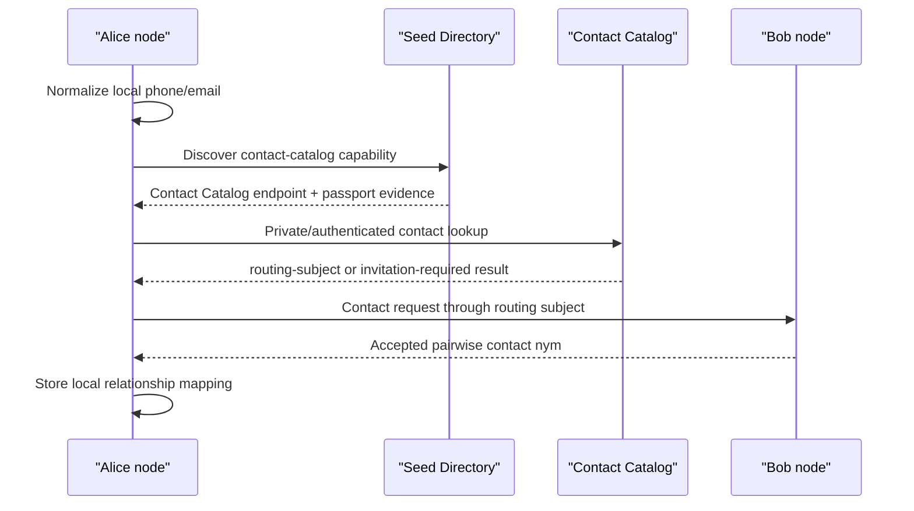

# Proposal 058: Contact Catalog and Private Contact Discovery

Based on:

- `doc/project/40-proposals/023-federated-offer-distribution-and-catalog-listener.md`
- `doc/project/40-proposals/025-seed-directory-as-capability-catalog.md`
- `doc/project/40-proposals/028-service-schema-catalog.md`
- `doc/project/40-proposals/054-user-maintained-federated-seed-directory.md`
- `doc/normative/50-constitutional-ops/pl/ROOT-IDENTITY-AND-NYMS.pl.md`
- `doc/schemas/routing-subject-binding.v1.schema.json`

## Status

Draft, MVP contract seeded

## Date

2026-05-15

MVP contract update: 2026-05-16

Alias and invitation design revision: 2026-11-27 (planned, P058-022–028).

## Executive Summary

Contact discovery is the problem of answering:

```text
Given a phone number, email address, or other human contact handle, is there a
safe Orbiplex contact path for the person who controls it?
```

This proposal introduces a **Contact Catalog** as a separate domain catalog,
inspired by the offer catalog but not merged with Seed Directory.

The core decision is:

```text
Seed Directory discovers infrastructure and capabilities.
Contact Catalog discovers opt-in contact routes.
```

A Contact Catalog may be discovered through Seed Directory as a capability, but
the catalog's own data model remains separate. It MUST NOT publish raw public
maps such as `phone -> participant` or `email -> participant` as its default
mode. Contact identifiers are high-risk correlation handles; the catalog should
return a privacy-preserving `routing-subject`, `contact_nym`, or invitation flow
rather than a root `participant:did:key`.

For one-to-one communication, the preferred model is a **pairwise contact nym**
or pairwise routing subject: each relationship may use a distinct pseudonymous
handle, while accountability remains anchored in the participant/node layer and
can be revealed only through explicit policy and high-stakes procedures.

## Context and Problem Statement

Orbiplex already has several catalog-like mechanisms:

- the service-offer catalog indexes `service-offer.v1` artifacts for marketplace
  discovery,
- the schema catalog lets modules publish descriptive contract metadata,
- the workflow template catalog lets users reuse plans and offer templates,
- Seed Directory indexes node endpoints and passport-backed capabilities.

These catalogs share a common pattern:

```text
source artifacts -> admission policy -> local/observed catalog projection -> query
```

Contact discovery looks similar at first glance, but it has a different risk
profile. Phone numbers and email addresses are not merely routing hints. They
are globally recognizable, low-entropy, and easily enumerated. A public mapping
from phone or email to `participant:did:key` would become a deanonymization
service.

At the same time, users reasonably expect to find contacts by phone or email,
especially during onboarding. The system therefore needs a contact-discovery
surface that:

- works with familiar human identifiers,
- remains opt-in,
- avoids public raw identifier mappings,
- supports privacy-preserving relationship setup,
- composes with routing subjects and nym semantics,
- keeps Seed Directory focused on infrastructure discovery.

## Goals

- Define Contact Catalog as a domain catalog distinct from Seed Directory.
- Reuse the generic catalog pattern where practical: catalog endpoint
  registration, local projections, observed catalog provenance, and explicit
  admission policy.
- Define the default contact-discovery result as a privacy-preserving contact
  route, not as a root participant identity.
- Support phone and email lookup without normalizing the network around public
  `phone/email -> participant` maps.
- Define pairwise contact nym usage for relationship-level decorrelation.
- Define failure modes and mitigations for enumeration, hash reversal, unwanted
  disclosure, stale contact routes, and whitewashing.

## Non-Goals

- This proposal does not define final JSON Schemas for contact catalog records.
- This proposal does not mandate a specific private set intersection protocol.
- This proposal does not make Seed Directory a people directory.
- This proposal does not define a global address book.
- This proposal does not bypass the existing nym, participant, node, and
  identity-assurance layers.
- This proposal does not define legal identity verification for phone or email;
  those remain lower-assurance contact controls unless combined with stronger
  attestation.

## Proposed Model

## MVP Decisions Frozen on 2026-05-16

These decisions define the first implementation contract. They are deliberately
conservative; stronger private-discovery protocols can replace the lookup edge
later without changing the high-level Contact Catalog boundary.

1. **Lookup mode:** MVP Contact Catalog uses public invitation-only digest
   lookup with strict rate limiting and redacted audit. Admin/sync surfaces
   remain authenticated. A successful lookup returns a route candidate or
   invitation-required result, not the owner identity.
2. **Capability id:** `contact-catalog` is a standalone domain capability id
   with wire name `role/contact-catalog`.
3. **Contact-control proof ids:** `email-control` and `phone-control` are
   standalone capability ids used by contact-control attestation services.
4. **Messaging contact consent id:** `messaging-receive` is the narrow passport
   profile minted after accepting a `contact-request.v1`. The earlier
   story-local spelling `messaging.receive@v1` should be treated as superseded
   by this registry-safe bare capability id.
5. **Claim signer:** MVP contact claims are signed by the controlling
   participant or by a participant-authorized delegated signing key. A node may
   add hosting evidence, but a node signature alone is not sufficient to bind a
   human contact handle to a route.
6. **Control-proof TTL:** email and phone control proofs SHOULD use a default
   maximum freshness window of 90 days for MVP catalog admission. Local policy
   MAY require shorter windows, especially for phone numbers or known unstable
   providers.
7. **Routes per claim:** canonical `contact-claim.v1` carries an ordered
   `owner/routes[]` route set. Lookup returns canonical
   `contact-lookup-result.v1` with `result/routes[]` and `selected/route`.
8. **Pairwise nyms:** pairwise contact nyms are the default privacy posture for
   ordinary one-to-one relationships, but not mandatory for public handles or
   governance/high-stakes procedures.
9. **Agora non-goal:** Contact Catalog records are not published through
   Agora, and future Contact Catalog closure work MUST NOT depend on Agora
   propagation. Discovery stays with Seed Directory; contact lookup stays with
   the Contact Catalog service and its privacy policy.
10. **No-match audit:** no-match lookups may emit redacted aggregate or
    digest-bound audit events, but MUST NOT store raw queried handles in shared
    audit records.
11. **Public fetch boundary:** a network-reachable Contact Catalog is not an
    anonymous full-dump endpoint. Ordinary clients use authenticated lookup.
    Bulk/list fetch is reserved for local operator APIs or explicitly trusted
    provider sync, under policy and audit.
12. **Provider sync control/data plane:** host/daemon policy owns discovery,
    trust state, passport validation, auth material, and revocation freshness.
    Once a provider is trusted, catalog-to-catalog record fetch may use a
    direct data-plane call between Contact Catalog services.
13. **Pre-freeze schema consolidation:** the earlier route-candidate
    `contact-claim.v1` / `contact-lookup-result.v1` drafts were replaced before
    public freeze. Route-set/private-lookup semantics are now the only
    canonical v1 contracts; no `*.v2` wire contract is advertised or emitted.
14. **Generic sync mechanics:** transport-neutral catalog sync mechanics
    belong in `node/catalog`, not in Contact Catalog runtime. Contact Catalog
    supplies the domain record, filter, admission, privacy policy, and HTTP
    worker/runtime.

The corresponding initial schemas are:

- `contact-claim.v1`
- `contact-lookup-result.v1`
- `contact-request.v1`

The solution-level component contract is:

- `doc/project/60-solutions/025-contact-catalog/025-contact-catalog.md`

### 1. Contact Catalog Is a Domain Catalog

Contact Catalog follows the same broad shape as the offer catalog:

```text
contact claim artifacts
  -> catalog admission policy
  -> local/observed contact projection
  -> contact lookup
  -> invitation or routing-subject contact path
```

It should be exposed as a catalog kind:

```json
{
  "catalog_kind": "contact",
  "path": "/v1/contact-catalog"
}
```

This fits the `catalog_endpoints` abstraction introduced for schema/template
catalogs. A module or attached role can provide contact catalog behavior without
teaching the daemon contact-domain semantics.

The daemon MAY later expose an aggregated read proxy such as:

```text
GET /v1/catalog/contact?lookup=...
```

but the aggregated proxy should remain a transport/read-model convenience. It
must not become the authority over contact identity.

### 2. Seed Directory Discovers Contact Catalogs, Not Contacts

Seed Directory MAY advertise that a node or community runs a
`contact-catalog` or `contact-discovery` capability:

```text
capability_id = contact-catalog
```

Seed Directory SHOULD NOT store raw contact mappings as its own native data.
Its role is limited to infrastructure discovery:

```text
Who runs a Contact Catalog I may query?
What endpoint and capability passport backs that catalog?
What trust tier or governance scope is attached to that catalog?
```

The Contact Catalog then owns the domain policy:

```text
Who may query?
What contact identifiers are accepted?
How are identifiers blinded or normalized?
What result can be returned?
What consent or opt-in is required?
```

This keeps the Seed Directory small and auditable while avoiding a global
people-directory coupling.

### 3. Contact Identifiers Are Not Stable Public Keys

Phone numbers and email addresses are contact claims, not identities.

The catalog MUST treat them as:

- low-entropy identifiers,
- potentially recycled or reassigned,
- externally governed by telecom or email providers,
- useful for bootstrapping contact, not for durable accountability.

Therefore a successful lookup SHOULD NOT return:

```text
participant:did:key:...
```

by default.

It SHOULD return one of:

- `routing-subject/id` for direct delivery or inbox contact,
- `contact_nym` for relationship-level communication,
- an invitation token or contact request flow,
- a present-on-demand proof that lets the owner decide what to disclose.

### 4. Contact Claim Artifact

A participant or node may publish a contact claim to a Contact Catalog. The
catalog MUST require a fresh attestation proving control of the contact handle
before admitting the claim. In other words: only the party that has confirmed a
phone number, email address, or equivalent contact channel may associate that
contact with itself, its nym, or its routing subject. A contact claim without
control proof is not an opt-in contact route; it is an unauthenticated assertion
about someone else's address book.

The canonical schema carries at least:

```text
contact-claim.v1
  claim/id
  contact/kind                 # phone | email | other
  contact/normalized-digest     # never raw by default
  contact/attestation-ref       # proof of control, not raw OTP transcript
  contact/attested-at
  contact/attestation-expires-at
  owner/routes[]                # ordered route-set: routing-subject | contact-nym | invitation-route
  owner/participant-id?         # optional and disclosure-gated
  disclosure/mode               # private-lookup | invite-only | public-handle | present-on-demand
  purposes[]                    # contact | inbox | direct-delivery | recovery
  issued/at
  expires/at
  revocation/ref?
  proof/signature
```

The raw phone number or email address should not be stored in a public catalog
record. A local personal address book may store raw contacts, but that is a
different trust boundary.

### 5. Lookup Result Artifact

A successful lookup should return a route, not a person record:

```text
contact-lookup-result.v1
  lookup/id
  catalog/id?                  # optional in MVP
  lookup/mode                  # invitation-only | blinded-digest | psi
  match/class                  # invitation-available | ambiguous | no-match | policy-denied | rate-limited
  result/routes[]
    route/type                 # routing-subject | contact-nym | invitation-route | node
    route/id?                  # stable route mirror for local UI/forms
    routing-subject/id?
    contact-nym/id?
    node/id?
    invitation/ref?
    purposes[]
    valid/until?
  selected/route?
  valid/until?
  policy/ref?
```

The result is a **contact route candidate**. A consumer must still complete the
normal invitation, messaging, or direct-delivery handshake before assuming a
relationship exists.

The canonical v1 contract requires `schema`, `schema/v`, `lookup/id`,
`lookup/mode`, `match/class`, `result/routes`, and `issued/at`;
`selected/route` plus at least one route is additionally required when
`match/class = "invitation-available"`.

### 6. Pairwise Contact Nyms

For one-to-one communication, the preferred privacy posture is pairwise
pseudonymity:

```text
participant A
  -> local private contact map
  -> contact_nym_for_B
  -> routing-subject_for_B
```

Participant B may receive a stable handle for the relationship, but that handle
does not automatically link to A's other relationships. Participant C may see a
different nym for the same underlying participant.

This should be configurable by relationship class:

| Relationship class | Suggested handle |
| :--- | :--- |
| one-time invitation | one-shot invitation token or `case_nym` |
| ordinary one-to-one chat | pairwise `persistent_nym` or pairwise routing subject |
| public profile contact | public contact handle that still routes through a nym |
| governance or high-stakes procedure | stable `participant:did:key` or procedural pseudonym, not ordinary contact nym |

Pairwise nyms improve decorrelation, but they are not a reputation reset
mechanism. Abuse, sanctions, and recovery procedures must be able to reason
through the private mapping under explicit policy thresholds.

#### Federation-scoped contact alias {#federation-contact-alias}

**Planned, 2026-11-27 (P058-024).** A participant may choose a searchable
name such as `random:seed` without publishing an email or phone claim. Reservation
requires current federation membership and fresh federation-recognized assurance
at least equivalent to verified email. An accepted phone or stronger attestation
may satisfy it. Verify this privately at admission using [P061](061-contact-attestation-service.md)
and the federation's membership policy. It proves eligibility for a name. Treat `alias` as a first-class `contact/kind` alongside `email`
and `phone`: use the same opt-in claim, exact lookup, purpose filter and
route-set result. For an alias, proof of control comes from the current
federation reservation. The search key includes the trusted federation ID,
the handle kind and the canonical name. A name may belong to different
people in different federations. Search in the selected federation only.

One public name can lead to a pseudonymous invitation route. After acceptance
each relationship can use its own `contact-nym`. Looking up the public name
reveals neither the participant's root identity nor a list of their pairwise
nyms. Finding a route leaves the recipient's request policy, block decisions
and Messaging consent in force.

**Allocation authority (decision, 2026-11-27, implementation planned).** A
federation may endorse several Contact Catalogs for lookup. For the first
deployment it designates one of them to allocate aliases. That catalog
advertises a separate capability (proposed ID `contact-alias-allocation`)
through Seed Directory. The federation can withdraw this role independently
of ordinary lookup. The service endpoint belongs in discovery and can move
without updating the federation root.

The client verifies the federation's endorsement for that exact node and
capability, then checks the allocation receipt under the versioned policy
selected by its active federation configuration. For example, if A and B
both offer official lookup but only B has the allocation mandate, A may
forward a reservation sealed to B after the claimant verifies its mandate.
An `authoritative` flag set by A cannot turn A's
receipt into proof. The initial policy selects one writer by stable identity.
Receipt verification follows the policy, so quorum or unanimous approval
can be considered later. [S025 specifies discovery, verification and writer handover](../60-solutions/025-contact-catalog/025-contact-catalog.md#alias-allocation-authority).

| Operation | Rule at the federation's designated Contact Catalog allocation authority |
|---|---|
| Reserve | Verify membership, assurance, signed intent, route control and quota at the writer. Atomically reserve both the match key and confusable skeleton. Return the original result on exact retry. Other claimants see only “unavailable”. The default quota is one live alias per member. |
| Update or renew | Authenticate the holder of the active allocation and generation. Route rotation retains the name. Renewal extends the allocation lease. A rename needs an atomic exchange within quota or a separate free slot. |
| Release | Commit a tombstone on authenticated release or lease expiration after the notice/grace procedure below. Freeze `reusable/at` at commit time plus the federation hold (default **30 days** of 24 hours). The hold covers both keys and applies to the former holder too. |
| Reallocate | At or after the deadline the next allocation increments the per-name generation. Preserve its high-water mark across compaction. Earlier contact relationships, invitations and consents stay with their original peers. |

The federation publishes quota, lease, notice and grace intervals. The proposed
default lease is 12 months from allocation or the last explicit renewal. Notify the holder
privately 30 and 7 days before expiry and allow renewal throughout this grace
window. A route claim expiring, a node going offline, or a failed notification
does not itself release an alias. Record the expiry transition at the writer.
A disputed or quarantined name remains reserved pending a reasoned decision
with notice and appeal under the federation’s [P051 procedure](051-swarm-membership-and-reputation-bootstrap.md).
The UI explains that hidden names may still be recognized as unavailable at
reservation. Open lookup of generation 2 or later says “This name was allocated
again”, without identifying any earlier holder.

**Alias profile v1.** Freeze the following three representations as versioned
data before Schema Gate. Use the same profile for reservation and lookup.

| Representation | Derivation and use |
|---|---|
| Display | NFC, locale-independent Unicode lowercase, NFC. Admit the pinned Latin allowlist (ASCII letters and an explicit selection from Latin-1 Supplement and Latin Extended-A including Polish letters), ASCII digits, and the separators `.-_:`. Pin allowed input spellings and their case/canonical equivalents. Reject fullwidth forms, other scripts, IPA lookalikes, format/bidi controls, joiners, and colons other than ASCII before any lossy mapping. Reject a remaining combining mark, including the lowercase expansion of U+0130. |
| Match key | From the validated display spelling, case-fold, decompose accents, strip combining marks, apply the complete pinned variant table (including ł→l, ß→ss, æ→ae, ø→o, đ→d) and remove separators. Require a nonempty ASCII `[a-z0-9]+` result for every allowed spelling. Use this key for equality, indexing and the slip checksum. |
| Confusable skeleton | Compute the pinned UTS #39 skeleton of the match key. Its collision blocks registration, including through a release hold. A skeleton never resolves a lookup. |

Initial lowercase display repertoire (literal Unicode characters, spaces
between groups for readability):

```text
abcdefghijklmnopqrstuvwxyz
àáâãäåæçèéêëìíîïðñòóôõöøùúûüýþÿß
āăąćĉċčďđēĕėęěĝğġģĥħĩīĭįĵķĺļľłńņňōŏőœŕŗřśŝşšţťũūŭůűųŵŷźżž
```

Accept ASCII digits and the four separators separately. After NFC admit only
these lowercase letters and their single-code-point uppercase counterparts
(including ẞ for ß). Reject U+0130, long s and compatibility lookalikes even
if a later fold would map them to allowed letters. For the match key, strip
canonical accents as above and map the remaining exceptions exactly:
æ→ae, ð→d, ø→o, þ→th, đ→d, ħ→h, ł→l, œ→oe (case folding already maps ß→ss).
Qualify the entire repertoire and freeze its Unicode data version with vectors
for each nontrivial mapping; unassigned characters remain invalid.

Require 3–32 display code points (a federation may raise the minimum) and at
most 128 UTF-8 bytes. Both ends must be alphanumeric, separators must occur
singly, and at most one ASCII colon is allowed. Before stripping separators
from the full name, compare the first colon-delimited segment under the same
match rules against reserved locator kinds (`contact-nym`, `email`, `phone`)
and tag families (`ask`, `once`, including decimal suffixes). Reserve official
service names, `admin`, `support` and their confusing equivalents. Apply the
reservation to bare reserved names too.

The federation pins the exact code-point and variant tables, Unicode/confusables
versions, limits and reserved names. Claims and receipts bind the profile revision.
Preflight a revision against live names and holds. If old keys would merge,
preserve both existing allocations under the old revision and block conflicting
new allocations until an explicit resolution permits cutover. Never select a
winner by lookup order. Include registration vectors for equivalent separators,
a reserved service name, `pawe1` versus `pawel`, a Latin/Cyrillic mix, a fullwidth colon,
a bidi override and an invisible joiner. Re-run those vectors on restore and
profile migration. Adding scripts requires new script-mixing, digit and
bidi rules with cross-script collision vectors. This restricted Latin profile
has its own wire semantics.

Lookup stops on release at the authority. Readers must verify the current
binding before forwarding a request or presenting a credential to the receiver.
Bind the request presentation to that recipient, federation and generation
so a delayed request cannot be admitted by a later holder.
If freshness cannot be established, leave the action pending or refuse.
Use exact, rate-limited lookup without enumeration or prefix suggestions.
Releasing an alias retires that discovery path. Existing pairwise relationships
and independently issued receive consents keep their own lifecycle.

### 7. Local Contact Store vs Federated Contact Catalog

The node should distinguish:

1. **Local contact store**
   - raw address book entries,
   - user labels,
   - local address-book mappings and UX metadata,
   - never published by default.

2. **Contact Catalog**
   - opt-in contact claims,
   - privacy-preserving lookup indexes,
   - contact routes or invitations,
   - query policy and audit.

3. **Local Relationship Layer**
   - private relationship classes such as `contacts` and `friends`,
   - membership facts and relationship predicates,
   - pairwise relationship facts,
   - never published as catalog state.

4. **Seed Directory**
   - discovery of Contact Catalog providers,
   - endpoint and capability evidence,
   - no people-directory semantics.

This mirrors the local/observed split in the offer catalog: local knowledge and
network-observed projections are different stores with different provenance.

### 8. Query Privacy Profiles

Contact Catalog implementations may support multiple lookup modes.

#### 8.1 Authenticated Exact Lookup

The caller authenticates and submits a normalized contact token. The catalog
returns a match only if local policy permits.

This is simple but leaks lookup intent to the catalog.

#### 8.2 Blinded Digest Lookup

The caller sends a blinded or keyed digest. The catalog can answer without
receiving raw phone/email. This still requires careful design because phone
numbers and common email addresses are dictionary-sized.

#### 8.3 Private Set Intersection

The caller and catalog compare sets without revealing non-matches. This is the
best long-term shape for address-book discovery, but it is not required for MVP.

#### 8.4 Invitation-Only Lookup

The catalog never answers "who owns this contact". It only allows the caller to
submit a contact request, which the owner may accept, reject, or ignore.

This is the safest default for public or semi-public catalogs.

#### Discovery policy per contact identifier {#per-identifier-discovery}

**Planned (P058-026).** A *lookup code* permits a Catalog to return a route.
A *request code* permits the receiver to consider a signed request. The slip
tag `ask` represents a request for a decision, while `once` represents
one advance consent redeemed privately at the receiver. Their proofs have
different audiences. Each email, phone or alias claim has its own policy:

| Visibility | Result for this identifier |
|---|---|
| `hidden` | No match even with an earlier valid code. The reservation or claim remains active. |
| `open` | A current, purpose-limited route under the ordinary lookup policy. |
| `ask` | The route only after confidential verification of the identifier-specific lookup proof. Missing, wrong, expired and withdrawn credentials yield the ordinary negative response. |

**Discovery privacy contract** (what the Catalog can learn). The authenticated
or network context can expose the caller on any path. None of these modes
promises transport anonymity.

| Query mode | Miss, including wrong code | Hit |
|---|---|---|
| Exact / invitation-only | The target, or a normalized index often dictionary-recoverable. The Node invitation-only profile rejects raw handles. | The matching entry. |
| Blinded digest | A digest. For phone numbers and common emails it may identify the target if the key or a guessing oracle is available. | The matching entry. |
| PSI, open entries only | Blinded input and protocol metadata. The queried non-member identifier stays private. | The Catalog can learn the selected entry when the client presents its match token. |
| Code-protected lookup | The target identifier or its lookup-equivalent index, even on failure. This is an explicit exact-mode request. | The matching entry. |

The sensitive observation is *who sought which entry*. Keep that association
only for the configured rate-limit window. Entry counters aggregate across
callers. Durable audit, status and exports must not reconstruct the pair.
A PSI miss must never silently trigger an exact lookup. A partial PSI evaluation
has an explicit incomplete outcome. [S025 owns both independent follow-ups](../60-solutions/025-contact-catalog/025-contact-catalog.md#lookup-privacy-follow-ups).

For example, set one email to `open` and the alias to `ask`, or set both
to `ask` with separately rotatable codes. A result for one identifier must
not list the owner's other identifiers or their visibility. An absent opt-in
stays hidden. Preserve existing explicitly published claims under their
previous restrictions during migration. An unknown policy or stale policy
revision cannot authorize an open lookup.

The Catalog can answer from a current claim, policy and verifier while the
recipient node is offline. The caller learns a route, and can later submit
a signed contact request. The receiving host independently enforces its own
request policy, even on a cached route. To issue one shareable ask slip for
both gates, provision two purpose-separated credentials from one freshly
generated secret. Keep the Catalog proof unusable for request admission.
If the gates have independent secrets, ask explicitly for the second input
at the corresponding step. A separate recipient-only code can still be short.
Switching to hidden or rotating a lookup code affects future lookups. It
cannot erase a route already learned or revoke an existing sender's passport.
Offer a local emergency action to require a receiver code and hide the
identifier. Close the receiver gate first, show which changes committed and
allow retry if the Catalog is offline. Offer verified route rotation where
supported and show existing consents separately. A no-match client may say
“If you supplied a code, check it. The same result is shown for an absent
entry and an incorrect code.”

Only `ask` has a Catalog verifier. Keep `once` and all derivatives of that
token exclusive to the recipient-side redemption flow. If a `once` invite
names an `ask`-protected alias, obtain its route with a separate lookup
`ask` or use an independently verified private route to the intended recipient.
For a hidden alias only the private path works. Before issuing paper, warn
if the recipient could not be reached from the supplied information. A future
self-contained hidden-alias card requires a separate Schema Gate profile with
a fresh invitation-specific, authenticated locator resolvable by its addressee
without prior contact or public lookup. Keep its
routing reference separate from the redemption secret. A `once` token
cannot unlock discovery. [S025 defines the salted verifier and its limits](../60-solutions/025-contact-catalog/025-contact-catalog.md#catalog-ask-verifier).

#### Recipient-issued contact invitations {#recipient-issued-contact-invitations}

**Planned, 2026-11-27.** The recipient can share two kinds of invitation for
first contact. The Catalog still resolves a route. The recipient's host enforces
the invitation at request admission, including direct or previously cached routes.

| What the recipient shares | What the holder can do | When the recipient decides |
|---|---|---|
| Reusable request code | Submit a signed `contact-request.v1` for Messaging. Each sender gets a separate decision. | On each new request, through the existing accept/reject notification. |
| Single-use invitation with advance consent | Redeem a private, expiring token with one signed request. On successful redemption the host issues the ordinary sender-specific receive passport. | At invitation creation, for exactly one contact. [P076 owns the issuance rule](076-limited-messaging-grants-decision.md#advance-contact-consent). |

**Reusable request code.** The recipient-only manual input accepts
`[A-Za-z0-9]{3,32}` with ASCII lowercase comparison. Short human-chosen
codes are confined to this private, online, rate-limited gate. Generated
shareable codes use the [slip alphabet and limits](#shareable-contact-text).
Never request an account password. A receiver checks the proof before any
prompt and records only its private opaque `code/ref` and optional local
label with an admitted request. This identifies the admission channel.

Separate failed-proof work from accepted-request/prompt budgets. Bound both
per peer and across peers, and cap admissions per code. Apply bounded delay
and fair scheduling under pressure, with a fixed work ceiling and uniform
responses. Invalid guesses cannot indefinitely lock an entire name. Allow
the recipient to pause one code and coalesce private flood alerts offering
rotation. The UI shows “New requests closed (no active code)” when applicable.

The receiver chooses an explicit policy for ordinary first-contact requests.
With no code configured initially, retain the existing transport and block
policy (including the user and headless defaults). Enabling **code required**
persists that choice independently of the active code. Revoking, expiring or
rotating the last code keeps the gate closed to the old code across restart.
Only the recipient's explicit choice to reopen requests restores ordinary
admission. Requests already admitted remain available for their own decisions.

**Single-use invitation.** Issue a separate bearer token sampled uniformly
from the [27-symbol token format](#shareable-contact-text) for private
sharing. Apply the [P076 redemption window and renewal rules](076-limited-messaging-grants-decision.md#advance-contact-consent).
Bind its opaque `invite/ref` to the recipient, route, Messaging purpose and
expiry. Optionally bind it to the intended sender's key. For an unbound token,
the first eligible presenter can claim the invitation, including someone to
whom it was forwarded. Show that consequence before issue. A valid redemption
satisfies the invitation requirement for its own request. Both modes still
require the applicable INAC/AD policy, block checks and signed-request validation.

Keep three references distinct: the invitation's `invite/ref`, the signed
`request/id`, and the issued passport ID. Retiring the invitation stops new
admissions through it. Withdrawing a sender's consent targets that sender's
passport as specified in [P060](060-messaging-middleware.md#contact-invitations-and-receive-consent).
It leaves a reusable code available to other senders. A later request from the
withdrawn sender through that code requires a fresh explicit decision.

#### Shareable contact text {#shareable-contact-text}

**Planned (P058-025).** The v1 paper/copy/QR line is
`tag:locator:credential:check`. Read the tag up to the first ASCII colon and
split off two fields from the right. The intervening alias is literal, including
its optional colon. This replaces the earlier escaped, locator-first draft.
Wire and stored records carry separate typed fields. A pairwise `contact-nym`
belongs to one existing relationship. Refuse both exporting and importing it
on a first-contact slip and explain that sharing it would link relationships.
Reserve typed locator prefixes for separately qualified profiles.

| Field | Canonical v1 form |
|---|---|
| Tag | `ask` or `once` for alias generation 1. For later allocations append the decimal generation ≥2 without leading zeros. Reject unknown tags, explicit 1, overflow of the allocation counter or a suffix for a non-alias locator. |
| Locator | The display spelling under the federation’s alias profile. `kuźnia:dźwięku`, `kuznia-dzwieku` and `KUZNIA.DZWIEKU` all yield `kuzniadzwieku`. |
| Credential | Exchange alphabet `23456789abcdefghjkmnpqrstvwxyz` (30 symbols), lowercase on export and ASCII-case-insensitive on input. Sample uniformly with a cryptographic RNG. Export `ask` with 12–32 symbols (default 16), `once` with exactly 27 (about 132 bits). Manual request codes of 3–32 ASCII alphanumerics remain usable only at the receiver. |
| Check | Four symbols from the exchange alphabet, including leading zero digits (symbol `2`). For each trusted candidate federation use its own pinned alias profile. |

For the check, join the UTF-8 strings `orbiplex/contact-slip/v1`, canonical
federation ID, lowercase tag including generation, locator match key and folded
credential with one NUL byte between fields, no terminator. Interpret the
first four SHA-256 digest bytes as an unsigned big-endian integer, reduce
modulo 810000, then encode in four base-30 digits, most significant first.
This detects transcription errors (roughly one random collision in 810000).
Use it to suggest a locally trusted federation. Require a previously selected
trusted context or explicit selection before network access. Even a unique
checksum match confers no federation trust. No match or ambiguous match
requires local correction or explicit context resolution and revalidation.

Synthetic vectors for `orbiplex-main`:

| Input | Expected |
|---|---|
| `ask:random:seed:k7m2qx9dfh3c:mgs4` | Alias `random:seed`, generation 1, request. |
| `ask2:random:seed:k7m2qx9dfh3c:x6q6` | Same name, generation 2. |
| `once:kuźnia:dźwięku:7hq2mx4kvd9cpz3wnbr8tyg5ej6:s8mj` | Generation 1, single use. Uppercase ASCII transcription with locator `KUZNIA:DZWIEKU` must verify identically. |

**Import order.** Trim whitespace and the listed boundary format characters
(ZWSP, LRM, RLM, BOM) at the two outer edges only. Validate grammar, locator
profile, credential, checksum and trusted federation locally. Reject interior
whitespace/format controls, unknown tags, `ask1`, `ask02`, missing fields,
bad checksum, a second alias colon and confusable punctuation. Keep **Paste
invitation** separate from **Search alias**. A truncated slip, even the
plausible suffix `credential:check`, must never silently become a lookup.
In free-form search ask for clarification locally on slip-like suffixes.
After local validation use only the minimum lookup material. Verify the current
holder-signed route and generation before presenting anything to the receiver.

An importer may also accept a correctly checksummed `ask` line carrying a
legacy/manual 3–32 ASCII alphanumeric request code, folded to lowercase.
Require receiver-only mode for this input: resolve an open alias without any
lookup credential or use an independently verified private route. Never try
this code at the Catalog. A human-selected code cannot provision protected
discovery even if it looks random. Export always generates an exchange-alphabet
secret. When the mode is ambiguous, require the holder to select receiver-only
or explicitly authorize protected lookup with a generated slip.

A slip with a generated secret covering both gates still requires selection of
the intended identifier and federation. A per-purpose lookup input may then
go to the Catalog. A receiver presentation goes only to the verified receiver.
For a private route accompanying an alias slip, supply current binding evidence
independently; knowing the route string alone cannot satisfy the generation check.

**Card and UI.** Print the display alias, invitation purpose and expiry with
time zone beside the canonical line. Label an unbound token “first eligible
presenter can redeem”. Spaces or hyphens for reading in groups of four belong
only to a separate credential input/display. Bidi isolation is display-only.
A QR carries exactly the line. Links carry it only in the fragment on a
trusted import surface. Avoid history, referrers, analytics and third-party
scripts on that surface. Never log the line, checksum or credentials or
include them in notifications. Local syntax errors may explain the position
and remedy. Remote denials remain uniform.

### 9. Admission Policy

A Contact Catalog should admit claims only after checking:

- proof of contact control, such as email link or phone challenge; this proof is
  mandatory for any claim that associates a contact handle with a participant,
  nym, routing subject, or invitation route,
- claim signature by the participant, node, or delegated nym,
- expiry and revocation,
- disclosure mode,
- purpose allowlist,
- abuse limits for frequent re-registration,
- whether the contact identifier was recently reassigned or flagged as unstable.

Phone verification is a contact-control proof. It is not, by itself, strong
identity assurance.

### 10. Contact Discovery Flow

Example sequence:

1. Alice imports Bob's phone number into her local contact store.
2. Alice's node normalizes the phone number locally.
3. Alice's node discovers a trusted Contact Catalog through Seed Directory.
4. Alice's node performs an authenticated or private lookup.
5. The catalog returns an invitation-required result with a `routing-subject/id`.
6. Alice sends a contact request to that routing subject.
7. Bob's node decides locally whether to reveal a pairwise contact nym.
8. If Bob accepts, both nodes store a pairwise relationship record.
9. Future messages use the pairwise nym or routing subject, not Bob's phone
   number.



### 11. Catalog Provider Role

Across the Orbiplex node, several domains share the same architectural shape:
a node-attached, supervised middleware that owns one typed catalog and
exposes it through a domain-specific HTTP API. The offer-catalog
implementation in Dator is the existing concrete instance; Contact Catalog
is the next instance, for the contact domain. This shared shape is named
explicitly as the **Catalog Provider Role**:

```text
Catalog Provider Role
  -> typed domain records (CatalogRecord implementations)
  -> domain admission policy on the publish edge
  -> local published store (CatalogStore<T>) + optional observed store
  -> domain-specific HTTP API (publish, query, admin)
  -> capability id discoverable through Seed Directory
  -> optional domain-specific federation/fetch policy, if the domain accepts it
```

A node may host many Catalog Provider middleware instances side by side
(offers, contacts, schemas, templates, workflow templates) without
duplicating the storage layer, because the storage primitives live once in
the shared `node/catalog` crate (see §12 below) and each provider
parameterises them by its own record type.

The role contract that every Catalog Provider middleware must follow:

1. Declare one or more typed `CatalogRecord` implementations naming the
   domain artifacts the provider admits.
2. Use `CatalogStore<T>` for the local published store and, if federation is
   in scope, `ObservedCatalogStore<T>` for relay-observed records of the
   same type.
3. Expose a supervised domain-specific HTTP surface for publish, query, and
   admin, attached through the existing Node Middleware extension-host.
4. Declare a `catalog_kind` and a stable capability id so Seed Directory can
   advertise the endpoint and trust evidence without learning domain
   semantics.
5. Run a domain admission policy before any `CatalogStore::upsert`.
6. Optionally participate in domain-specific federated fetch or observed-store
   ingestion only if the domain accepts the privacy model. Contact Catalog does
   not use Agora for this role. Provider-to-provider Contact Catalog fetch is a
   direct catalog data-plane operation after host policy has accepted the
   provider; it is not a public dump and not a relay path.

Naming this role explicitly serves two purposes. First, Contact Catalog can
inherit the pattern instead of reinventing it. Second, future catalogs
(schema catalog, workflow template catalog, any community-defined catalog)
get a stable role contract to satisfy and a clear answer to "what crate do
I link?".

## Implementation Sketch: `node/catalog` Reuse

The Orbiplex node already exposes the catalog mechanics this proposal
needs, in the `orbiplex-node-catalog` crate at `node/catalog/`. Contact
Catalog must not invent a parallel storage layer; it must reuse these
primitives. This section is non-normative implementation guidance for the
future Contact Catalog middleware crate, intended to make the reuse path
explicit and to keep the `node/catalog` adapter trait open to
parameterisation when Contact Catalog (the second consumer after offers)
lands.

### 12.1 `node/catalog` Primitives Reused As-Is

- `CatalogRecord` trait — minimal contract: `record_id`, `sequence_no`,
  `expires_at_str`, `validate_record`. The first reuse decision is to
  implement this trait on the Contact Catalog domain record.
- `CatalogStore<T>` trait — typed local store with `upsert`, `get`, `list`,
  `expire_stale`, and the `UpsertOutcome::{Inserted, Replaced,
  IgnoredStale}` family. Sequence-aware idempotency for free.
- `InMemoryCatalog<T>` — in-memory store for tests and tiny deployments.
- `SqliteCatalog<T>` — persistent SQLite store under the `sqlite` feature.
  Recommended path:
  `<node-data-dir>/storage/contact-catalog.sqlite`.
- `ObservedCatalogStore<T>` + `InMemoryObservedStore<T>` + `TrustLevel` —
  for domain-specific observed claims when a catalog type has an accepted
  federation model. Contact Catalog has no Agora-backed observed projection in
  this plan.
- `CatalogResolver<T, L, O>` — composes local published and observed stores
  into one record-id-deduplicated view.
- `CatalogPredicate<T>` + `CatalogFilter<T>` — composable filters, with
  `active_only` automatically pushed down to SQLite via the existing
  `is_active_only` hook.
- `TrustedProviderStore` + `TrustedProviderFact` — append-only whitelist for
  trusted Contact Catalog peers (useful in invitation-only or
  federation-trusted profiles).

### 12.2 Contact-Catalog-Specific Types

Define a Contact Catalog domain record implementing `CatalogRecord` (sketch;
field names align with §4):

```rust
pub struct ContactClaimRecord {
    pub schema_v: u32,
    pub claim_id: String,                       // "contact-claim:..."
    pub contact_kind: ContactKind,              // Phone | Email | Other
    pub contact_normalized_digest: String,
    pub contact_attestation_ref: String,
    pub contact_attested_at: String,
    pub contact_attestation_expires_at: String,
    pub owner_routing_subject_id: Option<String>,
    pub owner_contact_nym_id: Option<String>,
    pub owner_participant_id: Option<String>,   // disclosure-gated
    pub disclosure_mode: DisclosureMode,
    pub purposes: Vec<String>,
    pub issued_at: String,
    pub expires_at: String,
    pub sequence_no: u64,
    pub revocation_ref: Option<String>,
    pub signature: ContactClaimSignature,
}

impl CatalogRecord for ContactClaimRecord {
    fn record_id(&self) -> &str { &self.claim_id }
    fn sequence_no(&self) -> u64 { self.sequence_no }
    fn expires_at_str(&self) -> Option<&str> { Some(&self.expires_at) }
    fn validate_record(&self) -> Result<(), CatalogError> {
        // schema/v check, claim/id prefix, signature shape,
        // attestation expiry presence, purpose allowlist, etc.
    }
}
```

The same trait holds contact-specific validation on the edge while the
generic store stays unaware of contact semantics. `ContactLookupResultRecord`
follows the same pattern for query-side artifacts when these need to be
cached or relayed.

Contact-specific filters live as `CatalogPredicate<ContactClaimRecord>`
implementations: lookup by normalised handle digest, lookup by purpose,
active-only, and so on. They compose with `CatalogFilter`.

### 12.3 Adapter Trait Generalisation

The current `CatalogAdapter` trait in `node/catalog/src/adapter.rs` is
specialised to `ServiceOfferRecord`:

```rust
async fn fetch_offers(...) -> Result<Vec<ObservedOfferRecord>, CatalogError>;
async fn notify_offer(offer: &ServiceOfferRecord, ...) -> Result<...>;
```

Contact Catalog is the second consumer of this surface. The right move is
to generalise the trait over `T: CatalogRecord` (and `ObservedRecord<T>` for
the fetch payload), so contact and offer providers can share one async
remote-fetch contract. Without this generalisation Contact Catalog would
need a parallel `ContactCatalogAdapter` trait that duplicates the
abstraction. The generalisation is tracked as P058-018.

### 12.4 Generic Catalog Sync Mechanic

The shared catalog crate should own the transport-neutral mechanics of
provider sync. A future `CatalogSynchronizer<T, F, A, S>` or equivalent
function over `CatalogAdapter<T, F>` and `ObservedCatalogStore<T>` should:

- fetch `ObservedRecord<T>` from one provider using a typed filter and cursor;
- validate every observed record through `T: CatalogRecord`;
- apply sequence-aware upsert and trust-level admission;
- preserve provider origin, relay hop counts, and any `do_not_forward` or
  `intended_node` constraints;
- return counted outcomes such as inserted, replaced, stale/ignored, and
  rejected;
- carry cursor or high-water metadata derived from accepted provider records
  without knowing the provider auth runtime;
- prevent loops when records have crossed multiple providers, including
  rejecting self-originated records when the runtime supplies the local node id.

This mechanic must not own HTTP routes, provider authentication, Seed
Directory discovery, revocation snapshots, or Contact Catalog privacy policy.
Those are runtime and policy concerns of the domain service and the host.

### 12.5 Deployment Shape

The Contact Catalog middleware runs as a supervised `channel_json` middleware with a
separately owned bounded product HTTP API, analogous to Dator. Recommended language: **Rust**, specifically so that the
middleware can link `orbiplex-node-catalog` as a library and use the typed
primitives directly, rather than going through an HTTP hop into the
daemon for storage operations. The middleware:

- declares `catalog_kind = "contact"` and a `catalog_endpoints` entry that
  Seed Directory advertises (per §1);
- exposes domain HTTP under `/v1/contact-catalog/...` (publish, query,
  admin);
- owns one `SqliteCatalog<ContactClaimRecord>` (and optionally one
  `InMemoryObservedStore<ContactClaimRecord>` for federation);
- runs the admission policy from §9 before each `upsert`;
- publishes a `contact-catalog` capability passport through Seed Directory
  so consumers can find it without learning domain semantics.

### 12.6 Storage Boundary

Contact Catalog storage stays inside the middleware's own data directory.
It does **not** become part of Memarium's fact stream by default. This
matches the storage-stratification reasoning in story-010 §11: per-record
catalog rows are operational state that the provider owns and may
vacuum/shard/rebuild independently. Memarium remains relevant only for
semantic facts about a catalog (audit events, policy changes), not for the
catalog rows themselves.

```text
contact-catalog middleware (Rust, supervised HTTP)
  -> uses orbiplex-node-catalog                          (Layer A: shared primitives)
  -> accepts contact-claim.v1                            (Layer B: domain admission)
  -> enforces admission policy
  -> stores in SqliteCatalog<ContactClaimRecord>         (Layer C: middleware-owned storage)
  -> exposes contact lookup HTTP API                     (Layer D: domain HTTP surface)

Seed Directory
  -> discovers contact-catalog capability
  -> returns endpoint + passport/evidence

client (messaging middleware or other domain consumer)
  -> queries catalog directly over HTTP at the
     Seed-Directory-discovered provider endpoint
  -> receives routing-subject / contact_nym / invitation flow
  -> hands Artifact Delivery a normal routing-subject (or node)
     selector for the subsequent contact-request / message delivery
```

Note: contact lookup is a **recipient-resolution** step. It is intentionally
not registered as an `artifact/ref` resolver scheme in AD, because resolver
schemes answer "where do I fetch the payload bytes?" while contact lookup
answers "to whom and over which route should this be delivered?" — two
different axes.

Artifact Delivery now exposes `selector/kind = "contact-lookup"` as a
host-composed recipient selector. AD core owns only the DTO, validation and
`ContactLookupNodeLookup` trait; the daemon calls the configured local Contact
Catalog provider, consumes canonical `contact-lookup-result.v1` route sets,
and normalizes `invitation-available` results
to a `routing-subject` or concrete `node` target. MVP accepts `lookup/mode =
"invitation-only"`, `"blinded-digest"` or `"psi"`, `purpose = "messaging"`,
`selector/purpose = "contact-request/messaging"`, and `max/nodes = 1`.

`selector/purpose` is allowed to use a slash as a lightweight hierarchy: the
left side names the selector use case, while the right side names the domain
capability being approached. This is intentionally more specific than the
Contact Catalog `purpose = "messaging"` field, because future subsystems may
have their own contact-request flows. MVP policy allows
`contact-request/messaging` only for small `contact-request.v1` artifacts
through a schema-scoped INAC/AD preflight gate, not for full message delivery
before a `messaging-receive` passport exists. That gate is configurable through
`inac_peer_transport.contact_requests` and checks Local Relationship
`status = blocked` candidates before surfacing the contact-request
notification. Fresh service/headless daemon configs leave this contact-request
admission disabled with `unknown_peer_mode = "deny"`; user-mode startup
materializes an explicit user profile that enables the narrow `auto-admit`
contact-request flow without widening arbitrary INAC artifact admission.
The preflight extracts deny-only block candidates before signature
verification, so locally blocked participants/routes/nodes can be rejected
cheaply; non-blocked candidates still require the normal signed
`contact-request.v1` validation before admission. Repeated equivalent requests
collapse under a logical local-state key while the original wire `request/id`
remains in the stored request JSON.

## Relationship to Existing Mechanisms

### Seed Directory

Seed Directory discovers the Contact Catalog role and its endpoint. It should
not become the contact catalog itself.

### Routing Subject Binding

`routing-subject-binding.v1` already provides a privacy-preserving routing
subject that may be delegated by a participant without revealing the root
relationship. Contact Catalog lookup results should reuse this shape for
contactable routes.

### Nym Layer

The nym layer supplies relationship-specific and context-specific public keys.
Contact Catalog should prefer nym/routing-subject results over root participant
results.

### Offer Catalog

Offer Catalog indexes exchange-facing service artifacts. Contact Catalog indexes
contactability claims. Both use admission policy and observed projections, but
their privacy risks differ sharply.

### `node/catalog` and the Catalog Provider Role

`orbiplex-node-catalog` (`node/catalog/`) is the shared crate that owns the
typed catalog mechanics — records, stores, observed projections, resolvers,
adapters, and SQLite/in-memory backends. Some domains may add their own relay
bridges, but those bridges are not part of the Contact Catalog plan. The crate
is mechanism, not domain authority: it provides primitives and stays unaware
of the domain that instantiates them.

Dator is the existing concrete instance of the Catalog Provider Role for
the offer domain (today as a Python supervised `channel_json` middleware that does
not link the crate directly). Contact Catalog is the proposed next
instance, recommended as a Rust supervised `channel_json` middleware that **does**
link `orbiplex-node-catalog` directly and parameterises it with a
`ContactClaimRecord`. See §11 for the role contract and §12 for the
implementation sketch.

### Agora Non-Goal

Contact Catalog does not publish records, observed contact projections,
lookup indexes, routes, or relationship facts through Agora. If a deployment
needs broader discovery, it should advertise the `contact-catalog` capability
through Seed Directory and expose policy-controlled lookup or fetch endpoints.
Agora may still exist for other Orbiplex domains, but it is not a Contact
Catalog dependency. Trusted provider sync/fetch, if enabled, is direct between
Contact Catalog services after host authorization; records are not published,
relayed, or fanned out through Agora.

## Failure Modes and Mitigations

| Failure mode | Mitigation |
| :--- | :--- |
| Public deanonymization through `phone/email -> participant` | Do not return root participant by default; return routing subject, nym, or invitation flow. |
| Enumeration of phone/email space | Require authentication, rate limits, query audit, invitation-only mode, and future PSI for address-book discovery. |
| Hash reversal of low-entropy contacts | Do not treat unsalted hashes as privacy. Use keyed/blinded indexes and avoid public dumps. |
| Contact provider reassignment | Short TTLs, proof freshness, revocation, and re-verification windows. |
| Unwanted relationship linking | Use pairwise nyms or pairwise routing subjects. |
| Whitewashing through new contact nyms | Keep private accountability mapping and sanction thresholds at participant/node layer. |
| Catalog operator overreach | Catalog results remain route candidates; final trust comes from local policy, invitation acceptance, and cryptographic handshakes. |
| Stale contact routes | Expiry on claims and lookup results; direct-delivery still requires current routing evidence. |

## Trade-offs

### Benefits

- Familiar discovery UX without turning Seed Directory into a people directory.
- Better privacy by default than public contact maps.
- Clear reuse of the catalog pattern already present in offers, schemas, and
  templates.
- Pairwise nyms reduce accidental correlation across relationships.
- Contact discovery can evolve from simple authenticated lookup to PSI without
  changing the high-level catalog boundary.

### Costs

- More state: local contact store, pairwise nym mappings, revocation, and
  relationship records.
- Harder debugging: the same person may appear under different nyms in different
  contexts.
- More policy surface: consent, rate limits, disclosure modes, and abuse
  procedures must be explicit.
- Contact lookup requires careful UX to avoid giving users a false sense that a
  phone number is a durable identity.

## Open Questions

The original MVP questions have been answered in
[`MVP Decisions Frozen on 2026-05-16`](#mvp-decisions-frozen-on-2026-05-16).
The remaining open questions are post-MVP:

1. What operator-facing aggregate metrics are useful for abuse defense without
   leaking address-book contents?

## Post-MVP Next Actions

The original hard-MVP rows are complete. The remaining actions are production
hardening and privacy/federation expansion beyond the hard-MVP acceptance gate.

1. Harden the daemon-managed Contact Catalog provider trust policy beyond the
   MVP trusted/uncertain/blocked cache.
2. Exercise `contact-request.v1` accept/reject through broader failure-matrix
   Artifact Delivery tests beyond the Story 010 strict smoke.
3. Close the independent PSI completeness and caller–entry retention gates
   (P058-027 and P058-028) before claiming the stronger discovery guarantees.
4. Define the production federation acceptance matrix for provider sync,
   provider trust expiry, and provider policy rotation.

## Tracking

Status legend: `todo` (no implementation work started), `planned` (design
defined, awaiting implementation), `partial` (partially implemented), `done`
(fully implemented and integrated), `open` (a design decision is still
required before implementation can proceed), `deferred` (explicitly post-MVP
for this proposal). Status values are kept consistent with other tracker
tables in this project (see Proposal 057 §Tracking for precedent).

| ID | Feature | Status | Evidence |
|---|---|---|---|
| P058-001 | `contact-claim.v1` schema (fields per §4, signing key class decision, route-set v1) | done | `doc/schemas/contact-claim.v1.schema.json` defines the canonical route-set contract with ordered `owner/routes[]`. The earlier route-candidate v1 draft was replaced before public freeze and is not a supported public contract. MVP signer rule is frozen in the 2026-05-16 decisions; canonical v1 keeps the current participant-signature domain until the proof contract carries an explicit domain. |
| P058-002 | `contact-lookup-result.v1` schema (fields per §5, route-set v1) | done | `doc/schemas/contact-lookup-result.v1.schema.json` defines the active route-set result with `result/routes[]`, optional `route/id` mirrors for local UI/forms, `node` route candidates, and `selected/route`. The earlier route-candidate v1 draft was replaced before public freeze and is not a supported public contract. |
| P058-003 | `contact-catalog` capability id and minimal profile registered in the Capability Registry | done | `contact-catalog` is registered in `doc/project/60-solutions/CAPABILITY-REGISTRY.en.md` / `.pl.md` with wire name `role/contact-catalog`. |
| P058-004 | `catalog_kind: contact` registration through the existing `catalog_endpoints` plug-in pattern | done | Node `contact-catalog-service` issues a daemon-managed `contact-catalog` passport with `catalog_kind = "contact"`, `catalog_endpoints`, `lookup_modes = ["invitation-only", "blinded-digest", "psi"]`, and schema refs for `contact-claim.v1` / `contact-lookup-result.v1`. Daemon `/v1/contact-catalog/status` proxies service state, `/admin/contact-catalog` exposes discovered providers and provider trust controls, and Story 010 strict smoke discovers the provider through Seed Directory before lookup. |
| P058-005 | Contact Catalog admission policy (attestation freshness, signature, expiry, purpose allowlist, TTL recommendation) | done | Node `contact-catalog-core` validates canonical route-set `contact-claim.v1`, verifies participant/delegated participant claim signatures, rejects node-only signatures, requires first-class `email-control@v1` / `phone-control@v1` `capability-passport.v1` profiles, checks passport signatures, expiry, profile match, and revocation freshness. |
| P058-006 | Privacy-preserving lookup index implementation (normalized or blinded) | done | Node now has `orbiplex-node-crypto::contact_psi`, a small Ristretto255 DH-PSI primitive layer depending only on the crypto crate's existing curve25519-dalek/sha2 stack plus randomness. `contact-catalog-service` accepts `invitation-only`, `blinded-digest`, and `psi` lookup modes, requires mode/index pairing for private modes, rejects raw handle-like inputs, exposes hard-MVP two-step `POST /v1/contact-catalog/psi/evaluate` plus `POST /v1/contact-catalog/lookups` by matched PSI token, stores the service-local PSI seed as plain base64url under the local SQLite/data-dir filesystem boundary, returns canonical `contact-lookup-result.v1`, and rate-limits/audits by redacted fingerprints and digests without storing PSI tokens, raw handles or route secrets. |
| P058-007 | First MVP query mode decision (exact / invitation-only / blinded digest) | done | MVP is public invitation-only digest lookup with strict rate limiting and redacted audit; authentication remains required for admin/sync surfaces, not for remote sender lookup. |
| P058-008 | Local contact store model (raw handles, labels, pairwise nym mappings, never-published-by-default) | done | Node daemon now owns `<node-data-dir>/storage/local-contacts.sqlite` and exposes local operator/control API routes `GET/POST/PATCH/DELETE /v1/local-contacts...` plus handle resolution. Records carry compatible `label`, explicit `labels[]`, `metadata {}`, UX/provenance fields, and pairwise nym pointers; `local_contact_pairwise_mappings` records active/rotated/revoked/archived lifecycle. Raw handles stay in the daemon-local store and are not used in Contact Catalog claims, lookup responses, Seed Directory records, provider sync, status or shared lookup audit. The local contact store now has an export/replay recovery bundle for local contacts, pairwise mappings, and messaging recovery mirror records; replay preserves terminal pairwise mapping lifecycle and refuses to reactivate revoked/archived mappings. `pseudonym-vault.v1` can carry sealed `local-contact-recovery-bundle.v1`; pseudonym vault import replays that bundle, daemon startup replays the latest root-only sealed vault snapshot, and explicit operator passphrase replay/export hooks cover `root+local-passphrase` vaults without weakening their wrap profile. |
| P058-009 | Pairwise contact nym handling for one-to-one relationships | done | `contact-request.v1` acceptance creates an idempotent deterministic local `contact-nym:*` mapping and scopes `messaging-receive@v1` to that local nym, sender, route, request and purpose. The daemon store exposes pairwise mapping lifecycle transitions for `active`, `rotated`, `revoked`, and `archived`; terminal mappings are preserved in history and cannot be reactivated by recovery replay. Active local-contact route-key matching preserves existing schema-safe pairwise nyms during repair, emits a typed audit trace when replacing a legacy non-schema-safe nym, treats `handle.kind = other` route-like values as local route keys only, and excludes `state = blocked` contacts from active matching. |
| P058-010 | Routing-subject / contact-nym as default lookup result (never root participant by default), with multi-route support | done | Runtime now emits canonical `contact-lookup-result.v1` with `result/routes[]` and `selected/route`, and daemon AD lookup consumes that route-set shape. `contact-claim.v1` supports ordered `owner/routes[]` with routing-subject, contact-nym and invitation-route entries. Participant-routed contactability claims expose only opaque `contact-route:<digest>` invitation refs plus node routing data in lookup results; lookup still never returns `owner/participant-id` or root participant identifiers. |
| P058-011 | Contact claim revocation and expiry pipeline for rotated or removed handles | done | Contact Catalog admission and lookup consume daemon revocation snapshots, and `contact-catalog-service` runs a daemon-managed background projector that periodically refreshes `capability.revocation.snapshot`, replays `SqliteCatalog<ContactClaimRecord>`, records projection runs, materializes `active | expired | revoked | tombstoned | unknown`, and fails closed when projection/revocation freshness is unavailable. Local append-only tombstone facts are produced for operator tombstones and materialized revocations; sync exports lookup-safe tombstone facts and active-only lookup/list hides revoked/tombstoned claims after restart. |
| P058-012 | Operator / user UI wording distinguishing contact-control proof from identity assurance | done | Node UI exposes `/admin/contact-catalog`, contact-request notifications, and messaging contactability surfaces that distinguish `contact-control` from identity assurance; the contact-request notification body and Contact Catalog admin page explicitly state that channel control is not full identity assurance. Future copy refinements are UX polish, not missing contract coverage. |
| P058-013 | No Agora publication path for Contact Catalog records | done | Contact Catalog has no Agora publication path: records, lookup indexes, routes, relationship facts, and observed contact projections are not planned for Agora. Discovery stays with Seed Directory and lookup/fetch policy stays with Contact Catalog providers. |
| P058-014 | Contact Catalog solution document and capability sidecar | done | `doc/project/60-solutions/025-contact-catalog/025-contact-catalog.md` and `025-contact-catalog-caps.edn`. |
| P058-015 | No-match audit event policy (avoiding address-book leakage) | done | `contact-catalog-service` records redacted lookup audit rows for no-match, ambiguous, policy-denied, rate-limited and success classes using auth fingerprint, contact-index digest, purpose and count class; status exposes counters plus recent redacted policy/rate-limit events. Tests assert that status output does not expose raw query bodies, raw handles, raw lookup values or root participant ids. |
| P058-016 | Catalog Provider Role contract documented (role shared by Dator and Contact Catalog: typed `CatalogRecord` + `CatalogStore<T>` + supervised HTTP + capability id + admission policy) | done | §11 Catalog Provider Role. Dator named as existing offer-domain instance; Contact Catalog named as next contact-domain instance. |
| P058-017 | Contact Catalog Rust service crate scaffold reusing `orbiplex-node-catalog` (`ContactClaimRecord: CatalogRecord`, `SqliteCatalog<ContactClaimRecord>`, `ContactClaimPredicate` variants implementing `CatalogPredicate`, admission gate before `upsert`) | done | Node now has `contact-catalog-core`, `contact-catalog-service`, daemon-owned local contacts, and a daemon in-process `contact-request.v1` acceptor. The service includes lifecycle, passport-backed admission, SQLite claim store, authenticated claim read/list/tombstone, lookup, active projection worker, local/remote tombstone sidecars, provider-cache/remote-claim-cache, redacted audit sidecars, provider trust audit, private lookup modes including two-step PSI, canonical v1 route-set responses, and opt-in daemon-managed runtime on stable loopback. Its host lifecycle and middleware attachment use `channel_json`; the stable loopback endpoint is an independently owned product API. `/admin/contact-catalog` exposes discovered providers, provider sync state, private lookup health, tombstone counters, and active trust/uncertain/block controls with required reason over the service policy endpoint. Story-010 strict `ad-smoke` is the top-level Contact Catalog E2E gate; focused service/daemon tests cover refusal, replay, private lookup and policy edges. |
| P058-018 | Generalise `node/catalog` `CatalogAdapter` trait over `T: CatalogRecord` (and `ObservedRecord<T>` for the fetch payload), so contact and offer providers share one async remote-fetch contract instead of duplicating it | done | `node/catalog::CatalogAdapter<T, F>` now fetches `ObservedRecord<T>` and notifies `T: CatalogRecord`, while offer-specific HTTP/in-memory adapters keep compatibility wrappers. `node/catalog` also exposes `CatalogSyncOptions`, `CatalogSyncReport`, `CatalogSyncSink`, and `sync_catalog_provider(...)` for transport-neutral fetch/validate/merge/count mechanics. `contact-catalog-core::RemoteContactClaimFilter` defines the Contact Catalog remote fetch filter, and `contact-catalog-service` uses a `RemoteContactCatalogHttpAdapter` plus generic sync to refresh trusted providers into a sidecar remote claim cache. Operator provider trust UX and durable provider-policy audit are wired in Node UI/service; broader production federation matrices are post-MVP hardening rather than missing trait generalization. |
| P058-019 | `selector/kind = "contact-lookup"` as a host-composed *recipient selector kind* in Artifact Delivery, normalising lookup-safe contact references into `routing-subject` / `node` targets via a configured Contact Catalog provider. | done | AD core defines `RecipientSelector::ContactLookup`, selector shape validation, `SelectorClass::ContactLookup`, `ContactLookupNodeLookup`, and selector-purpose-aware outbound allow. Daemon wires the trait to local supervised HTTP `contact-catalog-service`, consumes `contact-lookup-result.v1` route sets, rejects raw handles, supports `invitation-only`, `blinded-digest`, and `psi` lookup modes for `contact-request/messaging` with `max/nodes = 1`, uses only remote providers whose Contact Catalog passport advertises the requested lookup mode, and fails closed for `no-match`, `ambiguous`, `policy-denied`, `rate-limited`, unavailable provider, and `contact-nym/id` without a routable target. Explicitly distinguished from an `artifact/ref` resolver scheme. |
| P058-020 | Provider-to-provider Contact Catalog sync contract without Agora: no anonymous public dumps, host-authorized direct fetch, cursor/high-water replay, tombstone/revocation handling, and loop prevention over generic catalog mechanics. | done | Decision captured in MVP decisions, §11, §12.4, and the Agora non-goal. Node exposes authenticated `GET /v1/contact-catalog/sync/claims` as a trusted-provider snapshot fetch contract, extends `RemoteContactClaimFilter` with an opaque cursor, runs trusted-provider refresh through generic `node/catalog::sync_catalog_provider(...)`, derives high-water from accepted provider records/tombstones, rejects self-originated records when the daemon injects the local node id, stores provider sync last-run counts, cumulative total counts, high-water/cursor/error/failure-class state in the service sidecar, keeps durable provider-policy audit for trust changes, requires trusted/fresh providers before remote cache participates in lookup, exports local tombstone/revocation facts, and maintains durable remote tombstone cache that hides tombstoned provider claims after restart/replay. Broader production federation matrices remain post-MVP hardening, not a hard-MVP blocker. |
| P058-021 | Adapt trusted-provider sync to the P081 bounded replication contracts | done | Contact Catalog claim and tombstone refresh now constructs schema-gated `replication-delta-batch.v1` values, recomputes canonical artifact and sequence digests, enforces the direct provider source/origin binding, and passes every item through shared bounded apply before the existing SQLite merge. Provider authentication, private lookup policy, cursor/high-water state, tombstone dominance, redacted diagnostics, and the no-public-dump invariant remain domain-owned and unchanged. |
| P058-022 | Reusable request code and receiver-owned first-contact gate | todo | Test 3/32 and 2/33 character manual boundaries, mixed case, cached routes, pause/rotation across restart, uniform pre-prompt refusal and private code/ref. Flood invalid proofs and valid prompts separately. A legitimate caller can progress under the documented fair budget. S027-017. |
| P058-023 | Single-use invitation lifecycle | todo | Bind recipient, route, purpose, optional sender and commit-time expiry. Refuse invalid claims without spending the token. Exercise parent replacement, lost response, notification and separate child withdrawal with P076-039 and S027-018. |
| P058-024 | Federation alias, verified allocation and current binding | todo | Freeze profile, portable proofs, transition and checkpoint vectors before Schema Gate. Race equivalent and skeleton-colliding claims through two providers. Check membership/assurance, quota, lease warnings, appeal, release hold immediately before and at its deadline (default and override), per-federation independence, exact retry, fork quarantine and writer handover. Pass the [S025 authority gate](../60-solutions/025-contact-catalog/025-contact-catalog.md#alias-allocation-authority). |
| P058-025 | First-contact slip presentation | todo | Freeze the [codec vectors](#shareable-contact-text), including equivalent spellings, wrong federation, ambiguous checksum, truncated prefix/suffix, disallowed nyms and malformed generations. Observe zero network calls on local failure. S027-019 checks actual receipt and reassignment. |
| P058-026 | Visibility and scoped lookup proof per identifier | todo | Exercise hidden/open/protected, separate lookup/request purposes, no per-entry parameter request, explicit second input and receiver-only once. Rotate at one identifier, restart and query stale replicas. Test cross-scope proof misuse, stored verifier replay, and no automatic PSI downgrade. S027-020 owns participant acceptance. |
| P058-027 | PSI-128 bounded candidate completeness | todo | [S025 completeness gate](../60-solutions/025-contact-catalog/025-contact-catalog.md#lookup-privacy-follow-ups). Test 127/128/129 unique eligible entries, duplicates, different insertion orders and a smaller requested limit. Require a verified hit or explicit incomplete result whenever truncation could hide it. |
| P058-028 | Caller–entry association retention | todo | [S025 retention gate](../60-solutions/025-contact-catalog/025-contact-catalog.md#lookup-privacy-follow-ups). Inspect existing and new audit, rate state, diagnostics and backup/restore across TTL and restart. Prove paired identifiers cannot be recovered from retained outputs and independent aggregate limits still apply. |
