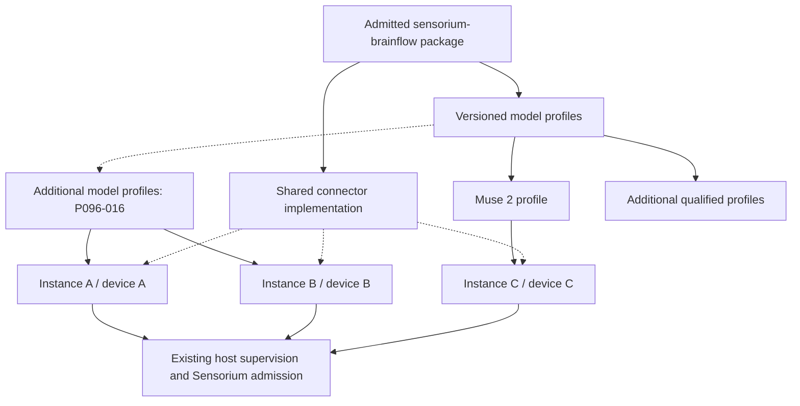

# Proposal 096: Sensorium BrainFlow Connector

Based on:
- `doc/project/10-challenges/091-predictable-operator-configuration.md`
- `doc/normative/90-supplementary/en/ONTOLOGICAL-BASIS.en.md`
- `doc/normative/30-core-values/en/CORE-VALUES.en.md`
- `doc/normative/20-vision/en/VISION.en.md`
- `doc/normative/40-constitution/en/CONSTITUTION.en.md`
- `doc/project/40-proposals/045-sensorium-local-enaction-stratum.md`
- `doc/project/40-proposals/048-sensorium-os-connector-action-classes.md`
- `doc/project/40-proposals/047-classification-label-propagation.md`
- `doc/project/40-proposals/051-swarm-membership-and-reputation-bootstrap.md`
- `doc/project/40-proposals/071-sensorium-workbench.md`
- `doc/project/40-proposals/080-multiplexed-middleware-channel-executor.md`
- `doc/project/40-proposals/082-sensorium-interfaces.md`
- `doc/project/40-proposals/084-sensorium-web-observation-connector.md`
- `doc/project/40-proposals/091-file-backed-configuration-and-explainable-composition.md`

Implementation basis: `node:DEV-GUIDELINES.md`.

Challenge 091 supplies the configuration problem: model-oriented declarations
must have one explainable owner and consistent file, GUI and CLI behavior.
P045 supplies the Sensorium acquisition and consent problem.

## Status

**Proposed**, following the operator's design request on 2026-10-11. One shared
BrainFlow integration, declarative model profiles, and independently managed
device instances are the requested architectural direction. This proposal
defines the receiving-layer contract; it does not establish implementation or
hardware acceptance. The first-slice scope was narrowed by the operator on
2026-10-13 to one Muse 2 over native BLE. Implementation and measured acceptance
remain separate tracker claims.

Existing Sensorium and middleware mechanisms are antecedents. BrainFlow has
its own instance materializer; it does not use or extend the OS/Workbench
factory. Independent host creation/restoration is implemented under P096-003, and the
pinned catalogue/private selector confirmations under P096-004. Acquisition,
lifecycle mutations and delivery retain their separate tracker gates.
The schema names and configuration shapes below have draft contracts under
P096-002. Their registration and the operator registration API do not establish
Sensorium source readiness or runtime qualification. No release or hard-MVP
scope is enlarged here.

## Date

2026-10-11

## Executive Summary

Provide an optional `sensorium-brainflow` middleware package that reuses
BrainFlow's device acquisition engine. Ship versioned model profiles so an
operator chooses a recognizable device model, a particular physical device,
and named signals rather than BrainFlow board numbers or command strings.

A profile is data interpreted by the common connector implementation. A
BrainFlow-owned instance materializer creates independent configuration and
identity through the host's generic middleware contracts. An admitted activation
starts one supervised acquisition worker
for one bound device. Two devices of the same model use the same package and profile,
with independent grants, processes, sessions, buffers, stop controls, and
diagnostics. Other BrainFlow-supported models follow the same contract after
their profiles and deployment combinations are qualified.

Acquisition, observation admission, local consumption, recording, and remote
publication remain separate decisions. Default instances are disabled, raw
recording and remote publication are off, and read/status requests do not start
the device. Use Sensorium's existing policy boundary and interface carriers.

## Context and Problem Statement

BrainFlow already supplies device drivers, transport handling, decoded sample
matrices, buffers, board metadata, and a uniform session API. Reimplementing
those mechanisms inside individual Muse adapters would create unnecessary
maintenance and make every additional device a new integration project.
Exposing BrainFlow's raw configuration directly would instead transfer that
complexity to operators and would conceal differences in signal modes,
identity selectors, native dependencies, and side effects.

The intended operator sequence is: **add device, choose model, bind a specific
device, choose signals, create a disabled instance, review its scope, enable**.
An optional discovery step helps resolve the device binding; it is not a
precondition for manually configuring a supported selector.

### Upstream meaning and receiving-layer decisions

| Upstream layer | Meaning preserved here | What this proposal newly determines |
| --- | --- | --- |
| [Ontological Basis](../../normative/90-supplementary/en/ONTOLOGICAL-BASIS.en.md) | Measurements and derived interpretations remain distinguishable; an abstraction does not establish a person's state by itself | Preserve raw/derived provenance, processing recipe, clock semantics, and uncertainty. The Basis is explanatory and grants no authority |
| [Core Values](../../normative/30-core-values/en/CORE-VALUES.en.md) and [Vision](../../normative/20-vision/en/VISION.en.md) | Human agency, local usefulness, data sovereignty, minimal disclosure, and Sensorium as voluntary contact with the world | Device-oriented configuration, explicit stop, local processing, and open export shapes |
| [Constitution](../../normative/40-constitution/en/CONSTITUTION.en.md), Articles III and IV | Control of one's data, revocable opt-in telemetry, layered audit, and Sensorium's grounding role | Separate measured-person consent from host administration and downstream disclosure; no new exception to constitutional authority |
| P045, P048, P071, P080, P082, P084, P091 | Host-owned module lifecycle, mediated contact, current grants, bounded observations, immutable source generations, explainable configuration | A BrainFlow model-profile contract, device binding, independent acquisition sessions, and independent instance materialization |
| Future schemas and Node implementation | Exact, inspectable contracts and repository-local evidence | Register proposed shapes, implement refusal/recovery paths, and qualify real devices before promoting support |

EEG features are observations with an interpretation recipe. This proposal does
not equate a band-power value with attention, calmness, a diagnosis, or consent.
Device ownership also does not identify the person currently wearing it.

### Inspected reuse baseline

The following is a source/documentation inspection on 2026-10-11, not a new
runtime test:

| Existing mechanism | Reuse | Boundary or missing work |
| --- | --- | --- |
| [P045 connector model](045-sensorium-local-enaction-stratum.md) | Ordinary middleware modules with distinct module/connector identities; Sensorium Core mediates observations and directives | No second Sensorium plugin loader or nested connector supervisor |
| Sensorium OS configuration and signed artifacts | Host-owned effective configuration, readiness checks, explicit operator authority | OS executes bounded commands; a continuous acquisition session belongs in its own supervised connector |
| [Workbench](071-sensorium-workbench.md) | Bounded sessions, cancellation, host-owned consent, visible state, source and effect separation | `sensorium-workbench-instance.v1` is a per-run microVM allocation contract, not a durable device-instance contract |
| [Middleware](../60-solutions/019-middleware/019-middleware.md) and P080 | Shared `channel_json` transport, per-launch authentication, supervision, component controls, package/runtime-home separation | Existing bundled factory projects one service per `config_key`; this is inspection evidence, not the BrainFlow integration point. Its independent materializer and generic instance inventory are P096 work |
| P082 and [Sensorium Interfaces](../60-solutions/046-sensorium-interfaces/046-sensorium-interfaces.md) | Open bounded source adapter registry, current grants, generation fencing, local/peer pull-batch | BrainFlow source adapters do not yet exist; Room supports latest state, not ordered sample history |
| P084 source projections | Read already acquired, admitted data; preserve source generations and independent acquisition authority | A subscription must not become a hidden acquisition command |
| P091 configuration | Owner-validated declarations and distinct declared/resolved/active/observed views | Adopt available scoped machinery; do not assume its entire proposed lifecycle is implemented |

Concrete Node antecedents: `node:middleware-modules/sensorium-os/README.md`,
`node:middleware-modules/sensorium-os/config/00-sensorium-os.json`,
`node:middleware-modules/sensorium-workbench/service.py`,
`node:middleware-runtime/src/channel_config.rs`,
`node:daemon/src/identity_store.rs` (`project_runtime_middleware_services`),
`node:daemon/src/middleware_settings.rs`, and
`node:daemon/src/control_ops.rs`.
The OS and Workbench scripts currently use singleton module constants; copying
those constants would defeat the proposed per-device identity model. Their
factory and settings flows are reference examples, not dependencies of
BrainFlow instance creation.

## Proposed Model / Decisions

### 1. One package, model profiles, independent instances



This is a composition of data and runtime bindings. There is no parent
BrainFlow connector process supervising model-specific child plugins. A
BrainFlow-owned host-side materializer creates ordinary, independently
addressable middleware components from one reusable package. It uses generic
host registration and lifecycle contracts, independently of OS/Workbench
instance construction. Model-specific code is justified only where a reviewed
behavior cannot be expressed by the common interpreter and a bounded profile.

The first implementation uses one process per device instance. This isolates
native crashes and permits enforced shutdown of a blocked native call. Process
overhead is accepted initially. Shared-process optimization is a later measured
decision and must preserve the same authority, isolation, and lifecycle contract.

### 2. Keep identity axes explicit

| Identity | Lifetime and meaning |
| --- | --- |
| Package id/revision/digest | Installed executable material and admitted profile catalogue; a package signature proves package admission, not acquisition consent |
| Profile id/revision/digest | Immutable model/transport/signal interpretation definition; a semantic version is separate display/release metadata; many instances may reference it |
| Instance id and host module/component ids | Durable local configuration and independent administrative scope; stable across process restarts |
| Device binding id/revision | Host-private resolution of one physical acquisition endpoint; independent of its display label and of the wearer |
| Subject binding | Explicit, consent-governed association with a measured person or session; may be absent, never inferred from a serial/name |
| Supervisor launch id | A particular authenticated worker launch, owned by the existing supervisor |
| Acquisition session id/epoch | A successful or attempted native session; reconnect creates a new epoch |
| Source id/generation and interface publication id | Meaning and audience of an admitted projection; immutable replacement follows P082 |

Serials, advertised names, transport addresses, and OS-local device identifiers
are selector evidence, not cryptographic identity. Do not derive instance ids,
grants, or public source labels from a physical serial or a human's name.
Changing the device or profile creates an explicit binding/configuration
revision and a new source generation; it must not silently reassign an existing
stream or preserve stale grants.

All **new P096 revisioned references** use `{id, revision, digest?}`: `id` is
stable, `revision` is a positive JSON-safe integer, and `digest`, when present,
binds that exact revision. Package and profile admission requires a digest.
Never encode a revision into `id`. Existing P082 source-generation, Passport or
artifact reference contracts retain their own wire shapes at integration seams;
this proposal does not migrate them. Labels are separate, private presentation
fields and cannot become identifiers or authority.

### 3. Versioned model profiles and operator templates

A model profile declares:

- its stable id, numeric revision, semantic version, digest, display name and descriptions;
- the compatible BrainFlow binding/native builds and symbolic board id;
- one model/transport pair, supported OS/CPU combinations and retained qualification;
- a bounded connection-selector schema and optional discovery-provider contract;
- named acquisition modes and the exact allowlisted backend configuration;
- the signals each mode necessarily acquires, exposes, or discards, including
  unavoidable incidental acquisition;
- stream metadata expectations: preset, channel roles, units, nominal rates,
  timestamp/package-counter semantics, and validation rules;
- limits, cleanup/reconnect policy constraints, and required host/device access;
- a versioned form schema with user-facing labels, choices, explanations and
  defaults, without arbitrary executable form logic.

The template selects a profile and supplies defaults. The instantiated
configuration records the exact profile revision/digest and operator choices.
Updating a catalogue does not silently migrate running instances. A profile
change is reviewed, validated, and applied through the instance owner.

Three concepts MUST retain separate names: **Sensorium model profile**,
**device acquisition mode** (for Muse, a command such as `p21`), and **BrainFlow
buffer preset** (`DEFAULT_PRESET`, `AUXILIARY_PRESET`, `ANCILLARY_PRESET`).
The operator sees signals and named modes, not those backend identifiers.

Use separate profiles per **(model, transport)**. For example, `muse-s.ble`
selects `MUSE_S_BOARD`, while `muse-s.bled112` selects `MUSE_S_BLED_BOARD`.
The latter has its own serial/dongle permissions, selectors, dependencies and
qualification; it is not a fallback hidden inside the BLE profile. The same
separation applies to Muse 2. A user-facing model group may list both choices.
Changing transport changes the pinned profile and requires re-admission.

Illustrative profile fragment; omitted common metadata is not a complete schema:

```json
{
  "schema": "sensorium-brainflow-model-profile.v1",
  "schema/v": 1,
  "profile/id": "muse-2.ble",
  "profile/revision": 1,
  "profile/version": "1.0.0",
  "display/name": "Muse 2",
  "model/id": "muse-2",
  "transport/kind": "ble",
  "brainflow/board": "MUSE_2_BOARD",
  "connection/selector-kinds": ["advertised-name"],
  "acquisition/modes": {
    "eeg-and-motion": {
      "brainflow/startup-command": "p21",
      "signals/acquired": ["eeg", "accelerometer", "gyroscope"]
    },
    "eeg-motion-and-ppg": {
      "brainflow/startup-command": "p51",
      "signals/acquired": ["eeg", "accelerometer", "gyroscope", "ppg"]
    }
  }
}
```

This fragment is a candidate to verify against the pinned build in P096-001,
including incidentally acquired signals and actual active matrix rows. The
first slice uses `p21` by default and separately consented `p51`; neither mode
promises heart-rate inference or electrode-contact quality.
Muse S Athena has a separate BrainFlow board definition and must have its own
profile; marketing-family similarity is not evidence of equivalent channels.
The generic profile namespace stays open to other boards and signal types.
There is no closed Muse-only registry in Sensorium Core.

### 4. Instance declarations and private device bindings

An illustrative operator-facing intent fragment (the resolved host input also
contains host-owned module/component/home/auth-slot bindings):

```json
{
  "schema": "sensorium-brainflow-instance.v1",
  "schema/v": 1,
  "instance/id": "ins_8d764901f3764c6cb5e740d2e3a18059",
  "instance/label": "Studio headband",
  "instance/revision": 1,
  "profile/ref": {
    "id": "muse-2.ble",
    "revision": 1,
    "digest": "sha256:1111111111111111111111111111111111111111111111111111111111111111"
  },
  "device/binding-ref": {"id": "bnd_0ff3d1a581f746d9a96af576e1a737c4", "revision": 1},
  "acquisition/mode": "eeg-and-motion",
  "signals/requested": ["eeg", "accelerometer", "gyroscope"],
  "activation/desired": "disabled",
  "restart/policy": "manual",
  "recording/mode": "off",
  "publication/mode": "local-only"
}
```

The fixture digest above is illustrative, not a known package digest. The host
checks the admitted profile's real canonical digest and derives the effective
backend input; the caller cannot override it through hidden extra fields.
Instance declarations contain references to host-owned authority, never bearer
tokens or a self-asserted `consent: true` flag.

A private binding can contain a selector such as:

```json
{
  "schema": "sensorium-brainflow-device-binding.v1",
  "schema/v": 1,
  "binding/id": "bnd_0ff3d1a581f746d9a96af576e1a737c4",
  "binding/revision": 1,
  "device/local-ref": {"id": "dev_d308a9460875451292c4c48a2c226307", "revision": 1},
  "transport/kind": "ble",
  "selector": {"kind": "advertised-name", "value": "Muse-ABCD"},
  "identity/assurance": "operator-confirmed-selector"
}
```

The instance's module id, component id, runtime home and configuration scope
are generated once by the host and retained as explicit bindings. They are
not independently editable aliases that could target another module.
Cloning configuration allocates new instance/module identities and requires
an explicit device binding; it does not copy an active session, grants or leases.

For Muse, BrainFlow's `serial_number` parameter denotes a device name. The
adapter maps `advertised-name` to that backend field without presenting it as
a verified factory serial. An optional serial recorded by the operator remains
separate evidence. Do not pass multiple selectors and assume the backend
conjoins them: its precedence rules must be reflected in the profile.

Activation requires a resolvable, sufficiently specific binding. An empty
selector, conflicting evidence, or multiple matching devices returns a typed
refusal; it must not fall back to the first discovered device. A name-based
binding cannot promise authenticated physical identity. If the selected
transport cannot distinguish candidates reliably, require re-binding or report
unsupported selection rather than claiming unique identity.

BrainFlow does not provide a documented universal device-enumeration API.
Discovery is optional, explicitly invoked, time/result-bounded work, using a
qualified transport provider. Listing profiles and viewing status do not scan.
`prepare_session` is resource acquisition, not a harmless discovery substitute.

#### Local device discovery provider

[P045's local device discovery continuation](045-sensorium-local-enaction-stratum.md#local-device-discovery-continuation)
owns the common request/candidate/result semantics and action routing.
P096-017 adds the first independently registered BLE provider behind
`sensorium.directive.invoke` / `device.discover.ble`; it is not a scan method
on a running BrainFlow acquisition instance. Reuse generic middleware plans,
package admission, the supervisor and bounded S029 invocation lifecycle.
BrainFlow's lack of universal enumeration is not permission to use
`prepare_session` for discovery. Choose/qualify a transport backend separately
and retain its license/effect inventory.

The caller selects an ephemeral operation/caller/scope-bound `candidate/ref`,
then separately approves a host-owned `binding/ref`. Selection during a scan
does not commit a binding: wait for confirmed discovery-session cleanup,
revalidate authority/evidence and atomically create the binding/consume the
candidate. Exact approved retry returns that same binding; another request,
caller, expired candidate, restarted operation or changed authority cannot
allocate another. Stable binding identity does not override its current expiry
or acquisition-consent rules. Advertised name, transport address and verified
serial remain evidence kinds with methods/provenance, not trust ranks.

Reuse P096-005 alias-aware device claims and fenced **transport/controller**
claims for atomic scan/acquisition conflicts in both directions. V1 denies
discovery during acquisition on the same controller; unknown shared-resource
state is not approval. Failed or uncertain cleanup fences candidate disclosure
and consumption and holds the claim. Cancellation stops only the provider's
own discovery session, with qualified backend/exit release evidence. Every
qualification records the actual launch/access context; retained iTerm lab
TCC observations do not qualify launchd discovery.

P096-017/018 require the complete typed private S029 progress path from
[P055-10/11](055-bounded-deferred-operation-contract.md#41-planned-local-device-discovery-progress).
Provider filtering and host revalidation disclose only profile-matching
candidates. Results default to sensitive-personal/Personal and never enter
observation history, artifacts, audit identifiers/derived-list digests or
federation. Discovery grants no acquisition, recording or P082 publication/
read authority. No profile, status read or UI visit starts a scan.

Manual selector confirmation from P096-004 remains usable independently of
this optional route. P096-009 may add discovery-assisted setup after 017/018;
its manual create/edit/control path has no discovery prerequisite. P096-015
continues to promote only its existing single-Muse-2 qualification scope;
discovery is promoted separately on exact P096-018 evidence. New discovery
contracts are **planned under P045**, outside the completed P096-002 inventory.
No completed 002/003/004 row is reopened. USB/serial and mDNS runtime providers
remain deferred even though P045 requires their contract fixtures.

Implementation checkpoint, 2026-10-14: Node provides current host-owned discovery
and acquisition enforcement with shared BLE claims, private progress, atomic
binding consumption and a dedicated wearer control listener. Native enrollment
delivers a private activation/withdrawal bearer before device effects; withdrawal
does not require continuing operator login. The byte-exact known native worker
may launch idle with no BrainFlow import or device open before a host-issued
permit. Full interpreter/distribution integrity is checked before spawn and
again before effects; live checks retain current package, declaration, grant,
binding and registered-pin equality without repeated full runtime hashing.
This detects drift at those boundaries and does not attest byte immutability
throughout an already running process. Device-free proofs and terminal lab
observations do not close 005, 006b, 017 or 018. The failed supervised scan has
uncertain cleanup and requires separately recorded laboratory recovery and new
consent before another attempt. Launchd and approved binding use remain unqualified.

Implementation checkpoint, 2026-10-15: Node adds a supported **private
acceptance-root**, sole-owner, pre-binding controller-recovery corridor. Current
normal identity owns cleanup custody separately from activation and old runtime
availability. An actual kernel boot-session baseline and a separately approved
changed-boot observation bound exact metadata reconciliation; a global durable
fence precedes disposal, original expiry/history and sibling resources remain,
and known consumed interruptions require explicit exact resume. A detached fact
permits only inert history restoration. Host execution-epoch reset is not native
stop acknowledgement, radio quiescence or production recovery qualification.
Normal-key temporary-root and owned-process interruption evidence does not close
P096-005/009/011a/017/018. Actual nearby recovery and device tests remain
unperformed. See Node's
[recovery contract](https://github.com/diapod/node/blob/master/daemon/docs/SENSORIUM-CONTROLLER-RECOVERY.md)
and
[software review](https://github.com/diapod/node/blob/master/docs/audits/REVIEW-SENSORIUM-CONTROLLER-RECOVERY-2026-10-15.md).

The same software checkpoint gives the changed known discovery worker a distinct
fixed verified-image package identity. Its exact stopped logical revision-2-to-3
transition preserves both earlier signed generations and checks all historical
consumption slots. The frozen nearby client separates recovery decisions from
fresh SCAN/BIND/REGISTER/WEAR; neither preparation nor metadata completion grants
native authority. These remain implementation mechanisms below the unchanged
P096 qualification requirements.

Nearby preparation checkpoint, 2026-10-15: the clean Node candidate binds 4702
source files and passes no-effects process/boot preflights. The normal owner
signed the distinct verified-image package; independent 13-file and Ed25519
checks pass on both hosts. The exact stopped transition installed logical
revision 3 while preserving original expiry, both older migration facts,
quarantine and Case/deferred history. The frozen nearby console and 20 client
checks are staged and verified. No real recovery baseline, host restart,
recovery commit, Case or device acquisition occurred. The next physical corridor
requires fresh separate baseline/restart/recovery and SCAN/BIND/REGISTER/WEAR
decisions; host-epoch reset remains distinct from native/radio qualification.
P096-005/009/011a/017/018 stay partial or open as tracked. See the
[retained preparation review](https://github.com/diapod/node/blob/master/docs/audits/REVIEW-SENSORIUM-VERIFIED-IMAGE-PREPARATION-2026-10-15.md).

Subsequent restart observation, 2026-10-15: the operator prepared a real baseline
and restarted the nearby host. Read-only inspection confirmed changed kernel
boot-session and unchanged quarantine/policy/history; no recovery or hardware
operation was performed. The restart exposed a false implementation assumption:
boot-local device numbers are not persistent root custody. The private corridor
now requires observed persistent volume UUID plus inode for cross-restart
custody, while live descriptor/path checks retain device/inode guards. Existing
version-1 baselines are historical evidence only: a fresh explicit owner review
may preserve and re-confirm one after the already performed restart, without
pretending it recorded a volume UUID retrospectively. Exact normal identity,
source and sole-controller custody checks remain mandatory. Separate recovery
approval has a **two-hour window from the actual restart**, measured by the
continuous kernel clock including sleep. Preparing another review or adjusting
wall time cannot renew that window. Original grants/expiry/history remain, and
no native authority follows from preparation. This correction does not close
P096-005/009/011a/017/018; see Node's
[restart-custody review](https://github.com/diapod/node/blob/master/docs/audits/REVIEW-SENSORIUM-RESTART-CUSTODY-2026-10-15.md).

Subsequent operator-approved checkpoint, 2026-10-15: the normal owner locally
re-confirmed the retained baseline and separately approved exact RECOVER.
Independent read-only inspection confirms the reviewed v2 custody/generation,
unchanged expiry and original uncertain history, disposal of only the old BLE
discovery row, preserved other resource state and removal of held/global fences.
Finite discovery grants remain valid without renewal. This measures the narrow
private pre-binding metadata corridor only; native stop/reset, radio exclusivity,
production recovery and fresh acquisition remain separate gates. The next Case
requires new SCAN/BIND/REGISTER/WEAR; no p21 registration or hardware effect is
implied by recovery. P096-005/009/011a/017/018 stay partial or open. See the
[completion checkpoint](https://github.com/diapod/node/blob/master/docs/audits/REVIEW-SENSORIUM-RESTART-CUSTODY-2026-10-15.md#operator-approved-recovery-checkpoint).

### 5. Independent instance materialization and host ownership

Reuse installed package material separately from per-instance runtime homes:

```text
middleware-packages/<package-id>/    admitted code and model profiles
middleware/<module-id>/config/      declared file source for one instance
middleware/<module-id>/data/        bounded instance-owned operational data
middleware_channel_services        derived ordinary host executor bindings
```

The declared files are the single editable source of ordinary durable intent,
following P091. The host journal records admitted source revisions and resolved
snapshots, not a second editable copy of settings. Freeze the ownership mapping:

| P091 view | Owner and meaning |
| --- | --- |
| `declared` | Exact bounded file bytes and digest, with validation/admission status; GUI and CLI target the same source |
| `admitted/resolved` | Host journal binds retained source bytes, expected revision, package/profile digests, constraints and immutable resolution; admission does not mean activation |
| `active` | Host application record plus owning component acknowledgement for that resolution and activation generation |
| `observed` | Actual process, acquisition and stream health with freshness; never inferred from a save |

Host-issued identity/credential-slot allocations and consent facts are separate
authority records, not ordinary editable settings. The resolved declaration
joins those explicit bindings to the declared source for pure plan construction.

An out-of-band edit becomes an **unadmitted candidate**, never an automatic
activation. An explicit authenticated import/apply operation snapshots bounded
bytes, validates them and performs CAS against the admitted source revision and
digest. A valid current candidate creates a new revision; a stale, invalid or
unauthorized one returns `source-conflict`, `invalid-source` or `denied` with
redacted diagnostics. Keep the previous admitted/active revision and expose the
divergence; never silently overwrite the external edit or start acquisition from
it. Writes, journal commit and recovery use P091's ordered protocol and retained
bytes; a crash cannot admit whatever file happens to exist on restart. A file
edit is not a stop mechanism: the protected stop surface below remains available.
Executor entries, catalogue cards and component snapshots are projections of
admitted intent. Creation and reconciliation are idempotent; no separately
editable BrainFlow process registry exists.

Implement a dedicated BrainFlow instance materializer in the host integration
layer. Its pure function is `declaration + admitted package -> instance plan`.
The declaration already carries host-allocated opaque identities and explicit
input bindings; the package input includes its pinned profile closure. The
function performs no I/O, allocation, discovery or authorization. It produces
an adapter-neutral `middleware-instance-plan.v1` for host admission/registration:
unique executor, module/component, home,
dependency and channel-authentication bindings. The host commits the plan and
owns its effects. Neither creation nor recovery calls the OS/Workbench factory,
uses their singleton configuration keys, or requires either adapter to be
installed. Reject duplicate ids and conflicting explicit/materialized executor
declarations before launch. Verify the module report against the host-bound
instance identity. Extend the generic settings inventory to present these
independent instances.

The plan describes one instance's registration intent, not a replacement for
the full `middleware_channel_services` map or host runtime snapshot. Only the
generic host owner merges and atomically applies the complete snapshot under
its lifecycle/configuration concurrency boundary. The full lifecycle contract
requires creation, update and deletion of A to preserve B and unrelated
components. P096-003 closes creation, exact replay and stopped restoration only;
P096-009 owns supported update/delete, explicit source/activation generations,
old-grant invalidation, home/auth retention or replacement and tests preserving B.
Maintenance import/apply acknowledges externally edited bytes but is not a
qualified update/delete workflow and establishes no migration semantics. Add a narrow
generic registration seam if it is missing; do not route around host ownership.

#### Frozen generic host entry contract

[middleware-instance-plan.v1](../../schemas/middleware-instance-plan.v1.schema.json)
is owned by middleware, not BrainFlow. Its V1 fields and boundaries are fixed
here before the first consumer; P096-002 must register and validate them rather
than invent a BrainFlow-specific host ingress. The plan contains:

| Field | Meaning |
| --- | --- |
| `instance/ref`, `declaration/ref`, `package/ref` | Revisioned identity, exact source and admitted package; content digests bind source/package material |
| `executor` | Host-allocated id, `channel_json` kind, package-relative entrypoint and bounded arguments; no caller-selected executable outside the package |
| `module/id`, `component/id` | Explicit host-bound identities, validated for uniqueness and ownership |
| `home/binding` | Opaque host allocation binding; the host resolves config/data locations, never arbitrary caller paths |
| `channel-auth/binding` | Host credential-slot binding with per-launch issuance; never a token in a plan or journal |
| `dependencies` | Exact component references, readiness requirement and stop/degrade policy; no model-specific vocabulary |

Host admission verifies the plan against its declaration/package, current
authority, allocated identities, entrypoint, limits and dependency DAG, then
commits it through the existing host lifecycle boundary. The plan grants no
authority and contains neither BrainFlow board ids nor device selectors. Host
credentials are minted only at launch. No adapter writes the global snapshot.

If implementation evidence identifies common mechanics, a small **abstract
instance factory** may be extracted for reuse by similar adapters. This optional
extraction concerns plan construction only: the receiving host contract above
is generic from day one. Generic host operations own commit, reconciliation and cleanup.
Keep model profiles, device binding, BrainFlow parameters and consent decisions
in their respective owners. This optional shared mechanism must not depend on
OS or Workbench, introduce a parallel registry/supervisor, require their
migration, or become a prerequisite for delivering BrainFlow. Prefer composition
of small functions and contracts over an adapter inheritance hierarchy.

Reuse the existing component start/stop/restart controls and supervision graph.
An operator stop remains authoritative even when durable desired activation is
enabled. File/GUI/CLI changes must share owner validation and current authority;
editing a declaration does not grant permission or prove successful application.
P091's declared/resolved/active/observed distinction applies here, but P096 must
identify exactly which existing P091 surfaces it consumes before exposure.

### 6. Lifecycle: declaration, process, acquisition and source

Keep durable desired activation (`disabled | enabled`) separate from the host
process phase and the observed acquisition phase. The latter is:
`idle | preparing | streaming | reconnecting | stopping | cleanup-uncertain | blocked | failed`.
Expose the reason, retryability, session epoch, required-stream freshness, and
last successful transition. A ready middleware channel is not healthy EEG.
`idle`, `blocked` and `failed` imply proven disposal of acquisition resources;
if proof is missing, the phase is `cleanup-uncertain` with the pending terminal
outcome recorded separately. Any transition not listed/admitted is refused.

Each preset independently reports `unknown | fresh | stale | missing | invalid`
health and whether it is required. Aggregate health may be `healthy | degraded |
unavailable`; `degraded` is not an acquisition phase. Optional PPG loss can leave
EEG streaming with degraded health. Missing/invalid required streams prevent
readiness or trigger bounded recovery/stop; a mode change that makes PPG
optional requires a new admitted revision, not silent downgrade.

| Trigger / current condition | Required admission | Result and owned effects |
| --- | --- | --- |
| Create | Current instance-management authority; admitted profile and valid configuration | Persist disabled intent; no scan, device open, native session, recording or publication |
| Set desired activation to enabled | Current instance-management authority and CAS revision | Persist launch eligibility; preserve any explicit operator-stop fence; no acquisition merely from editing the setting |
| Explicit Start/Resume, or admitted automatic resume | Enabled intent, current administration and acquisition scope, measured-person consent where applicable, OS permission, valid binding, available budgets, device claim and active visibility/stop surface | Record admitted activation and launch through host supervisor; only explicit Start/Resume may clear operator-stop; begin `preparing` after all effect gates |
| Prepare succeeds | Same current scope, binding revision and launch fence | Call bounded `start_stream`; remain `preparing` until first valid data for every required preset arrives before its deadline |
| Required data valid and fresh | Metadata/mode match; current session and grant | Enter `streaming`; normalize bounded batches and submit authorized candidates |
| Disconnect, stall or retryable transport failure | Reconnect allowed by the still-current acquisition grant and host policy | End old epoch, emit explicit discontinuity, clean old native session; enter bounded `reconnecting`, then revalidate before a new prepare |
| Invalid metadata, ambiguous binding, unavailable consent/authority, or terminal backend error | No bypass | Stop data admission, clean resources; enter `blocked` or `failed` with typed reason; automatic retries cannot repair authority |
| Disable, consent withdrawal or grant expiry/revocation | Authorized stop, or host enforcement of lost authority | Fence outputs first; enter `stopping`; stop/release native session; terminate a stuck worker within host deadline; return to `idle` only with cleanup proof |
| Edit device/profile/mode/subject/meaning-bearing configuration | Current manage authority and CAS revision; renewed scope as required | Stop affected acquisition, invalidate old source/publication generation, record new declaration; explicit re-admission before activation |
| Delete instance | Current manage authority; stopped worker and released claim | Tombstone intent, remove derived executor/view, apply retention policy; do not silently delete retained evidence or undo remote disclosures |
| Host/worker restart | Recovered declaration, current package/profile admission and authority | New launch, acquisition epoch and source generation; invalidate old publications/cursors. Default manual restart; automatic resume is an explicit opt-in scope and never restores an operator-stopped or revoked instance |
| Cleanup cannot be proven within the stop deadline | Output fence remains closed; claim retained | Enter `cleanup-uncertain`; refuse prepare, reassign, delete and automatic resume until supervisor/recovery proves disposal |
| `cleanup-uncertain`, cleanup later proven | Current fenced owner and supervisor evidence | Release claim, then enter `idle`, `blocked` or `failed` according to the recorded pending outcome; no direct transition to `preparing` |
| `blocked`, prerequisite restored | Explicit re-admission of corrected binding/authority/configuration and all activation gates | Move to `idle`, then an admitted Start may enter `preparing`; Disable/Delete allowed only with proven cleanup; no retry loop to repair authority |
| `failed`, diagnosed or reset | Explicit reset/reconfiguration with current manage authority and proven cleanup | Move to `idle`; renewed activation is separate. Otherwise remain failed; Disable/Delete remains available after cleanup |

Repeated operations with the same instance-scoped idempotency key and input
digest return the same decision; a conflicting reuse is refused. Reads are
side-effect-free. Lifecycle reconciliation has a bounded host trigger, not a
hidden effect of opening a status page.

The device UI may offer one explicit "Enable acquisition" action that composes
an admitted configuration change with Start. Its receipt distinguishes saved
intent from actual acquisition readiness. A minimal ongoing acquisition
indicator and an independently serviced stop control are prerequisites for
real device access; the richer P096-009 forms may be delivered later.

BrainFlow's native sequence is `prepare_session -> start_stream -> stop_stream
-> release_session`. Stopping a stream does not release all session resources.
Cleanup must cover partial preparation and failed start as well as normal stop.
Do not substitute raw vendor start/stop commands or process-wide
`release_all_sessions` for instance-specific lifecycle.

#### Protected wearer stop and withdrawal

Before real acquisition the host establishes a wearer-facing session-control
surface: an authenticated participant/wearer control view backed by host consent
operations, or an equivalently scoped local control established during consent
when no participant account is used. It exposes only this wearer's active
measurement, Stop and Withdraw Consent, with a receipt. The binding to the
measurement is explicit and survives operator UI logout. It does not grant
device management or sample-reading authority. The access path cannot depend
on the operator's session, a Room, notifications, reputation, or the acquisition
grant it must be able to revoke. Do not permit real activation before this path
and the active indicator have been demonstrated to the wearer.

Apply P051's protected-access pattern, without importing its case semantics:
reserve bounded control admission slots, execution capacity and response budget
per active measurement independently of data, normal management and ordinary
participant quotas. Stop is idempotent and coalesces duplicates; it must not
wait behind sample reads, serialization, inference or a native call. The host
marks consent withdrawn and closes the output fence through that reserved path;
durable audit failure must not defer stopping and is recovered explicitly.
Before opening a real device, the host durably records an acquisition-start
marker. Only durable stop/consent state plus verified disposal can close it.
An unclosed marker after host restart prohibits automatic resume until cleanup
and current wearer authority are re-established; an in-memory withdrawal lost
during an audit outage must not resurrect an old automatic-resume grant.
Operator logout, stalled UI/SSE and a saturated data queue are required tests.
If the protected surface becomes unavailable, the host stops real acquisition
within its declared bound instead of allowing indefinite collection. This
protects against ordinary access restrictions/overload, not a hostile host owner
who controls the operating system; device removal remains under wearer control.

#### Host-enforced stop contract

Every stop, withdrawal, expiry and enforcement stop follows this host-owned
sequence, including partial prepare and blocked native I/O:

1. Close the instance output/admission fence and prevent reconnect; record the
   stop/withdrawal intent. In-flight old-epoch batches cannot be published.
2. Send an instance-scoped cooperative stop/release request with a monotonic
   deadline. The worker may acknowledge progress, but its acknowledgement is
   not process-exit or cleanup proof.
3. The existing supervisor terminates the worker by the enforced deadline,
   escalating to forced termination if needed. No worker cooperation is
   required for this step; cleanup covers descendants/resources in its scope.
4. Verify exit of the exact launch (not only its reusable PID) and disposal of
   its transport/resource handles. Unknown disposal means `cleanup-uncertain`.
5. Only after that proof release the fenced claim and report the terminal
   acquisition outcome. A receipt distinguishes `requested`, `fenced`,
   `cleanup-pending`, `cleanup-uncertain` and `completed`.

The stop endpoint and supervisor termination path have a reserved control lane
and never share a queue or a potentially blocking mutex with the data path.
Use an atomic fence or a short bounded control-only critical section; no native
call, matrix copy or delivery occurs while holding it. A stop receipt is not a
promise to erase previously disclosed data. P096-002 fixes admission, fence,
cooperative-stop and termination deadlines; P096-005 proves their enforcement
under saturation and a non-cooperative worker before BLE exposure.

### 7. Device claims and authority

BrainFlow's duplicate-session check uses board id plus backend input parameters
inside one process. Different configurations or separate workers can still
address the same physical endpoint. Before preparation the host acquires an
exclusive claim on the canonical local device binding, resolving known aliases
independently of instance id and serialized BrainFlow parameters.

The claim binds device, instance, launch and acquisition epoch, with a fenced
owner and bounded renewal. Expiry or an unresponsive owner triggers cleanup;
it does not immediately authorize a competing open. A claim is reassigned only
after confirmed cleanup/worker termination. Unknown cleanup leaves the device
blocked for diagnosis. This is host-local coordination, not a promise to
exclude other applications or another computer. Different devices still share
the radio controller; concurrency requires platform evidence.

The host, admitted worker/native package and qualified transport implementation
form the acquisition trust boundary; device data and caller-supplied inputs are
validated at its edges. Process separation provides crash containment and a
kill boundary, not by itself an I/O sandbox. Host grants must be backed by the
actual platform access/containment mechanism declared for the transport.

Use host-owned authorization/consent records and authenticated module bindings.
Permission intents below are proposed scopes to freeze and register, not a new
connector-owned authority service:

| Decision | Scope and owner | Does not imply |
| --- | --- | --- |
| Install/admit package and profiles | Existing signed middleware package admission and trust | Any device access or measured-person consent |
| Inspect/create/change/delete instance | Host-local, exact administrative instance/configuration scope | Scanning or acquisition; a user shell receives only its authorized instances |
| Discover | Explicit local transport, duration, result-count and disclosure scope | Pairing, persistent tracking, or opening an arbitrary matching device |
| Acquire | Exact instance, binding revision, profile/mode, necessarily acquired signals, subject context, duration and restart policy | Arbitrary device commands, recording, feature inference or egress |
| Compute/expose a derived feature | Named versioned recipe, input scope, purpose and output classification | A clinical claim or additional undisclosed inference |
| Read admitted observations or local sample blocks | Existing Sensorium/P082 policy, exact source generation and consumer scope | Permission to start/refresh acquisition or persist raw samples |
| Retain/export raw capture | Explicit recording scope, destination, quota/TTL and recipient where applicable | Default persistence of every sample or unlimited historical access |
| Publish/read/subscribe remotely | Existing P082 publication management, exact source generation, grants, signed peer Passports, classification and current revocation | Acquisition control, local raw retention, or access obtained merely by Room membership |

Host administration and a person's consent are independently necessary when
the operator and wearer differ. Revoking either required acquisition authority
fences new output and stops collection. Local source/read and recording grants
are independently enforced; revoking a reader need not stop an otherwise
authorized acquisition. Loss of required authority providers is a lifecycle
transition, not permission to continue with stale cached decisions.

The effective scope includes any incidental signals a hardware mode acquires
even if only a subset is exposed. Refuse a request whose unavoidable acquisition
exceeds consent; discarding the extra samples afterwards does not authorize
their collection. The profile catalogue, form and confirmation expose this fact.

Unrestricted `config_board`, arbitrary `BrainFlowInputParams`, and free-form
streamer strings are not public operator or agent surfaces. Device configuration
comes from reviewed profile modes. `streamer_params` stays empty by default:
BrainFlow's direct file/multicast streamers would otherwise bypass retention
and disclosure admission. Future reuse of them requires an exact admitted sink
adapter. Multicast is not the Orbiplex inter-node authorization protocol.

#### Biosignal sensitivity is fixed at ingress

Classify real EEG, PPG, accelerometer and gyroscope signals, wearer-linked
features and captures as `health-wearable`
with the P045/S030 **`sensitive-personal`** baseline. Stamp
[`classification.v1`](../../schemas/classification.v1.schema.json) with immutable
`source_tier = Personal` and default `effective_tier = Personal`, the most
restrictive existing tier. Bind the actual consent subject through the existing
`bound_subjects` contract; absent identity is not public data. Private device
selectors and linkable session metadata receive the same baseline. These are
health-related physiological/biometric signals for this engineering policy;
this is not a claim that every use has the same statutory legal classification.

P082 frames retain this label. Any permitted lower-tier projection requires a
current P047 fact for `surface = interface` and the exact topic class; filtering,
aggregation, hashing a selector, changing a label, or consent to acquisition
does not by itself declassify data. Profiles cannot lower this baseline.
Synthetic data has explicit non-person provenance and its own admitted policy;
playback of real recordings retains the source restrictions.

The normative documents do not currently supply a biosignal-specific rule for
EEG/PPG inference, retention or secondary use. Record that refinement as an
upstream policy gap, without deferring today's classification or inventing a
fourth tier. P096-002 freezes the mapping above and carries the gap to the
normative owner; until resolved, it cannot justify broader use.

### 8. Data plane, clock semantics and bounded buffers

Reuse `BoardShim` metadata for supported presets, matrix row count, channel
indices and sampling rates. Validate it against the selected profile/build and
mode. Unknown optional signals remain absent with an explanation; missing
required streams or incompatible layout blocks readiness. Preserve units from
the qualified board contract; do not assume every row is EEG or every signal
is measured in microvolts.

Each BrainFlow preset is a distinct stream with its own rate, timestamps and
package numbering. Drain each with one owner through bounded
`get_board_data(n, preset)` calls and fan out admitted projections afterwards.
Independent consumers must not compete to drain the native queue.
`get_current_board_data` is a recent non-destructive view, not cursor-based
replay or proof of continuity.

The native ring buffer can overwrite old samples. Allocate explicit capacities
and preflight rows × samples × element size across every preset allocated by
the pinned backend, including inactive presets. The inspected native engine
uses one `buffer_size` argument for all descriptor presets; do not invent
independent native capacity knobs. Include temporary read copies and wrapper
allocations in headroom. Connector output caps can differ per stream. Bound
drain frequency, downstream bytes and retention.
Slow consumers cause a declared gap/drop policy rather than unbounded growth
or blocking the acquisition control path. A full queue is not proof of an exact
number of lost samples.

Use a backend-neutral sample-block payload with at least:

| Field group | Required semantics |
| --- | --- |
| Identity/provenance | Instance, device-binding revision, acquisition session/epoch, source generation, profile digest, backend binding/native version, device/firmware evidence when available |
| Stream descriptor | Stable stream id, signal kinds, ordered channel descriptors, units, effective nominal rate, layout and descriptor revision |
| Sample block | Typed little-endian binary buffer: `dtype`, `shape`, `layout`, `values/b64u`, separate `missing/b64u`; no JSON float array. An existing carrier may instead reference the admitted complete block artifact; inline/artifact alternatives remain exclusive |
| Timing | Per-sample source wall timestamps with origin/derivation; monotonic drain time and clock epoch, corresponding drain wall time, uncertainty or explicit unknown; transport receive time only when available. Source, drain and admission time remain distinct |
| Ordering | Connector-assigned session-local sequence/range, preserved backend package ids separately, continuity status and known/unknown loss quantity |
| Quality | Available contact/artifact/quality evidence with its source; `unknown` when unavailable, never a fabricated universal quality score |
| Interpretation | `raw` or exact processing recipe/version, calibration and window description; synthetic/replayed provenance explicit |
| Policy | Effective classification, admission/projection scope and retention/capture references as applicable |

#### Typed binary sample buffer and host digest

The sample payload has this fixed shape (illustrative two-channel, two-sample
buffer; index 1 is missing):

```json
{
  "dtype": "f32le",
  "shape": [2, 2],
  "layout": "channels-by-samples",
  "values/b64u": "AACAPwAAAAAAAABAAAAAAA",
  "missing/b64u": "Ag"
}
```

`dtype` is `f32le | f64le` (IEEE 754); default to `f64le` to preserve BrainFlow's
precision. A profile must admit any `f32le` conversion and error bound.
`shape = [channels, samples]` contains bounded positive integers; flatten as
`index = channel * samples + sample`. Both byte strings use canonical unpadded
base64url. Decoded values length is exactly `channels * samples * sizeof(dtype)`.
The mask is exactly `ceil(channels * samples / 8)` bytes, least-significant bit
first, with `1 = missing`, zero unused high bits, and all-zero positive-zero
value bytes for every missing entry. A zero without that bit is a measured zero.
Non-finite values must be mapped to explicit missingness with a typed quality
reason or rejected, never silently to a valid zero. Present values must be
finite; canonicalize negative zero to positive zero. Bound dimensions and
encoded/decoded sizes with checked arithmetic before allocation, decoding or
hashing. A cross-language golden fixture checks bits, mask and length failures.

Per-sample source timestamps use an independently named binary buffer with the
same encoding rules and `shape = [1, samples]`, `dtype = f64le`; its descriptor
names wall-clock Unix seconds and origin. No floating-point array or Python
`json.dumps` representation enters canonical identity.

When a block digest is requested, **the host computes it** after validation;
worker ingress must omit an authoritative digest. Freeze the preimage as
UTF-8 domain `orbiplex.sensorium.sample-block.v1` followed by a zero byte, then
seven individually length-prefixed segments: JCS canonical typed metadata,
decoded signal values and mask, decoded source-time values and mask, then
decoded package-number values and mask.
Each segment has an unsigned 64-bit big-endian byte-length prefix; the metadata
includes all three tensor descriptors (including their mask lengths),
instance/session/source bindings, clocks, sequence and interpretation, and
excludes digest and base64 strings. Metadata contains no floats: use bounded
integers, rational pairs or specified decimal strings. The digest is lowercase
`sha256:<hex>`. JCS canonicalization reuses the host canonical-JSON primitive;
the binary values are not reserialized as JSON. Golden vectors must agree in
Python and Rust. A content digest proves bytes, not hardware truth or authority.

Base64 adds roughly one third over binary size; savings over JSON floats depend
on dtype and numeric representation. Do not promise a fixed 3–4x reduction.

Muse's upstream backend expands several samples from one BLE packet and may
repeat package numbers; its timestamps are derived from host arrivals and
interpolation. A generic counter-per-sample gap detector would be wrong.
Preserve that timing provenance and qualify any profile-specific loss detector.
Every block additionally carries `clock/epoch`, `drain/monotonic-ns` as a
canonical unsigned decimal string, and `drain/wall-time` as UTC RFC 3339.
The epoch names one continuous monotonic clock domain and wall-time mapping;
start a new epoch on process/boot clock-domain change or detected wall-clock
step and emit a clock-discontinuity fact. Keep the raw source timestamps.
Use monotonic elapsed time and connector sequence for stalls/deadlines, never
wall-clock subtraction alone. Values from different clock epochs cannot be
subtracted or aligned without an explicit mapping. Suspend behavior and clock
resolution are qualified for the chosen clock API. An NTP jump alone is not
proof of missing or overlapping samples; detection uncertainty is explicit.
Cross-preset alignment is a separate versioned transformation with an explicit
resampling/uncertainty policy, not column-wise zipping.

### 9. Sensorium admission, projections and retention

Submit bounded, normalized observation candidates through the existing
Sensorium admission boundary. The first slice's observation windows contain
compact factual summaries such as sample count, stream timing and contact
quality, rather than raw sample arrays in the durable observation store.
Raw blocks remain in the bounded transient pipeline. The first slice includes
an explicitly enabled, authorized local sample projection through P082, so a
local consumer can receive actual signal values without enabling recording or
remote publication. Acquisition alone does not grant that consumer access.
Recording follows P096-013; named feature recipes follow P096-012. Avoid a
local Agora publication per raw sample.
Preserve source/ingestion times, sensitivity and provenance. Consumers depend
on signal contracts, not BrainFlow board ids.
Host/module diagnostics do not contain sample arrays, physical selectors,
subject identity or native debug dumps by default.

The first slice provides admitted local observation windows, per-instance
health, and a bounded local transient sample-read path. Reuse P082 source
bindings and local read admission; do not introduce a private bypass API.
Separate these projections:

- `latest-state`: newest admitted window summary, named feature, or bounded
  status with freshness; local reads in the first slice, optional peer/Room
  publication under P096-014;
- `ordered-events`: expressly enabled, bounded retained sample blocks with
  cursor, `gap` and `end`; local/direct-peer pull only under the current carrier
  contract. Local reads are required in P096-008/010; direct-peer publication
  is optional P096-014 work. The new source adapter retains only a bounded
  transient window and must not treat a latest-state observation store as full
  history or silently turn transient retention into durable capture.

Reads and subscriptions consume acquired data. They cannot activate a disabled
instance, invoke device configuration or widen capture. Profiles are an edge
catalogue; the P082 provider registry gets a generic BrainFlow source adapter,
not a central branch for each model.

Meaning-bearing changes, host/worker restart, or loss of the adapter's cursor
and retained-floor state supersede the source generation and require fresh
publication/grants under P082. Reconnect within the same surviving worker may
retain a source generation only when its admitted semantics, cursor state and
retained-floor contract survive; it still creates a new acquisition epoch and
explicit gap. A pending old-session callback must fail the session/generation
fence before admission. Unknown device continuity requires re-binding rather
than a silent reconnect. The first slice does not promise durable sample-buffer
recovery across worker restarts.

Raw samples are transient by default. Recording, when implemented, creates
explicit capture artifacts behind existing storage/admission and Artifact
Delivery contracts. Record quota, TTL, owner, active-capture key and cleanup
rules. Stopping recording finalizes or marks a partial artifact; revocation
prevents further writes/disclosure according to its scope. Deleting local
state does not undo an already admitted remote delivery. iCloud/phone gateways
are future transport adapters; they do not alter this authorization model.

### 10. Operator and user surfaces

Both surfaces consume the same host contracts and server-provided allowed
transitions. Present model, instance label, device binding, available signals,
necessarily acquired signals, requested activation, actual acquisition health,
recording/publication state and actionable refusal reasons. Technical BrainFlow
fields belong in restricted diagnostics, not routine device setup.

The operator may administer multiple devices; an authorized user sees only the
instances and consent decisions in their scope. UI forms never infer authority
from a profile, a detected device or component readiness. Stopping acquisition
must remain reachable while a data view is slow or the native call is stuck.
Show reconnecting, stale, blocked and cleanup-uncertain states explicitly.

The initial catalogue contains `synthetic` and `muse-2.ble` only. Muse S,
Athena and BLED112 profiles belong to P096-016, with their own hardware evidence.
Additional models are additive
profile work when the common interpreter suffices. Label availability with
separate axes: upstream-supported, profile-present, deployment-qualified and
currently-available. No single green badge may collapse all four.

## Implementation Recommendations

### Reuse map and ownership

Apply `node:DEV-GUIDELINES.md`, especially Layering, Data and Contracts,
Host-Owned Runtime Primitives, and review rules on authority, lifecycle,
bounded stores, recovery and dependency loss.

| Owner / existing mechanism | Recommended responsibility |
| --- | --- |
| BrainFlow host-side instance materializer | Validate instance declarations and construct independent instance plans through generic host contracts; no dependency on OS/Workbench factories; extract a small shared factory only when reuse is demonstrated |
| Generic host package admission, configuration and component runtime | Admit packages and instance plans; retain declared intent and admission/application facts; own registration/reconciliation, authority, device claims, credentials, dependency graph and enforced shutdown |
| Common `sensorium-brainflow` middleware implementation | Interpret admitted profile/config, call the existing BrainFlow binding, own one acquisition session and bounded queues, normalize data and report per-instance health |
| BrainFlow `BoardShim` / native BoardController | Device protocols, transport, decoding, native buffers, metadata and session operations |
| Optional BrainFlow `DataFilter` | Named/versioned processing recipes with explicit units, input window and output provenance |
| Optional `MLModel` | A later separately admitted inference feature; not a prerequisite or an implicit interpretation of acquisition data |
| Sensorium Core | Admission, normalization policy, sensitivity, bounded observation storage and consumer mediation |
| P082 runtime and generic source adapter | Publication, cursors, subscriptions, current read grants, generation fencing and carrier projection |
| Node UI / CLI | Device-oriented clients of the same host operations; no second domain state machine |

Prefer the existing **Python BrainFlow binding for the first supervised
connector**, matching the shared Python middleware/channel helpers used by OS
and Workbench. Keep host authority and lifecycle integration in their existing
Rust owners. BrainFlow also supplies a Rust binding; qualify that existing
binding if a later deployment benefits from an all-Rust worker. Do not write a
new FFI wrapper, BLE decoder, driver hierarchy or plugin framework merely to
connect the library.

Keep pure profile validation, selector resolution rules, metadata interpretation
and transition decisions separate from native calls. A small portable core is
appropriate if these rules need reuse across host/worker boundaries; do not
create empty L0/L1/L2 crates just to match names. Protocol semantics remain
independent of Python, Rust, macOS, NumPy and the chosen native artifact.

### Use BrainFlow's existing seams

1. Compile validated profile choices into `BoardIds` and
   `BrainFlowInputParams`; pin and record the resolved inputs privately.
2. Obtain static metadata through `get_board_descr`, `get_board_presets`,
   channel accessors, `get_num_rows` and `get_sampling_rate` as supported by
   the pinned binding. After preparation/configuration, use
   `get_board_sampling_rate(preset)` where available for the session rate and
   verify the effective stream layout. Where unavailable, require a qualified
   mode-specific rate contract; a nominal static value is not observed evidence.
3. After host admission and device claim, construct one `BoardShim`, prepare,
   configure only the approved mode at its supported lifecycle point, and start
   with an explicit bounded buffer and no unmanaged streamer.
4. Drain each preset once into bounded blocks. Branch to allowed observation,
   processing and capture sinks after current authority and epoch checks.
5. Stop and release that session on every exit path. If a native call prevents
   timely cleanup, the host supervisor terminates that worker and verifies exit
   before releasing its device claim.

Binding and native artifacts are pinned together. Package qualification records
OS, CPU, library loading, Bluetooth/serial/network access and the actual
launched executable's permissions. An upstream macOS binary or a successful
Python import is not a deployed acquisition test. No runtime `pip install`,
unreviewed native download, or automatic firmware update belongs in activation.
Preserve upstream/dependency license notices and inventory native artifacts.

A profile's transport authority covers the SDK's real device I/O. BLE, serial,
USB and network boards require different host permissions and containment.
Network-board SDK sockets are acquisition transport and must have bounded,
admitted destinations; ordinary output publication grants cannot authorize
them. The first slice qualifies local BLE and synthetic input. Other transports
remain unavailable until their real permission/containment path is proven.

### Executable P096-001 spike and early delivery

P096-001 is a bounded executable integration spike, not just an inventory. In
the intended deployment environment, load a pinned package containing the
chosen Python/runtime, BrainFlow native artifacts and NumPy through the actual
host package path; launch a Synthetic Board worker through the actual
supervisor and authenticated `channel_json`. Retain import, metadata, first
samples, bounded stop, forced-stop and exit evidence. Initially use a fixed
fixture module declaration through existing generic host controls; this does
not preimplement the new instance-plan API or expose a production connector.
No real-device scan/open and no external network streamer is allowed.

The spike has three explicit outputs:

1. **Packaging:** record OS/CPU/ABI, Python/NumPy/binding/native digests, dynamic
   library resolution, offline startup and installation provenance. Runtime
   `pip install` and downloads are forbidden. Inspect signed middleware package
   admission and variant selection in `node:daemon/src/middleware_config_artifacts.rs`
   and `node:daemon/src/tests/middleware_packages.rs`. The inspected typed
   package manifest declares id, trust requirements and config fragments, with
   no explicit OS/CPU variant selector; generic JSON preservation is not
   selection evidence. Demonstrate selection of
   an exact platform artifact under one logical package identity, or record a
   missing host contract and a narrow extension before P096-003. S015's small
   JSON Module Store alone does not prove platform package selection.
2. **Native dependency licensing:** inventory every distributed native component
   and transitive dependency, exact version/source or binary digest, license
   text and redistribution obligations. BrainFlow's MIT license is not a
   license for the whole binary closure. Upstream SimpleBLE now documents
   BUSL-1.1; the exact vendored version and license in the selected BrainFlow
   artifact are still unverified. Gate distribution on a compatible free-software
   dependency closure; an older source pin is not a security or binary-provenance
   substitute. A finding that requires replacement/build changes remains an
   explicit deployment blocker, not an implicit acceptance of new license terms.
3. **macOS permission attribution:** retain a launch-context matrix for terminal,
   login agent and daemon as applicable, including signing/bundle identity,
   permission state, denial and recovery. **Hypothesis:** the responsible-process
   chain may prevent the intended Python worker from obtaining Bluetooth access.
   A bounded permission-status/prompt probe can run separately without scanning
   or collecting; product radio access waits for P096-005. A separately bounded,
   operator-run laboratory observation is defined below.
   Synthetic Board success is not TCC evidence. An Apple engineering note about
   IOBluetooth/root daemons motivates checking this boundary, but does not prove
   behavior of the chosen CoreBluetooth/BrainFlow build. Never edit TCC databases
   or weaken system protections as the deployment solution.

After P096-003/004, P096-006a/007a/008/010a deliver a **synthetic-only** path to an
authorized local sample consumer without waiting for human-measurement consent
work. It still requires host admission, a fenced simulation resource claim,
bounded buffers and independently enforced stop. The admitted execution profile
and worker reject every non-synthetic board id; no caller-controlled board,
transport, playback file or device selector can escape it. Playback is separately
classified and is not automatically exempt from source consent/retention policy.
P096-006b/007b add product real-transport behavior only after P096-005. The gate
remains: **no product discovery/acquisition exposure before P096-005**. The
[finite qualification bootstrap](#same-candidate-finite-qualification-bootstrap)
below separately defines how an exact candidate can collect that gate's native
evidence while retaining its operational protections.

### First-slice laboratory observation and frozen defaults

The first hardware target is one operator-owned Muse 2, with the operator also
the wearer, on macOS arm64 with the Node launched from a terminal. Both `p21`
and `p51` require separate, exact-mode consent. One explicit self-wearer
confirmation creates the consent record; administration and wearer authority
remain distinct. The initial consent lasts at most 30 minutes and renewal is
manual. Logout does not remove the wearer's independent stop/withdraw path.

P096-001-lab is an optional early **manual** experiment outside the product:
on the pinned runtime, prepare, configure one mode, start for at most ten
seconds, stop and release under an external watchdog. It neither creates a
Sensorium source nor uses product acquisition authority. Record only metadata,
counters, cleanup and permission observations as `lab-observation`, with its
own [lab contract](../../schemas/sensorium-brainflow-lab-observation.v1.schema.json).
That class is never admitted as qualification evidence. Compare an operator-run
terminal observation with the ignored, terminal-guarded supervisor laboratory
test before product activation. Both are manual lab observations. Terminal
success does not prove Bluetooth/TCC access for the supervisor child; neither
observation bypasses P096-005 for product acquisition. Never edit TCC databases.

Record firmware as an operator-observed value with its source, for example
the Muse application. A firmware update creates a new tuple. Obtain the private
`Muse-XXXX` selector from device information, not the macOS pairing list;
record `identity/assurance: operator-confirmed-selector`. A prepare timeout is
`device-not-advertising-or-busy`, a retryable uncertainty rather than proof of
a busy device. Recovery may require closing the phone application or disabling
its Bluetooth connection. Never retry automatically. Ambiguous resolution and
host claim conflicts have separate refusal reasons.

Expected EEG (four named electrodes at 256 Hz), motion (about 52 Hz) and PPG
(about 64 Hz) are hypotheses until pinned metadata and actual acquisition agree.
Static rows and zeros do not prove an active signal. Contact quality remains
`unknown`; heuristics are named recipes under P096-012. Include a 120-second
warmup per hardware mode before rate thresholds, without treating it as a
quality measurement. Real samples, even anonymized, are not synthetic fixtures:
public vectors preserve observed layout using newly generated values and times.

The following initial finite budgets are design defaults, not measurements.
P096-002 binds their revision and digest before any acceptance run; changing
them invalidates affected reports. Count complete messages, copies and every
preset, including base64 expansion and metadata.

| Surface | Initial bound |
| --- | --- |
| Prepare / required first data | 15 seconds / 5 seconds |
| Worker drain / aggregation | 25 ms / at most 100 ms |
| Normalized block | 32 channels × 128 samples, split before encoding |
| Native capacity | 2,048 samples per preset; checked combined allocation at most 2 MiB |
| Channel message / worker-host queue | 64 KiB / 16 blocks, 512 KiB or 1 second, first limit wins |
| Transient source retention | 5 seconds, 256 blocks or 1 MiB, first limit wins |
| Local consumers / read batch | 4 per source / 8 frames or 64 KiB; one in-flight read per reader |
| Carrier output / read revocation visibility | 8 blocks, 64 KiB or 1 second / at most 100 ms |
| Memory | 512 MiB worker RSS; 16 MiB host slice buffers |
| Drain-to-local-receipt latency | p95 ≤ 250 ms, p99 ≤ 500 ms, maximum ≤ 1 second |
| Protected stop | receipt ≤ 250 ms; output fence ≤ 100 ms from host decision; process exit ≤ 5 seconds |
| Cleanup / recovery | after 10 seconds unproven cleanup becomes uncertain and holds the claim; recovery after pressure ≤ 5 seconds |
| Surviving-worker reconnect | at most two attempts within 45 seconds, with current authority; killed workers require manual restart |
| Hardware acceptance | three 300-second runs per mode; observed rates within 5% of confirmed nominal rates |

Muse 2 plus a synthetic instance proves process, claim and stop isolation only.
It reports `concurrency.device/count: 1`. P096-011b independently requires two
physical Muse 2 devices and proves concurrent radio operation. Only P096-011a,
including both modes and all four live-delivery cases, can feed P096-015.

### Existing host primitives before new mechanisms

- Use [Module Store](../60-solutions/015-host-owned-module-store/015-host-owned-module-store.md)
  for bounded module-scoped records; use the signed middleware package lifecycle
  for package/profile provenance and activation. These are distinct host
  mechanisms. Signed configuration artifacts may bind effective instance
  configuration without replacing personal consent or the declared files.
- Use [Middleware](../60-solutions/019-middleware/019-middleware.md), P080 and
  existing component controls for workers, channel calls and shutdown.
  Do not revive the retired `http_local_json` supervisor or create one HTTP
  listener per device. Any required product listener uses the existing
  bounded authenticated runtime with its own justification.
- Use [Bounded Deferred Operations](../60-solutions/029-bounded-deferred-operations/029-bounded-deferred-operations.md)
  for bounded discovery, prepare/stop and capture-finalization operations.
  A persistent stream is a supervised session, not an immortal deferred task.
- Use [Replay Scheduler](../60-solutions/020-scheduler/020-scheduler.md) for
  host-owned bounded reconnect/maintenance scheduling. Continuous native-buffer
  draining is session mechanics; it does not require one scheduler job per sample.
- Use the host-owned consent path already employed by Workbench, Sensorium
  admission and P082 grants; introduce only the missing typed acquisition and
  device-claim scopes. Reuse an existing exact resource-claim primitive if its
  fencing/recovery contract fits, otherwise add a narrow host-owned device seam.
- Evaluate `node:daemon/src/model_runtime_leases.rs` (`ModelRuntimeLeaseRegistry`)
  and `node:scoped-claim-runtime/src/lib.rs` before adding device-claim machinery.
  The inspected former manages model data leases with expiry/release; the latter
  verifies scoped claims with a durable nonce replay cache. Neither inspected
  contract establishes exclusive physical-device ownership or cleanup before
  reassignment. P096-001 must record a fit/gap matrix for canonical aliases,
  monotonic fencing, launch identity, crash/restart recovery, expiry quarantine
  and proven cleanup; reuse suitable primitives without calling proof claims
  resource leases or importing model-runtime authority into biosignal access.
- Use [Artifact Delivery](../60-solutions/023-artifact-delivery/023-artifact-delivery.md)
  for admitted capture transfer. SDK multicast or a connector-private cloud
  account is not a substitute for recipient authorization.

### Proposed contract inventory and validation

All cross-process rows now have canonical draft schemas, Node mirrors and
semantic ingress/egress checks; report/qualification schemas remain Node-local.
P096-002 completion includes fixtures, qualifier and finite budgets as recorded
below. Draft registration alone establishes neither authority nor activation:

| Candidate family | Owning meaning |
| --- | --- |
| `middleware-instance-plan.v1` | Adapter-neutral registration intent; host authority and lifecycle own its effects |
| `sensorium-brainflow-qualification-tuple.v1` | Exact bounded deployment/test conditions; embedded as `qualification/tuple` in a report |
| `sensorium-brainflow-model-profile.v1` | Admitted declarative model, modes, selector and metadata rules |
| `sensorium-brainflow-instance.v1` | Durable instance intent and pinned references |
| `sensorium-brainflow-device-binding.v1` | Host-private endpoint resolution and assurance |
| `sensorium-brainflow-acquisition-scope.v1` | Exact host-owned acquisition consent/grant payload, integrated with existing authority envelopes |
| `sensorium-brainflow-status.v1` | Separate configuration, supervisor and acquisition evidence without raw data |
| `sensorium-brainflow-lab-observation.v1` | Manual metadata-only observation, firmware and actual launch/TCC attribution; excluded from qualification |
| `sensorium-brainflow-budget-profile.v1` | Predeclared finite numeric limits and fixed profile revision |
| `sensorium-biosignal-stream-descriptor.v1` | Backend-neutral stream/channel/time semantics |
| `sensorium-biosignal-buffer.v1` | Nested tensor: buffer ⊂ sample-block; shape/bytes alone do not bind source, stream or authority |
| `sensorium-biosignal-sample-block.v1` | Typed binary values/missingness and source-time buffers, host digest, clock epochs, provenance and continuity |
| `sensorium-biosignal-capture.v1` | Optional retained capture manifest and artifact references |
| `sensorium-brainflow-acceptance-report.v1` / `sensorium-brainflow-qualification.v1` | Node-local evidence report and candidate/report/qualifier binding, with separate evidence classes; implementation-owned schemas follow the existing acceptance pattern |

Use existing observation, interface frame/read-result, classification, operation
and causal-context envelopes. Freeze closed authority/control fields and typed
errors; open vendor metadata belongs in a bounded non-authorizing extension
map. Cross-process contracts go through Node Schema Gate. Direct validators
are limited to local configuration/profile schemas as allowed by the guidelines.

Register canonical schemas, Node mirrors, metadata/registry entries, positive
and semantic-negative fixtures together. Keep example JSON valid; references
must bind exact revisions, and secrets/selectors must not leak into public
schemas' read projections. A new shape is not accepted merely because it parses.

### Budgets, effects and recovery

P096-002 freezes finite limits and defaults for every row below. No production
activation may depend on a timeout field without an enforcing runtime owner.

| Resource/effect | Owner and required bounds | Recovery |
| --- | --- | --- |
| Discovery results | Host operation; scan deadline, transport scope, result count/bytes, short expiry | Cancel/drain; discard private candidates after expiry |
| Device claim | Host; canonical binding key, fenced launch/epoch, renewal and cleanup deadlines | Verify disposal before reassignment; stale worker cannot regain ownership |
| Prepare/native session | Supervisor + worker; start/first-data deadline, retry count/backoff, worker memory and CPU budget | Partial prepare cleanup; enforced termination if blocked |
| Native buffers and normalized blocks | One worker per instance; account for every allocated native preset under the common capacity argument, temporary copies, and separate bounded output sizes/age/drain policy | Explicit gaps/unknown loss; release on stop; never replay old session as live |
| Interface retained blocks | Source adapter; bytes/events/age and per-reader batch caps | Retained-floor gaps, terminal end, generation fencing; no implied durable capture |
| Recording/artifacts | Capture owner; per-session/global quota, TTL, active-capture protection, indexed cleanup | Final/partial manifest; deletion/tombstone under policy, no fabricated complete capture |
| Instance/configuration facts | Host; revision, idempotency key, bounded audit retention and materialization journal | Rebuild derived inventory/executors from admitted intent |
| Metrics/diagnostics | Existing bounded host telemetry; counts, latency, lag, drop/unknown-loss and reason codes | Reset transient counters explicitly; retain only policy-admitted metadata |
| Protected stop/control lane | Host; reserved admission/execution/response capacity, monotonic fence/stop/terminate deadlines independent of data queues | Coalesce repeated stop; fence without waiting for durable audit; retain claim on uncertain cleanup |

Classify native handles/processes as `ephemeral-revertible` with truthful
disposers, instance changes as journaled durable transitions, and remote
deliveries as independently admitted external facts. A revoked acquisition
fences new admission immediately at the enforcing host boundary; collection
shutdown and already admitted/recorded data have their own measured bounds and
retention outcomes. Do not claim remote erasure from a local stop.

### Acceptance strategy

#### Report and qualifier contract

Reuse the evidence/report/qualifier separation demonstrated by
`node:docs/contracts/local-accountability-report.v2.schema.json`,
`node:docs/contracts/local-accountability-qualification.v2.schema.json`,
`node:tools/acceptance/local-accountability/qualify.py` and Story-013's
`node:tools/acceptance/story-013-qmail-task-pack/qualify_workbench_restart.py`.
Reuse its binding and refusal pattern, not those scenarios' verdicts or payloads.

The proposed report requires `schema`, `candidate/ref`, `source/digest`,
`harness/digest`, `evidence/class`, `qualification/tuple`, `cases`,
`privacy-canary/result` and `scope/exclusions`. Each case binds its id, expected
invariant, outcome and content-addressed evidence. The qualifier binds the report
digest, candidate and its own executable digest; it checks schema and semantic
completeness and emits explicit qualified scope/exclusions. A printed `passed`
or a report supplied by the worker cannot qualify itself.

`evidence/class` is exactly `synthetic | playback | real-device | conformance-ref`.
A referenced conformance check binds its source report/digest/scope and cannot
count as a new execution. Mixed runs are a collection of class-specific reports,
not a single ambiguously qualified run. Every report embeds the canonical
[`sensorium-brainflow-qualification-tuple.v1`](../../schemas/sensorium-brainflow-qualification-tuple.v1.schema.json)
under `qualification/tuple`: model and hardware revision, firmware evidence,
OS/version/CPU, transport, exact package/binding/native/runtime builds, mode,
nominal and observed rates per stream, permission/launch context, controller
arrangement and observed concurrent device count. Unknown/not-applicable values
are tagged states, never invented versions or an omitted required field.
The tuple uses evidence-local opaque aliases, never serials or advertised names.

P096-002 freezes the Node-local report/qualifier contracts; P096-001 retains
preliminary spike evidence for later normalization without claiming qualification.
P096-010a qualifies only the synthetic path; P096-010 closes shared/refusal
coverage and P096-011a supplies single-device real reports; 011b adds radio concurrency. None can substitute for
another class, missing consent, a platform variant or a firmware tuple.

#### Narrow native-exposure adoption

Discovery binding-use acceptance needs a purpose-specific host admission before
the full P096-011a delivery qualification exists. Node owns the separate local
contracts `sensorium-native-p21-admission.v1`,
`sensorium-native-p21-exposure-qualification.v1`,
`sensorium-native-p21-qualification-case.v1` and
`sensorium-native-safety-prerequisite.v1`, with immutable producer input
`sensorium-native-p21-source-report.v1`. Their scope is one Muse 2 and the
`muse-2-p21-acquisition` purpose; they do not promote P096-011a, P096-015 or P082.
These additions are outside P096-002's completed contract inventory.

An independently reviewed immutable report binds the exact host, launch chain,
package, runtime, worker, effective containment policy, profile, mode, instance
and binding revision. A separate P096-005 prerequisite covers the same tuple
and the entire adoption lifetime. Cases retain closed measured facts, including
the actual trigger for authority-loss and protected-stop cases. Portable case
evidence contains neither sample buffers nor digests derived from signal values.
Monotonic nanoseconds use exact decimal strings; source generation is a separate
positive integer whose implementation mapping remains Node-owned.

Producer observations and independent qualification remain separate immutable
artifacts. The source report binds the exact package candidate, host executable
through the tuple, run, harness, actual observation interval and both native and
P096-005 proof maps. The decision binds those exact source bytes, candidate and
qualifier identity. The private admission consumer compares the typed tuple and
both proof maps, and freshly verifies the source reference alongside the other
evidence. P096-005 remains a separately adopted prerequisite.

For the initial Python qualifier, source and executable artifact are the same
retained script. Interpreter and content-free schema-validator executable digests
are separate identities. The script imports only the isolated interpreter's
standard library. These identities are accountable observations, not proof that
a program executed or a complete standard-library runtime pin. A changed script
requires a newly reviewed qualifier identity and decision.

Execution origin is distinct from the owner of a case record. The initial closed
policy below determines which observed path may satisfy each case:

| Origin | Narrow p21 cases | P096-005 prerequisite cases |
| --- | --- | --- |
| `physical-native` | `approved-binding-use`, `required-preset-readiness`, `external-busy`, `disconnect-stop`, `stop`, `revoke`, `deadline`, `scan-first-conflict`, `acquisition-first-conflict`, `private-sinks` | `current-authority-before-effects`, `mode-scoped-wearer-consent`, `wearer-stop-after-operator-logout`, `reserved-stop-under-saturation`, `live-grant-revocation`, `control-provider-loss` |
| `controlled-native-fault` | `partial-start-cleanup`, `cleanup-uncertain` | `hung-worker-stop`, `uncertain-cleanup-retains-claim` |
| `host-software` | `mode-incidental-scope`, `binding-refusals`, `restart-unclosed-marker`, `ip-denial` | `expired-grant-before-effects`, `restart-unclosed-marker` |
| `synthetic-fixture` | Never qualifies native exposure | Never qualifies native exposure |

Controlled native faults exercise the same candidate, known native worker and
runtime, current owners and tuple. A fake Board, substituted worker or historical
laboratory observation cannot satisfy that origin. Host-software cases measure
the actual candidate owner or process-containment boundary. Each case retains
its own typed invariant, source, origin, facts and content-addressed record.
Several records may truthfully describe one execution; their references do not
count as additional executions or authorize additional device effects. Incomplete
runs and synthetic source reports cannot qualify native exposure.

Firmware and TCC attribution remain explicitly operator-observed evidence for
the exact launch context. An unreported firmware or permission change is not
claimed automatically detectable. Reported changes require withdrawing or
replacing adoption and collecting new evidence. Node's initial adoption is
bounded to 24 hours from the retained observations and cannot outlive its
prerequisite. Freshly dating a report cannot renew old case evidence or the
operator-observed firmware/TCC facts. The source interval contains those facts
and all case observations; decisions expire within 24 hours of its retained
start. Terminal observations cannot qualify a
daemon launched by launchd.

Current operator authority, mode-scoped wearer consent, protected withdrawal,
owned binding, shared claim and the one-use START permit remain independently
enforced. Qualification evidence requires a separately authorized harness and
an independent qualifier; laboratory observations, fixture signers, schema-valid
JSON and an adopted discovery report cannot authorize p21. A consumer awaiting
that producer and evidence keeps native exposure closed.

#### Same-candidate finite qualification bootstrap

The qualification experiment and ordinary product adoption are separate
authorities. The initial experiment scope is one Muse 2, native BLE and p21,
local-only, for the relevant P096-005/017/018 cases. A host-owned, explicitly
approved experiment may collect the missing native proof before the finished
purpose verdict and P096-005 prerequisite are adopted. It substitutes only for
that circular demand for a finished verdict: actual OS access, effective
containment, current operator authority, exact package/runtime admission,
mode-scoped wearer consent, protected withdrawal, binding and shared claims
remain mandatory before their respective effects. This design creates neither
a public capability nor completed implementation or runtime evidence.

The experiment runs in the same normal-build candidate daemon subsequently
evaluated for adoption. Retain its actual executable, OS and launch ancestry,
the exact worker/package/runtime/helper bytes and effective containment body.
Author and sign ordinary packages through the current `PrimaryParticipant`
and normal HostSigner service; a package signature and the private host grant
are separate approvals. Normal configuration retains its admitted signed
federation-root requirement. A fixture signer, test executable, test-only runtime
exception, substituted worker or historical laboratory report cannot stand in
for these identities or authorities. Inert identity/package initialization and
materialization grant no scan, acquisition or experiment authority.

Use a dedicated persistent, explicitly selected acceptance root with exclusive
owner control. A closed qualification mode keeps ordinary catalogue exposure,
directive starts and generic-RPC effect routes unavailable, even after proof is
installed. The ordinary factory retains its production qualification consumer;
do not replace it globally. A private runner binds one prepared, allowlisted
case to the actual daemon/boot session, candidate and harness, launch context,
current owners, finite effects allowance and opaque operation references.
Preparation is inert. An owner transition durably consumes its one-use authority
before effects; restart or an exact retry cannot replenish it. There is no
caller-supplied script, method list, board id, replacement admission or global
unqualified-enable flag. Unknown controller sharing is a refusal.

The first harness authority lasts at most 120 seconds, and one case lasts at
most 90 seconds including interaction and a reserved cleanup tail. Every
existing tighter limit also applies: BLE observation at most 10 seconds with a
25-second request deadline, at most 8 candidates / 16 KiB, progress no more
frequent than 200 ms and candidate TTL at most 120 seconds; p21 acquisition at
most 10 seconds, required-preset
readiness within 5 seconds and its original deadline, worker RPC at most
1 second, and a one-use START permit at most 5 seconds. Protected receipt,
fencing and verified owned exit retain their separate 250 ms, 100 ms and
5-second bounds. Each request is bounded by remaining case, grant and wearer
lifetime. Polling, delayed preparation, activation, cache refresh or retry never
renews a deadline or effects allowance. These are ceilings to enforce and
measure, not claims that a run met them. Existing sample-queue count, byte and
age bounds also remain unchanged.

For the binding-use case, the reviewed allowance is at most one scan and one
separately consented acquisition. The nearby operator approves that exact case
and SCAN; BIND approves one current candidate only after confirmed scan cleanup.
The normal binding owner then supplies the binding revision to the disabled
p21 instance; the driver cannot substitute a selector. Install the real
protected wearer control before a separate exact-mode self-wearer confirmation
and activation. Current owner checks, the shared claim, normal supervisor and
private START permit still precede native work. A refused conflicting attempt
must open no additional native session. No automatic retry, reconnect, fallback,
second device, p51, recording, publication or controller reset is included.

The implementation step promotes the same finite runner, monitor and private
ports out of test-only compilation, behind a closed factory over the actual
normal owners and operation-scoped `NativeAdmission`. Tests exercise that same
code. An inert normal factory or software conformance alone is not native
qualification. The first control transport is explicitly Unix-only; Windows
requires a separate transport for the same `H <nonce>\n` / `S\n` semantics.
Its first case assumes operator and wearer are the same person. Two-person
cases require a wearer stop path independent of operator-console liveness.

The retained first fence reason distinguishes protected client withdrawal from
normal run completion; later events cannot replace its attribution or clock.
Confirmed cleanup after early withdrawal remains an incomplete observation.
Stalled cleanup retains the original lease and slot and is counted in private
status as `cleanup-stalled`; that status grants no release or retry authority.

The reference implementation enables source-inventory provenance explicitly for
candidate builds; ordinary development or archive builds stay unpinned and
cannot enter this private native factory. The tracked inventory must invalidate
on newly tracked runtime assets as well as changes to existing files. A partial
runner-file digest is only an auxiliary diagnostic, never the candidate boundary.

The closed console entry keeps stopped discovery registration and package
signing as separate approvals. Its REGISTER stage obtains the exact stopped
p21 host grant through the normal owner and materializer; a reply cannot assert
a target or release witness. A controller ownership namespace outside experiment
roots must already be established by the responsible owner. Reading it does not
establish exclusivity, reconcile unknown sharing or adopt laboratory recovery.
The case records a durable claim before native operation allocation and removes
it only after normal-owner disposal and durable case release, within the original
cleanup budget. Missing ownership or unresolved quarantine refuses the case.


Withdrawal, client EOF/error, loss of the private control provider and expiry
fence effects. Abrupt client loss requires a bounded host-owned liveness check;
a client destructor alone is insufficient. The durable in-progress/consumed
record and uncertain-cleanup claim survive process failure and acceptance-root
reopening. Process exit or removing a launch registration alone does not prove
native release. Uncertainty blocks conflicting work until the existing owner
reconciliation proves release; experiment authority grants no recovery/reset.
A fresh acceptance root does not clear known quarantine of the shared controller.
First require the responsible owner's separately authorized reconciliation or
recovery; laboratory recovery evidence does not become production release proof.

Terminal and launchd are separate experiments and adoption tuples. A launchd
case uses the same normal candidate started by the actual intended per-user
adapter, initially inert and without automatic start/retry. A separate nearby
console client approves a fresh private challenge for that exact daemon session
and launch context. Neither a terminal grant nor an environment flag authorizes
the launchd case. Stale, consumed or wrong-session/context approval refuses.
Retain actual OS decisions and explicitly observed responsible-process evidence
from the prompt, settings or log; successful BLE work alone does not identify
the TCC responsible process. Missing attribution or OS denial leaves that
context unqualified. Do not edit TCC state or weaken platform protections.

For example, an approved binding-use run scans once, confirms its own cleanup,
consumes one candidate into a binding, materializes the stopped p21 instance,
installs wearer control, and obtains new p21 consent before activation. It
observes valid nonempty required EEG and motion blocks, withdraws through the
protected lane, then records distinct ingress, decision, fence, receipt, owned
exit and disposal facts. Early withdrawal or missing required data is an
incomplete attempt. Fault cases use the reviewed same-candidate path and retain
uncertainty rather than fabricate release. The preceding execution-origin table
remains controlling: software host invariants do not establish physical cases,
and several truthful case records from one execution do not authorize more work.

Retain immutable, metadata-only source facts with the consumed authority scope,
original budgets, observation interval and exact candidate/run/case references.
The independent offline qualifier binds those source bytes and its own identity;
it has no experiment or device authority. Only a separate explicit owner
adoption installs a qualifying decision and P096-005 prerequisite in the normal
consumer. An experiment never writes proof to admit itself. Installed proof
does not open ordinary routes in qualification mode or start acquisition.
Later normal-mode exposure still requires current operational authority and
consent. None of this closes P096-005/017/018, P096-011a/015 or P082, or changes
completed P096-002/003/004 scope. Implement and review the inert authoring and
closed authority/route boundaries before collecting fresh physical evidence.

#### Hard privacy canary

Generate a unique fixture advertised name at test runtime (illustrative format
`Muse-CANARY-7F92`) and
synthetic subject/selector values in success, denial, error, timeout, reconnect
and restart paths. Assert their absence from status, ordinary/native logs,
SSE, notifications, publication descriptors/metadata, exported traces and
acceptance reports plus their retained evidence. Include encoded/escaped and
trivially derived representations, not just a literal substring search.
Suppress/sanitize native logging before it reaches these sinks. Restricted
binding storage is a separately tested allowed sink; privacy tests must not
publish their own input canary in failure diagnostics. Retain only the case id,
redacted findings and outcome in portable evidence. Any leak fails qualification;
redaction in the final UI alone cannot pass this case.
Runtime-generated private fixture inputs are excluded from portable source and
evidence bundles; retain executable test source and non-identifying input facts.

#### Runtime cases

Reuse BrainFlow **Synthetic Board** for device-free acquisition and
**Playback File Board** for replay fixtures. Pin replay mode: playback may
generate new timestamps unless configured to preserve recorded ones. Select
metadata through the effective master board and exercise the chosen binding's
matrix shape, preset and timestamp behavior. Synthetic inputs and replay
remain visibly labeled and cannot qualify a real device/radio.

Use deterministic connector fault injection for stuck calls, missing presets,
bad metadata, overflow, clock discontinuities, stale callbacks and permission
loss. Retained fixtures require known licensing/consent and preferably contain
synthetic data. Test refusal and recovery before operator happy paths.

P096-011a first qualifies one Muse 2. P096-011b separately requires two Muse 2
devices simultaneously; additional models belong to 016. Each scope exercises
explicit binding, acquisition, correct independent
stream rates, per-instance stop/restart, disconnect/reconnect, revocation during
in-flight native I/O, duplicate-device claim refusal, host restart and bounded
cleanup. A stopped or failing instance must not interrupt the other instance. One Muse 2
plus a synthetic instance demonstrates host isolation with device/count 1; it
does not demonstrate radio concurrency.
Record the tested concurrency and Bluetooth-controller arrangement.
Also cover wearer stop after operator logout, saturated read/serialization
queues, a stuck native call, audit persistence failure, NTP steps, missing
optional versus required PPG, uncertain cleanup, and recovery from `blocked`
and `failed`. External-device contention is tested independently of binding
ambiguity. Stop timing is measured at the host boundary with monotonic clocks.

For each qualified profile retain the schema-bound `qualification/tuple` above.
Catalogue support,
successful import, synthetic tests and one-device streaming are distinct from
this acceptance evidence.

#### Live delivery acceptance

Live delivery qualifies the BrainFlow source through the existing P082 admission,
pull-batch and carrier paths. It does not promise hard real-time scheduling.
Run the cases below locally in P096-010a/010, for qualified hardware in P096-011a/011b,
and over actual independently running peers in P096-014. Room cases cover only
`latest-state`; ordered sample blocks require local/direct-peer delivery.
Synthetic success cannot qualify BLE timing or a remote carrier.

P096-002 must make `live-delivery/profile` and `live-delivery/results` required
structured fields for these cases in the Node-local report contract. Bind the
versioned test profile by digest before execution. It records carrier and
delivery semantics, source generation, presets/rates/block sizes, consumer and
device counts, polling/wait settings, network/load conditions, warm-up, duration,
minimum observation count, repetitions, injected faults and clock methodology.
Declare finite numeric budgets for latency percentiles and maximum, queue
bytes/events/age, in-flight batch size/count, total memory, recovery time and
revocation propagation/enforcement. Name the enforcing owner of each bound.
Results contain matching per-stage measurements, counts, high-water marks,
budget comparisons and evidence references; unavailable measurements carry an
explicit reason and cannot pass their associated gate. Thresholds cannot be
chosen after seeing results; revisions require a new profile and run.

1. **`live-latency`: measure the complete declared delivery path.** Correlate
   blocks with content-free evidence-local tokens and record monotonic times at
   worker drain, host admission, source read, carrier emission and consumer
   receipt. Report p50/p95/p99, maximum, observation count and effective delivered
   rate per preset, both at baseline and under the declared concurrent load.
   Include polling, batching and queue residence; report startup-to-first-value
   separately. Use a common monotonic domain only where demonstrated; across
   hosts, retain clock-offset/uncertainty bounds and use conservative interval
   upper bounds for one-way qualification. RTT is a separate metric, never a
   substitute for one-way latency. A BrainFlow interpolated wall timestamp is
   not evidence of physical sensing time: drain-to-receipt is the baseline,
   while sample-to-receipt requires a separately qualified clock mapping.
   Inject a wall-clock step and show that it neither corrupts monotonic metrics
   nor fabricates sample gaps. Account for every produced block as delivered,
   retained, coalesced, lost or refused according to its layer and semantics;
   reporting only fast surviving blocks cannot pass. All declared latency and
   rate budgets must hold in the qualified load envelope.

2. **`live-slow-consumer`: isolate reader pressure.** Run one consumer below
   source throughput, then pause it beyond the ordered-event retention horizon
   (or the declared stall duration for latest state), alongside a
   healthy consumer and another active instance. Memory and all queues must stay
   within declared caps; the healthy paths must retain their latency/rate
   budgets, and protected stop must retain its independent deadline. Acquisition
   must not block on a reader. For `latest-state`, retain one complete current
   snapshot and count coalesces. For `ordered-events`, enforce the descriptor's
   selected `emit-gap` or `close-subscription` policy, with no silent loss.
   Resume with the old cursor: prove retained replay or the exact P082
   gap/`cursor-expired`/terminal outcome, with no cross-generation replay or
   unexplained duplication. Recovery must meet its declared bound; closure
   requires fresh admitted subscription, never an implicit restart of capture.

3. **`live-overflow`: exceed each buffering boundary deliberately.** Test SDK
   ring overwrite, worker-to-host ingress pressure, source retained-window
   eviction and carrier queue saturation separately; exercise event, byte and
   age limits at the boundary and beyond it, including an oversized block.
   Record per-owner high-water marks, dropped/coalesced counts and typed
   outcomes. Ordered-event source eviction advances the retained floor with an
   explicit gap or closes according to the fixed policy; latest state coalesces.
   Carrier loss remains a carrier
   diagnostic and must not be forged into a source gap. When native loss counts
   are unknowable, report an unknown-sized discontinuity rather than inventing
   a count. Reject oversized input before unbounded decoding/allocation.
   Prove bounded memory through repeated fill/drain cycles and bounded recovery,
   with no automatic durable capture, hidden disk spool or rate reconfiguration.

4. **`live-grant-revoke`: revoke while a batch is in flight.** Use barriers to
   revoke before source read, after read but before carrier emission, and while
   a slow consumer has queued output. Include a saturated data path and a stale
   or unavailable peer revocation view. Record separately the authoritative
   revocation time, enforcing-boundary visibility/fence, last permitted read and
   emission, and terminal outcome. Prove current authorization at bounded batch
   boundaries: after the applicable fence, no new read or emission is admitted
   under that grant, including queued results or reconnect/replay attempts.
   Propagation plus enforcement must fit the profile's P082 pull-loop and
   revocation-view freshness budgets; stale authority fails closed. A short
   revoke transaction is not evidence of that bound. Bound and account for any
   batch emitted before the fence but received afterward; already delivered
   bytes cannot be recalled. Persist terminal state/receipt and verify old-grant
   refusal after reconnect and host restart. Revoking this read grant must not
   stop independently authorized acquisition or unrelated consumers; withdrawing
   acquisition consent is a separate protected-stop case. Room delivery must
   update recipients before the next emission and terminate the affected
   projection without closing the durable Room.

The qualifier refuses a live-delivery scope when any required case, budget,
clock bound, loss accounting or privacy-canary evidence is missing or fails.
P096-014 must retain peer evidence for all four cases, including remote local-feed
delivery where offered, rather than reuse local measurements as network proof.
Only content-free timing/counter evidence enters the report; no raw biosignals,
private selectors or participant identities are required for these metrics.

## Trade-offs

- Declarative profiles reduce repeated integration code and operator vocabulary;
  they still require model-specific semantics and real compatibility evidence.
- Per-instance workers cost memory/processes but isolate native failures and
  permit enforced time bounds; sharing a radio still limits concurrency.
- Host-owned claims and consent add lifecycle work, while preventing a generic
  backend parameter bag from becoming uncontrolled device access.
- Independent presets preserve measured timing and signal diversity; consumers
  needing aligned features must choose an explicit processing recipe.
- The Python reference worker reuses mature bindings and existing middleware
  helpers; a qualified Rust worker can preserve the same contracts later.
- Local windows provide useful observations cheaply; raw replay/recording and
  remote feeds require additional bounded storage and authority work.

## Failure Modes and Mitigations

| Failure | Required outcome |
| --- | --- |
| Two declarations select the same physical endpoint through different aliases | Canonical host claim refuses the conflict; backend duplicate-config checking is insufficient |
| Empty Muse selector opens an arbitrary nearby band | Refuse before prepare; require explicit binding and disclose selector assurance |
| New firmware/profile changes channel meaning | Metadata mismatch blocks readiness; reviewed revision and source supersession before renewed acquisition/publication |
| Process/channel is ready but PPG never arrives | Missing optional PPG gives degraded stream health while EEG may stream; missing required PPG prevents readiness or causes bounded recovery/stop; no fabricated zero PPG |
| Phone application or another external process holds the device connection | `device-busy-external` when evidence supports that cause; retryable only after release/current authority, with bounded backoff and no forced takeover. An indistinguishable open failure is `device-open-unavailable` with unknown cause, never invented contention or `ambiguous-binding` |
| Cleanup cannot be verified | `cleanup-uncertain` phase retains the fenced claim; only proven disposal permits reassignment |
| Wearer withdraws consent while operator is logged out or data lane is saturated | Protected wearer control and reserved host stop capacity; fence before cooperative stop, supervisor termination and exit verification |
| External configuration edit races host apply | Unadmitted candidate and CAS refusal; retain prior active revision and visible divergence, never silently admit current bytes |
| Source wall clock jumps | Monotonic drain time, clock epoch and discontinuity evidence; wall-time jump alone is not a sample gap |
| A slow subscriber or capture sink stalls | Bounded independent output queues, explicit drop/gap or capture refusal; stop/control path remains available |
| Native call hangs | Host-enforced worker shutdown; retain device claim until termination is proven |
| Grant expires while a batch is being normalized | Current admission and epoch check rejects the stale batch; bounded acquisition teardown |
| Automatic reconnect follows an explicit stop | Existing operator-stop fence wins; no background or read-triggered reactivation |
| SDK streamer writes to arbitrary file/network destination | Raw streamer input unavailable; future sink adapter requires separate authorization |
| BrainFlow package counter repeats across expanded samples | Profile-specific continuity rules and connector sequence; never infer one packet per sample |
| Private selector appears in any public/control/evidence sink | Hard canary fails qualification for logs, status, SSE, notifications, publication metadata, traces and acceptance evidence; sanitize native logs as well |
| Worker crash/restart resurrects old subject or publication | Fresh session epoch, current authority, exact binding/source generation and explicit immutable publication replacement |

## Implementation Tracker

Vocabulary: `todo | partial | done`. Dependencies are completion prerequisites,
not a prohibition on preparing fixtures earlier. Every `done` claim needs
repository-local evidence for its exact surface; proposal acceptance, upstream
support, contract registration, runtime implementation and release qualification
are independent axes. The 2026-10-13 foundation evidence is recorded below;
remaining completion gates still apply.

| ID | Work item | Depends on | Status | Completion gate |
| --- | --- | --- | --- | --- |
| `P096-001` | Run pinned synthetic deployment spike and reuse audit | — | `done` | Actual package/supervisor/channel_json imports, metadata, samples and enforced stop; offline platform artifact selection or explicit gap; complete native dependency/license inventory; TCC attribution hypothesis/probe evidence; fit/gap evaluation of ModelRuntimeLeaseRegistry and scoped-claim-runtime for aliases/fencing/cleanup; no real-device exposure |
| `P096-001-lab` | Retain an operator-run laboratory observation | `P096-001` (pinned runtime only) | `done` | Scoped terminal/supervisor-terminal p21 and p51 comparisons retained on 2026-10-13: firmware 1.0.25/Muse iOS, matching matrix/activity per mode, successful stop/release, operator-reported iTerm2 prompt attribution; actual Schema Gate and distinct nearby-host runtime pin checked. p21 has matching EEG/motion counts and no PPG samples. Both p51 paths have 2520 EEG and 624 PPG samples, motion counts 513/510, two varying PPG rows and a constant PPG counter that cannot prove continuity. Initial refused p21 supervisor attempt remains historical; operator reported headband power-off and explicitly repeated. Launchd and other hosts remain untested; separate lab-observation contract; no product source or qualification promotion |
| `P096-002` | Register contracts, report shapes and limits | `P096-001` | `done` | Generic middleware-instance-plan and qualification-tuple draft schemas plus remaining shapes/mirrors/Schema Gate/fixtures; binary buffers and host digest vectors; uniform refs; declared/admitted/resolved/active ownership; Personal classification; full state/stop tables, protected control budgets, Node report/qualifier classes and recovery; structured live-delivery profiles/results with predeclared finite latency, pressure, recovery and revocation budgets; no production activation yet |
| `P096-003` | Implement independent BrainFlow instance creation and restoration | `P096-002` | `done` | Independent creation/exact replay/stopped restoration without OS/Workbench; supported update/delete and generation semantics belong to P096-009. Current private host policy, exact declaration/package bytes, authentic signed source capsule, bounded operator preview/commit/apply/import/recover API, whole supervisor configuration application and daemon reopen; journal CAS, explicit external-edit import, unique bindings, sibling/stopped-state preservation and actual owner-process crashes at five boundaries. Initial creation has no dependencies; nonempty imported dependency plans refuse runtime application until provider mappings exist. Host pre-spawn integrity covers launcher, framework/libpython, stdlib, selected dependencies and worker material; self-check remains diagnostic. Registration grants no acquisition and never starts a worker |
| `P096-004` | Implement profile catalogue, validation and device binding | `P096-002` | `done` | Pure pinned synthetic/Muse 2 native BLE catalogue, numeric exact revisions/digests and readable form data; per-mode signals including motion, three declared PPG rows with two varying in scoped lab observations and unknown PPG continuity. Operator-only private selector confirmations over shared CAS/journal, stable opaque ids separate from names, exact-instance/profile/mode/expiry validation and empty/ambiguous/conflicting selector refusals; actual API, sibling/replay/reopen and five owner-crash tests. Discovery unavailable and actual real-profile start refused until 005; other models/transports remain under 016 |
| `P096-005` | Enforce real acquisition authority, protected stop and claims | `P096-003`, `P096-004` | `partial` | Manage/discover/acquire separation, wearer consent/control independent of operator login, reserved control lane and real OS/TCC access; alias-aware fenced claims; output fence -> deadline stop -> supervisor termination -> verified exit -> release; cleanup-uncertain holds claim; distinct closed host-restart and observed-radio recovery reviews cannot substitute for native release/reset qualification; revoke/expiry/provider loss and overload/hung-worker proof before product real-device exposure |
| `P096-006a` | Connect synthetic-only supervised worker | `P096-003`, `P096-004` | `todo` | Only pinned Synthetic Board admitted; simulation claim, channel auth, buffer caps and enforced stop; no wearer or radio, no board/transport override escape; no unmanaged streamers |
| `P096-006b` | Add admitted real-device worker path | `P096-005`, `P096-006a` | `todo` | Reuse BrainFlow prepare/configure/start/stop/release; native partial-start/hang cleanup, session epochs, current-authority reconnect, external-busy/unknown-open distinction; deployment permission path proven |
| `P096-007a` | Implement common binary stream normalization | `P096-006a` | `todo` | Independent preset metadata, one destructive reader, typed endian buffers/missing masks, checked size limits, host-computed digest golden vectors, monotonic clocks/epochs, explicit simulation provenance and gaps |
| `P096-007b` | Qualify real transport metadata and continuity | `P096-006b`, `P096-007a` | `todo` | Actual mode/rate/unit mapping, repeated Muse counters, source-time provenance/NTP steps, optional versus required stream health, overflow uncertainty and cleanup outcomes |
| `P096-008` | Deliver bounded local samples, windows and health | `P096-007a` | `todo` | Authorized local consumer receives actual synthetic values via transient P082 source adapter, current classification and fences, no implicit capture; preserve instance isolation; instrument live-latency and expose bounded per-layer pressure/loss diagnostics for live-slow-consumer/live-overflow; real sources remain gated by 005/006b/007b and cannot be activated through this early path |
| `P096-009` | Deliver operator/user instance management and lifecycle mutations | `P096-003`, `P096-004`, `P096-005`, `P096-008` | `partial` | Device-oriented create/edit/enable/stop/delete and state views over common APIs; update/delete preserve B, its stops and unrelated components; explicit source/activation generations, old-grant invalidation and home/auth retention or replacement before mutation exposure; instance-scoped visibility, explicit consent and ongoing acquisition indicator; no raw BrainFlow knowledge required. Manual setup stays independent of discovery; optional assisted setup follows 017/018 |
| `P096-010a` | Qualify early synthetic local value path | `P096-008` | `todo` | Schema-bound synthetic report/tuple and executable qualifier; actual host/channel/local consumer and all four live-delivery cases (latency, slow consumer, overflow, local read-grant revocation), predeclared budgets, independent stop and privacy canary; no dependence on rich UI or real-device consent work and no hardware qualification claim |
| `P096-010` | Close shared, playback and authority refusal acceptance | `P096-009`, `P096-010a`, `P096-007b` | `todo` | Separate synthetic/playback/conformance-ref reports; real host/consent/configuration paths, source policy, signal values/metadata, cursors/gaps, revocation, host-enforced protected stop under saturation/hang, CAS/restart, all four live-delivery cases with in-flight revoke barriers and stale-authority refusal, privacy canary across every named sink; no substitution for real-device reports |
| `P096-011a` | Qualify one Muse 2 over native BLE | `P096-010` | `todo` | Exact single-device tuple with firmware/source, terminal-launched supervisor permission evidence and an explicit daemon-through-launchd case with attributable Bluetooth decision; both p21 and p51, actual local signal delivery, refusals, disconnect, stop, revoke, host restart and cleanup; all four live-delivery cases; Muse 2 + synthetic isolation reports device/count 1, with no radio concurrency claim |
| `P096-011b` | Qualify two simultaneous Muse 2 devices | `P096-011a` | `todo` | Requires a second physical Muse 2; exact two-device tuples, concurrent radio delivery and independent stop/revoke/cleanup; one physical device plus synthetic cannot satisfy this gate |
| `P096-012` | Add optional named feature recipes | `P096-007a`, `P096-008`, `P096-010` | `todo` | Reuse DataFilter under versioned input/window/calibration/uncertainty and inference scope; preserve source binding and generation on recipe changes; no unvalidated mental-state claims |
| `P096-013` | Add optional admitted raw recording/export | `P096-007a`, `P096-008`, `P096-010` | `todo` | Explicit capture scope, artifact manifest, quotas/TTL/cleanup, partial-stop and revoke behavior, open metadata-preserving replay/export through existing storage/AD authority |
| `P096-014` | Add optional P082 remote live projections | `P096-005`, `P096-008`, `P096-010` | `todo` | Extend qualified local sources to independently admitted peer/Room publication; real peer grant/subscription/revoke/reconnect/gap tests, generation replacement, Room ordered-event refusal and read-without-acquisition proof; all four live-delivery cases over actual peers, clock uncertainty, healthy-reader isolation, per-layer overflow and in-flight revocation bounds; qualify each offered carrier separately |
| `P096-015` | Promote only the qualified initial slice | `P096-011a` | `todo` | Reconcile solution, Node ledger, operator/API docs, runbook and dated acceptance evidence for exact single-Muse-2 tuples including both p21 and p51; no claim of 011b radio concurrency; review MVP/release trackers without implicit scope promotion; optional rows retain their own status |
| `P096-016` | Qualify additional model/transport profiles | `P096-010` | `todo` | Each added tuple passes its transport authority, metadata, device binding, lifecycle and real acceptance gates; common interpreter reused or a bounded behavior extension justified |
| `P096-017` | Implement the first BLE discovery provider | `P045-DISC-001`, `P045-DISC-002`, `P045-DISC-003`, `P045-DISC-004`, `P045-DISC-005`, `P096-005` | `partial` | Independently admitted/supervised bounded provider through device.discover.ble, no active acquisition instance dependency; enforce real passive/active effects and profile filtering; private typed progress, shared transport claims, own-session stop and uncertain-cleanup fencing; no prepare_session scan substitute |
| `P096-018` | Qualify discovery -> approved binding | `P096-017`, `P045-DISC-006` | `todo` | Real BLE/OS-access and actual launch tuple, both scan/acquisition conflict directions, revocation/hang/confirmed stop and uncertain cleanup, source filtering/private retention, incremental bounds and partial results, caller/expiry/restart/replay/idempotent consumption; use the approved binding through separately authorized acquisition and preserved manual setup. Independent discovery promotion; no expansion of 015 or USB/serial/mDNS runtime qualification |

Follow-up on 2026-10-15 marks 005/009/017 **partial** for their implemented
software subsets, not physical qualification or ordinary exposure. The closed
normal owner now supports a stopped discovery registration change with fresh
execution bindings and unchanged grant expiry; general update/delete and UI
remain open. The supervisor launches a retained host-owned verified image rather
than reopening the package helper path, denies worker package/image writes and
ancestor renames, and preserves bounded private output and protected stop.
Signed null-helper and macOS software probes cover source replacement, inherited
exact-channel access and explicit denial elsewhere. See
`node:docs/audits/REVIEW-SENSORIUM-HELPER-IMAGE-2026-10-15.md` and
`node:docs/audits/REVIEW-SENSORIUM-STOPPED-TRANSITION-2026-10-15.md`.
Actual controller recovery, fresh terminal/launchd access/cleanup cases, approved
binding use and the remaining completion gates still apply. No native
qualification or adoption follows from the partial implementation status.

The 2026-10-15 terminal observation subsequently passed fresh SCAN, BIND,
REGISTER and WEAR p21, then ended `uncertain` during acquisition observation.
Discovery cleanup was confirmed; acquisition cleanup and controller release
were not. This is failed source evidence, not completion of 005/018. The bound,
worn Case remains outside the narrow pre-binding restart-recovery contract.
A software follow-up replaces the premature five-second host observation
stopwatch with explicit fresh-WEAR preparation (30 seconds) inside a 45-second
whole-session ceiling, further bounded by original Case/grant/withdrawal clocks.
The worker's separate five-second first-data bound after stream startup stays
unchanged. New records identify this budget; old ten-second consent/history is
not reinterpreted. Closed acquisition startup diagnostics, both-owner stop
fanout and empty-candidate refusal improve diagnosis without authorizing a retry
or clearing quarantine. See
`node:docs/audits/REVIEW-SENSORIUM-P21-OBSERVATION-2026-10-15.md`.
The clean 686a13d0 matching candidate is now frozen on the nearby host with
independent source/image/signature checks and 25 passing console tests. These
files-only/preflight checks opened no root/controller and provide no fresh
journal/grant or quarantine-disposal evidence; no recovery or physical retry ran.

The subsequent supported recovery extension uses v3 reviews for exact registered,
enrolled or worn Case prefixes and their own acquisition claim. It preserves
binding, registration, consent, original finite grants and uncertain Case/BDO
history, and requires a separately observed host restart plus exact approval.
Changed protected metadata and old pre-binding approval refuse. A detached v2
receipt authorizes no consent reuse, native-stop claim, restart of measurement
or ordinary exposure. Software conformance does not recover the actual
acquisition quarantine; no recovery or hardware trial was performed. See
`node:daemon/docs/SENSORIUM-CONTROLLER-RECOVERY.md` and
`node:docs/audits/REVIEW-SENSORIUM-ACQUISITION-RECOVERY-2026-10-15.md`.
The clean 4f82f6d9 matching candidate is frozen on the nearby host; independent
source/image/signature and files-only checks plus 26 console tests passed without
root/controller access. No actual baseline, recovery, restart or hardware trial
was performed. Qualification status and the retained acquisition quarantine are
unchanged by software preparation.

The subsequent nearby operator prepared the exact v3 worn-case baseline; independent
inspection matched the current candidate/owner, original claim/journal, all eleven
protected sources and the sole acquisition resource. The operator then selected
macOS Bluetooth OFF/ON instead of host restart. No reset or recovery was consumed,
and the old v3 approval remains host-restart-only. A separate v4 corridor archives
that exact predecessor, binds the reviewed protected-image source epoch and
requires actual API-state ON/OFF/ON, conservative admitted-worker absence and a
fresh two-hour post-ON approval before the same fenced metadata disposal. The
observer never scans, connects or resets; unknown live process images refuse.
The result is neither kernel-epoch proof nor native-stop/qualification authority.
Original grants/history and consent remain unchanged; expired p21 grants/binding
need a supported new lifecycle before another fresh Case. Implementation and
software tests do not complete the actual nearby reset/disposal gate. See
`node:daemon/docs/SENSORIUM-CONTROLLER-RECOVERY.md#observed-bluetooth-power-cycle-v4`.

The clean c70f1621 matching radio-recovery candidate and observer are frozen on
the nearby host. Strict signatures/system dependencies, four-file integrity,
29 nearby console checks and a manager-free process probe under the exact
sandbox/empty environment pass. Preparation performed no new method review,
radio observation, recovery or measurement; each still needs its own local
decision. See `node:docs/evidence/sensorium-device-discovery/bluetooth-recovery.preparation.json`.

Follow-up evidence on 2026-10-13 closes **001's software spike/reuse audit** and
**002's draft contract preparation**, with no product or hardware qualification.
The exact source-bound checkpoint and chunk reviews are retained under
`node:docs/evidence/sensorium-brainflow/` and
`node:docs/audits/REVIEW-SENSORIUM-BRAINFLOW-FOUNDATION-2026-10-13.md`.

The chosen packaging variant is a signed **source-only worker** plus an explicitly
operator-installed offline runtime. The worker capsule includes no native files.
The dependency inventory lists all 69 external wheel native components, 119
inspected host native files and 34 retained notices. Native-runtime redistribution,
binary/source rebuild provenance, non-selected proprietary drivers and additional
platforms remain explicit blockers for a future bundled-runtime variant. A
source-only capsule does not approve redistribution of the external runtime.
The spike verifies an actual Ed25519 package authorization under a host-supplied
current key, exact OS/CPU selection, isolated native workers and bounded exit.
The later 003 registration owner supplies current private host admission and
bounded signed source acquisition into a read-only worker capsule. Runtime pins
remain a trusted-host drift check; native redistribution remains outside scope.

At the software checkpoint, 001 recorded the TCC responsible-process hypothesis
and prepared both interactive terminal and actual-supervisor probes; 001-lab was
then todo, with no Bluetooth measurement or native real-device cleanup claimed.
Subsequent retained p21 and p51 terminal/supervisor-terminal lab observations
completed both scoped comparisons with successful native stop/release. Both p51
paths delivered 624 PPG samples with two varying PPG rows and a constant package
counter. The profile/readiness work must distinguish descriptors from row activity
and cannot use this constant counter as evidence of continuity. The pinned source
inspection is consistent with these observations but does not establish native
binary/source equivalence. Firmware 1.0.25/Muse iOS and iTerm2 prompt attribution
remain operator-reported facts. See
[Node laboratory comparison](https://github.com/diapod/node/blob/main/docs/evidence/sensorium-brainflow/lab-p51-2026-10-13.md)
for retained reports and limits. No product qualification or launchd evidence follows.

002 now has canonical schemas, Node mirrors, ingress/egress Schema Gate checks,
closed typed block metadata, independent golden vectors, state/stop and ownership
contracts, finite budget profiles and the Node-local report/qualifier. Delivery
profiles are separately retained and digest-bound before execution; report cases
must bind exact metadata-only evidence. Conformance fixtures are explicitly
excluded from runtime qualification. Schemas remain draft; their registration
and this tracker completion do not constitute adopted normative policy.

003 now closes independent registration over the existing single-writer
CAS/journal and supervisor. The operator API provides bounded read-only preview,
exact commit, explicit apply/import/recover and inventory inspection. Current
host grants bind exact intent, signer, expiry, actual declaration/package bytes
and host-selected runtime pins. Complete runtime maps preserve unrelated
middleware and operator stops; registration and daemon reopen never start a
worker. Actual owner subprocess interruptions cover intent, empty/written stage,
rename and outcome boundaries. Not-committed recovery preserves the previously
owned snapshot; replay does not repeat application or reallocate identities.
The initial creation path has no dependencies, and nonempty imported dependency
plans refuse application until concrete provider mappings are supplied.
See the
[Node registration review](https://github.com/diapod/node/blob/main/docs/audits/REVIEW-SENSORIUM-INSTANCE-MATERIALIZATION-2026-10-13.md)
and [operator API](https://github.com/diapod/node/blob/main/daemon/docs/MIDDLEWARE-INSTANCES.md).
This registration evidence is not 006a/008/010a delivery and cannot promote 005
or 011a/011b. Earlier foundation/follow-up checkpoints remain historical.

004 now closes the device-free catalogue and private binding layer. The pinned
metadata artifact supplies exact descriptors for synthetic and Muse 2 BLE;
profile hashes include readable forms, acquired modalities and continuity policy.
Units remain unknown until 007b. The p51 lab fact describes two varying PPG rows
out of three acquired, without an active-channel guarantee or heart-rate claim;
its constant packet counter leaves PPG continuity unknown. Selector confirmation
is host-private, operator-authorized and expires independently of acquisition.
The existing instance owner rechecks profile/mode and current binding on source
resolution. A real profile registers stopped and its actual supervisor start
refuses until 005. Binding CAS/replay/reopen and five interrupted owner writes
preserve the first instance. Discovery remains unavailable. See the
[Node profile/binding API](https://github.com/diapod/node/blob/main/daemon/docs/SENSORIUM-BRAINFLOW-PROFILES.md)
and [review](https://github.com/diapod/node/blob/main/docs/audits/REVIEW-SENSORIUM-PROFILES-2026-10-13.md).

003 is explicitly limited to creation, exact replay and stopped restoration.
Supported updates/deletions, generation changes, old-grant invalidation and
home/auth retention/replacement belong to 009; maintenance import is not proof
of those lifecycle semantics. A registration grant is checked before spawn,
not a runtime lease: revoke/expiry fencing and verified stop belong to 005.
Capsule directories/files are now 0500/0400 and standalone `.pyc` files refuse;
new lab failures expose only the first failed closed lifecycle phase. Historical
reports retain their original bytes and absent-stage uncertainty. Launchd is
an explicit 011a qualification case and remains unperformed. Per-spawn hashing
must be measured separately before automatic restart policies are enabled.

The early value path is **001 -> 002 -> (003, 004) -> 006a -> 007a -> 008 -> 010a**.
In parallel, **(003, 004) -> 005 -> 006b -> 007b** supplies real-device gates;
009/010 join those tracks before **011a -> 015** promotes single-device support.
Former P096-011 is superseded by 011a/011b, not marked complete; Muse S coverage
is now owned by 016. P096-001-lab is outside the product activation graph.
Former unsplit 006/007 scope is now owned by 006a/006b and 007a/007b; those
earlier labels are not completed rows. Optional features, captures, remote
projections and additional hardware proceed under their separate rows. Existing
OS, Workbench and BrainFlow implementations do not mark any P096 row complete.

## Open Questions

- Which exact Muse hardware/firmware and host OS/CPU combinations will supply
  the first retained hardware evidence? P096-001/011a must record available
  devices and selector assurance rather than infer them from product names.
- Which existing host claim primitive, if any, satisfies device alias
  resolution and cleanup-before-reassignment? P096-001 settles reuse; P096-005
  owns any minimal extension.
- What finite buffer/latency defaults meet measured BLE behavior on the first
  host? P096-002 defines conservative bounds; P096-011a may revise them through
  an explicit profile/configuration revision.
- Which discovery providers expose enough evidence to distinguish identical
  models on each platform? Manual exact binding remains the baseline when
  discovery cannot meet the contract.
- Which exact native dependency closure can be redistributed under the project's
  free-software requirements? P096-001 must pin and inspect the included
  SimpleBLE revision/license and all bundled libraries, not infer from BrainFlow MIT.
- Which signed process/bundle is responsible for Bluetooth permission in each
  intended macOS launch context? P096-001 records the hypothesis/probes; 005/011a
  close actual transport evidence, including denied and unavailable prompts.
- Additional platform variants require their own exact package/runtime evidence.
  The initial host selection reuses the generic signed artifact manifest and
  refuses absent or ambiguous OS/CPU variants without a new manifest extension.
- Which normative owner will refine biosignal-specific inference, retention and
  secondary-use policy? The fixed sensitive-personal/Personal baseline applies
  meanwhile; the gap cannot be used to lower protection.

These engineering questions do not reopen the chosen package/profile/instance
separation or permit product real-device exposure before the authority gate.

## Next Actions

1. Use the completed 003 creation/restoration and 004 catalogue/private binding
   layers to implement 006a and prepare 005; keep product discovery and acquisition
   gated until the latter authority/stop/OS-access contract is proven.
2. Use the retained 001-lab terminal/supervisor-terminal p21 and p51 comparisons
   to inform profiles and product launch planning; launchd still needs a separate
   observation when that scope is requested. Qualification remains P096-011a work.
3. Deliver the synthetic local value path through 006a/007a/008/010a; pass
   P096-005 before enabling any ordinary real discovery/acquisition route.
4. Qualify 006b/007b, the wearer controls and class-specific reports, then retain
   single-Muse-2 evidence for both modes before advertising that exact qualified
   scope. Two-device radio concurrency waits for P096-011b.
5. Prepare optional discovery from P045-DISC-001 and P055-10 first; route the
   first real provider through P096-017 only after the common gates and 005.
   Retain independent 018 discovery/binding evidence before exposing assisted
   setup. Manual setup and 015's existing scope remain separate.

## External Implementation References

Inspected on 2026-10-11. These are upstream documentation/source observations,
not local hardware tests. `stable` and `master` links can move; P096-001 must pin
the exact revision/artifacts used for implementation and acceptance.

- [BrainFlow User API](https://brainflow.readthedocs.io/en/stable/UserAPI.html):
  BoardShim, DataFilter, MLModel, lifecycle, buffer and streamer calls.
- [Data format and presets](https://brainflow.readthedocs.io/en/stable/DataFormatDesc.html):
  matrices, units, per-preset sampling rates and timestamp semantics.
- [Supported boards](https://brainflow.readthedocs.io/en/stable/SupportedBoards.html#muse):
  model/transport parameters, Muse names, modes, and separate Athena support.
- [Synthetic and Playback boards](https://brainflow.readthedocs.io/en/stable/SupportedBoards.html#brainflow-dummy-boards):
  device-free development and explicit replay timestamp mode.
- [Installation and bindings](https://brainflow.readthedocs.io/en/stable/BuildBrainFlow.html):
  Python/Rust and native packaging; qualify the selected build on the host.
- [Board identifiers](https://github.com/brainflow-dev/brainflow/blob/master/python_package/brainflow/board_shim.py):
  separate native BLE/BLED112 board ids; NumPy and native-library boundary.
- [Native build dependencies](https://github.com/brainflow-dev/brainflow/blob/master/src/board_controller/build.cmake)
  and [SimpleBLE licensing](https://docs.simpleble.org/licensing): BLE build seam
  and current upstream BUSL-1.1 terms; not proof of the license in a chosen wheel.
- [Apple engineer on IOBluetooth and root daemons](https://developer.apple.com/forums/thread/738748):
  a launch-context/TCC risk antecedent, not qualification of BrainFlow/CoreBluetooth.
- [Board controller](https://github.com/brainflow-dev/brainflow/blob/master/src/board_controller/board_controller.cpp):
  session registry, process-wide state and instance cleanup operations.
- [Muse native backend](https://github.com/brainflow-dev/brainflow/blob/master/src/board_controller/muse/muse.cpp):
  selector precedence, packet expansion and host-derived timestamps.
- [Native buffer](https://github.com/brainflow-dev/brainflow/blob/master/src/utils/data_buffer.cpp):
  bounded buffering and overwrite semantics.
- [Board session buffers](https://github.com/brainflow-dev/brainflow/blob/master/src/board_controller/board.cpp):
  allocation across descriptor presets and temporary read matrices.
- [Upstream licensing](https://github.com/brainflow-dev/brainflow/blob/master/LICENSE):
  BrainFlow license; retain separate notices for packaged dependencies.


### Reviewer follow-up checkpoint (2026-10-13)

The first follow-up replaces arbitrary digest metadata with closed
`sensorium-biosignal-sample-block.v1` and `-stream-descriptor.v1` contracts.
The nested buffer is a tensor inside the typed sample-block contract; the
follow-up now closes the remaining P096-002 draft shapes and qualifier. Signal rows, source-time,
package numbers and excluded marker rows come from pinned native metadata,
with one block per preset and no alias duplication. Units and source-clock
uncertainty remain explicit unknowns until profile qualification.
All value and mask segments are individually u64BE length-prefixed. Workers
normalize every negative zero; `nonfinite/count` is worker-declared diagnostics.
Generated fixtures contain no real wearer values; no lab-derived fixture exists
until a real lab observation supplies verified layout.

Operator-supplied hardware fact: Muse 2 firmware `1.0.25`, read from the Muse iOS
application on 2026-10-13. Reconfirm before each observation; an update creates a
new qualification tuple. Hardware laboratory work is assigned to the nearby
`turbo.local` host. Terminal, SSH, supervisor-terminal and supervisor-SSH launch
contexts remain separate TCC observations. No inter-node raw delivery is needed
for this early probe. Neither firmware attestation nor prepared probe code is
measured Bluetooth/runtime acceptance.


### P096-002 ownership and executable contract checkpoint

| Layer | Owns | Explicit boundary |
| --- | --- | --- |
| Declaration | Instance revision, profile/mode intent, desired enabled/disabled state | Saving intent grants no acquisition; exact declaration/package refs identify the reviewed input |
| Admission | Current instance/declaration/package authority and allowed sensitive-personal scope | Signature validity and an earlier journal receipt cannot replace current permission |
| Resolution | Exact package platform, private runtime/home/auth bindings, profile metadata and physical binding | No selector, path or secret enters the portable plan; unresolved real metadata blocks readiness |
| Active execution | Supervisor launch/epoch, source generation, output fence and cleanup evidence | Applying a saved plan never implies Start; replay/recovery never restarts a stopped instance |
| Sample admission | Host-replaced identity, clocks, classification and current source/read authority | Worker diagnostic metadata and content digests establish neither consent nor device identity |

The frozen state/stop table in §6 owns transitions. Status separately reports
configuration, supervisor, acquisition, claim, output fence, pending terminal
outcome and required/optional stream health. `streaming` requires a nonempty fresh
required set, resolved configuration and a ready supervisor. Real-device
streaming additionally requires a held physical claim and available wearer
control. Optional stream loss is degraded. `cleanup-uncertain` keeps the fence
closed and claim held until disposal is proven; idle/blocked/failed release the
claim only afterwards. Stop reasons are typed and carry explicit retryability.

The sample-block metadata uses instance revision and exact profile refs to bind
host-resolved device, package/runtime/firmware and admitted source context. The
first slice is raw; transformed recipes are separate 012 work. Per-block tensors
carry only selected signal rows, source time and package counters. Missing contact
quality and unqualified continuity remain unknown; neither is inferred from
nonzero values. `drain/wall-time` carries an observed UTC value, or explicit null
in conformance/unavailable contexts; product admission supplies its clock mapping.
`nonfinite/count` is worker-declared diagnostics, bounded by the missing mask.

`node:tools/acceptance/sensorium-brainflow/budgets.json` fixes the numeric budget
profile. Worker/native owners enforce allocation, drain and ingress bounds;
the source owner enforces retained events/bytes/age; carrier/read owners enforce
batch, queue and current read-grant bounds; the supervisor enforces exit; host
consent/claim owners enforce TTL, fence and cleanup holds. These are declared
requirements, not measured results. The separate live profile freezes presets,
rates, block size, generation, consumer/device/instance counts, polling/batching,
network/load, warmup/duration/repetitions and injected faults. The qualifier binds
that artifact by digest, checks per-stage timing accounting, rates/startup, every
queue owner, healthy-reader/protected-stop coverage and in-flight revocation.
Unknown measurements cannot pass. Lab observations and conformance/playback
reports cannot qualify a synthetic or Muse hardware execution.
