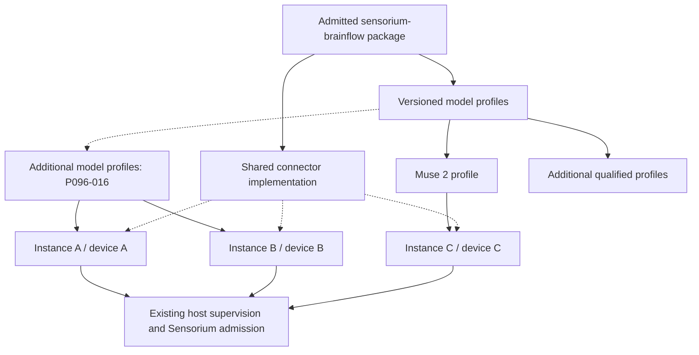

# Proposal 096: Sensorium BrainFlow Connector

Based on:
- `doc/project/10-challenges/091-predictable-operator-configuration.md`
- `doc/normative/90-supplementary/en/ONTOLOGICAL-BASIS.en.md`
- `doc/normative/30-core-values/en/CORE-VALUES.en.md`
- `doc/normative/20-vision/en/VISION.en.md`
- `doc/normative/40-constitution/en/CONSTITUTION.en.md`
- `doc/project/40-proposals/045-sensorium-local-enaction-stratum.md`
- `doc/project/40-proposals/048-sensorium-os-connector-action-classes.md`
- `doc/project/40-proposals/047-classification-label-propagation.md`
- `doc/project/40-proposals/051-swarm-membership-and-reputation-bootstrap.md`
- `doc/project/40-proposals/071-sensorium-workbench.md`
- `doc/project/40-proposals/080-multiplexed-middleware-channel-executor.md`
- `doc/project/40-proposals/082-sensorium-interfaces.md`
- `doc/project/40-proposals/084-sensorium-web-observation-connector.md`
- `doc/project/40-proposals/091-file-backed-configuration-and-explainable-composition.md`

Implementation basis: `node:DEV-GUIDELINES.md`.

Challenge 091 supplies the configuration problem: model-oriented declarations
must have one explainable owner and consistent file, GUI and CLI behavior.
P045 supplies the Sensorium acquisition and consent problem.

## Status

**Proposed**, following the operator's design request on 2026-10-11. One shared
BrainFlow integration, declarative model profiles, and independently managed
device instances are the requested architectural direction. This proposal
defines the receiving-layer contract; it does not establish implementation or
hardware acceptance. The first-slice scope was narrowed by the operator on
2026-10-13 to one Muse 2 over native BLE. Implementation and measured acceptance
remain separate tracker claims.

Existing Sensorium and middleware mechanisms are antecedents. BrainFlow has
its own instance materializer; it does not use or extend the OS/Workbench
factory. Independent host creation/restoration is implemented under P096-003, and the
pinned catalogue/private selector confirmations under P096-004. Acquisition,
lifecycle mutations and delivery retain their separate tracker gates.
The schema names and configuration shapes below have draft contracts under
P096-002. Their registration and the operator registration API do not establish
Sensorium source readiness or runtime qualification. No release or hard-MVP
scope is enlarged here.

## Date

2026-10-11

## Executive Summary

Provide an optional `sensorium-brainflow` middleware package that reuses
BrainFlow's device acquisition engine. Ship versioned model profiles so an
operator chooses a recognizable device model, a particular physical device,
and named signals rather than BrainFlow board numbers or command strings.

A profile is data interpreted by the common connector implementation. A
BrainFlow-owned instance materializer creates independent configuration and
identity through the host's generic middleware contracts. An admitted activation
starts one supervised acquisition worker
for one bound device. Two devices of the same model use the same package and profile,
with independent grants, processes, sessions, buffers, stop controls, and
diagnostics. Other BrainFlow-supported models follow the same contract after
their profiles and deployment combinations are qualified.

Acquisition, observation admission, local consumption, recording, and remote
publication remain separate decisions. Default instances are disabled, raw
recording and remote publication are off, and read/status requests do not start
the device. Use Sensorium's existing policy boundary and interface carriers.

## Context and Problem Statement

BrainFlow already supplies device drivers, transport handling, decoded sample
matrices, buffers, board metadata, and a uniform session API. Reimplementing
those mechanisms inside individual Muse adapters would create unnecessary
maintenance and make every additional device a new integration project.
Exposing BrainFlow's raw configuration directly would instead transfer that
complexity to operators and would conceal differences in signal modes,
identity selectors, native dependencies, and side effects.

The intended operator sequence is: **add device, choose model, bind a specific
device, choose signals, create a disabled instance, review its scope, enable**.
An optional discovery step helps resolve the device binding; it is not a
precondition for manually configuring a supported selector.

### Upstream meaning and receiving-layer decisions

| Upstream layer | Meaning preserved here | What this proposal newly determines |
| --- | --- | --- |
| [Ontological Basis](../../normative/90-supplementary/en/ONTOLOGICAL-BASIS.en.md) | Measurements and derived interpretations remain distinguishable; an abstraction does not establish a person's state by itself | Preserve raw/derived provenance, processing recipe, clock semantics, and uncertainty. The Basis is explanatory and grants no authority |
| [Core Values](../../normative/30-core-values/en/CORE-VALUES.en.md) and [Vision](../../normative/20-vision/en/VISION.en.md) | Human agency, local usefulness, data sovereignty, minimal disclosure, and Sensorium as voluntary contact with the world | Device-oriented configuration, explicit stop, local processing, and open export shapes |
| [Constitution](../../normative/40-constitution/en/CONSTITUTION.en.md), Articles III and IV | Control of one's data, revocable opt-in telemetry, layered audit, and Sensorium's grounding role | Separate measured-person consent from host administration and downstream disclosure; no new exception to constitutional authority |
| P045, P048, P071, P080, P082, P084, P091 | Host-owned module lifecycle, mediated contact, current grants, bounded observations, immutable source generations, explainable configuration | A BrainFlow model-profile contract, device binding, independent acquisition sessions, and independent instance materialization |
| Future schemas and Node implementation | Exact, inspectable contracts and repository-local evidence | Register proposed shapes, implement refusal/recovery paths, and qualify real devices before promoting support |

EEG features are observations with an interpretation recipe. This proposal does
not equate a band-power value with attention, calmness, a diagnosis, or consent.
Device ownership also does not identify the person currently wearing it.

### Inspected reuse baseline

The following is a source/documentation inspection on 2026-10-11, not a new
runtime test:

| Existing mechanism | Reuse | Boundary or missing work |
| --- | --- | --- |
| [P045 connector model](045-sensorium-local-enaction-stratum.md) | Ordinary middleware modules with distinct module/connector identities; Sensorium Core mediates observations and directives | No second Sensorium plugin loader or nested connector supervisor |
| Sensorium OS configuration and signed artifacts | Host-owned effective configuration, readiness checks, explicit operator authority | OS executes bounded commands; a continuous acquisition session belongs in its own supervised connector |
| [Workbench](071-sensorium-workbench.md) | Bounded sessions, cancellation, host-owned consent, visible state, source and effect separation | `sensorium-workbench-instance.v1` is a per-run microVM allocation contract, not a durable device-instance contract |
| [Middleware](../60-solutions/019-middleware/019-middleware.md) and P080 | Shared `channel_json` transport, per-launch authentication, supervision, component controls, package/runtime-home separation | Existing bundled factory projects one service per `config_key`; this is inspection evidence, not the BrainFlow integration point. Its independent materializer and generic instance inventory are P096 work |
| P082 and [Sensorium Interfaces](../60-solutions/046-sensorium-interfaces/046-sensorium-interfaces.md) | Open bounded source adapter registry, current grants, generation fencing, local/peer pull-batch | BrainFlow source adapters do not yet exist; Room supports latest state, not ordered sample history |
| P084 source projections | Read already acquired, admitted data; preserve source generations and independent acquisition authority | A subscription must not become a hidden acquisition command |
| P091 configuration | Owner-validated declarations and distinct declared/resolved/active/observed views | Adopt available scoped machinery; do not assume its entire proposed lifecycle is implemented |

Concrete Node antecedents: `node:middleware-modules/sensorium-os/README.md`,
`node:middleware-modules/sensorium-os/config/00-sensorium-os.json`,
`node:middleware-modules/sensorium-workbench/service.py`,
`node:middleware-runtime/src/channel_config.rs`,
`node:daemon/src/identity_store.rs` (`project_runtime_middleware_services`),
`node:daemon/src/middleware_settings.rs`, and
`node:daemon/src/control_ops.rs`.
The OS and Workbench scripts currently use singleton module constants; copying
those constants would defeat the proposed per-device identity model. Their
factory and settings flows are reference examples, not dependencies of
BrainFlow instance creation.

## Proposed Model / Decisions

### 1. One package, model profiles, independent instances



This is a composition of data and runtime bindings. There is no parent
BrainFlow connector process supervising model-specific child plugins. A
BrainFlow-owned host-side materializer creates ordinary, independently
addressable middleware components from one reusable package. It uses generic
host registration and lifecycle contracts, independently of OS/Workbench
instance construction. Model-specific code is justified only where a reviewed
behavior cannot be expressed by the common interpreter and a bounded profile.

The first implementation uses one process per device instance. This isolates
native crashes and permits enforced shutdown of a blocked native call. Process
overhead is accepted initially. Shared-process optimization is a later measured
decision and must preserve the same authority, isolation, and lifecycle contract.

### 2. Keep identity axes explicit

| Identity | Lifetime and meaning |
| --- | --- |
| Package id/revision/digest | Installed executable material and admitted profile catalogue; a package signature proves package admission, not acquisition consent |
| Profile id/revision/digest | Immutable model/transport/signal interpretation definition; a semantic version is separate display/release metadata; many instances may reference it |
| Instance id and host module/component ids | Durable local configuration and independent administrative scope; stable across process restarts |
| Device binding id/revision | Host-private resolution of one physical acquisition endpoint; independent of its display label and of the wearer |
| Subject binding | Explicit, consent-governed association with a measured person or session; may be absent, never inferred from a serial/name |
| Supervisor launch id | A particular authenticated worker launch, owned by the existing supervisor |
| Acquisition session id/epoch | A successful or attempted native session; reconnect creates a new epoch |
| Source id/generation and interface publication id | Meaning and audience of an admitted projection; immutable replacement follows P082 |

Serials, advertised names, transport addresses, and OS-local device identifiers
are selector evidence, not cryptographic identity. Do not derive instance ids,
grants, or public source labels from a physical serial or a human's name.
Changing the device or profile creates an explicit binding/configuration
revision and a new source generation; it must not silently reassign an existing
stream or preserve stale grants.

All **new P096 revisioned references** use `{id, revision, digest?}`: `id` is
stable, `revision` is a positive JSON-safe integer, and `digest`, when present,
binds that exact revision. Package and profile admission requires a digest.
Never encode a revision into `id`. Existing P082 source-generation, Passport or
artifact reference contracts retain their own wire shapes at integration seams;
this proposal does not migrate them. Labels are separate, private presentation
fields and cannot become identifiers or authority.

### 3. Versioned model profiles and operator templates

A model profile declares:

- its stable id, numeric revision, semantic version, digest, display name and descriptions;
- the compatible BrainFlow binding/native builds and symbolic board id;
- one model/transport pair, supported OS/CPU combinations and retained qualification;
- a bounded connection-selector schema and optional discovery-provider contract;
- named acquisition modes and the exact allowlisted backend configuration;
- the signals each mode necessarily acquires, exposes, or discards, including
  unavoidable incidental acquisition;
- stream metadata expectations: preset, channel roles, units, nominal rates,
  timestamp/package-counter semantics, and validation rules;
- limits, cleanup/reconnect policy constraints, and required host/device access;
- a versioned form schema with user-facing labels, choices, explanations and
  defaults, without arbitrary executable form logic.

The template selects a profile and supplies defaults. The instantiated
configuration records the exact profile revision/digest and operator choices.
Updating a catalogue does not silently migrate running instances. A profile
change is reviewed, validated, and applied through the instance owner.

Three concepts MUST retain separate names: **Sensorium model profile**,
**device acquisition mode** (for Muse, a command such as `p21`), and **BrainFlow
buffer preset** (`DEFAULT_PRESET`, `AUXILIARY_PRESET`, `ANCILLARY_PRESET`).
The operator sees signals and named modes, not those backend identifiers.

Use separate profiles per **(model, transport)**. For example, `muse-s.ble`
selects `MUSE_S_BOARD`, while `muse-s.bled112` selects `MUSE_S_BLED_BOARD`.
The latter has its own serial/dongle permissions, selectors, dependencies and
qualification; it is not a fallback hidden inside the BLE profile. The same
separation applies to Muse 2. A user-facing model group may list both choices.
Changing transport changes the pinned profile and requires re-admission.

Illustrative profile fragment; omitted common metadata is not a complete schema:

```json
{
  "schema": "sensorium-brainflow-model-profile.v1",
  "schema/v": 1,
  "profile/id": "muse-2.ble",
  "profile/revision": 1,
  "profile/version": "1.0.0",
  "display/name": "Muse 2",
  "model/id": "muse-2",
  "transport/kind": "ble",
  "brainflow/board": "MUSE_2_BOARD",
  "connection/selector-kinds": ["advertised-name"],
  "acquisition/modes": {
    "eeg-and-motion": {
      "brainflow/startup-command": "p21",
      "signals/acquired": ["eeg", "accelerometer", "gyroscope"]
    },
    "eeg-motion-and-ppg": {
      "brainflow/startup-command": "p51",
      "signals/acquired": ["eeg", "accelerometer", "gyroscope", "ppg"]
    }
  }
}
```

This fragment is a candidate to verify against the pinned build in P096-001,
including incidentally acquired signals and actual active matrix rows. The
first slice uses `p21` by default and separately consented `p51`; neither mode
promises heart-rate inference or electrode-contact quality.
Muse S Athena has a separate BrainFlow board definition and must have its own
profile; marketing-family similarity is not evidence of equivalent channels.
The generic profile namespace stays open to other boards and signal types.
There is no closed Muse-only registry in Sensorium Core.

### 4. Instance declarations and private device bindings

An illustrative operator-facing intent fragment (the resolved host input also
contains host-owned module/component/home/auth-slot bindings):

```json
{
  "schema": "sensorium-brainflow-instance.v1",
  "schema/v": 1,
  "instance/id": "ins_8d764901f3764c6cb5e740d2e3a18059",
  "instance/label": "Studio headband",
  "instance/revision": 1,
  "profile/ref": {
    "id": "muse-2.ble",
    "revision": 1,
    "digest": "sha256:1111111111111111111111111111111111111111111111111111111111111111"
  },
  "device/binding-ref": {"id": "bnd_0ff3d1a581f746d9a96af576e1a737c4", "revision": 1},
  "acquisition/mode": "eeg-and-motion",
  "signals/requested": ["eeg", "accelerometer", "gyroscope"],
  "activation/desired": "disabled",
  "restart/policy": "manual",
  "recording/mode": "off",
  "publication/mode": "local-only"
}
```

The fixture digest above is illustrative, not a known package digest. The host
checks the admitted profile's real canonical digest and derives the effective
backend input; the caller cannot override it through hidden extra fields.
Instance declarations contain references to host-owned authority, never bearer
tokens or a self-asserted `consent: true` flag.

A private binding can contain a selector such as:

```json
{
  "schema": "sensorium-brainflow-device-binding.v1",
  "schema/v": 1,
  "binding/id": "bnd_0ff3d1a581f746d9a96af576e1a737c4",
  "binding/revision": 1,
  "device/local-ref": {"id": "dev_d308a9460875451292c4c48a2c226307", "revision": 1},
  "transport/kind": "ble",
  "selector": {"kind": "advertised-name", "value": "Muse-ABCD"},
  "identity/assurance": "operator-confirmed-selector"
}
```

The instance's module id, component id, runtime home and configuration scope
are generated once by the host and retained as explicit bindings. They are
not independently editable aliases that could target another module.
Cloning configuration allocates new instance/module identities and requires
an explicit device binding; it does not copy an active session, grants or leases.

For Muse, BrainFlow's `serial_number` parameter denotes a device name. The
adapter maps `advertised-name` to that backend field without presenting it as
a verified factory serial. An optional serial recorded by the operator remains
separate evidence. Do not pass multiple selectors and assume the backend
conjoins them: its precedence rules must be reflected in the profile.

Activation requires a resolvable, sufficiently specific binding. An empty
selector, conflicting evidence, or multiple matching devices returns a typed
refusal; it must not fall back to the first discovered device. A name-based
binding cannot promise authenticated physical identity. If the selected
transport cannot distinguish candidates reliably, require re-binding or report
unsupported selection rather than claiming unique identity.

BrainFlow does not provide a documented universal device-enumeration API.
Discovery is optional, explicitly invoked, time/result-bounded work, using a
qualified transport provider. Listing profiles and viewing status do not scan.
`prepare_session` is resource acquisition, not a harmless discovery substitute.

#### Local device discovery provider

[P045's local device discovery continuation](045-sensorium-local-enaction-stratum.md#local-device-discovery-continuation)
owns the common request/candidate/result semantics and action routing.
P096-017 adds the first independently registered BLE provider behind
`sensorium.directive.invoke` / `device.discover.ble`; it is not a scan method
on a running BrainFlow acquisition instance. Reuse generic middleware plans,
package admission, the supervisor and bounded S029 invocation lifecycle.
BrainFlow's lack of universal enumeration is not permission to use
`prepare_session` for discovery. Choose/qualify a transport backend separately
and retain its license/effect inventory.

The caller selects an ephemeral operation/caller/scope-bound `candidate/ref`,
then separately approves a host-owned `binding/ref`. Selection during a scan
does not commit a binding: wait for confirmed discovery-session cleanup,
revalidate authority/evidence and atomically create the binding/consume the
candidate. Exact approved retry returns that same binding; another request,
caller, expired candidate, restarted operation or changed authority cannot
allocate another. Stable binding identity does not override its current expiry
or acquisition-consent rules. Advertised name, transport address and verified
serial remain evidence kinds with methods/provenance, not trust ranks.

Reuse P096-005 alias-aware device claims and fenced **transport/controller**
claims for atomic scan/acquisition conflicts in both directions. V1 denies
discovery during acquisition on the same controller; unknown shared-resource
state is not approval. Failed or uncertain cleanup fences candidate disclosure
and consumption and holds the claim. Cancellation stops only the provider's
own discovery session, with qualified backend/exit release evidence. Every
qualification records the actual launch/access context; retained iTerm lab
TCC observations do not qualify launchd discovery.

P096-017/018 require the complete typed private S029 progress path from
[P055-10/11](055-bounded-deferred-operation-contract.md#41-planned-local-device-discovery-progress).
Provider filtering and host revalidation disclose only profile-matching
candidates. Results default to sensitive-personal/Personal and never enter
observation history, artifacts, audit identifiers/derived-list digests or
federation. Discovery grants no acquisition, recording or P082 publication/
read authority. No profile, status read or UI visit starts a scan.

Manual selector confirmation from P096-004 remains usable independently of
this optional route. P096-009 may add discovery-assisted setup after 017/018;
its manual create/edit/control path has no discovery prerequisite. P096-015
continues to promote only its existing single-Muse-2 qualification scope;
discovery is promoted separately on exact P096-018 evidence. New discovery
contracts are **planned under P045**, outside the completed P096-002 inventory.
No completed 002/003/004 row is reopened. USB/serial and mDNS runtime providers
remain deferred even though P045 requires their contract fixtures.

Implementation checkpoint, 2026-10-14: Node provides current host-owned discovery
and acquisition enforcement with shared BLE claims, private progress, atomic
binding consumption and a dedicated wearer control listener. Native enrollment
delivers a private activation/withdrawal bearer before device effects; withdrawal
does not require continuing operator login. The byte-exact known native worker
may launch idle with no BrainFlow import or device open before a host-issued
permit. Full interpreter/distribution integrity is checked before spawn and
again before effects; live checks retain current package, declaration, grant,
binding and registered-pin equality without repeated full runtime hashing.
This detects drift at those boundaries and does not attest byte immutability
throughout an already running process. Device-free proofs and terminal lab
observations do not close 005, 006b, 017 or 018. The failed supervised scan has
uncertain cleanup and requires separately recorded laboratory recovery and new
consent before another attempt. Launchd and approved binding use remain unqualified.

Implementation checkpoint, 2026-10-15: Node adds a supported **private
acceptance-root**, sole-owner, pre-binding controller-recovery corridor. Current
normal identity owns cleanup custody separately from activation and old runtime
availability. An actual kernel boot-session baseline and a separately approved
changed-boot observation bound exact metadata reconciliation; a global durable
fence precedes disposal, original expiry/history and sibling resources remain,
and known consumed interruptions require explicit exact resume. A detached fact
permits only inert history restoration. Host execution-epoch reset is not native
stop acknowledgement, radio quiescence or production recovery qualification.
Normal-key temporary-root and owned-process interruption evidence does not close
P096-005/009/011a/017/018. Actual nearby recovery and device tests remain
unperformed. See Node's
[recovery contract](https://github.com/diapod/node/blob/master/daemon/docs/SENSORIUM-CONTROLLER-RECOVERY.md)
and
[software review](https://github.com/diapod/node/blob/master/docs/audits/REVIEW-SENSORIUM-CONTROLLER-RECOVERY-2026-10-15.md).

The same software checkpoint gives the changed known discovery worker a distinct
fixed verified-image package identity. Its exact stopped logical revision-2-to-3
transition preserves both earlier signed generations and checks all historical
consumption slots. The frozen nearby client separates recovery decisions from
fresh SCAN/BIND/REGISTER/WEAR; neither preparation nor metadata completion grants
native authority. These remain implementation mechanisms below the unchanged
P096 qualification requirements.

Nearby preparation checkpoint, 2026-10-15: the clean Node candidate binds 4702
source files and passes no-effects process/boot preflights. The normal owner
signed the distinct verified-image package; independent 13-file and Ed25519
checks pass on both hosts. The exact stopped transition installed logical
revision 3 while preserving original expiry, both older migration facts,
quarantine and Case/deferred history. The frozen nearby console and 20 client
checks are staged and verified. No real recovery baseline, host restart,
recovery commit, Case or device acquisition occurred. The next physical corridor
requires fresh separate baseline/restart/recovery and SCAN/BIND/REGISTER/WEAR
decisions; host-epoch reset remains distinct from native/radio qualification.
P096-005/009/011a/017/018 stay partial or open as tracked. See the
[retained preparation review](https://github.com/diapod/node/blob/master/docs/audits/REVIEW-SENSORIUM-VERIFIED-IMAGE-PREPARATION-2026-10-15.md).

Subsequent restart observation, 2026-10-15: the operator prepared a real baseline
and restarted the nearby host. Read-only inspection confirmed changed kernel
boot-session and unchanged quarantine/policy/history; no recovery or hardware
operation was performed. The restart exposed a false implementation assumption:
boot-local device numbers are not persistent root custody. The private corridor
now requires observed persistent volume UUID plus inode for cross-restart
custody, while live descriptor/path checks retain device/inode guards. Existing
version-1 baselines are historical evidence only: a fresh explicit owner review
may preserve and re-confirm one after the already performed restart, without
pretending it recorded a volume UUID retrospectively. Exact normal identity,
source and sole-controller custody checks remain mandatory. Separate recovery
approval has a **two-hour window from the actual restart**, measured by the
continuous kernel clock including sleep. Preparing another review or adjusting
wall time cannot renew that window. Original grants/expiry/history remain, and
no native authority follows from preparation. This correction does not close
P096-005/009/011a/017/018; see Node's
[restart-custody review](https://github.com/diapod/node/blob/master/docs/audits/REVIEW-SENSORIUM-RESTART-CUSTODY-2026-10-15.md).

Subsequent operator-approved checkpoint, 2026-10-15: the normal owner locally
re-confirmed the retained baseline and separately approved exact RECOVER.
Independent read-only inspection confirms the reviewed v2 custody/generation,
unchanged expiry and original uncertain history, disposal of only the old BLE
discovery row, preserved other resource state and removal of held/global fences.
Finite discovery grants remain valid without renewal. This measures the narrow
private pre-binding metadata corridor only; native stop/reset, radio exclusivity,
production recovery and fresh acquisition remain separate gates. The next Case
requires new SCAN/BIND/REGISTER/WEAR; no p21 registration or hardware effect is
implied by recovery. P096-005/009/011a/017/018 stay partial or open. See the
[completion checkpoint](https://github.com/diapod/node/blob/master/docs/audits/REVIEW-SENSORIUM-RESTART-CUSTODY-2026-10-15.md#operator-approved-recovery-checkpoint).

Subsequent revision-3 checkpoint, 2026-10-15: a fresh approved private p21 Case
reached required EEG/motion observation and `run-completed`, but native cleanup
remained uncertain. Read-only inspection preserves its claim and original
history. Source review found a 500 ms cooperative release window incompatible
with two two-second waits in retained BrainFlow Muse source. Exact wheel timing
is unmeasured. New private Cases explicitly reserve ten seconds for cleanup;
older records retain five seconds. Disclosure fences immediately, acquisition
limits stay 30/45 seconds, and release still requires acknowledgement, verified
exit and durable disposition before the original deadline. Closed diagnostics
and device-free delay/history tests support this correction only. Existing
P096-005 control/process-exit qualification thresholds are unchanged; no
qualification, recovery, renewed consent or hardware retry is implied.
P096-005/009/011a/017/018 remain open or partial. See Node's
[native cleanup review](https://github.com/diapod/node/blob/master/docs/audits/REVIEW-SENSORIUM-NATIVE-CLEANUP-2026-10-15.md).

The corrected clean code `c29e1b3f` now freezes 4720-file source `9dadd575`
and nearby image `b2a8d2e9`. Exact pins, strict signatures, no-effect preflights
and 35 nearby console tests pass. Read-only handoff checks preserve journal
revision 58/nine Cases and the held revision-3 acquisition quarantine.
No baseline, Bluetooth observation, recovery, renewal or hardware retry ran.
See `node:docs/evidence/sensorium-device-discovery/p21-cleanup.preparation.json`.

The operator subsequently prepared v3 baseline `38941cea` for revision 3.
Read-only verification matches its exact candidate, retained journal, held
claim, resources and eleven protected sources; the proposed policy changes only
generation. No reset/recovery has run. Bluetooth method review, OFF/ON observation
and commit require their separate approvals; expiry and original uncertain
history remain unchanged. See
`node:docs/evidence/sensorium-device-discovery/p21-cleanup.baseline.json`.

The separately approved Bluetooth method review v4 `a9d93da5` preserves exact
v3 `38941cea` bytes and matches the original claim, journal, resources, eleven
protected sources and pinned observer. No reset or recovery has run. Fresh
OFF/ON observation must precede separate recovery approval; method selection
starts no two-hour window and releases nothing. See
`node:docs/evidence/sensorium-device-discovery/p21-cleanup.method.json`.

The operator subsequently observed OFF/ON through the pinned observer. Protected
proof `988ef272` matches v4 `a9d93da5`, exact candidate/observer and unchanged
boot; 3509 ms OFF and four worker-absence checks precede publication after
successful observer exit. The approval window ends at
`2026-10-15T22:34:23.205Z`. Read-only inspection preserves the journal, held
claim, resources and eleven protected sources. Separate recovery commit remains
pending; this attests neither native stop nor qualification and renews no grant.
See `node:docs/evidence/sensorium-device-discovery/p21-cleanup.observation.json`.

The operator separately committed Bluetooth recovery. Read-only verification
matches completed marker `dfb003cb` to v4 `a9d93da5`/proof `988ef272`, installs
only the reviewed controller generation, and confirms exact acquisition
claim/resource removal with unchanged remaining rows, journal revision 58/nine
Cases and eleven protected sources. Original uncertain history and expiry remain.
No native-stop or measurement qualification follows. Expired-only stopped
retirement of revision 3 must wait for binding expiry at
`2026-10-15T20:47:33Z`; PREPARE-P21/RETIRE-P21 and fresh revision-4 Case consents
remain separate. See
`node:docs/evidence/sensorium-device-discovery/p21-cleanup.completion.json`.

The operator explicitly delegated this bounded workflow to the agent over SSH
without interactive local-console approvals, retaining a physical-readiness
check before device use. After original binding expiry, reviewed `2368cc10`
retirement completed through normal owners; exact four after-files, both
configuration journals, preserved siblings/history/recovery and reserved
revision 4 are verified. No grant, consent or hardware action follows.
A state-only native SSH permission probe remains undetermined with confirmed
no-scan cleanup. SSH control therefore remains distinct from measured native
launch/TCC access; it must never be labelled as terminal ancestry or native
qualification. See `node:docs/evidence/sensorium-device-discovery/p21-ssh-retirement.runtime.json`
and `node:docs/evidence/sensorium-device-discovery/ssh-permission.lab.json`.
The private delegated path now keeps the SSH endpoint as control owner while a
real LaunchServices application supplies independently observed `launchd`
native ancestry. Optional `operator_control: delegated-ssh` is separate from
launch provenance; historical omission stays valid. Fresh nonce echoes must
traverse SSH before the host receives a heartbeat. Endpoint loss withdraws and
uses normal cleanup/quarantine; the relay never creates stage approvals,
recovery or qualification. The signed application/client closure is retained in
the supervisor worker-denied image area. Physical readiness remains a distinct
operator confirmation. Device-free checks do not prove GUI Bluetooth access.
The frozen nearby source `4c29a072` and signed app image `ef87d290` now pass
seven-file capsule checks, actual GUI launchd preflight and 46 console tests.
Protected stopped state and the free controller match before/after inspection.
This GUI-session observation does not qualify a background launchd daemon or
Bluetooth access. See `node:docs/evidence/sensorium-device-discovery/ssh-gui-preparation.runtime.json`
and `node:docs/audits/REVIEW-SENSORIUM-SSH-CONTROL-2026-10-15.md`.

A fresh self-wearer-approved delegated Case subsequently observes Bluetooth
allowed and completes SCAN/BIND/REGISTER revision 4. Activation after WEAR
refuses before executor/permit start. Actual discovery cleanup and never-started
acquisition cleanup are confirmed; independent journal revision 67/ten Cases
matches released controller and zero resource claims. The refusal's precise
pre-activation cause is not retained by that producer. A software diagnostic
follow-up preserves the first closed monitor observation and authenticated
activation-guard failure without changing validation or consent clocks. No
acquisition success, automatic retry, recovery or native qualification follows.
See `node:docs/evidence/sensorium-device-discovery/ssh-gui-p21-r4.observation.json`.
The released registration retained original expiry. A separate stopped corridor
now accepts its exact fully reconciled released Case and existing idle resource
state, in a v3 review whose release basis excludes recovery. It preserves legacy
v1/v2 recovery review bytes and the normal target-only expiry/sibling/CAS
publication. The selected released record must match the current node, primary
participant and owner scope; any unclosed history, claim or pending recovery
refuses. Reviewed SSH prepare/commit creates no new authority, consent or native
effect. Device-free normal-key, legacy-history and interrupted-publication
regressions pass; see
`node:docs/audits/REVIEW-SENSORIUM-RELEASED-RETIREMENT-2026-10-16.md`.
The exact nearby SSH retirement 4→5 is now independently observed under v3
review `25079a02`, after the binding's original expiry. Both ordinary journals
and four after-sources match; 47 protected hashes and 25 retained package/capsule/
home entries stay unchanged, including the previously uncreated home. Original
journal67/ten Cases, consent and recovery history remain exact; controller and
resource claims were absent. At that checkpoint revision 5 was reserved without
registration, grant or reused consent. No recovery or hardware action occurred;
another physical Case requires fresh authorization. See
`node:docs/evidence/sensorium-device-discovery/released-p21-retirement.runtime.json`.
The first separately approved fresh revision-5 GUI/SSH Case refused SCAN with
`os-access-undetermined` before native manager creation or scanning. The operator
reports no OS prompt; the fixed helper explicitly returns before manager
creation at this authorization state. This does not identify the TCC responsible
process or prove denial. Independent released journal72/eleven Cases, zero
claims and 44 unchanged source hashes confirm disposal. BIND/REGISTER/WEAR were
not delivered; revision 5 remained reserved/unregistered at that checkpoint,
with no retry/recovery. Separate permission provisioning for the exact launch
chain and fresh physical approval were required. See
`node:docs/evidence/sensorium-device-discovery/ssh-gui-p21-r5.observation.json`.
A subsequent separately approved permission-only preflight for the exact same
signed GUI image `20f2b5f5` observes `allowed`, confirmed no-scan cleanup and
observer exit. No root/controller/Case, scan or acquisition is opened by that
probe; independent inspection preserves all 50 current source hashes and
journal72/eleven Cases. This does not identify TCC responsibility, qualify the
full supervisor helper chain or authorize another Case. See
`node:docs/evidence/sensorium-device-discovery/ssh-gui-r5-permission.lab.json`.
A later newly approved single Case on that same signed GUI now completes
SCAN/BIND/REGISTER revision 5/WEAR p21 and reports `observed-released` after
host-validated nonempty EEG/motion blocks. Independent journal81/twelve Cases
matches `released` / `run-completed`, native cleanup and executor exit are
confirmed, and controller/resources are free. Registration and fresh consent
are retained with original expiry; five configuration sources changed and one
declaration was added while 45 prior hashes and the discovery sibling stayed
unchanged. The first monitor warning (`configuration-refused`, running, 170 ms)
has no proven ordering against completion. The generic pending acquisition seed
is not the private terminal projection, which the owning contract explicitly
does not persist there. This limited approved binding-use observation does not
close the full qualification tuple, background daemon or authority/stop matrix.
See `node:docs/evidence/sensorium-device-discovery/ssh-gui-p21-r5-observed.runtime.json`.
A subsequent device-free review derives a narrower order from the pinned sealed
admission wrapper: it attempts `ScopeChanged` before returning this refusal,
while the first Case fence is already `RunCompleted`. Its refusal handling
therefore follows completion; the underlying predicate and its read time remain
unidentified. Confirmed stale queued-validation publication is corrected in the
software producer: current local closure/phase and optional boolean
`effects/fenced` distinguish a late monitor observation from startup failure or
a new stop. The timer lane rechecks current expiry and phase before applying a
retained result; completed validation or fresh WEAR cannot leave an obsolete
cancellation timer. Open-session refusals retain normal protected stopping; the original
validation250ms and authority/cleanup clocks remain unchanged. Controlled
fenced/finished/open regressions and legacy diagnostic compatibility provide
software conformance only. No remote native entry or new physical Case follows;
the original observation remains immutable. See
`node:docs/audits/REVIEW-SENSORIUM-MONITOR-REFUSAL-2026-10-16.md`.
The corrected producer is now prepared nearby from clean `fcc0c97c`, with
independent 4728-file source pin `f860ff8e`, release image `a3ae9ae4` and new signed
GUI image `819d4ce0`. Strict signature, seven-file closure and actual GUI launchd
preflight match; all 49 frozen-client console tests pass on Python 3.13.15.
All 163 prior protected hashes and journal81/twelve Cases are unchanged, with
only eight new capsule files and no controller/resource claim. Revision5 and its
original expiry remain intact. No manager, permission probe, Case, native work,
renewal, retirement or recovery runs; no old TCC/physical evidence is reused.
See `node:docs/evidence/sensorium-device-discovery/ssh-monitor-fix.preparation.json`.

At the earlier diagnostic checkpoint, source `d40a6d10` and app image
`e8e9a847` passed nearby signature/GUI launch checks and 47 frozen-client tests.
Nine protected source hashes and journal67/ten Cases matched before/after.
That checkpoint performed no second permission probe, Case, retirement or
recovery. See
`node:docs/evidence/sensorium-device-discovery/ssh-monitor-preparation.runtime.json`.


### 5. Independent instance materialization and host ownership

Reuse installed package material separately from per-instance runtime homes:

```text
middleware-packages/<package-id>/    admitted code and model profiles
middleware/<module-id>/config/      declared file source for one instance
middleware/<module-id>/data/        bounded instance-owned operational data
middleware_channel_services        derived ordinary host executor bindings
```

The declared files are the single editable source of ordinary durable intent,
following P091. The host journal records admitted source revisions and resolved
snapshots, not a second editable copy of settings. Freeze the ownership mapping:

| P091 view | Owner and meaning |
| --- | --- |
| `declared` | Exact bounded file bytes and digest, with validation/admission status; GUI and CLI target the same source |
| `admitted/resolved` | Host journal binds retained source bytes, expected revision, package/profile digests, constraints and immutable resolution; admission does not mean activation |
| `active` | Host application record plus owning component acknowledgement for that resolution and activation generation |
| `observed` | Actual process, acquisition and stream health with freshness; never inferred from a save |

Host-issued identity/credential-slot allocations and consent facts are separate
authority records, not ordinary editable settings. The resolved declaration
joins those explicit bindings to the declared source for pure plan construction.

An out-of-band edit becomes an **unadmitted candidate**, never an automatic
activation. An explicit authenticated import/apply operation snapshots bounded
bytes, validates them and performs CAS against the admitted source revision and
digest. A valid current candidate creates a new revision; a stale, invalid or
unauthorized one returns `source-conflict`, `invalid-source` or `denied` with
redacted diagnostics. Keep the previous admitted/active revision and expose the
divergence; never silently overwrite the external edit or start acquisition from
it. Writes, journal commit and recovery use P091's ordered protocol and retained
bytes; a crash cannot admit whatever file happens to exist on restart. A file
edit is not a stop mechanism: the protected stop surface below remains available.
Executor entries, catalogue cards and component snapshots are projections of
admitted intent. Creation and reconciliation are idempotent; no separately
editable BrainFlow process registry exists.

Implement a dedicated BrainFlow instance materializer in the host integration
layer. Its pure function is `declaration + admitted package -> instance plan`.
The declaration already carries host-allocated opaque identities and explicit
input bindings; the package input includes its pinned profile closure. The
function performs no I/O, allocation, discovery or authorization. It produces
an adapter-neutral `middleware-instance-plan.v1` for host admission/registration:
unique executor, module/component, home,
dependency and channel-authentication bindings. The host commits the plan and
owns its effects. Neither creation nor recovery calls the OS/Workbench factory,
uses their singleton configuration keys, or requires either adapter to be
installed. Reject duplicate ids and conflicting explicit/materialized executor
declarations before launch. Verify the module report against the host-bound
instance identity. Extend the generic settings inventory to present these
independent instances.

The plan describes one instance's registration intent, not a replacement for
the full `middleware_channel_services` map or host runtime snapshot. Only the
generic host owner merges and atomically applies the complete snapshot under
its lifecycle/configuration concurrency boundary. The full lifecycle contract
requires creation, update and deletion of A to preserve B and unrelated
components. P096-003 closes creation, exact replay and stopped restoration only;
P096-009 owns supported update/delete, explicit source/activation generations,
old-grant invalidation, home/auth retention or replacement and tests preserving B.
Maintenance import/apply acknowledges externally edited bytes but is not a
qualified update/delete workflow and establishes no migration semantics. Add a narrow
generic registration seam if it is missing; do not route around host ownership.

#### Frozen generic host entry contract

[middleware-instance-plan.v1](../../schemas/middleware-instance-plan.v1.schema.json)
is owned by middleware, not BrainFlow. Its V1 fields and boundaries are fixed
here before the first consumer; P096-002 must register and validate them rather
than invent a BrainFlow-specific host ingress. The plan contains:

| Field | Meaning |
| --- | --- |
| `instance/ref`, `declaration/ref`, `package/ref` | Revisioned identity, exact source and admitted package; content digests bind source/package material |
| `executor` | Host-allocated id, `channel_json` kind, package-relative entrypoint and bounded arguments; no caller-selected executable outside the package |
| `module/id`, `component/id` | Explicit host-bound identities, validated for uniqueness and ownership |
| `home/binding` | Opaque host allocation binding; the host resolves config/data locations, never arbitrary caller paths |
| `channel-auth/binding` | Host credential-slot binding with per-launch issuance; never a token in a plan or journal |
| `dependencies` | Exact component references, readiness requirement and stop/degrade policy; no model-specific vocabulary |

Host admission verifies the plan against its declaration/package, current
authority, allocated identities, entrypoint, limits and dependency DAG, then
commits it through the existing host lifecycle boundary. The plan grants no
authority and contains neither BrainFlow board ids nor device selectors. Host
credentials are minted only at launch. No adapter writes the global snapshot.

If implementation evidence identifies common mechanics, a small **abstract
instance factory** may be extracted for reuse by similar adapters. This optional
extraction concerns plan construction only: the receiving host contract above
is generic from day one. Generic host operations own commit, reconciliation and cleanup.
Keep model profiles, device binding, BrainFlow parameters and consent decisions
in their respective owners. This optional shared mechanism must not depend on
OS or Workbench, introduce a parallel registry/supervisor, require their
migration, or become a prerequisite for delivering BrainFlow. Prefer composition
of small functions and contracts over an adapter inheritance hierarchy.

Reuse the existing component start/stop/restart controls and supervision graph.
An operator stop remains authoritative even when durable desired activation is
enabled. File/GUI/CLI changes must share owner validation and current authority;
editing a declaration does not grant permission or prove successful application.
P091's declared/resolved/active/observed distinction applies here, but P096 must
identify exactly which existing P091 surfaces it consumes before exposure.

### 6. Lifecycle: declaration, process, acquisition and source

Keep durable desired activation (`disabled | enabled`) separate from the host
process phase and the observed acquisition phase. The latter is:
`idle | preparing | streaming | reconnecting | stopping | cleanup-uncertain | blocked | failed`.
Expose the reason, retryability, session epoch, required-stream freshness, and
last successful transition. A ready middleware channel is not healthy EEG.
`idle`, `blocked` and `failed` imply proven disposal of acquisition resources;
if proof is missing, the phase is `cleanup-uncertain` with the pending terminal
outcome recorded separately. Any transition not listed/admitted is refused.

Each preset independently reports `unknown | fresh | stale | missing | invalid`
health and whether it is required. Aggregate health may be `healthy | degraded |
unavailable`; `degraded` is not an acquisition phase. Optional PPG loss can leave
EEG streaming with degraded health. Missing/invalid required streams prevent
readiness or trigger bounded recovery/stop; a mode change that makes PPG
optional requires a new admitted revision, not silent downgrade.

| Trigger / current condition | Required admission | Result and owned effects |
| --- | --- | --- |
| Create | Current instance-management authority; admitted profile and valid configuration | Persist disabled intent; no scan, device open, native session, recording or publication |
| Set desired activation to enabled | Current instance-management authority and CAS revision | Persist launch eligibility; preserve any explicit operator-stop fence; no acquisition merely from editing the setting |
| Explicit Start/Resume, or admitted automatic resume | Enabled intent, current administration and acquisition scope, measured-person consent where applicable, OS permission, valid binding, available budgets, device claim and active visibility/stop surface | Record admitted activation and launch through host supervisor; only explicit Start/Resume may clear operator-stop; begin `preparing` after all effect gates |
| Prepare succeeds | Same current scope, binding revision and launch fence | Call bounded `start_stream`; remain `preparing` until first valid data for every required preset arrives before its deadline |
| Required data valid and fresh | Metadata/mode match; current session and grant | Enter `streaming`; normalize bounded batches and submit authorized candidates |
| Disconnect, stall or retryable transport failure | Reconnect allowed by the still-current acquisition grant and host policy | End old epoch, emit explicit discontinuity, clean old native session; enter bounded `reconnecting`, then revalidate before a new prepare |
| Invalid metadata, ambiguous binding, unavailable consent/authority, or terminal backend error | No bypass | Stop data admission, clean resources; enter `blocked` or `failed` with typed reason; automatic retries cannot repair authority |
| Disable, consent withdrawal or grant expiry/revocation | Authorized stop, or host enforcement of lost authority | Fence outputs first; enter `stopping`; stop/release native session; terminate a stuck worker within host deadline; return to `idle` only with cleanup proof |
| Edit device/profile/mode/subject/meaning-bearing configuration | Current manage authority and CAS revision; renewed scope as required | Stop affected acquisition, invalidate old source/publication generation, record new declaration; explicit re-admission before activation |
| Delete instance | Current manage authority; stopped worker and released claim | Tombstone intent, remove derived executor/view, apply retention policy; do not silently delete retained evidence or undo remote disclosures |
| Host/worker restart | Recovered declaration, current package/profile admission and authority | New launch, acquisition epoch and source generation; invalidate old publications/cursors. Default manual restart; automatic resume is an explicit opt-in scope and never restores an operator-stopped or revoked instance |
| Cleanup cannot be proven within the stop deadline | Output fence remains closed; claim retained | Enter `cleanup-uncertain`; refuse prepare, reassign, delete and automatic resume until supervisor/recovery proves disposal |
| `cleanup-uncertain`, cleanup later proven | Current fenced owner and supervisor evidence | Release claim, then enter `idle`, `blocked` or `failed` according to the recorded pending outcome; no direct transition to `preparing` |
| `blocked`, prerequisite restored | Explicit re-admission of corrected binding/authority/configuration and all activation gates | Move to `idle`, then an admitted Start may enter `preparing`; Disable/Delete allowed only with proven cleanup; no retry loop to repair authority |
| `failed`, diagnosed or reset | Explicit reset/reconfiguration with current manage authority and proven cleanup | Move to `idle`; renewed activation is separate. Otherwise remain failed; Disable/Delete remains available after cleanup |

Repeated operations with the same instance-scoped idempotency key and input
digest return the same decision; a conflicting reuse is refused. Reads are
side-effect-free. Lifecycle reconciliation has a bounded host trigger, not a
hidden effect of opening a status page.

The device UI may offer one explicit "Enable acquisition" action that composes
an admitted configuration change with Start. Its receipt distinguishes saved
intent from actual acquisition readiness. A minimal ongoing acquisition
indicator and an independently serviced stop control are prerequisites for
real device access; the richer P096-009 forms may be delivered later.

BrainFlow's native sequence is `prepare_session -> start_stream -> stop_stream
-> release_session`. Stopping a stream does not release all session resources.
Cleanup must cover partial preparation and failed start as well as normal stop.
Do not substitute raw vendor start/stop commands or process-wide
`release_all_sessions` for instance-specific lifecycle.

#### Protected wearer stop and withdrawal

Before real acquisition the host establishes a wearer-facing session-control
surface: an authenticated participant/wearer control view backed by host consent
operations, or an equivalently scoped local control established during consent
when no participant account is used. It exposes only this wearer's active
measurement, Stop and Withdraw Consent, with a receipt. The binding to the
measurement is explicit and survives operator UI logout. It does not grant
device management or sample-reading authority. The access path cannot depend
on the operator's session, a Room, notifications, reputation, or the acquisition
grant it must be able to revoke. Do not permit real activation before this path
and the active indicator have been demonstrated to the wearer.

Apply P051's protected-access pattern, without importing its case semantics:
reserve bounded control admission slots, execution capacity and response budget
per active measurement independently of data, normal management and ordinary
participant quotas. Stop is idempotent and coalesces duplicates; it must not
wait behind sample reads, serialization, inference or a native call. The host
marks consent withdrawn and closes the output fence through that reserved path;
durable audit failure must not defer stopping and is recovered explicitly.
Confirmation, pre-effect activation, stop, withdrawal and disposal remain distinct
facts. Never-WEAR withdrawal creates no acquisition consent. Before effects the
host reserves bounded durable capacity for the terminal facts; later admissions
cannot consume that reservation. The first accepted stop and withdrawal retain
their original clocks, and duplicate requests neither renew the cleanup deadline
nor retry a failed audit. Receipts project fencing/cleanup and audit durability
separately; an unconfirmed write cannot be treated as durable success.

Cooperative stop and verified executor disposal precede fallible terminal audit
I/O. A final control-only release-authorization point requires the current stop
and every earlier accepted withdrawal fact to be durable within the original
cleanup deadline. A first withdrawal accepted after that point is a separate
terminal fact: it cannot reopen effects, reuse consent or retroactively invalidate
verified disposal. Failed or stale terminal audit before authorization leaves
the claim/start fence for explicit reconciliation; late acknowledgements cannot
release quarantined cleanup automatically.
Before opening a real device, the host durably records an acquisition-start
marker. Only durable stop/consent state plus verified disposal can close it.
An unclosed marker after host restart prohibits automatic resume until cleanup
and current wearer authority are re-established; an in-memory withdrawal lost
during an audit outage must not resurrect an old automatic-resume grant.
Operator logout, stalled UI/SSE and a saturated data queue are required tests.
If the protected surface becomes unavailable, the host stops real acquisition
within its declared bound instead of allowing indefinite collection. This
protects against ordinary access restrictions/overload, not a hostile host owner
who controls the operating system; device removal remains under wearer control.

#### Host-enforced stop contract

Every stop, withdrawal, expiry and enforcement stop follows this host-owned
sequence, including partial prepare and blocked native I/O:

1. Close the instance output/admission fence and prevent reconnect; record the
   stop/withdrawal intent. In-flight old-epoch batches cannot be published.
2. Send an instance-scoped cooperative stop/release request with a monotonic
   deadline. The worker may acknowledge progress, but its acknowledgement is
   not process-exit or cleanup proof.
3. The existing supervisor terminates the worker by the enforced deadline,
   escalating to forced termination if needed. No worker cooperation is
   required for this step; cleanup covers descendants/resources in its scope.
4. Verify exit of the exact launch (not only its reusable PID) and disposal of
   its transport/resource handles. Unknown disposal means `cleanup-uncertain`.
5. Only after that proof release the fenced claim and report the terminal
   acquisition outcome. A receipt distinguishes `requested`, `fenced`,
   `cleanup-pending`, `cleanup-uncertain` and `completed`.

The stop endpoint and supervisor termination path have a reserved control lane
and never share a queue or a potentially blocking mutex with the data path.
Use an atomic fence or a short bounded control-only critical section; no native
call, matrix copy or delivery occurs while holding it. A stop receipt is not a
promise to erase previously disclosed data. P096-002 fixes admission, fence,
cooperative-stop and termination deadlines; P096-005 proves their enforcement
under saturation and a non-cooperative worker before BLE exposure.

### 7. Device claims and authority

BrainFlow's duplicate-session check uses board id plus backend input parameters
inside one process. Different configurations or separate workers can still
address the same physical endpoint. Before preparation the host acquires an
exclusive claim on the canonical local device binding, resolving known aliases
independently of instance id and serialized BrainFlow parameters.

The claim binds device, instance, launch and acquisition epoch, with a fenced
owner and bounded renewal. Expiry or an unresponsive owner triggers cleanup;
it does not immediately authorize a competing open. A claim is reassigned only
after confirmed cleanup/worker termination. Unknown cleanup leaves the device
blocked for diagnosis. This is host-local coordination, not a promise to
exclude other applications or another computer. Different devices still share
the radio controller; concurrency requires platform evidence.

The host, admitted worker/native package and qualified transport implementation
form the acquisition trust boundary; device data and caller-supplied inputs are
validated at its edges. Process separation provides crash containment and a
kill boundary, not by itself an I/O sandbox. Host grants must be backed by the
actual platform access/containment mechanism declared for the transport.

Use host-owned authorization/consent records and authenticated module bindings.
Permission intents below are proposed scopes to freeze and register, not a new
connector-owned authority service:

| Decision | Scope and owner | Does not imply |
| --- | --- | --- |
| Install/admit package and profiles | Existing signed middleware package admission and trust | Any device access or measured-person consent |
| Inspect/create/change/delete instance | Host-local, exact administrative instance/configuration scope | Scanning or acquisition; a user shell receives only its authorized instances |
| Discover | Explicit local transport, duration, result-count and disclosure scope | Pairing, persistent tracking, or opening an arbitrary matching device |
| Acquire | Exact instance, binding revision, profile/mode, necessarily acquired signals, subject context, duration and restart policy | Arbitrary device commands, recording, feature inference or egress |
| Compute/expose a derived feature | Named versioned recipe, input scope, purpose and output classification | A clinical claim or additional undisclosed inference |
| Read admitted observations or local sample blocks | Existing Sensorium/P082 policy, exact source generation and consumer scope | Permission to start/refresh acquisition or persist raw samples |
| Retain/export raw capture | Explicit recording scope, destination, quota/TTL and recipient where applicable | Default persistence of every sample or unlimited historical access |
| Publish/read/subscribe remotely | Existing P082 publication management, exact source generation, grants, signed peer Passports, classification and current revocation | Acquisition control, local raw retention, or access obtained merely by Room membership |

Host administration and a person's consent are independently necessary when
the operator and wearer differ. Revoking either required acquisition authority
fences new output and stops collection. Local source/read and recording grants
are independently enforced; revoking a reader need not stop an otherwise
authorized acquisition. Loss of required authority providers is a lifecycle
transition, not permission to continue with stale cached decisions.

The effective scope includes any incidental signals a hardware mode acquires
even if only a subset is exposed. Refuse a request whose unavoidable acquisition
exceeds consent; discarding the extra samples afterwards does not authorize
their collection. The profile catalogue, form and confirmation expose this fact.

Unrestricted `config_board`, arbitrary `BrainFlowInputParams`, and free-form
streamer strings are not public operator or agent surfaces. Device configuration
comes from reviewed profile modes. `streamer_params` stays empty by default:
BrainFlow's direct file/multicast streamers would otherwise bypass retention
and disclosure admission. Future reuse of them requires an exact admitted sink
adapter. Multicast is not the Orbiplex inter-node authorization protocol.

#### Biosignal sensitivity is fixed at ingress

Classify real EEG, PPG, accelerometer and gyroscope signals, wearer-linked
features and captures as `health-wearable`
with the P045/S030 **`sensitive-personal`** baseline. Stamp
[`classification.v1`](../../schemas/classification.v1.schema.json) with immutable
`source_tier = Personal` and default `effective_tier = Personal`, the most
restrictive existing tier. Bind the actual consent subject through the existing
`bound_subjects` contract; absent identity is not public data. Private device
selectors and linkable session metadata receive the same baseline. These are
health-related physiological/biometric signals for this engineering policy;
this is not a claim that every use has the same statutory legal classification.

P082 frames retain this label. Any permitted lower-tier projection requires a
current P047 fact for `surface = interface` and the exact topic class; filtering,
aggregation, hashing a selector, changing a label, or consent to acquisition
does not by itself declassify data. Profiles cannot lower this baseline.
Synthetic data has explicit non-person provenance and its own admitted policy;
playback of real recordings retains the source restrictions.

The normative documents do not currently supply a biosignal-specific rule for
EEG/PPG inference, retention or secondary use. Record that refinement as an
upstream policy gap, without deferring today's classification or inventing a
fourth tier. P096-002 freezes the mapping above and carries the gap to the
normative owner; until resolved, it cannot justify broader use.

### 8. Data plane, clock semantics and bounded buffers

Reuse `BoardShim` metadata for supported presets, matrix row count, channel
indices and sampling rates. Validate it against the selected profile/build and
mode. Unknown optional signals remain absent with an explanation; missing
required streams or incompatible layout blocks readiness. Preserve units from
the qualified board contract; do not assume every row is EEG or every signal
is measured in microvolts.

Each BrainFlow preset is a distinct stream with its own rate, timestamps and
package numbering. Drain each with one owner through bounded
`get_board_data(n, preset)` calls and fan out admitted projections afterwards.
Independent consumers must not compete to drain the native queue.
`get_current_board_data` is a recent non-destructive view, not cursor-based
replay or proof of continuity.

The native ring buffer can overwrite old samples. Allocate explicit capacities
and preflight rows × samples × element size across every preset allocated by
the pinned backend, including inactive presets. The inspected native engine
uses one `buffer_size` argument for all descriptor presets; do not invent
independent native capacity knobs. Include temporary read copies and wrapper
allocations in headroom. Connector output caps can differ per stream. Bound
drain frequency, downstream bytes and retention.
Slow consumers cause a declared gap/drop policy rather than unbounded growth
or blocking the acquisition control path. A full queue is not proof of an exact
number of lost samples.

Use a backend-neutral sample-block payload with at least:

| Field group | Required semantics |
| --- | --- |
| Identity/provenance | Instance, device-binding revision, acquisition session/epoch, source generation, profile digest, backend binding/native version, device/firmware evidence when available |
| Stream descriptor | Stable stream id, signal kinds, ordered channel descriptors, units, effective nominal rate, layout and descriptor revision |
| Sample block | Typed little-endian binary buffer: `dtype`, `shape`, `layout`, `values/b64u`, separate `missing/b64u`; no JSON float array. An existing carrier may instead reference the admitted complete block artifact; inline/artifact alternatives remain exclusive |
| Timing | Per-sample source wall timestamps with origin/derivation; monotonic drain time and clock epoch, corresponding drain wall time, uncertainty or explicit unknown; transport receive time only when available. Source, drain and admission time remain distinct |
| Ordering | Connector-assigned session-local sequence/range, preserved backend package ids separately, continuity status and known/unknown loss quantity |
| Quality | Available contact/artifact/quality evidence with its source; `unknown` when unavailable, never a fabricated universal quality score |
| Interpretation | `raw` or exact processing recipe/version, calibration and window description; synthetic/replayed provenance explicit |
| Policy | Effective classification, admission/projection scope and retention/capture references as applicable |

#### Typed binary sample buffer and host digest

The sample payload has this fixed shape (illustrative two-channel, two-sample
buffer; index 1 is missing):

```json
{
  "dtype": "f32le",
  "shape": [2, 2],
  "layout": "channels-by-samples",
  "values/b64u": "AACAPwAAAAAAAABAAAAAAA",
  "missing/b64u": "Ag"
}
```

`dtype` is `f32le | f64le` (IEEE 754); default to `f64le` to preserve BrainFlow's
precision. A profile must admit any `f32le` conversion and error bound.
`shape = [channels, samples]` contains bounded positive integers; flatten as
`index = channel * samples + sample`. Both byte strings use canonical unpadded
base64url. Decoded values length is exactly `channels * samples * sizeof(dtype)`.
The mask is exactly `ceil(channels * samples / 8)` bytes, least-significant bit
first, with `1 = missing`, zero unused high bits, and all-zero positive-zero
value bytes for every missing entry. A zero without that bit is a measured zero.
Non-finite values must be mapped to explicit missingness with a typed quality
reason or rejected, never silently to a valid zero. Present values must be
finite; canonicalize negative zero to positive zero. Bound dimensions and
encoded/decoded sizes with checked arithmetic before allocation, decoding or
hashing. A cross-language golden fixture checks bits, mask and length failures.

Per-sample source timestamps use an independently named binary buffer with the
same encoding rules and `shape = [1, samples]`, `dtype = f64le`; its descriptor
names wall-clock Unix seconds and origin. No floating-point array or Python
`json.dumps` representation enters canonical identity.

When a block digest is requested, **the host computes it** after validation;
worker ingress must omit an authoritative digest. Freeze the preimage as
UTF-8 domain `orbiplex.sensorium.sample-block.v1` followed by a zero byte, then
seven individually length-prefixed segments: JCS canonical typed metadata,
decoded signal values and mask, decoded source-time values and mask, then
decoded package-number values and mask.
Each segment has an unsigned 64-bit big-endian byte-length prefix; the metadata
includes all three tensor descriptors (including their mask lengths),
instance/session/source bindings, clocks, sequence and interpretation, and
excludes digest and base64 strings. Metadata contains no floats: use bounded
integers, rational pairs or specified decimal strings. The digest is lowercase
`sha256:<hex>`. JCS canonicalization reuses the host canonical-JSON primitive;
the binary values are not reserialized as JSON. Golden vectors must agree in
Python and Rust. A content digest proves bytes, not hardware truth or authority.

Base64 adds roughly one third over binary size; savings over JSON floats depend
on dtype and numeric representation. Do not promise a fixed 3–4x reduction.

Muse's upstream backend expands several samples from one BLE packet and may
repeat package numbers; its timestamps are derived from host arrivals and
interpolation. A generic counter-per-sample gap detector would be wrong.
Preserve that timing provenance and qualify any profile-specific loss detector.
Every block additionally carries `clock/epoch`, `drain/monotonic-ns` as a
canonical unsigned decimal string, and `drain/wall-time` as UTC RFC 3339.
The epoch names one continuous monotonic clock domain and wall-time mapping;
start a new epoch on process/boot clock-domain change or detected wall-clock
step and emit a clock-discontinuity fact. Keep the raw source timestamps.
Use monotonic elapsed time and connector sequence for stalls/deadlines, never
wall-clock subtraction alone. Values from different clock epochs cannot be
subtracted or aligned without an explicit mapping. Suspend behavior and clock
resolution are qualified for the chosen clock API. An NTP jump alone is not
proof of missing or overlapping samples; detection uncertainty is explicit.
Cross-preset alignment is a separate versioned transformation with an explicit
resampling/uncertainty policy, not column-wise zipping.

### 9. Sensorium admission, projections and retention

Submit bounded, normalized observation candidates through the existing
Sensorium admission boundary. The first slice's observation windows contain
compact factual summaries such as sample count, stream timing and contact
quality, rather than raw sample arrays in the durable observation store.
Raw blocks remain in the bounded transient pipeline. The first slice includes
an explicitly enabled, authorized local sample projection through P082, so a
local consumer can receive actual signal values without enabling recording or
remote publication. Acquisition alone does not grant that consumer access.
Recording follows P096-013; named feature recipes follow P096-012. Avoid a
local Agora publication per raw sample.
Preserve source/ingestion times, sensitivity and provenance. Consumers depend
on signal contracts, not BrainFlow board ids.
Host/module diagnostics do not contain sample arrays, physical selectors,
subject identity or native debug dumps by default.

The first slice provides admitted local observation windows, per-instance
health, and a bounded local transient sample-read path. Reuse P082 source
bindings and local read admission; do not introduce a private bypass API.
Separate these projections:

- `latest-state`: newest admitted window summary, named feature, or bounded
  status with freshness; local reads in the first slice, optional peer/Room
  publication under P096-014;
- `ordered-events`: expressly enabled, bounded retained sample blocks with
  cursor, `gap` and `end`; local/direct-peer pull only under the current carrier
  contract. Local reads are required in P096-008/010; direct-peer publication
  is optional P096-014 work. The new source adapter retains only a bounded
  transient window and must not treat a latest-state observation store as full
  history or silently turn transient retention into durable capture.

Reads and subscriptions consume acquired data. They cannot activate a disabled
instance, invoke device configuration or widen capture. Profiles are an edge
catalogue; the P082 provider registry gets a generic BrainFlow source adapter,
not a central branch for each model.

Meaning-bearing changes, host/worker restart, or loss of the adapter's cursor
and retained-floor state supersede the source generation and require fresh
publication/grants under P082. Reconnect within the same surviving worker may
retain a source generation only when its admitted semantics, cursor state and
retained-floor contract survive; it still creates a new acquisition epoch and
explicit gap. A pending old-session callback must fail the session/generation
fence before admission. Unknown device continuity requires re-binding rather
than a silent reconnect. The first slice does not promise durable sample-buffer
recovery across worker restarts.

Raw samples are transient by default. Recording, when implemented, creates
explicit capture artifacts behind existing storage/admission and Artifact
Delivery contracts. Record quota, TTL, owner, active-capture key and cleanup
rules. Stopping recording finalizes or marks a partial artifact; revocation
prevents further writes/disclosure according to its scope. Deleting local
state does not undo an already admitted remote delivery. iCloud/phone gateways
are future transport adapters; they do not alter this authorization model.

### 10. Operator and user surfaces

Both surfaces consume the same host contracts and server-provided allowed
transitions. Present model, instance label, device binding, available signals,
necessarily acquired signals, requested activation, actual acquisition health,
recording/publication state and actionable refusal reasons. Technical BrainFlow
fields belong in restricted diagnostics, not routine device setup.

The operator may administer multiple devices; an authorized user sees only the
instances and consent decisions in their scope. UI forms never infer authority
from a profile, a detected device or component readiness. Stopping acquisition
must remain reachable while a data view is slow or the native call is stuck.
Show reconnecting, stale, blocked and cleanup-uncertain states explicitly.

The initial catalogue contains `synthetic` and `muse-2.ble` only. Muse S,
Athena and BLED112 profiles belong to P096-016, with their own hardware evidence.
Additional models are additive
profile work when the common interpreter suffices. Label availability with
separate axes: upstream-supported, profile-present, deployment-qualified and
currently-available. No single green badge may collapse all four.

## Implementation Recommendations

### Reuse map and ownership

Apply `node:DEV-GUIDELINES.md`, especially Layering, Data and Contracts,
Host-Owned Runtime Primitives, and review rules on authority, lifecycle,
bounded stores, recovery and dependency loss.

| Owner / existing mechanism | Recommended responsibility |
| --- | --- |
| BrainFlow host-side instance materializer | Validate instance declarations and construct independent instance plans through generic host contracts; no dependency on OS/Workbench factories; extract a small shared factory only when reuse is demonstrated |
| Generic host package admission, configuration and component runtime | Admit packages and instance plans; retain declared intent and admission/application facts; own registration/reconciliation, authority, device claims, credentials, dependency graph and enforced shutdown |
| Common `sensorium-brainflow` middleware implementation | Interpret admitted profile/config, call the existing BrainFlow binding, own one acquisition session and bounded queues, normalize data and report per-instance health |
| BrainFlow `BoardShim` / native BoardController | Device protocols, transport, decoding, native buffers, metadata and session operations |
| Optional BrainFlow `DataFilter` | Named/versioned processing recipes with explicit units, input window and output provenance |
| Optional `MLModel` | A later separately admitted inference feature; not a prerequisite or an implicit interpretation of acquisition data |
| Sensorium Core | Admission, normalization policy, sensitivity, bounded observation storage and consumer mediation |
| P082 runtime and generic source adapter | Publication, cursors, subscriptions, current read grants, generation fencing and carrier projection |
| Node UI / CLI | Device-oriented clients of the same host operations; no second domain state machine |

Prefer the existing **Python BrainFlow binding for the first supervised
connector**, matching the shared Python middleware/channel helpers used by OS
and Workbench. Keep host authority and lifecycle integration in their existing
Rust owners. BrainFlow also supplies a Rust binding; qualify that existing
binding if a later deployment benefits from an all-Rust worker. Do not write a
new FFI wrapper, BLE decoder, driver hierarchy or plugin framework merely to
connect the library.

Keep pure profile validation, selector resolution rules, metadata interpretation
and transition decisions separate from native calls. A small portable core is
appropriate if these rules need reuse across host/worker boundaries; do not
create empty L0/L1/L2 crates just to match names. Protocol semantics remain
independent of Python, Rust, macOS, NumPy and the chosen native artifact.

### Use BrainFlow's existing seams

1. Compile validated profile choices into `BoardIds` and
   `BrainFlowInputParams`; pin and record the resolved inputs privately.
2. Obtain static metadata through `get_board_descr`, `get_board_presets`,
   channel accessors, `get_num_rows` and `get_sampling_rate` as supported by
   the pinned binding. After preparation/configuration, use
   `get_board_sampling_rate(preset)` where available for the session rate and
   verify the effective stream layout. Where unavailable, require a qualified
   mode-specific rate contract; a nominal static value is not observed evidence.
3. After host admission and device claim, construct one `BoardShim`, prepare,
   configure only the approved mode at its supported lifecycle point, and start
   with an explicit bounded buffer and no unmanaged streamer.
4. Drain each preset once into bounded blocks. Branch to allowed observation,
   processing and capture sinks after current authority and epoch checks.
5. Stop and release that session on every exit path. If a native call prevents
   timely cleanup, the host supervisor terminates that worker and verifies exit
   before releasing its device claim.

Binding and native artifacts are pinned together. Package qualification records
OS, CPU, library loading, Bluetooth/serial/network access and the actual
launched executable's permissions. An upstream macOS binary or a successful
Python import is not a deployed acquisition test. No runtime `pip install`,
unreviewed native download, or automatic firmware update belongs in activation.
Preserve upstream/dependency license notices and inventory native artifacts.

A profile's transport authority covers the SDK's real device I/O. BLE, serial,
USB and network boards require different host permissions and containment.
Network-board SDK sockets are acquisition transport and must have bounded,
admitted destinations; ordinary output publication grants cannot authorize
them. The first slice qualifies local BLE and synthetic input. Other transports
remain unavailable until their real permission/containment path is proven.

### Executable P096-001 spike and early delivery

P096-001 is a bounded executable integration spike, not just an inventory. In
the intended deployment environment, load a pinned package containing the
chosen Python/runtime, BrainFlow native artifacts and NumPy through the actual
host package path; launch a Synthetic Board worker through the actual
supervisor and authenticated `channel_json`. Retain import, metadata, first
samples, bounded stop, forced-stop and exit evidence. Initially use a fixed
fixture module declaration through existing generic host controls; this does
not preimplement the new instance-plan API or expose a production connector.
No real-device scan/open and no external network streamer is allowed.

The spike has three explicit outputs:

1. **Packaging:** record OS/CPU/ABI, Python/NumPy/binding/native digests, dynamic
   library resolution, offline startup and installation provenance. Runtime
   `pip install` and downloads are forbidden. Inspect signed middleware package
   admission and variant selection in `node:daemon/src/middleware_config_artifacts.rs`
   and `node:daemon/src/tests/middleware_packages.rs`. The inspected typed
   package manifest declares id, trust requirements and config fragments, with
   no explicit OS/CPU variant selector; generic JSON preservation is not
   selection evidence. Demonstrate selection of
   an exact platform artifact under one logical package identity, or record a
   missing host contract and a narrow extension before P096-003. S015's small
   JSON Module Store alone does not prove platform package selection.
2. **Native dependency licensing:** inventory every distributed native component
   and transitive dependency, exact version/source or binary digest, license
   text and redistribution obligations. BrainFlow's MIT license is not a
   license for the whole binary closure. Upstream SimpleBLE now documents
   BUSL-1.1; the exact vendored version and license in the selected BrainFlow
   artifact are still unverified. Gate distribution on a compatible free-software
   dependency closure; an older source pin is not a security or binary-provenance
   substitute. A finding that requires replacement/build changes remains an
   explicit deployment blocker, not an implicit acceptance of new license terms.
3. **macOS permission attribution:** retain a launch-context matrix for terminal,
   login agent and daemon as applicable, including signing/bundle identity,
   permission state, denial and recovery. **Hypothesis:** the responsible-process
   chain may prevent the intended Python worker from obtaining Bluetooth access.
   A bounded permission-status/prompt probe can run separately without scanning
   or collecting; product radio access waits for P096-005. A separately bounded,
   operator-run laboratory observation is defined below.
   Synthetic Board success is not TCC evidence. An Apple engineering note about
   IOBluetooth/root daemons motivates checking this boundary, but does not prove
   behavior of the chosen CoreBluetooth/BrainFlow build. Never edit TCC databases
   or weaken system protections as the deployment solution.

After P096-003/004, P096-006a/007a/008/010a deliver a **synthetic-only** path to an
authorized local sample consumer without waiting for human-measurement consent
work. It still requires host admission, a fenced simulation resource claim,
bounded buffers and independently enforced stop. The admitted execution profile
and worker reject every non-synthetic board id; no caller-controlled board,
transport, playback file or device selector can escape it. Playback is separately
classified and is not automatically exempt from source consent/retention policy.
P096-006b/007b add product real-transport behavior only after P096-005. The gate
remains: **no product discovery/acquisition exposure before P096-005**. The
[finite qualification bootstrap](#same-candidate-finite-qualification-bootstrap)
below separately defines how an exact candidate can collect that gate's native
evidence while retaining its operational protections.

### First-slice laboratory observation and frozen defaults

The first hardware target is one operator-owned Muse 2, with the operator also
the wearer, on macOS arm64 with the Node launched from a terminal. Both `p21`
and `p51` require separate, exact-mode consent. One explicit self-wearer
confirmation creates the consent record; administration and wearer authority
remain distinct. The initial consent lasts at most 30 minutes and renewal is
manual. Logout does not remove the wearer's independent stop/withdraw path.

P096-001-lab is an optional early **manual** experiment outside the product:
on the pinned runtime, prepare, configure one mode, start for at most ten
seconds, stop and release under an external watchdog. It neither creates a
Sensorium source nor uses product acquisition authority. Record only metadata,
counters, cleanup and permission observations as `lab-observation`, with its
own [lab contract](../../schemas/sensorium-brainflow-lab-observation.v1.schema.json).
That class is never admitted as qualification evidence. Compare an operator-run
terminal observation with the ignored, terminal-guarded supervisor laboratory
test before product activation. Both are manual lab observations. Terminal
success does not prove Bluetooth/TCC access for the supervisor child; neither
observation bypasses P096-005 for product acquisition. Never edit TCC databases.

Record firmware as an operator-observed value with its source, for example
the Muse application. A firmware update creates a new tuple. Obtain the private
`Muse-XXXX` selector from device information, not the macOS pairing list;
record `identity/assurance: operator-confirmed-selector`. A prepare timeout is
`device-not-advertising-or-busy`, a retryable uncertainty rather than proof of
a busy device. Recovery may require closing the phone application or disabling
its Bluetooth connection. Never retry automatically. Ambiguous resolution and
host claim conflicts have separate refusal reasons.

Expected EEG (four named electrodes at 256 Hz), motion (about 52 Hz) and PPG
(about 64 Hz) are hypotheses until pinned metadata and actual acquisition agree.
Static rows and zeros do not prove an active signal. Contact quality remains
`unknown`; heuristics are named recipes under P096-012. Include a 120-second
warmup per hardware mode before rate thresholds, without treating it as a
quality measurement. Real samples, even anonymized, are not synthetic fixtures:
public vectors preserve observed layout using newly generated values and times.

The following initial finite budgets are design defaults, not measurements.
P096-002 binds their revision and digest before any acceptance run; changing
them invalidates affected reports. Count complete messages, copies and every
preset, including base64 expansion and metadata.

| Surface | Initial bound |
| --- | --- |
| Prepare / required first data (budget revision 3) | 60 seconds / 10 seconds, capped by the original session/authority |
| Worker drain / aggregation | 25 ms / at most 100 ms |
| Normalized block | 32 channels × 128 samples, split before encoding |
| Native capacity | 2,048 samples per preset; checked combined allocation at most 2 MiB |
| Channel message / worker-host queue | 64 KiB / 16 blocks, 512 KiB or 1 second, first limit wins |
| Transient source retention | 5 seconds, 256 blocks or 1 MiB, first limit wins |
| Local consumers / read batch | 4 per source / 8 frames or 64 KiB; one in-flight read per reader |
| Carrier output / read revocation visibility | 8 blocks, 64 KiB or 1 second / at most 100 ms |
| Memory | 512 MiB worker RSS; 16 MiB host slice buffers |
| Drain-to-local-receipt latency | p95 ≤ 250 ms, p99 ≤ 500 ms, maximum ≤ 1 second |
| Protected stop (budget revision 3, adopted 2026-10-21) | receipt ≤ 626 ms; output fence ≤ 250 ms from host decision; process exit ≤ 10 seconds |
| Cleanup / recovery (budget revision 3) | after 20 seconds unproven native cleanup becomes uncertain and holds the claim; recovery after pressure ≤ 10 seconds |
| Surviving-worker reconnect | at most three serial operation attempts after returned timeouts within the original 90-second session and current authority; unconfirmed disposal retains the claim; killed workers require manual restart |
| Hardware acceptance | three 300-second runs per mode; observed rates within 5% of confirmed nominal rates |

Muse 2 plus a synthetic instance proves process, claim and stop isolation only.
It reports `concurrency.device/count: 1`. P096-011b independently requires two
physical Muse 2 devices and proves concurrent radio operation. Only P096-011a,
including both modes and all four live-delivery cases, can feed P096-015.

### Existing host primitives before new mechanisms

- Use [Module Store](../60-solutions/015-host-owned-module-store/015-host-owned-module-store.md)
  for bounded module-scoped records; use the signed middleware package lifecycle
  for package/profile provenance and activation. These are distinct host
  mechanisms. Signed configuration artifacts may bind effective instance
  configuration without replacing personal consent or the declared files.
- Use [Middleware](../60-solutions/019-middleware/019-middleware.md), P080 and
  existing component controls for workers, channel calls and shutdown.
  Do not revive the retired `http_local_json` supervisor or create one HTTP
  listener per device. Any required product listener uses the existing
  bounded authenticated runtime with its own justification.
- Use [Bounded Deferred Operations](../60-solutions/029-bounded-deferred-operations/029-bounded-deferred-operations.md)
  for bounded discovery, prepare/stop and capture-finalization operations.
  A persistent stream is a supervised session, not an immortal deferred task.
- Use [Replay Scheduler](../60-solutions/020-scheduler/020-scheduler.md) for
  host-owned bounded reconnect/maintenance scheduling. Continuous native-buffer
  draining is session mechanics; it does not require one scheduler job per sample.
- Use the host-owned consent path already employed by Workbench, Sensorium
  admission and P082 grants; introduce only the missing typed acquisition and
  device-claim scopes. Reuse an existing exact resource-claim primitive if its
  fencing/recovery contract fits, otherwise add a narrow host-owned device seam.
- Evaluate `node:daemon/src/model_runtime_leases.rs` (`ModelRuntimeLeaseRegistry`)
  and `node:scoped-claim-runtime/src/lib.rs` before adding device-claim machinery.
  The inspected former manages model data leases with expiry/release; the latter
  verifies scoped claims with a durable nonce replay cache. Neither inspected
  contract establishes exclusive physical-device ownership or cleanup before
  reassignment. P096-001 must record a fit/gap matrix for canonical aliases,
  monotonic fencing, launch identity, crash/restart recovery, expiry quarantine
  and proven cleanup; reuse suitable primitives without calling proof claims
  resource leases or importing model-runtime authority into biosignal access.
- Use [Artifact Delivery](../60-solutions/023-artifact-delivery/023-artifact-delivery.md)
  for admitted capture transfer. SDK multicast or a connector-private cloud
  account is not a substitute for recipient authorization.

### Proposed contract inventory and validation

All cross-process rows now have canonical draft schemas, Node mirrors and
semantic ingress/egress checks; report/qualification schemas remain Node-local.
P096-002 completion includes fixtures, qualifier and finite budgets as recorded
below. Draft registration alone establishes neither authority nor activation:

| Candidate family | Owning meaning |
| --- | --- |
| `middleware-instance-plan.v1` | Adapter-neutral registration intent; host authority and lifecycle own its effects |
| `sensorium-brainflow-qualification-tuple.v1` | Exact bounded deployment/test conditions; embedded as `qualification/tuple` in a report |
| `sensorium-brainflow-model-profile.v1` | Admitted declarative model, modes, selector and metadata rules |
| `sensorium-brainflow-instance.v1` | Durable instance intent and pinned references |
| `sensorium-brainflow-device-binding.v1` | Host-private endpoint resolution and assurance |
| `sensorium-brainflow-acquisition-scope.v1` | Exact host-owned acquisition consent/grant payload, integrated with existing authority envelopes |
| `sensorium-brainflow-status.v1` | Separate configuration, supervisor and acquisition evidence without raw data |
| `sensorium-brainflow-lab-observation.v1` | Manual metadata-only observation, firmware and actual launch/TCC attribution; excluded from qualification |
| `sensorium-brainflow-budget-profile.v1` | Predeclared finite numeric limits and fixed profile revision |
| `sensorium-biosignal-stream-descriptor.v1` | Backend-neutral stream/channel/time semantics |
| `sensorium-biosignal-buffer.v1` | Nested tensor: buffer ⊂ sample-block; shape/bytes alone do not bind source, stream or authority |
| `sensorium-biosignal-sample-block.v1` | Typed binary values/missingness and source-time buffers, host digest, clock epochs, provenance and continuity |
| `sensorium-biosignal-window.v1` | Synthetic per-preset retained-window min/max, present counts and retention health; P082 latest-state projection, quality unknown |
| `sensorium-biosignal-capture.v1` | Optional retained capture manifest and artifact references |
| `sensorium-brainflow-acceptance-report.v1` / `sensorium-brainflow-qualification.v1` | Node-local evidence report and candidate/report/qualifier binding, with separate evidence classes; implementation-owned schemas follow the existing acceptance pattern |

Use existing observation, interface frame/read-result, classification, operation
and causal-context envelopes. Freeze closed authority/control fields and typed
errors; open vendor metadata belongs in a bounded non-authorizing extension
map. Cross-process contracts go through Node Schema Gate. Direct validators
are limited to local configuration/profile schemas as allowed by the guidelines.

Register canonical schemas, Node mirrors, metadata/registry entries, positive
and semantic-negative fixtures together. Keep example JSON valid; references
must bind exact revisions, and secrets/selectors must not leak into public
schemas' read projections. A new shape is not accepted merely because it parses.

### Budgets, effects and recovery

P096-002 freezes finite limits and defaults for every row below. No production
activation may depend on a timeout field without an enforcing runtime owner.

| Resource/effect | Owner and required bounds | Recovery |
| --- | --- | --- |
| Discovery results | Host operation; scan deadline, transport scope, result count/bytes, short expiry | Cancel/drain; discard private candidates after expiry |
| Device claim | Host; canonical binding key, fenced launch/epoch, renewal and cleanup deadlines | Verify disposal before reassignment; stale worker cannot regain ownership |
| Prepare/native session | Supervisor + worker; start/first-data deadline, retry count/backoff, worker memory and CPU budget | Partial prepare cleanup; enforced termination if blocked |
| Native buffers and normalized blocks | One worker per instance; account for every allocated native preset under the common capacity argument, temporary copies, and separate bounded output sizes/age/drain policy | Explicit gaps/unknown loss; release on stop; never replay old session as live |
| Interface retained blocks | Source adapter; bytes/events/age and per-reader batch caps | Retained-floor gaps, terminal end, generation fencing; no implied durable capture |
| Recording/artifacts | Capture owner; per-session/global quota, TTL, active-capture protection, indexed cleanup | Final/partial manifest; deletion/tombstone under policy, no fabricated complete capture |
| Instance/configuration facts | Host; revision, idempotency key, bounded audit retention and materialization journal | Rebuild derived inventory/executors from admitted intent |
| Metrics/diagnostics | Existing bounded host telemetry; counts, latency, lag, drop/unknown-loss and reason codes | Reset transient counters explicitly; retain only policy-admitted metadata |
| Protected stop/control lane | Host; reserved admission/execution/response capacity, monotonic fence/stop/terminate deadlines independent of data queues | Coalesce repeated stop; fence without waiting for durable audit; retain claim on uncertain cleanup |

Classify native handles/processes as `ephemeral-revertible` with truthful
disposers, instance changes as journaled durable transitions, and remote
deliveries as independently admitted external facts. A revoked acquisition
fences new admission immediately at the enforcing host boundary; collection
shutdown and already admitted/recorded data have their own measured bounds and
retention outcomes. Do not claim remote erasure from a local stop.

### Acceptance strategy

#### Report and qualifier contract

Reuse the evidence/report/qualifier separation demonstrated by
`node:docs/contracts/local-accountability-report.v2.schema.json`,
`node:docs/contracts/local-accountability-qualification.v2.schema.json`,
`node:tools/acceptance/local-accountability/qualify.py` and Story-013's
`node:tools/acceptance/story-013-qmail-task-pack/qualify_workbench_restart.py`.
Reuse its binding and refusal pattern, not those scenarios' verdicts or payloads.

The proposed report requires `schema`, `candidate/ref`, `source/digest`,
`harness/digest`, `evidence/class`, `qualification/tuple`, `cases`,
`privacy-canary/result` and `scope/exclusions`. Each case binds its id, expected
invariant, outcome and content-addressed evidence. The qualifier binds the report
digest, candidate and its own executable digest; it checks schema and semantic
completeness and emits explicit qualified scope/exclusions. A printed `passed`
or a report supplied by the worker cannot qualify itself.

`evidence/class` is exactly `synthetic | playback | real-device | conformance-ref`.
A referenced conformance check binds its source report/digest/scope and cannot
count as a new execution. Mixed runs are a collection of class-specific reports,
not a single ambiguously qualified run. Every report embeds the canonical
[`sensorium-brainflow-qualification-tuple.v1`](../../schemas/sensorium-brainflow-qualification-tuple.v1.schema.json)
under `qualification/tuple`: model and hardware revision, firmware evidence,
OS/version/CPU, transport, exact package/binding/native/runtime builds, mode,
nominal and observed rates per stream, permission/launch context, controller
arrangement and observed concurrent device count. Unknown/not-applicable values
are tagged states, never invented versions or an omitted required field.
The tuple uses evidence-local opaque aliases, never serials or advertised names.

P096-002 freezes the Node-local report/qualifier contracts; P096-001 retains
preliminary spike evidence for later normalization without claiming qualification.
P096-010a qualifies only the synthetic path; P096-010 closes shared/refusal
coverage and P096-011a supplies single-device real reports; 011b adds radio concurrency. None can substitute for
another class, missing consent, a platform variant or a firmware tuple.

#### Narrow native-exposure adoption

Discovery binding-use acceptance needs a purpose-specific host admission before
the full P096-011a delivery qualification exists. Node owns the separate local
contracts `sensorium-native-p21-admission.v1`,
`sensorium-native-p21-exposure-qualification.v1`,
`sensorium-native-p21-qualification-case.v1` and
`sensorium-native-safety-prerequisite.v1`, with immutable producer input
`sensorium-native-p21-source-report.v1`. Their scope is one Muse 2 and the
`muse-2-p21-acquisition` purpose; they do not promote P096-011a, P096-015 or P082.
These additions are outside P096-002's completed contract inventory.

An independently reviewed immutable report binds the exact host, launch chain,
package, runtime, worker, effective containment policy, profile, mode, instance
and binding revision. A separate P096-005 prerequisite covers the same tuple
and the entire adoption lifetime. Cases retain closed measured facts, including
the actual trigger for authority-loss and protected-stop cases. Portable case
evidence contains neither sample buffers nor digests derived from signal values.
Monotonic nanoseconds use exact decimal strings; source generation is a separate
positive integer whose implementation mapping remains Node-owned.

Producer observations and independent qualification remain separate immutable
artifacts. The source report binds the exact package candidate, host executable
through the tuple, run, harness, actual observation interval and both native and
P096-005 proof maps. The decision binds those exact source bytes, candidate and
qualifier identity. The private admission consumer compares the typed tuple and
both proof maps, and freshly verifies the source reference alongside the other
evidence. P096-005 remains a separately adopted prerequisite.

For the initial Python qualifier, source and executable artifact are the same
retained script. Interpreter and content-free schema-validator executable digests
are separate identities. The script imports only the isolated interpreter's
standard library. These identities are accountable observations, not proof that
a program executed or a complete standard-library runtime pin. A changed script
requires a newly reviewed qualifier identity and decision.

Execution origin is distinct from the owner of a case record. The initial closed
policy below determines which observed path may satisfy each case:

| Origin | Narrow p21 cases | P096-005 prerequisite cases |
| --- | --- | --- |
| `physical-native` | `approved-binding-use`, `required-preset-readiness`, `external-busy`, `disconnect-stop`, `stop`, `revoke`, `deadline`, `scan-first-conflict`, `acquisition-first-conflict`, `private-sinks` | `current-authority-before-effects`, `mode-scoped-wearer-consent`, `wearer-stop-after-operator-logout`, `reserved-stop-under-saturation`, `live-grant-revocation`, `control-provider-loss` |
| `controlled-native-fault` | `partial-start-cleanup`, `cleanup-uncertain` | `hung-worker-stop`, `uncertain-cleanup-retains-claim` |
| `host-software` | `mode-incidental-scope`, `binding-refusals`, `restart-unclosed-marker`, `ip-denial` | `expired-grant-before-effects`, `restart-unclosed-marker` |
| `synthetic-fixture` | Never qualifies native exposure | Never qualifies native exposure |

Controlled native faults exercise the same candidate, known native worker and
runtime, current owners and tuple. A fake Board, substituted worker or historical
laboratory observation cannot satisfy that origin. Host-software cases measure
the actual candidate owner or process-containment boundary. Each case retains
its own typed invariant, source, origin, facts and content-addressed record.
Several records may truthfully describe one execution; their references do not
count as additional executions or authorize additional device effects. Incomplete
runs and synthetic source reports cannot qualify native exposure.

Firmware and TCC attribution remain explicitly operator-observed evidence for
the exact launch context. An unreported firmware or permission change is not
claimed automatically detectable. Reported changes require withdrawing or
replacing adoption and collecting new evidence. Node's initial adoption is
bounded to 24 hours from the retained observations and cannot outlive its
prerequisite. Freshly dating a report cannot renew old case evidence or the
operator-observed firmware/TCC facts. The source interval contains those facts
and all case observations; decisions expire within 24 hours of its retained
start. Terminal observations cannot qualify a
daemon launched by launchd.

Current operator authority, mode-scoped wearer consent, protected withdrawal,
owned binding, shared claim and the one-use START permit remain independently
enforced. Qualification evidence requires a separately authorized harness and
an independent qualifier; laboratory observations, fixture signers, schema-valid
JSON and an adopted discovery report cannot authorize p21. A consumer awaiting
that producer and evidence keeps native exposure closed.

#### Same-candidate finite qualification bootstrap

The qualification experiment and ordinary product adoption are separate
authorities. The initial experiment scope is one Muse 2, native BLE and p21,
local-only, for the relevant P096-005/017/018 cases. A host-owned, explicitly
approved experiment may collect the missing native proof before the finished
purpose verdict and P096-005 prerequisite are adopted. It substitutes only for
that circular demand for a finished verdict: actual OS access, effective
containment, current operator authority, exact package/runtime admission,
mode-scoped wearer consent, protected withdrawal, binding and shared claims
remain mandatory before their respective effects. This design creates neither
a public capability nor completed implementation or runtime evidence.

The experiment runs in the same normal-build candidate daemon subsequently
evaluated for adoption. Retain its actual executable, OS and launch ancestry,
the exact worker/package/runtime/helper bytes and effective containment body.
Author and sign ordinary packages through the current `PrimaryParticipant`
and normal HostSigner service; a package signature and the private host grant
are separate approvals. Normal configuration retains its admitted signed
federation-root requirement. A fixture signer, test executable, test-only runtime
exception, substituted worker or historical laboratory report cannot stand in
for these identities or authorities. Inert identity/package initialization and
materialization grant no scan, acquisition or experiment authority.

Use a dedicated persistent, explicitly selected acceptance root with exclusive
owner control. A closed qualification mode keeps ordinary catalogue exposure,
directive starts and generic-RPC effect routes unavailable, even after proof is
installed. The ordinary factory retains its production qualification consumer;
do not replace it globally. A private runner binds one prepared, allowlisted
case to the actual daemon/boot session, candidate and harness, launch context,
current owners, finite effects allowance and opaque operation references.
Preparation is inert. An owner transition durably consumes its one-use authority
before effects; restart or an exact retry cannot replenish it. There is no
caller-supplied script, method list, board id, replacement admission or global
unqualified-enable flag. Unknown controller sharing is a refusal.

The private harness authority still lasts at most 120 seconds. Prospective budget
revision 3 permits a nominal Case ceiling of 180 seconds, including interaction
and reserved cleanup, but the unchanged authority ceiling can end it earlier.
BLE observation uses a 20-second window and a 50-second total request deadline,
at most 8 candidates / 16 KiB, progress no more frequent than 200 ms and candidate
TTL at most 120 seconds. Up to three serial empty-window attempts share that
one request and manager; they do not replenish the request deadline.

One scoped p21 consent permits preparation up to 60 seconds and an enclosing
session up to 90 seconds, subject to remaining Case, grant and wearer lifetimes.
Required-preset readiness is within 10 seconds of stream start and the original
session deadline; worker RPC waits are at most 2 seconds. The one-use START
permit stays at most 5 seconds. Protected receipt, fencing and verified owned
exit use revision-3 limits 626/250/10000 ms. Earlier frozen runs retain their
original limits and pinned qualifiers. A successful second or third SDK attempt
counts as success without multiplying binding, grant, permit or consent. Native
attempt counts and completed disposal remain visible; unknown cleanup cannot
restart acquisition. Polling, delayed preparation, activation, cache refresh and
retry never renew a deadline or effects allowance. Queue/count/byte/age limits
remain unchanged. See the [current policy](#prospective-operation-retries-2026-10-21).

For the binding-use case, the reviewed allowance is at most one logical discovery operation and one
separately consented acquisition; operation retries remain within those scopes. The nearby operator approves that exact case
and SCAN; BIND approves one current candidate only after confirmed scan cleanup.
The normal binding owner then supplies the binding revision to the disabled
p21 instance; the driver cannot substitute a selector. Install the real
protected wearer control before a separate exact-mode self-wearer confirmation
and activation. Current owner checks, the shared claim, normal supervisor and
private START permit still precede native work. A refused conflicting attempt
must open no additional native session. No automatic retry, reconnect, fallback,
second device, p51, recording, publication or controller reset is included.

The implementation step promotes the same finite runner, monitor and private
ports out of test-only compilation, behind a closed factory over the actual
normal owners and operation-scoped `NativeAdmission`. Tests exercise that same
code. An inert normal factory or software conformance alone is not native
qualification. The first control transport is explicitly Unix-only; Windows
requires a separate transport for the same `H <nonce>\n` / `S\n` semantics.
Its first case assumes operator and wearer are the same person. Two-person
cases require a wearer stop path independent of operator-console liveness.

The retained first fence reason distinguishes protected client withdrawal from
normal run completion; later events cannot replace its attribution or clock.
Confirmed cleanup after early withdrawal remains an incomplete observation.
Stalled cleanup retains the original lease and slot and is counted in private
status as `cleanup-stalled`; that status grants no release or retry authority.

The reference implementation enables source-inventory provenance explicitly for
candidate builds; ordinary development or archive builds stay unpinned and
cannot enter this private native factory. The tracked inventory must invalidate
on newly tracked runtime assets as well as changes to existing files. A partial
runner-file digest is only an auxiliary diagnostic, never the candidate boundary.

The closed console entry keeps stopped discovery registration and package
signing as separate approvals. Its REGISTER stage obtains the exact stopped
p21 host grant through the normal owner and materializer; a reply cannot assert
a target or release witness. A controller ownership namespace outside experiment
roots must already be established by the responsible owner. Reading it does not
establish exclusivity, reconcile unknown sharing or adopt laboratory recovery.
The case records a durable claim before native operation allocation and removes
it only after normal-owner disposal and durable case release, within the original
cleanup budget. Missing ownership or unresolved quarantine refuses the case.


Withdrawal, client EOF/error, loss of the private control provider and expiry
fence effects. Abrupt client loss requires a bounded host-owned liveness check;
a client destructor alone is insufficient. The durable in-progress/consumed
record and uncertain-cleanup claim survive process failure and acceptance-root
reopening. Process exit or removing a launch registration alone does not prove
native release. Uncertainty blocks conflicting work until the existing owner
reconciliation proves release; experiment authority grants no recovery/reset.
A fresh acceptance root does not clear known quarantine of the shared controller.
First require the responsible owner's separately authorized reconciliation or
recovery; laboratory recovery evidence does not become production release proof.

Terminal and launchd are separate experiments and adoption tuples. A launchd
case uses the same normal candidate started by the actual intended per-user
adapter, initially inert and without automatic start/retry. A separate nearby
console client approves a fresh private challenge for that exact daemon session
and launch context. Neither a terminal grant nor an environment flag authorizes
the launchd case. Stale, consumed or wrong-session/context approval refuses.
Retain actual OS decisions and explicitly observed responsible-process evidence
from the prompt, settings or log; successful BLE work alone does not identify
the TCC responsible process. Missing attribution or OS denial leaves that
context unqualified. Do not edit TCC state or weaken platform protections.

For example, an approved binding-use run scans once, confirms its own cleanup,
consumes one candidate into a binding, materializes the stopped p21 instance,
installs wearer control, and obtains new p21 consent before activation. It
observes valid nonempty required EEG and motion blocks, withdraws through the
protected lane, then records distinct ingress, decision, fence, receipt, owned
exit and disposal facts. Early withdrawal or missing required data is an
incomplete attempt. Fault cases use the reviewed same-candidate path and retain
uncertainty rather than fabricate release. The preceding execution-origin table
remains controlling: software host invariants do not establish physical cases,
and several truthful case records from one execution do not authorize more work.

Retain immutable, metadata-only source facts with the consumed authority scope,
original budgets, observation interval and exact candidate/run/case references.
The independent offline qualifier binds those source bytes and its own identity;
it has no experiment or device authority. Only a separate explicit owner
adoption installs a qualifying decision and P096-005 prerequisite in the normal
consumer. An experiment never writes proof to admit itself. Installed proof
does not open ordinary routes in qualification mode or start acquisition.
Later normal-mode exposure still requires current operational authority and
consent. None of this closes P096-005/017/018, P096-011a/015 or P082, or changes
completed P096-002/003/004 scope. Implement and review the inert authoring and
closed authority/route boundaries before collecting fresh physical evidence.

#### Hard privacy canary

Generate a unique fixture advertised name at test runtime (illustrative format
`Muse-CANARY-7F92`) and
synthetic subject/selector values in success, denial, error, timeout, reconnect
and restart paths. Assert their absence from status, ordinary/native logs,
SSE, notifications, publication descriptors/metadata, exported traces and
acceptance reports plus their retained evidence. Include encoded/escaped and
trivially derived representations, not just a literal substring search.
Suppress/sanitize native logging before it reaches these sinks. Restricted
binding storage is a separately tested allowed sink; privacy tests must not
publish their own input canary in failure diagnostics. Retain only the case id,
redacted findings and outcome in portable evidence. Any leak fails qualification;
redaction in the final UI alone cannot pass this case.
Runtime-generated private fixture inputs are excluded from portable source and
evidence bundles; retain executable test source and non-identifying input facts.

#### Runtime cases

Reuse BrainFlow **Synthetic Board** for device-free acquisition and
**Playback File Board** for replay fixtures. Pin replay mode: playback may
generate new timestamps unless configured to preserve recorded ones. Select
metadata through the effective master board and exercise the chosen binding's
matrix shape, preset and timestamp behavior. Synthetic inputs and replay
remain visibly labeled and cannot qualify a real device/radio.

Use deterministic connector fault injection for stuck calls, missing presets,
bad metadata, overflow, clock discontinuities, stale callbacks and permission
loss. Retained fixtures require known licensing/consent and preferably contain
synthetic data. Test refusal and recovery before operator happy paths.

P096-011a first qualifies one Muse 2. P096-011b separately requires two Muse 2
devices simultaneously; additional models belong to 016. Each scope exercises
explicit binding, acquisition, correct independent
stream rates, per-instance stop/restart, disconnect/reconnect, revocation during
in-flight native I/O, duplicate-device claim refusal, host restart and bounded
cleanup. A stopped or failing instance must not interrupt the other instance. One Muse 2
plus a synthetic instance demonstrates host isolation with device/count 1; it
does not demonstrate radio concurrency.
Record the tested concurrency and Bluetooth-controller arrangement.
Also cover wearer stop after operator logout, saturated read/serialization
queues, a stuck native call, audit persistence failure, NTP steps, missing
optional versus required PPG, uncertain cleanup, and recovery from `blocked`
and `failed`. External-device contention is tested independently of binding
ambiguity. Stop timing is measured at the host boundary with monotonic clocks.

For each qualified profile retain the schema-bound `qualification/tuple` above.
Catalogue support,
successful import, synthetic tests and one-device streaming are distinct from
this acceptance evidence.

#### Live delivery acceptance

Live delivery qualifies the BrainFlow source through the existing P082 admission,
pull-batch and carrier paths. It does not promise hard real-time scheduling.
Run the cases below locally in P096-010a/010, for qualified hardware in P096-011a/011b,
and over actual independently running peers in P096-014. Room cases cover only
`latest-state`; ordered sample blocks require local/direct-peer delivery.
Synthetic success cannot qualify BLE timing or a remote carrier.

P096-002 must make `live-delivery/profile` and `live-delivery/results` required
structured fields for these cases in the Node-local report contract. Bind the
versioned test profile by digest before execution. It records carrier and
delivery semantics, source generation, presets/rates/block sizes, consumer and
device counts, polling/wait settings, network/load conditions, warm-up, duration,
minimum observation count, repetitions, injected faults and clock methodology.
Declare finite numeric budgets for latency percentiles and maximum, queue
bytes/events/age, in-flight batch size/count, total memory, recovery time and
revocation propagation/enforcement. Name the enforcing owner of each bound.
Results contain matching per-stage measurements, counts, high-water marks,
budget comparisons and evidence references; unavailable measurements carry an
explicit reason and cannot pass their associated gate. Thresholds cannot be
chosen after seeing results; revisions require a new profile and run.

1. **`live-latency`: measure the complete declared delivery path.** Correlate
   blocks with content-free evidence-local tokens and record monotonic times at
   worker drain, host admission, source read, carrier emission and consumer
   receipt. Report p50/p95/p99, maximum, observation count and effective delivered
   rate per preset, both at baseline and under the declared concurrent load.
   Include polling, batching and queue residence; report startup-to-first-value
   separately. Use a common monotonic domain only where demonstrated; across
   hosts, retain clock-offset/uncertainty bounds and use conservative interval
   upper bounds for one-way qualification. RTT is a separate metric, never a
   substitute for one-way latency. A BrainFlow interpolated wall timestamp is
   not evidence of physical sensing time: drain-to-receipt is the baseline,
   while sample-to-receipt requires a separately qualified clock mapping.
   Inject a wall-clock step and show that it neither corrupts monotonic metrics
   nor fabricates sample gaps. Account for every produced block as delivered,
   retained, coalesced, lost or refused according to its layer and semantics;
   reporting only fast surviving blocks cannot pass. All declared latency and
   rate budgets must hold in the qualified load envelope.

2. **`live-slow-consumer`: isolate reader pressure.** Run one consumer below
   source throughput, then pause it beyond the ordered-event retention horizon
   (or the declared stall duration for latest state), alongside a
   healthy consumer and another active instance. Memory and all queues must stay
   within declared caps; the healthy paths must retain their latency/rate
   budgets, and protected stop must retain its independent deadline. Acquisition
   must not block on a reader. For `latest-state`, retain one complete current
   snapshot and count coalesces. For `ordered-events`, enforce the descriptor's
   selected `emit-gap` or `close-subscription` policy, with no silent loss.
   Resume with the old cursor: prove retained replay or the exact P082
   gap/`cursor-expired`/terminal outcome, with no cross-generation replay or
   unexplained duplication. Recovery must meet its declared bound; closure
   requires fresh admitted subscription, never an implicit restart of capture.

3. **`live-overflow`: exceed each buffering boundary deliberately.** Test SDK
   ring overwrite, worker-to-host ingress pressure, source retained-window
   eviction and carrier queue saturation separately; exercise event, byte and
   age limits at the boundary and beyond it, including an oversized block.
   Record per-owner high-water marks, dropped/coalesced counts and typed
   outcomes. Ordered-event source eviction advances the retained floor with an
   explicit gap or closes according to the fixed policy; latest state coalesces.
   Carrier loss remains a carrier
   diagnostic and must not be forged into a source gap. When native loss counts
   are unknowable, report an unknown-sized discontinuity rather than inventing
   a count. Reject oversized input before unbounded decoding/allocation.
   Prove bounded memory through repeated fill/drain cycles and bounded recovery,
   with no automatic durable capture, hidden disk spool or rate reconfiguration.

4. **`live-grant-revoke`: revoke while a batch is in flight.** Use barriers to
   revoke before source read, after read but before carrier emission, and while
   a slow consumer has queued output. Include a saturated data path and a stale
   or unavailable peer revocation view. Record separately the authoritative
   revocation time, enforcing-boundary visibility/fence, last permitted read and
   emission, and terminal outcome. Prove current authorization at bounded batch
   boundaries: after the applicable fence, no new read or emission is admitted
   under that grant, including queued results or reconnect/replay attempts.
   Propagation plus enforcement must fit the profile's P082 pull-loop and
   revocation-view freshness budgets; stale authority fails closed. A short
   revoke transaction is not evidence of that bound. Bound and account for any
   batch emitted before the fence but received afterward; already delivered
   bytes cannot be recalled. Persist terminal state/receipt and verify old-grant
   refusal after reconnect and host restart. Revoking this read grant must not
   stop independently authorized acquisition or unrelated consumers; withdrawing
   acquisition consent is a separate protected-stop case. Room delivery must
   update recipients before the next emission and terminate the affected
   projection without closing the durable Room.

The qualifier refuses a live-delivery scope when any required case, budget,
clock bound, loss accounting or privacy-canary evidence is missing or fails.
P096-014 must retain peer evidence for all four cases, including remote local-feed
delivery where offered, rather than reuse local measurements as network proof.
Only content-free timing/counter evidence enters the report; no raw biosignals,
private selectors or participant identities are required for these metrics.

## Synthetic implementation and acceptance checkpoint (2026-10-16)

P096-006a/007a/008/010a are complete for a **synthetic-only same-process local
P082 host-API profile**: two synthetic instances in one supervisor, two
separately authorized consumers and zero devices. A signed Synthetic Board
feeds one serialized drain, exact independent preset metadata, typed buffers,
host-computed content digests and normal P082 publication/grant/read ownership.
Publication and reads resolve an existing exact operation and cannot start
acquisition or extend its authority.

Retained data is capped at 64 blocks, 512 KiB and two monotonic seconds. Ordered
cursors have explicit gaps; latest windows preserve source identity, descriptors,
receipt intervals and min/max/health, including empty replacement after age-only
eviction. Carrier caps include envelopes/cursors. Stop fences retained samples.
Read-grant revocation does not stop independently admitted acquisition or another
reader. Final P082 output freezes/rechecks the exact grant and current
subscription in the delivery transaction serialized with local revocation;
regrant cannot revive an old read, closed state cannot be restored by late output,
and valid lease renewal remains preserved.

The pinned release at Node code checkpoint `a983167d` passed the unchanged
predeclared four-case independent P096-010a qualifier. Baseline p95/p99/max was
93/116/129 ms, loaded healthy-reader 110/148/155 ms, and full local revoke propagation
including a concurrent healthy read 54 ms, with zero admitted blocks after fence.
SDK pressure recovered in 2535 ms. Protected stop disposed a deliberately blocked
child in 1045 ms, preserving quarantine when SDK release was unacknowledged.
Clock-witness discontinuity, oversized ingress, per-layer loss/pressure,
shared-supervisor isolation, durable revocation/reopen and privacy boundaries
were exercised through actual signed synthetic processes and the normal P082
owner. The OS clock was not changed and no recovery was executed.

Node retains unchanged report/facts/qualification bytes in
`docs/evidence/sensorium-synthetic-local/`, with exact image/source/runtime/package
and profile bindings, separately bounded metadata storage, review corrections
and a source-checkpoint record. This scope grants no real-device, radio,
contact-quality, heart-rate, capture, remote-carrier, HTTP/SSE, production-signing
or background-daemon qualification. P096-005/006b/007b/009/010/011a/011b/014 and
later opt-in features retain their own remaining criteria.

### Delivery review decisions (2026-10-16)

Status: accepted implementation contract; the historical qualified image and
its original fact/qualifier digests remain unchanged.

Context: the first synthetic qualification measured valid baseline and loaded
latencies, but its loaded-reader gate checked only maximum latency and its
zero-gap assertion was not exported as a numeric fact. Review also exposed
partial batch application, session-baseline clock comparison and ambiguous
source-overload reporting.

Options considered: retain only max/coverage gates or gate p95/p99/max plus an
observed gap counter; equate local/global revoke propagation or scope them
separately; use source-unavailable or the existing P082 overload code; treat
SHA-256 as attestation or content consistency.

Decisions:

- Future `live-slow-consumer` qualification enforces the same nearest-rank
  p95/p99/max gates as `live-latency` and measured integer
  `healthy-reader/gap-frames: 0`. No old fact is backfilled; reevaluation of the
  historical report uses its pinned original qualifier.
- Operator/report prose names the metric **host-path latency** (SDK drain to
  local receipt). SDK sample-to-drain delay and source-clock uncertainty remain
  unknown; these numbers are not sample-to-receipt latency.
- The measured 54 ms and 100 ms limit apply to **local read-grant revocation**.
  Global revocation also depends on its configured view freshness/propagation
  budget. Stale views refuse; P096-014 must measure global/remote propagation
  separately. An external revocation service is not serialized by the local
  delivery transaction.
- Concurrent-reader exhaustion uses existing `interface/overloaded`, retryable
  while authority remains current, with HTTP 429 at the host adapter. Source,
  generation and subscription remain intact. It neither starts acquisition nor
  authorizes automatic retries. Remote/SSE biosignal behavior remains gated.
- `host/digest` is an unkeyed **host-computed content digest** proving
  consistency, not authenticity or cryptographic host attestation.
- Batch append validates fully before applying any visible state. Clock-step
  detection compares consecutive available wall/monotonic witnesses (at least
  100 ms), without accumulating gradual drift against session start.

Consequences: evidence tables distinguish predeclared source budgets
(1 MiB/256 blocks/5000 ms) from hard caps (512 KiB/64 blocks/2000 ms).
These corrections do not retroactively qualify a changed image, enable native
acquisition or close additional hardware/remote gates. The four synthetic-only
tracker completions retain their original evidence scope. Node records review
and conformance in `docs/audits/REVIEW-SENSORIUM-SYNTHETIC-FOLLOWUPS-2026-10-16.md`.


### Stronger-gate synthetic requalification (2026-10-19)

Node's separate Sensorium branch retained a new release at code checkpoint
`45454121`, independently matched source `ecbaf810` and image `532d20ed`.
The unchanged-budget independent qualifier accepted P096-010a for profile
revision 3, two synthetic instances and zero physical devices. Baseline
host-path p95/p99/max measured 138/167/197 ms; the healthy reader under pressure
measured 120/157/164 ms. Both enforce 250/500/1000 ms and measured integer zero
healthy-reader gap frames. Local read-grant revoke measured 61 ms; no global
revocation, native exposure or additional carrier qualification follows.

The profile predeclared fixed fifteen-second windows, at least 100 observed
blocks per preset and a test-only enclosing session of 45 seconds. Preset counts
were 136, 150 and 193 across the cases. Earlier runtime/schema/count refusals and
separate diagnostics remain explicit; unresolved original runtime causes were
not inferred from later passing runs. A correctly refused 99-observation result
led to the longer predeclared window without relaxing any performance gate.
The controlled paused-child fault is named `worker-rpc-stall`; native acquisition
queue overflow remains separate.

The immutable first report remains in Node's original metadata area. The new
report, independent decision, build/source observations, profile and all attempt
history are retained in `node:docs/evidence/sensorium-synthetic-local-20261019/`,
under the unchanged 1 MiB per-area/64 KiB per-file storage contract. Independent
source/evidence review found no remaining issue in this run. This report binds
its exact checkpoint; later P096-005 lifecycle code has separate evidence.
P096-005/006b/007b/010/011a/011b/014 remain unpromoted.


A second exact release `578abe5d` includes the protected-control implementation
and repeats the unchanged profile3 qualification: baseline p95/p99/max
100/126/141 ms, loaded 112/153/156 ms, measured healthy-reader gaps zero and local
read-grant revocation 58 ms. The report binds source `ec5ab693` and image
`f2482e5a`; subsequent protected-writer and test changes have their own
conformance checkpoint.
`node:docs/evidence/sensorium-host-control-20261019/` retains the independent
rerun and an explicit compiler-log-reference correction for the earlier release
metadata. Original report, source/image binding and historical bytes are preserved.
This remains P096-010a host-path qualification only.

### Device-free protected-control checkpoint (2026-10-19)

P096-005 remains **partial**. The separate Sensorium implementation now closes
the missing durable stop/withdrawal state: a pre-effect marker and bounded,
write-once lifecycle facts accompany the existing private confirmation envelope.
All writers share nonblocking cross-process coordination and reserve terminal
capacity before effects. The protected lane fences immediately, disposal precedes
audit I/O, current durable revisions authorize release, and late terminal
withdrawal has separate audit status. Normal release additionally requires the
exact still-held resource/owner row. Duplicate completed cleanup is idempotent.

Final separate release `753911aa` (source `b6d2dbfb`, image `26605f62`) passes
462 standard Sensorium cases and four explicitly selected actual-owned-synthetic
control cases. The latter exercise bearer HTTP withdrawal after policy revoke
with an occupied independent ordinary server fixture, actual control-listener
loss, injected retained-monotonic expiry/reopen, and disposal despite unavailable
audit storage. Explicit-unlock writer ownership also has two deterministic
surviving-descriptor regressions, including error return. The independent pool
is not a full management-graph qualification and injected expiry is not a clock-
mutation measurement. These software facts do not create native consent.

These are host implementation and device-free conformance claims, not adoption
or physical qualification. Existing native source observations, expired grants,
registration history and recovery decisions are not rewritten or renewed. The
generic Deferred Registry remains a pending seed, not a consent/terminal ledger.
Node records the contract and execution in
`daemon/docs/SENSORIUM-ACQUISITION-CONTROL.md` and
`docs/audits/REVIEW-SENSORIUM-DURABLE-CONTROL-2026-10-19.md`.

The accepted prerequisite matrix is unchanged: six `physical-native`, two
`controlled-native-fault` and two exact-candidate `host-software` cases.
Synthetic fixture/software tests cannot substitute for that matrix. Current
OS/TCC, mode consent, protected wearer stop after operator logout and saturation,
live authority loss, control-provider loss, hung native cleanup and the complete
launch context still require separately approved native evidence. The normal
native gate stays closed until its prerequisite is actually qualified.

### P096-005 candidate preparation checkpoint (2026-10-19)

A new clean production release `af692fed` is frozen on turbo.local with source
`4fc1405e` (4948 tracked files), release image `56fa8251` and distinct post-sign
GUI image `e8989103`/handoff `8c00d7d4`. The private reader now accepts optional
closed audit durability metadata and `audit-unconfirmed` while preserving
historical absence and the separation of audit, cleanup and authority.
All 51 frozen-client tests pass on target Python 3.13.15. Exact closure/signatures
and actual GUI LaunchServices `launchd` preflight pass without opening the root
or controller. Signing is ad hoc with an image-cdhash requirement; current
Bluetooth permission and background-daemon access remain unobserved.

Before/after protected-root comparison preserves 238 prior files (non-key hashes
and metadata; signing-key files metadata only) and directory identities, the controller namespace, journal revision 81/twelve Cases and zero
claims. Only eight files in one new capsule were added; expired owner authority,
grants, consent and historical observations were not renewed or reused. No
manager, permission probe, scan, acquisition, recovery or Case ran. This is
software preparation for the unchanged six/two/two native-origin prerequisite
matrix, not P096-005 qualification or adoption. Earlier synthetic reports retain
their exact candidate. Bounded records and review are in
`node:docs/evidence/sensorium-host-control-20261019/` and
`node:docs/audits/REVIEW-SENSORIUM-NATIVE-CANDIDATE-2026-10-19.md`.

### Explicit delegated authority renewal (2026-10-19)

The private acceptance operator may explicitly select delegated SSH control for
the metadata-only controller/discovery renewal review and its separate exact
commit/resume. The
review binds this declared control mode. It is not an SSH identity or OS/TCC
attestation; ordinary account/root custody, candidate/source/boot binding,
current source checks, admitted-process absence, idle claims and partial-write
fencing remain mandatory. The default nearby-terminal route retains its local
TTY guard and legacy canonical review/output shape.

A unique discovery grant can coexist with disabled same-owner registrations.
Their plans and declaration digests must match, and an occupied p21 revision
must equal the complete contiguous retirement-history head. The fresh-Case
occupied-declaration guard remains separate. Expired registered p21 authority
is preserved without re-admission, renewal, retirement or consent reuse. Only the
two discovery expiry fields and controller expiry/generation may change. This
metadata operation supplies no native permission, release/reset proof or P096-005
qualification. The focused implementation and runtime checkpoint are tracked in
`node:docs/audits/REVIEW-SENSORIUM-AUTHORITY-RENEWAL-2026-10-19.md`.

The 2026-10-19 runtime checkpoint completed exact review `4cdd860b` with admin
source `b7553f0f`/image `171b658b` and pinned process-only observer. Same-scope
controller/discovery authority expires at 2026-10-20 00:59:45 CEST. Independent
remote before/after comparisons preserve twelve protected sources, journal 81/
twelve Cases, expired stopped p21 revision 5 and zero claims/pending transition.
Two pure and three representative normal-owner/fault cases pass. Separately
approved identity-checked SIGTERM of twelve orphaned host helpers unblocked the
unchanged executable-inspection guard; it supplies no native-stop/reset proof.
No manager, Case, recovery, headband test or native qualification ran. Frozen GUI
closure and unobserved TCC remain separate. See
`node:docs/evidence/sensorium-host-control-20261019/authority-renewal-runtime.json`.

### Consent capacity follow-up (2026-10-19)

The private owner reserves maximum confirmation and terminal audit capacity for
all native enrollment before its transport claim and wearer-control publication,
including never-WEAR. Capacity is distinct from consent; exhaustion refuses with
a typed code before effects. Audit writer contention may wait at most 250 ms,
capped by the original cleanup deadline, after fencing and disposal. Late terminal
withdrawal has its own bounded audit wait without reopening cleanup. The source
checkpoint passes 55 acquisition tests; closed-session digest-linked compaction
remains the following checkpoint. Strict older readers may refuse new lifecycle
fields: selecting a binary for an updated root requires actual format compatibility.
No nearby root, frozen GUI image, hardware evidence or P096-005 status changes.
See `node:docs/audits/REVIEW-SENSORIUM-RETENTION-CAPACITY-2026-10-19.md`.

### Retention and private control follow-up (2026-10-19)

Every native enrollment reserves confirmation and terminal capacity before its
claim, including never-WEAR. Exhaustion refuses with a typed capacity code before
acquisition effects. Audit lock contention waits at most 250 ms within the
original cleanup deadline, independently of fence/disposal. Only durable closed
sessions with verified released-claim eligibility compact into immutable 64-KiB
segments chained by digest; the active head remains 64 KiB and the archive has
at most 128 segment files. Interrupted publication preserves the old head;
late withdrawal adds an amendment without rewriting segments or reusing consent.
No unproven or quarantined cleanup is promoted into released history.

Strict old readers cannot operate on roots after unsupported lifecycle fields
are persisted. Source `4fc1405e` knows base lifecycle but not these new fields;
immutable candidate/TCC history never establishes format compatibility. This is
one-way adoption, with no nearby migration in this checkpoint.

Delegated metadata renewal has a four-hour per-review ceiling in both input and
review validation; nearby-terminal approval retains its own TTY and 24-hour
bound. The trusted OS account and review remain authority for delegated metadata;
this ceiling supplies no proof of human presence or cumulative renewal budget.
Explicit idle-root status checks canonical completed review/marker history with
`authority/granted:false`; new public receipts use `operator/control`, while
private review bytes and prior public evidence stay unchanged. The Node source checkpoints are `c6a24619` (archival) and `55dc91eb` (delegated
control/diagnostics). All 475 standard and 52 console checks pass, plus three
normal-owner/fault cases and one real-owned-synthetic disposal case; these are
software conformance. Software checks and runtime prerequisites remain distinct;
P096-005 stays partial. See
`node:docs/audits/REVIEW-SENSORIUM-RETENTION-CAPACITY-2026-10-19.md`.

Pinned branch history is retained under
`refs/acceptance/sensorium-p096-20261019/` in both repositories. The future
integration choice is a merge commit, preserving master's current-source runtime
fixture and regenerating the combined ledger. No integration occurs in this work.


### Corrected nearby preparation (2026-10-19)

Node clean `3775bf56` freezes the reviewed source `cbb85050` as production release
`dfcf60f5` and a separate signed GUI `d153b457`/handoff `5205c163` on turbo.local.
Exact closure/signature checks, 52 frozen-client tests and rootless actual
`launchd` preflight pass. All 248 previous root files, controller namespace,
journal 81/twelve Cases and zero claims are preserved; only the new capsule's
eight files are added. No new consent fields or root migration, grant renewal,
manager, hardware or recovery runs. New ad-hoc TCC remains unobserved. Preparation
does not reuse earlier native evidence or close P096-005's origin matrix. Both
branches remain separate. See
`node:docs/audits/REVIEW-SENSORIUM-CORRECTED-CANDIDATE-2026-10-19.md` and
`node:docs/evidence/sensorium-host-control-20261019/corrected-candidate-preparation.json`.


### Merged-source preparation (2026-10-20)

Node clean merged `a176fdd2` freezes source `7a500816` as final signed deployment
`92f7ba9b` and GUI `0baa4846`/handoff `83f75e0d` on turbo.local. The oversized
compiler image was refused; explicit signing-container normalization preserves
the original and independently verifies payload equivalence within the unchanged
128-MiB deployment bound. All 52 frozen-client checks, signatures and rootless
actual GUI `launchd` preflight pass. All 256 previous root files, directory and
controller state, journal 81/twelve Cases and zero claims remain exact; eight new
capsule files are added. Expired authority and unobserved TCC are preserved.
No manager, hardware, root migration, renewal or further merge occurs. This
preparation leaves P096-005 and its native-origin matrix partial. Both temporary
branches continue separately after the earlier merge. See
`node:docs/audits/REVIEW-SENSORIUM-MERGED-CANDIDATE-2026-10-20.md` and
`node:docs/evidence/sensorium-host-control-20261019/merged-candidate-preparation.json`.

### Merged-source authority renewal (2026-10-20)

Exact delegated review `60ea3f0d` completed on turbo.local using merged commit
`a176fdd2`, source `7a500816` and deployment image `92f7ba9b`. The declared
`operator/control` is `delegated-ssh`; its 14400-second TTL was fixed at prepare,
with absolute controller/discovery expiry **2026-10-20 05:27:23 CEST**
(`1792466843000` Unix ms). The authority projection changes only the same-scope
discovery expiry fields and controller expiry/generation. Twelve protected sources, journal revision
81/twelve Cases and expired registered p21 revision 5 remain exact, with zero
claims and no pending transition.

Of 264 previous root files, two reviewed policies change content; the remaining
262 file observations preserve non-key content hashes and signing-key metadata.
`read-store.sqlite` changes only ctime through a `0600` permission refresh, with
unchanged content, inode, mode and mtime. Two create-only review/consumption files
are added. The explicit status projection records this completed review with
`authority/granted:false`; historical completion does not authorize a new action.
No Bluetooth manager, hardware, root migration, recovery, new consent, consent
reuse or merge ran. P096-005 stays **partial** under the unchanged six `physical-native`, two
`controlled-native-fault` and two exact-candidate `host-software` prerequisites.
See `node:docs/audits/REVIEW-SENSORIUM-AUTHORITY-RENEWAL-2026-10-20.md` and
`node:docs/evidence/sensorium-host-control-20261019/authority-renewal-20261020-runtime.json`.

### Native qualification preflight and immutable package correction (2026-10-20)

The operator authorized SSH qualification while wearing Muse 2. The exact signed
GUI `0baa4846`/source `7a500816` observed Bluetooth allowed with confirmed no-scan
cleanup; TCC responsibility remains unverified. Current controller/discovery
authority expires at **2026-10-20 05:27:23 CEST**. Normal released retirement
`02af8be7`, based on Case `1921aad7`, completed revision 5-to-6 with the four
reviewed sources matching and history, consent and the discovery sibling
preserved. Revision 6 is reserved but unregistered; journal 81/twelve Cases and
zero claims remain unchanged.

The intended Case refused before SCAN, stage decisions or journal allocation.
A separate console diagnostic supplied no SCAN approval and recovered the closed
`sensorium-private-case-refused` result. Offline comparison proves a separate
blocker: immutable `sensorium.acceptance.muse-2-p21.runtime-layout` retains worker
`616fd76e` from `047d9430`, while the compiled closure requires `1fa413b5` after
`3346a4cd`/`b6869f31`. Exact-asset refusal is correct; the original first failing
guard remains unobserved. The source correction selects new revision-1 package
`sensorium.acceptance.muse-2-p21.sdk-health`, requiring fresh normal Author and
separate Sign while preserving legacy packages. Sixteen closed preflight stages
and the relay's first bounded closed stderr projection improve diagnostics
without weakening guards or adding an effect route. Four focused Rust tests and
one normal-key Init/Author/Sign coexistence test pass; no corrected candidate is
yet frozen at this checkpoint.

No new consent/lifecycle format is adopted and no completed P096-005 case is
produced. The six physical-native, two controlled-native-fault and two
exact-candidate host-software prerequisites remain open. A private durability
mirror selected by `PRIMARY_EVIDENCE_STORE` does not adopt public external
retention. See
`node:docs/audits/REVIEW-SENSORIUM-NATIVE-PREFLIGHT-2026-10-20.md` and
`node:docs/evidence/sensorium-host-control-20261019/native-preflight-20261020-runtime.json`.

### Corrected native package preparation (2026-10-20)

Node `88542281` freezes source `280b188c` as admin image `51deff86` and signed GUI
`2b19ea81`/handoff `eeec3bc9`. The exact seven-file target closure, code signatures,
rootless actual `launchd` metadata and 58 target-frozen client checks pass. Normal
Author and separate Sign create package `47dccc41` under the new
`sensorium.acceptance.muse-2-p21.sdk-health` identity, review `ba9db538` and
signature sidecar `d37dfb8d`. Independent OpenSSL verification accepts the exact
payload and refuses its modified copy; legacy package bytes remain unchanged.

At the signing checkpoint, 274 previous non-key files preserve content hashes
and metadata except the normal `read-store.sqlite` ctime refresh; two signing-key
files are checked by metadata only, without reading their contents. Exactly
thirteen files are added: ten assets, review, artifact and signature sidecar. The
controller is unchanged, claims are zero and journal 81/twelve Cases is preserved. A later
explicit no-SCAN diagnostic using the frozen relay reaches one SCAN prompt, then
sends only STOP with zero stage approvals. Its new Case `67c78496` is released
through client withdrawal with no target instance; journal 84/thirteen Cases is
the only content change, while consent, control and grants remain unchanged.
Revision 6 remains unregistered. No scan, acquisition, recovery or merge runs.

The new GUI's TCC permission is unobserved; the older `0baa4846` permission
observation is a separate image-bound fact. Fresh physical readiness is still
required before a new approved trial. This is preparation, with no completed
P096-005 case, qualifier decision or adoption; the six/two/two origin matrix
remains partial. Private durability copies selected through
`PRIMARY_EVIDENCE_STORE` do not adopt public external retention. See
`node:docs/audits/REVIEW-SENSORIUM-NATIVE-PREFLIGHT-2026-10-20.md` and
`node:docs/evidence/sensorium-host-control-20261019/native-corrected-20261020-runtime.json`.

**Later fresh native observation (2026-10-20).** After renewed physical readiness,
the same `88542281`/source `280b188c`, GUI `2b19ea81` and package `47dccc41`
complete one separately approved SCAN/BIND/REGISTER revision 6/WEAR p21 sequence.
A separate state-only permission probe first observes allowed for this new GUI,
with confirmed manager cleanup; TCC responsibility remains unverified. The Case
reports `observed-released` with `run-completed`, confirmed cooperative native
cleanup, executor exit, durable audit revision 2 and controller release. Host
snapshots show journal 93/fourteen Cases, zero claims and unchanged controller
namespace. Revision 6 stays stopped and registered at its original new
five-minute p21 grant, with its fresh binding. Actual native persistence adopts
the lifecycle fields, so older strict readers must not open this updated root.
This source observation retains `qualification:false` and `adoption:false`;
it closes no formal case in the unchanged six/two/two matrix. Current firmware
was not freshly observed. No additional hardware trial, reset, retry or merge
follows. See
`node:docs/evidence/sensorium-host-control-20261019/native-p21-r6-20261020-runtime.json`
and the existing native-preflight review.

### Bounded acquisition-owner observations (2026-10-20)

A device-free implementation follow-up records write-once raw monotonic control
events and bounded counters in the same production acquisition owner. Protected
HTTP ingress is captured before waiting for the session lock and published only
after authentication; provider withdrawal refuses unfinished siblings before
removing their shared endpoint. Authority, consent, permits, validated presets,
fence, receipt, disposal, audit and claim release remain distinct observations.
Missing exact-launch and native-call witnesses stay null. The source snapshot
names its host-before-return fence boundary and independent atomic consistency;
it does not attest a post-return race or physical execution. The 491 passing
software checks (55 opt-in cases ignored) do not close any new native safety
case. P096-005 remains `partial`; historical device evidence is unchanged.

### Finite private campaign preparation (2026-10-20)

The same closed normal-owner runner now has finite baseline, protected wearer
HTTP-stop, Case-deadline and actual control-provider-loss episodes. The first
uses SCAN/BIND/REGISTER/WEAR; later episodes can reuse only the exact current
registration of an earlier ordinary released baseline, bound by its canonical
record digest. They create fresh Cases, enrollment, operation, consent and
permits. No grant/consent, scan observation or process ancestry is carried forward
as authority. The current process verifies its own ancestry, all other
owner/boot/candidate/runtime/target pins stay exact, and unresolved history
refuses. The explicit private-journal basis is one-way strict-reader evolution;
this implementation checkpoint migrates no root.

The fixed 900-second campaign ceiling cannot extend any original grant or
per-session clock. Refusal, uncertain disposal, wrong target/basis, EOF, STOP or
deadline prevents later executable episodes. Seven unavailable hooks are explicit
blocked rows: expired-authority probe, operator logout, ordinary-control pool
saturation, live revocation, native-call hang, uncertain retained claim and real
restart. None is simulated or silently replaced by another event. The deadline
operational episode is the Case clock, not automatically the qualifier's native
activation-deadline measurement.

Automatic private plans/events/validated observations/partial reports remain
bounded and create-only, with qualification/adoption false. The separate offline
collector validates existing v1 case records through the same Schema Gate and
semantic qualifier. It groups by the entire exact qualification tuple, retains
unbound episodes explicitly and never promotes synthetic origin. Only all sixteen
native-p21 and ten host-boundary records of one exact tuple permit source export;
the independent qualifier still decides afterward. Reused registration identity
is not equality of every full-tuple field, especially fresh process launch chains.
Missing exact-launch and native-call witnesses remain missing. No new native case
is claimed closed, and P096-005 stays `partial`. The closing software checks pass
493 standard Rust cases sequentially (55 opt-in cases ignored), 97 Python cases
and library/binary Clippy. One intermediate parallel process-stop refusal remains
retained with its passing isolated and sequential reruns; no timing limit changed. See the Node-owned
`daemon/docs/SENSORIUM-P096-CAMPAIGN.md` and dated campaign audit for mechanics,
review corrections and software checks. No SSH, hardware trial, root migration,
recovery or branch integration occurred in this checkpoint.


### Campaign owner integration checkpoint (2026-10-20)

A later device-free implementation connects the seven operational hooks left
blocked at the preceding checkpoint. The common prefix contains six episodes:
baseline, protected HTTP stop, Case deadline, provider loss, logout of the private
application operator session, and saturation of that application's ordinary
control pool. Logout and pool occupancy are observations of those actual private
owners; they do not establish Node UI logout, OS logout or saturation of the
whole Node management graph. Each acquisition still has fresh current admission,
enrollment, WEAR, consent and permit. The Case-deadline episode remains distinct
from the qualifier's native activation-deadline case.

Two explicit terminal branches preserve the authority and disposal boundaries:

- **Authority loss:** a fresh REVOKE approval reduces only the exact current
  acquisition grant's expiry to the observed real wall clock, with durable
  before/intent/receipt history and preserved sibling grants. The acquisition
  monitor must observe authority loss. After confirmed disposal, the same episode
  probes normal enrollment against that exact retained expired grant and requires
  refusal without a new session, listener, claim or deferred-operation identity.
  The grant is never restored or extended.
- **Native fault:** a fresh FAULT approval selects a fixed, separately signed C
  call after required EEG/motion blocks. The native body publishes its own entry
  clock before a nonreturning wait. This is an `injected-native-call`, not evidence
  of an SDK deadlock. The software caps this armed path's cleanup at five seconds
  and shortens its cooperative dispatch window; that cap is not a measured
  hardware shutdown qualification. Unconfirmed release retains the exact claim,
  and a normal conflicting enrollment probe must actually refuse through that
  claim owner. A create-only checkpoint can then await a separately approved host
  restart. The later read-only observer checks exact source/image, OS and launch
  context, changed boot, original journal, protected sources, controller and
  resources; ordinary Case reopening must still refuse. It resets or recovers
  nothing and starts no middleware.

The terminal branches are alternatives for one registered target. Expired
authority or retained quarantine cannot be bypassed to execute the other branch:
new registration or recovery remains a separate decision. Derived expired-grant
and retained-claim observations do not start another acquisition; restart remains
an explicit pending stage until its separately performed restart is observed.
Partial owner facts and interrupted reports stay partial, with no automatic
retry, authority renewal, reset or recovery.

The new immutable `sensorium.acceptance.muse-2-p21.campaign-native-fault` package
needs normal Author/Sign and a fresh pinned build/signed client before target use.
Old signed packages and observations remain unchanged; no target package or root
was migrated, and no SSH, hardware trial or branch integration occurred here.
The unchanged qualifier still requires its exact native-origin matrix, original
case taxonomy and complete qualification tuple. Reusing a registration does not
merge fresh process ancestry into the same qualification tuple. These are owner
implementation and software-conformance claims, not closure of any formal native
case: **P096-005 remains partial**. Operational details and current checks belong
to `node:daemon/docs/SENSORIUM-P096-CAMPAIGN.md`.

### Campaign target preparation checkpoint (2026-10-20)

The isolated workstream now prepares the campaign on the nearby host from merged
Node `64e92854`, source pin `2694f0aa`, admin image `cce00f57` and ad-hoc signed
GUI `e8ce6d5f`/handoff `6821f1d4`. Normal Author/Sign produces the distinct
campaign package `98dda828`, review `6bd78dd6` and sidecar `ffea479f`: thirteen
package files, a separate signature and nine frozen GUI closure files remain
exact. The oversized release is separately stripped of local symbols and signed;
eighteen loaded sections, globals, imports and fixups remain exact, while local
debug symbolization differs. This is an image-preparation proof, not native
qualification or a new image-size allowance.

The actual target passes 156 program checks after correcting an omitted C source
and Rust parity fixture in the validation kit; the initial failure remains
retained without product changes. Inert target loading of the fixed C library
observes no body entry or SDK import. Local checks pass 517 Rust, 156 Python,
22 ledger and thirteen registry-document tests. No Case, permission probe,
Bluetooth manager, renewal, migration, recovery or hardware trial runs.

Root comparison preserves 299 prior non-key content hashes, two signing-key
metadata observations, all 103 recorded directory identities, both parent
directories and the controller namespace. Three hundred of 301 previous files
also retain all metadata; the read-store SQLite file changes only ctime,
consistent with normal root opening's unconditional mode-0600 refresh. The strict
refusal is retained alongside a separate closed metadata-exception review.
Exactly 26 new files and eight directories are admitted. Journal 93/fourteen
Cases, zero claims, expired controller ownership and stopped registered p21
revision 6 remain unchanged.

P096-005 remains **partial** under the unchanged qualifier and origin matrix.
Fresh authority handling and any revision-6 retirement remain separate from this
preparation; new-image TCC and physical evidence are unobserved. This checkpoint
does not claim final integration into the primary branches. See
`node:docs/audits/REVIEW-SENSORIUM-CAMPAIGN-PREPARATION-2026-10-20.md` and
`node:docs/evidence/sensorium-host-control-20261019/campaign-preparation-20261020-runtime.json`.

### Revision-6 authority renewal checkpoint (2026-10-20)

The paired workstream fast-forwards to Node `82f9c535` and Orbidocs `7044cbe2`,
without a merge commit or changes to the primary branches. The existing immutable
administrator remains Node `64e92854` / source `2694f0aa` / signed image `cce00f57`;
this operation neither rebuilds it from the synchronized source nor transfers
new source/header or native-startup claims to that image.

Explicit delegated SSH prepare and commit approve review `5e89ee68`. The
14400-second lifetime is fixed at preparation, ending at **2026-10-21 00:19:27
CEST** (`1792534767000` Unix ms). Only the sole-owner controller policy's finite
expiry/generation and the existing stopped discovery revision 3's matching
host/caller grant expiries change. Twelve protected source digests, journal
revision 93/fourteen Cases and zero claims remain exact. Both immutable
SDK-health and campaign packages are preserved; the stopped registered p21
revision 6 retains its original expired grant, binding, consent and history.

This is metadata authority renewal, with no Bluetooth manager, permission probe,
SCAN, acquisition, recovery, root migration or new wearer consent. P096-005
remains **partial** under the unchanged native-origin and exact-tuple gates.
Separately reviewed retirement **6 → 7 is the next step**, not a result of this
renewal; no retirement completion is claimed here. See
`node:docs/audits/REVIEW-SENSORIUM-R6-AUTHORITY-RETIREMENT-2026-10-20.md` and
`node:docs/evidence/sensorium-host-control-20261019/authority-r6-20261020-runtime.json`.

### Released revision-6 retirement checkpoint (2026-10-20)

The separately reviewed metadata retirement now completes **6 → 7** on the
retained administrator `64e92854` / source `2694f0aa`. Review `fe930943` binds
Case `487b1e94` and its `confirmed-case-release` basis; no recovery fact is
substituted. Its four reviewed metadata sources remove only the expired revision-6
host grant/plan, acquisition grant, discovered binding and active candidate
receipt. The completed contiguous history reserves revision 7; it does not
register that revision or create/extend a grant.

Journal revision 93/fourteen Cases, consent and logical resource state remain unchanged;
the controller is free. Both immutable SDK-health and campaign packages remain
exact, and the prepared campaign package is still unregistered. Controller and
discovery authority retain their reviewed **2026-10-21 00:19:27 CEST** expiry
(`1792534767000` Unix ms). A local verifier correction accounts for typed serde's
omission of an empty `discovery/receipts` field; it changes no product contract
or protected source.

No hardware, manager, permission probe, recovery, new consent or new registration
occurs. Fresh SCAN, BIND, REGISTER revision 7 and WEAR p21 remain required for
later use. Synchronization to Node `82f9c535` is separate from the retained target
image; no current-source rebuild, primary-branch integration or native
qualification is claimed. P096-005 stays **partial**. See
`node:docs/evidence/sensorium-host-control-20261019/retirement-r6-r7-20261020-runtime.json`
and `node:docs/audits/REVIEW-SENSORIUM-R6-AUTHORITY-RETIREMENT-2026-10-20.md`.

### Revision-7 campaign interruption checkpoint (2026-10-20)

A freshly authorized delegated SSH campaign selects revision 7 and the prepared
`authority-loss` branch. Before effects, the exact nine-file GUI handoff
`6821f1d4`, source `2694f0aa` and signed image `e8ce6d5f` pass verification and an
actual `launchd` preflight. The same image's permission-only observation reports
Bluetooth allowed, confirmed no-scan cleanup and observer exit; the responsible
TCC process remains unverified. Controller and discovery authority are current
until **2026-10-21 00:19:27 CEST** (`1792534767000` Unix ms), with no controller
or resource claim and revision 7 reserved.

Only `CAMPAIGN p21` and `SCAN` are approved. Baseline Case `7aef6c89` returns
`incomplete-released` during scan, with `case-authority-fenced` and
`client-withdrawal`. Discovery reports a cancelled backend terminal, confirmed
`corebluetooth-not-scanning` cleanup, verified worker exit and confirmed
controller release; acquisition is absent. No BIND, REGISTER or WEAR occurs,
and no p21 grant, registration or wearer consent is created.

The operator-side endpoint records no STOP decision and `withdrawn: false`.
Client control code can also emit the withdrawal frame after internal
transport, nonce or timeout failures; the retained observations do not identify
which path fired. This result does not establish deliberate wearer withdrawal,
a missing device, denied Bluetooth access or expired authority. The automatic
report remains partial with `campaign-episode-not-released`: that campaign code
rejects an incomplete baseline and does not contradict confirmed actual release.
All remaining selected operational rows are blocked; the fault branch remains
unselected. No automatic retry, reset, recovery or renewal follows.

Fresh metadata reads confirm journal revision 98/fifteen Cases, a released new
Case, zero controller/resource claims, no pending fence and only discovery
revision 3 in current registered inventory. Revision 7 remains reserved and unregistered.
Diagnose the first closed client-control termination reason before another
freshly approved attempt. P096-005 stays **partial**, with no formal prerequisite
case closed and no branch integration. See
`node:docs/evidence/sensorium-host-control-20261019/campaign-r7-20261020-runtime.json`
and `node:docs/audits/REVIEW-SENSORIUM-CAMPAIGN-R7-2026-10-20.md`.


### Client-control diagnosis and software repair checkpoint (2026-10-20)

Device-free reproduction against the frozen revision-7 client identifies two
control-path defects without identifying the unique cause of historical Case
`7aef6c89`. Ordinary SSH output shares the heartbeat relay thread; a deliberately
blocked real-pipe output writer produces a remote-echo timeout at
approximately 605 ms while endpoint input remains open. Independently, remote
EOF, malformed host challenges and failed relay echoes can emit the same `S`
frame as an explicit STOP. Those internal failures therefore carry false explicit-withdrawal
attribution. The earlier report and its unresolved historical cause remain
unchanged.

The software repair reserves `S` for deliberate STOP/Ctrl-C. Internal failures
close the control socket, allowing the existing host monitor to classify
`ControlLost`; an independent small lock captures the first closed client
reason and monotonic timestamp without waiting for a socket write. SSH output
uses a bounded queue and nonblocking pipe/TTY writes, with heartbeat echoes
independent of ordinary output, bounded drain/final publication and a first
closed relay reason. Review also finds that repeated individually bounded
decision writes can monopolize a relay turn and delay input EOF. Bounded queued
decisions with per-turn EOF/STOP priority prevent that starvation. The existing
600 ms echo, 250 ms socket, one-second host control and 900-second campaign
bounds remain unchanged. Closed confirmation
error handling also accepts the declared LOGOUT/SATURATE/REVOKE/FAULT stages;
that defect is separate from the historical SCAN interruption.

A strict client diagnostic is published separately from host-authored results as
create-only `client-control-<scenario>.json` within the protected campaign
namespace. It contains closed reasons and timing, grants no authority and
attests neither native cleanup nor claim release. It cannot replace the host
observation or promote a campaign prerequisite.

This checkpoint concerns source review and device-free regressions only. No
SSH action, target build/signing, root migration, native attempt or branch
integration occurs. The retained signed client and historical reports are
unchanged. A new exact pinned build and signed client, followed by fresh
operator approval, are required before another physical attempt. P096-005
remains **partial**. See
`node:docs/evidence/sensorium-host-control-20261019/client-control-diagnosis-20261020.json`
and `node:docs/audits/REVIEW-SENSORIUM-CLIENT-CONTROL-2026-10-20.md`.

### Client-release follow-up source checkpoint (2026-10-20)

Follow-up source review separates output ownership, nonce scheduling and package
scope from the unresolved historical SCAN cause. The relay now assigns potentially
blocking display writes to a disposable owned copier instead of changing the
caller's stdout/stderr open-file-description flags. Its lifetime EOF watcher and
cancellable teardown bound the owned output path, including when its destination
stops accepting bytes. This replaces the earlier OFD-mutating output mechanism;
the earlier checkpoint and its measurements remain historical.

Nonce echoes have priority over ordinary decisions. Their shared lock protects
only an immediate write attempt; the original 250-ms write budget includes lock
waiting instead of granting another 250 ms after acquisition. The remote echo
window remains 600 ms. These local scheduling constraints do not guarantee an
SSH round-trip time or turn loss of the endpoint into liveness. EOF/STOP priority,
finite queues, first closed reason and separate client diagnostics remain.
An existing equality regression guards the two closed client-reason sets; source
review does not treat that guard as a new runtime qualification result.

The acquisition owner now distinguishes ordinary and campaign package scope.
The ordinary default refuses the fault-capable package before enrollment effects;
only the closed campaign factory selects that package family for both fresh and
reused targets. Acquisition request fields cannot opt into it. Structural package
verification and inert registration remain separate from execution admission:
a valid signed closure does not authorize acquisition. Fault arming still requires
its separate campaign/session/phase checks and does not follow asset presence
alone. These source changes do not bypass wearer confirmation, current authority,
configuration checks, permits or cleanup fences.

Campaign expectations already map provider loss to `ControlLost` and deliberate
protected stop to `ClientWithdrawal`. The added mapping regression preserves that
meaning; old reports are not rewritten to match the corrected client behavior.
In particular, baseline revision-7 attribution remains unobserved. No native or
full-tuple prerequisite is promoted from these source checks.

At this source checkpoint no target build/signing, permission observation,
hardware trial, root migration or branch integration has been performed. Target
preparation and measured checks require a separate checkpoint. P096-005 remains
**partial**. Before any later physical attempt, ask an interactive readiness
question and wait for explicit operator confirmation. See
`node:docs/audits/REVIEW-SENSORIUM-CLIENT-RELEASE-FOLLOWUPS-2026-10-20.md`
and
`node:docs/evidence/sensorium-host-control-20261019/client-release-followups-20261020.json`.

### Client-release target preparation checkpoint (2026-10-21)

Clean Node `c06d256a` now freezes the client-release repairs as source pin
`d5e12c64`, deployment image `e6f1a78a` and ad-hoc signed GUI
`8e5358d0`/handoff `536181a4`. Exact nine-file GUI closure verification and an
actual rootless `launchd` preflight pass. Neither preflight opens root/controller
authority or creates a Bluetooth manager; new-image permission remains unobserved.
Existing signed packages and acquisition registrations are unchanged.

The corrected target validation kit passes **201 program tests**, with no skips
or errors, against 66 exact inputs. Its first attempt remains retained: omission
of `native_fault.c` and the Rust `acquisition/evidence.rs` fixture caused two errors
and one skip. Restoring those validation inputs changes neither the frozen
candidate nor product code. The inert probe of the existing signed C library
observes no blocking-body entry; software fault tests use a fake board and do not
establish device or native SDK behavior.

The final strict preservation check passes for all 348 old file records: 346
non-key content hashes and two signing-key metadata observations, with every
recorded old metadata field exact. All 112 old directory identities, both parent
directories and the two-file controller namespace also remain exact. Only ten
files and six directories for the new immutable GUI capsule are added. Journal
98/fifteen Cases, zero claims and existing grant bytes remain unchanged; this
preparation issues no new authority or consent.

No Case, permission probe, Bluetooth manager, hardware trial, renewal, recovery,
root migration or branch integration runs at this checkpoint. P096-005 remains
**partial** under the unchanged qualifier, origin matrix and full-tuple rules.
Any later physical attempt requires fresh interactive readiness confirmation and
current authority checks; these device-free results do not reuse older TCC or
physical observations. See
`node:docs/audits/REVIEW-SENSORIUM-CLIENT-RELEASE-PREPARATION-2026-10-21.md` and
`node:docs/evidence/sensorium-host-control-20261019/client-release-preparation-20261021.json`.

### Client-release authority renewal checkpoint (2026-10-21)

A separately authorized four-hour delegated SSH renewal completes under review
`e2111556`, using Node `c06d256a`, source pin `d5e12c64` and admin image
`e6f1a78a`. The unchanged controller-owner and discovery-revision-3 scopes expire
at **2026-10-21 04:19:06 CEST** (`1792549146000` ms). That deadline is fixed at
prepare plus 14,400 seconds; commit neither restarts the TTL nor expands scope.
Only the selected discovery host/caller expiry fields and controller-owner
expiry/generation change. No p21 grant, consent or registration is created;
revision 7 remains reserved and unregistered.

Independent review matches all twelve protected source slots: eight present
content hashes and four explicit WAL/SHM absences. Of 358 prior root files, 354
other non-key content hashes and two signing-key metadata observations remain
exact; 355 retain every metadata field. Two policy files have the exact reviewed
changes. The remaining exception is read-store SQLite ctime alone, consistent
with normal opening's mode-0600 refresh; its content and other metadata remain
exact. All 118 old directory identities and both parent directories are preserved.
The controller policy has only its reviewed update, its lock remains exact, and
exactly two canonical review/completion files are added without new directories.

Journal 98/fifteen Cases, zero resource/controller claims, absence of a pending
controller transition and the revision-7 reservation are unchanged. Historical
status identifies the completed delegated review with `authority/granted:false`;
that projection grants no new action. No Bluetooth manager, permission/TCC
probe, hardware trial, root migration, recovery or branch integration runs.
P096-005 remains **partial** under the unchanged qualifier and native-origin
matrix. Future acquisition still requires fresh readiness, stage approvals,
current admission and p21 authority. See
`node:docs/audits/REVIEW-SENSORIUM-AUTHORITY-RENEWAL-2026-10-21.md` and
`node:docs/evidence/sensorium-host-control-20261019/authority-renewal-20261021-runtime.json`.

### Revision-7 finite campaign checkpoint (2026-10-21)

One freshly approved delegated SSH campaign selects the finite eight-scenario
`authority-loss` plan on source `d5e12c64` and signed GUI `8e5358d0`. Fourteen
operator decisions include five fresh WEAR confirmations. Baseline, protected
stop, runner Case deadline and control-provider loss each report
`observed-released`, confirmed cooperative cleanup, executor exit and release.
These are operational source observations; the Case-deadline episode does not
establish the qualifier's separate native activation-deadline prerequisite.

The fifth episode, `wearer-stop-after-operator-logout`, stops during preparation
before LOGOUT is requested or approved. Its monitor reports `validation-timeout`:
a pending current-authority validation reaches an observed 256 ms against the
unchanged 250-ms budget. The underlying authority predicate is not identified.
Required presets never become validated. Cleanup reports native release
unconfirmed despite executor exit; the controller release is not attempted, and
the exact uncertain claim remains quarantined. The runner halts with a partial
report. Saturation, live revocation and the derived expired-grant probe remain
blocked; no logout, saturation, revocation, retry or recovery occurs.

The offline formal collector retains all five episodes as unbound and creates
zero qualification tuple groups. Exact native launch/exit, native preparation
and execution-origin witnesses remain absent; exit booleans do not replace them.
`qualification:false` and `adoption:false` are preserved, with no formal
prerequisite closure. P096-005 remains **partial** under its unchanged qualifier,
origin matrix and full-tuple requirements. Any subsequent claim recovery or
physical continuation remains a separate decision. See
`node:docs/audits/REVIEW-SENSORIUM-CAMPAIGN-R7-2026-10-21.md` and
`node:docs/evidence/sensorium-host-control-20261019/campaign-r7-20261021-runtime.json`.

### Validation-timeout software checkpoint (2026-10-21)

The device-free follow-up keeps the historical 256-ms observation unattributed.
Source review finds duplicate private current-owner registration/plan walks and
composes their validated plan within one fresh call. Later validation jobs still
read their current owners independently: no cross-job cache, authority predicate
removal or relaxed 250-ms budget follows.

A separate confirmed publication gap could let successful owner reads wait for
session state beyond that original budget, then clear the validation timer
without checking again. Completion now checks the original queue-time budget
under the same session-state lock before clearing that timer. Queued and
between-stage guards avoid further owner reads when their observed work is
already expired or fenced; late results cannot authorize closed effects. This
repairs an independently identified source defect without attributing the earlier
preparing failure to that path.

Optional bounded diagnostics identify the observer (timer lane or validation
job), current queued/authority/configuration/publication stage and independently
observed segment costs. Unobserved costs remain unknown. These observations carry
no configuration contents, extend no deadline, cancel no blocked owner read and
supply no authority, native-origin or cleanup proof.

This source checkpoint performs no SSH action, target build/signing, hardware
trial, recovery, root migration or branch integration. The prepared candidate,
protected root and existing quarantine remain unchanged; historical records are
not rewritten. P096-005 stays **partial** under its unchanged qualifier and
full-tuple rules. Fresh target preparation and separately approved recovery or
physical work remain distinct. See
`node:docs/audits/REVIEW-SENSORIUM-VALIDATION-TIMEOUT-2026-10-21.md` and
`node:docs/evidence/sensorium-host-control-20261019/validation-timeout-20261021.json`.

### Validation-client target preparation checkpoint (2026-10-21)

The reviewed validation correction now has a separately pinned release and
signed client on the nearby host: clean Node source `a7266693`, source pin
`035c76a7`, deployment `12e0879b` and GUI `b2c83e3e`. Exact signatures, payload
and sidecar pins, rootless GUI launchd preflight and 202 frozen software checks
pass. The 250-ms gate is unchanged; no new native timing observation or
historical attribution follows from preparation.

Strict custody comparison preserves all 412 prior files, 123 directory
identities, three controller files, journal revision 135 and the quarantined
claim. Only the new GUI capsule is added. No permission probe, manager, physical
trial, authority renewal, recovery, root migration or branch integration runs.
P096-005 remains **partial**. New ad-hoc identity and launch-context evidence do
not reuse TCC or physical qualification. Further root/authority/recovery work
requires its own scope; physical work additionally requires a fresh interactive
readiness question. See
`node:docs/audits/REVIEW-SENSORIUM-VALIDATION-CLIENT-PREPARATION-2026-10-21.md` and
`node:docs/evidence/sensorium-host-control-20261019/validation-client-preparation-20261021.json`.

### Revision-7 recovery baseline checkpoint (2026-10-21)

One explicitly delegated SSH PREPARE on the verified new image `b2c83e3e` /
source pin `035c76a7` creates unconsumed v3 review `c5f0a9e2` for quarantined
revision-7 Case `5e94e1f8`. Its original source/image and uncertain history are
preserved. The review binds current normal owner/custody, actual kernel epoch,
original Case/journal/controller/resource state and eleven protected presence/
digest slots. No acquisition authority or consent is reused.

All old content hashes and custody match. Only the exact review file and a
disclosed storage-owner read-store ctime refresh appear; raw and conditioned
comparisons remain separate. Journal revision 135, twenty Cases, the sole
transport claim and controller marker are unchanged. The next generation is
proposal data only. There is no reset, consumption, renewal, manager, physical
trial, root migration or branch integration. P096-005 stays **partial**.

This is host-restart-only baseline preparation. Method compatibility/selection,
actual reset observation and recovery consumption remain separately authorized
steps; the baseline does not choose the Bluetooth method or authorize a retry.
Any physical continuation also requires fresh interactive readiness. See
`node:docs/audits/REVIEW-SENSORIUM-R7-RECOVERY-BASELINE-2026-10-21.md` and
`node:docs/evidence/sensorium-host-control-20261019/recovery-r7-baseline-20261021.json`.

### Revision-7 Bluetooth-method compatibility checkpoint (2026-10-21)

The original uncertain Case source `c06d256a` / `d5e12c64` was absent from the
closed historical source set despite a valid newer-actor v3 baseline. Independent
Git-blob inventory reproduces 5075 retained files and the exact pin. Review of
the actual supervisor launch, captured-image execution and read-only subtree/
ancestor rules establishes compatibility before adding that single exact pin.
Unknown source epochs now refuse before even archiving the predecessor.

This software correction preserves the original Case, v3 baseline and all reset,
process-absence, protected-source and separate-consumption requirements. It is
not reset observation, native cleanup or physical qualification. P096-005 stays
**partial**. See
`node:docs/audits/REVIEW-SENSORIUM-R7-BLUETOOTH-REVIEW-2026-10-21.md`.

### Revision-7 Bluetooth method review checkpoint (2026-10-21)

Clean Node `bcdb7094` pins source `a68c227c`, deployment `4eb902ec` and signed GUI
`d56b6c02`. Exact signatures/pins, manager-free preflights and 202 frozen client
checks on each host pass. One separately delegated native PREPARE creates v4
`18f2b21a` for uncertain Case `5e94e1f8`; the exact original v3 `c5f0a9e2` is
archived byte for byte. Only schema, method scope, actor and review time change.

All eleven protected slots, journal 135/twenty Cases, policy, sole claim and
resource inventory remain exact. Raw/conditioned comparisons disclose the
intentional canonical replacement and ordinary read-store ctime refresh.
The current kernel boot and custody are preserved. There is no reset, manager,
observer, consumption, generation installation, release, renewal, hardware,
migration or integration. The two-hour window has not started: it begins only
at separately authorized observed ON. P096-005 remains **partial**, with native
cleanup uncertain; a physical continuation still requires interactive readiness.
Broader release Clippy retains an unchanged pre-existing audit-sink dead-code
warning; that check is not reported as passing.
See `node:docs/audits/REVIEW-SENSORIUM-R7-BLUETOOTH-REVIEW-2026-10-21.md` and
`node:docs/evidence/sensorium-host-control-20261019/recovery-r7-bluetooth-review-20261021.json`.

### Observer closure and review refresh checkpoint (2026-10-21)

A rootless metadata preflight does not prove the adjacent reset-observer asset.
The existing Case/campaign GUI capsule stays sealed; its bare copy and added-
resource clone fail signature checks. The complete administrator `4eb902ec` /
source `a68c227c` and pinned observer `4b4d0579` pass strict signature/pin checks.

After explicit operator approval, native Discard archives unused v4 `18f2b21a`,
and supported preparation produces same-case v3 `c2465e4e` / v4 `ffe6987a` for
that administrator. Original and new history bytes, eleven protected slots,
journal 135/twenty Cases, policy, sole claim and resources are preserved.
Expired finite runtime grants remain unchanged: cleanup custody requires current
normal identity and exact enrolled-root ownership, and grants no NativeAdmission.
A real iTerm preflight driven by SSH confirms terminal context. No synthetic TTY,
manager, observer, reset, recovery, release, renewal or integration occurs in this
checkpoint. Fresh interactive OFF/ON readiness remains pending; P096-005 stays
**partial**. See
`node:docs/audits/REVIEW-SENSORIUM-OBSERVER-REVIEW-REFRESH-2026-10-21.md` and
`node:docs/evidence/sensorium-host-control-20261019/observer-review-refresh-20261021.json`.

### Revision-7 Bluetooth OFF/ON observation checkpoint (2026-10-21)

One fresh interactive approval authorizes a single state-only OFF/ON for v4
`ffe6987a`. Delegated SSH opens a real local iTerm for administrator `4eb902ec` /
source `a68c227c` and observer `4b4d0579`. Native ready/OFF/ON completes with exit
zero, no retry and no synthetic TTY. The durable proof records 3321 ms observed
OFF-to-ON and four worker-absence checkpoints. The two-hour window ends at
13:19:13.104 CEST on 2026-10-21; initial consumption still rechecks same-boot
continuous uptime rather than trusting the displayed wall deadline.

All 434 prior non-key hashes, two key metadata records, 135 directory identities,
eleven protected slots, review/archive bytes, journal 135/twenty Cases, sole
held claim and resource rows remain exact. Only the create-only proof and
ordinary read-store ctime refresh differ; the temporary observer image is removed.
Expired runtime grants are preserved. No recovery consumption, generation
installation, release, scan, acquisition, renewal or integration occurs. Native
stop remains unattested and P096-005 stays **partial**. A separate decision must
authorize exact RECOVER-BLUETOOTH after custody, source, absence and window checks.
See `node:docs/audits/REVIEW-SENSORIUM-R7-BLUETOOTH-OBSERVATION-2026-10-21.md` and
`node:docs/evidence/sensorium-host-control-20261019/recovery-r7-bluetooth-observation-20261021.json`.

### Revision-7 Bluetooth recovery completion checkpoint (2026-10-21)

The operator separately approves initial RECOVER-BLUETOOTH for revision 7 and
exact v4 `ffe6987a`. Through SSH, administrator `4eb902ec` / source `a68c227c`
rechecks strict pins/signatures, proof `68cd3d30`, same boot, protected sources
and normal cleanup custody. The native owner checks current worker absence and
the continuous-clock window again before effects. One attempt exits zero with
receipt v3; durable phase is completed and pending recovery is absent.

Only the selected acquisition row and old controller claim are removed; the
approved generation is installed with original expiry. Other resource tables,
434 other non-key hashes, two key metadata records, 135 directory identities,
eleven protected slots, journal 135/twenty Cases and bound registration/consent
remain exact. The original Case stays uncertain and native stop remains
unattested. Expected marker, resource-store and policy changes are accounted;
only the ordinary read-store ctime refresh differs otherwise. The prior reset
proof and all review history stay immutable.

No new manager, scan, acquisition, renewal, stopped retirement, root migration or
branch integration runs. P096-005 remains **partial**. Any subsequent retirement,
finite authority renewal and physical campaign need their own approved scope;
this recovery creates no grant or reusable acquisition consent. See
`node:docs/audits/REVIEW-SENSORIUM-R7-BLUETOOTH-RECOVERY-2026-10-21.md` and
`node:docs/evidence/sensorium-host-control-20261019/recovery-r7-bluetooth-commit-20261021.json`.

## Trade-offs

- Declarative profiles reduce repeated integration code and operator vocabulary;
  they still require model-specific semantics and real compatibility evidence.
- Per-instance workers cost memory/processes but isolate native failures and
  permit enforced time bounds; sharing a radio still limits concurrency.
- Host-owned claims and consent add lifecycle work, while preventing a generic
  backend parameter bag from becoming uncontrolled device access.
- Independent presets preserve measured timing and signal diversity; consumers
  needing aligned features must choose an explicit processing recipe.
- The Python reference worker reuses mature bindings and existing middleware
  helpers; a qualified Rust worker can preserve the same contracts later.
- Local windows provide useful observations cheaply; raw replay/recording and
  remote feeds require additional bounded storage and authority work.

## Failure Modes and Mitigations

| Failure | Required outcome |
| --- | --- |
| Two declarations select the same physical endpoint through different aliases | Canonical host claim refuses the conflict; backend duplicate-config checking is insufficient |
| Empty Muse selector opens an arbitrary nearby band | Refuse before prepare; require explicit binding and disclose selector assurance |
| New firmware/profile changes channel meaning | Metadata mismatch blocks readiness; reviewed revision and source supersession before renewed acquisition/publication |
| Process/channel is ready but PPG never arrives | Missing optional PPG gives degraded stream health while EEG may stream; missing required PPG prevents readiness or causes bounded recovery/stop; no fabricated zero PPG |
| Phone application or another external process holds the device connection | `device-busy-external` when evidence supports that cause; retryable only after release/current authority, with bounded backoff and no forced takeover. An indistinguishable open failure is `device-open-unavailable` with unknown cause, never invented contention or `ambiguous-binding` |
| Cleanup cannot be verified | `cleanup-uncertain` phase retains the fenced claim; only proven disposal permits reassignment |
| Wearer withdraws consent while operator is logged out or data lane is saturated | Protected wearer control and reserved host stop capacity; fence before cooperative stop, supervisor termination and exit verification |
| External configuration edit races host apply | Unadmitted candidate and CAS refusal; retain prior active revision and visible divergence, never silently admit current bytes |
| Source wall clock jumps | Monotonic drain time, clock epoch and discontinuity evidence; wall-time jump alone is not a sample gap |
| A slow subscriber or capture sink stalls | Bounded independent output queues, explicit drop/gap or capture refusal; stop/control path remains available |
| Native call hangs | Host-enforced worker shutdown; retain device claim until termination is proven |
| Grant expires while a batch is being normalized | Current admission and epoch check rejects the stale batch; bounded acquisition teardown |
| Automatic reconnect follows an explicit stop | Existing operator-stop fence wins; no background or read-triggered reactivation |
| SDK streamer writes to arbitrary file/network destination | Raw streamer input unavailable; future sink adapter requires separate authorization |
| BrainFlow package counter repeats across expanded samples | Profile-specific continuity rules and connector sequence; never infer one packet per sample |
| Private selector appears in any public/control/evidence sink | Hard canary fails qualification for logs, status, SSE, notifications, publication metadata, traces and acceptance evidence; sanitize native logs as well |
| Worker crash/restart resurrects old subject or publication | Fresh session epoch, current authority, exact binding/source generation and explicit immutable publication replacement |

## Implementation Tracker

Vocabulary: `todo | partial | done`. Dependencies are completion prerequisites,
not a prohibition on preparing fixtures earlier. Every `done` claim needs
repository-local evidence for its exact surface; proposal acceptance, upstream
support, contract registration, runtime implementation and release qualification
are independent axes. The 2026-10-13 foundation evidence is recorded below;
remaining completion gates still apply.

| ID | Work item | Depends on | Status | Completion gate |
| --- | --- | --- | --- | --- |
| `P096-001` | Run pinned synthetic deployment spike and reuse audit | — | `done` | Actual package/supervisor/channel_json imports, metadata, samples and enforced stop; offline platform artifact selection or explicit gap; complete native dependency/license inventory; TCC attribution hypothesis/probe evidence; fit/gap evaluation of ModelRuntimeLeaseRegistry and scoped-claim-runtime for aliases/fencing/cleanup; no real-device exposure |
| `P096-001-lab` | Retain an operator-run laboratory observation | `P096-001` (pinned runtime only) | `done` | Scoped terminal/supervisor-terminal p21 and p51 comparisons retained on 2026-10-13: firmware 1.0.25/Muse iOS, matching matrix/activity per mode, successful stop/release, operator-reported iTerm2 prompt attribution; actual Schema Gate and distinct nearby-host runtime pin checked. p21 has matching EEG/motion counts and no PPG samples. Both p51 paths have 2520 EEG and 624 PPG samples, motion counts 513/510, two varying PPG rows and a constant PPG counter that cannot prove continuity. Initial refused p21 supervisor attempt remains historical; operator reported headband power-off and explicitly repeated. Launchd and other hosts remain untested; separate lab-observation contract; no product source or qualification promotion |
| `P096-002` | Register contracts, report shapes and limits | `P096-001` | `done` | Generic middleware-instance-plan and qualification-tuple draft schemas plus remaining shapes/mirrors/Schema Gate/fixtures; binary buffers and host digest vectors; uniform refs; declared/admitted/resolved/active ownership; Personal classification; full state/stop tables, protected control budgets, Node report/qualifier classes and recovery; structured live-delivery profiles/results with predeclared finite latency, pressure, recovery and revocation budgets; no production activation yet |
| `P096-003` | Implement independent BrainFlow instance creation and restoration | `P096-002` | `done` | Independent creation/exact replay/stopped restoration without OS/Workbench; supported update/delete and generation semantics belong to P096-009. Current private host policy, exact declaration/package bytes, authentic signed source capsule, bounded operator preview/commit/apply/import/recover API, whole supervisor configuration application and daemon reopen; journal CAS, explicit external-edit import, unique bindings, sibling/stopped-state preservation and actual owner-process crashes at five boundaries. Initial creation has no dependencies; nonempty imported dependency plans refuse runtime application until provider mappings exist. Host pre-spawn integrity covers launcher, framework/libpython, stdlib, selected dependencies and worker material; self-check remains diagnostic. Registration grants no acquisition and never starts a worker |
| `P096-004` | Implement profile catalogue, validation and device binding | `P096-002` | `done` | Pure pinned synthetic/Muse 2 native BLE catalogue, numeric exact revisions/digests and readable form data; per-mode signals including motion, three declared PPG rows with two varying in scoped lab observations and unknown PPG continuity. Operator-only private selector confirmations over shared CAS/journal, stable opaque ids separate from names, exact-instance/profile/mode/expiry validation and empty/ambiguous/conflicting selector refusals; actual API, sibling/replay/reopen and five owner-crash tests. Discovery unavailable and actual real-profile start refused until 005; other models/transports remain under 016 |
| `P096-005` | Enforce real acquisition authority, protected stop and claims | `P096-003`, `P096-004` | `partial` | The [revision-13 campaign](#revision-13-2048-ms-campaign--2026-10-23) completes baseline and protected stop, then halts on an incomplete but released deadline episode; five later scenarios remain blocked, and the full tuple/origin matrix stays open. The earlier [renewal and retirement checkpoint](#four-hour-authority-renewal-and-released-r12-retirement--2026-10-23) reserves revision 13 before that campaign. The earlier [2048-ms target preparation](#prepared-2048-ms-validation-client--2026-10-23) binds the signed client and device-free tests; exact-client permission and fresh readiness remain separate from qualification. Current [validation-only allowance](#live-validation-only-budget-2026-10-23) is 2048 ms for the next candidate; protected receipt/fence/exit stay 626/250/10000 ms. The frozen revision-12 baseline remains partial at 784/626 ms with confirmed disposal, without identifying the configuration sub-read cause. Current prospective [operation policy v3](#prospective-operation-retries-2026-10-21) doubles operation waits and permits two bounded timeout retries inside one unchanged consent/authority epoch; retained r10 still has an uncertain protected-stop preparation and six blocked rows. Hardware qualification and separate recovery remain open. The later [revision-9 authority/retirement checkpoint](#revision-9-authority-renewal-and-retirement-2026-10-21) renews the same controller/discovery scope and reserves unregistered revision 10 without new native evidence or consent. The subsequent [SDK-batch target preparation](#sdk-batch-target-preparation-2026-10-21) passes 253 frozen software tests and normally signs two new inactive packages; registration, expired authority and native qualification remain separate. The 2026-10-21 device-free r9 follow-up implements bounded multi-batch sample responses and closed first-worker-failure diagnostics; the historical native cause and remaining qualification stay open. See the [software correction](#revision-9-sample-software-correction-2026-10-21). Historical operator-approved budget revision 2 used validation/receipt/fence 313/313/125 ms and unchanged 5000-ms exit, with distinct v2 qualifier identities and strict current-artifact admission. Software checks pass 147 Rust, 6 Schema Gate and 198 Python cases; 9 opt-in Rust cases remain ignored. The frozen r8 campaign remains bound to 250/100/5000 ms, with no target deployment or new native attempt. See node:docs/audits/REVIEW-SENSORIUM-CONTROL-BUDGET-V2-2026-10-21.md. Revision-8 physical SSH campaign on source b4bc9862/pin 1cda5c5f completed baseline and protected stop, then stopped during the deadline episode on timer-lane validation 273 ms against the original 250 ms gate. Protected receipt/fence/exact-exit measured 1/0/4717 ms; all three sessions released with current durable audit and zero claims. SDK entry/return and exact exit witnesses are now present. Three unbound collector episodes supply no formal cases; TCC attribution/full tuple and remaining safety witnesses are still missing. No retry/recovery/merge followed; P096-005 remains partial. See node:docs/audits/REVIEW-SENSORIUM-R8-CAMPAIGN-2026-10-21.md.  2026-10-21 SSH configuration checkpoint: distinct SDK-observation ordinary/campaign packages are normally signed, exact recovered r7 retirement reserves r8 without a runtime grant/consent, and a separate 14400-second controller/discovery renewal expires at 18:06:05 CEST. Source b4bc9862, pin 1cda5c5f, signed GUI d21848bb and handoff 0b768e43 pass 244 target software checks; native timing/TCC and remaining safety witnesses stay open. See node:docs/audits/REVIEW-SENSORIUM-WORKER-TRANSITION-2026-10-21.md. Manage/discover/acquire separation, wearer consent/control independent of operator login, reserved control lane and real OS/TCC access; alias-aware fenced claims; output fence -> deadline stop -> supervisor termination -> verified exit -> release; cleanup-uncertain holds claim; distinct closed host-restart and observed-radio recovery reviews cannot substitute for native release/reset qualification; revoke/expiry/provider loss and overload/hung-worker proof before product real-device exposure  Revision-3 run-completed retained cleanup uncertainty; the source-only correction freezes 10s native cleanup for new private Cases and preserves legacy 5s history, without changing qualification thresholds. Its separately approved recovery and retirement 3-to4 are complete; the fresh delegated GUI revision-4 Case releases cleanly after refusing activation before executor/permit start. Exact historical refusal cause remains unresolved; closed monitor diagnostics are a software follow-up. A later freshly approved revision-5 Case observes required EEG/motion blocks and confirmed cooperative native stop/executor exit/controller release within10s cleanup, with independent zero claims. A device-free follow-up derives late sealed-admission refusal handling after RunCompleted, without identifying predicate timing. The software producer now classifies late queued results against current local closure/phase, retains optional effects/fenced and avoids false startup failure or another stop; open-session refusals still stop with unchanged clocks. The corrected producer is prepared nearby at pinf860ff8e/GUI819d4ce0 with actual GUI launchd preflight and49 passing frozen-client tests;163 prior hashes/journal81 stay exact, no manager or native work runs. Preparation does not reuse old TCC/physical evidence or qualify the new producer; full authority/stop qualification remains open. Device-free 2026-10-19 work adds bounded durable lifecycle facts, disposal-before-audit, current-revision release authorization, separate terminal withdrawal and exact held-claim CAS; the prescribed native-origin matrix remains open. New clean `af692fed` candidate preparation binds source `4fc1405e`/release `56fa8251`/ad-hoc GUI `e8989103`, passes 51 frozen-client checks and rootless GUI launchd preflight, and preserves 238 prior files/journal 81/zero claims (signing-key files metadata only). Owner expiry and unobserved TCC remain unchanged at that preparation checkpoint. Subsequent metadata review4cdd860b renews only same-scope controller/discovery until 2026-10-20 00:59:45 CEST, preserving expired registered p21 revision5, twelve protected sources, journal81 and zero claims/pending transition. A subsequent software follow-up adds pre-claim capacity reservation for never-WEAR, digest-linked bounded closed/released history and a four-hour delegated TTL ceiling with canonical completed-review status. Compatibility requires a matching strict reader; no nearby migration or native qualification follows. New clean 3775bf56 corrected preparation freezes source cbb85050/release dfcf60f5/GUI d153b457, passes 52 target-frozen checks and rootless GUI launchd preflight while preserving 248 prior files/journal81/zero claims. It migrates no root and establishes no TCC or native qualification. Merged-source a176fdd2 preparation now pins source 7a500816/deployment 92f7ba9b/GUI 0baa4846 after verified signing-container-only normalization within the unchanged image cap. All 52 frozen-client checks and rootless GUI launchd preflight pass; 256 prior files/journal 81/zero claims and expired authority remain exact, with no root migration or native qualification. Metadata-only review `60ea3f0d` subsequently renews the same controller/discovery scope to 2026-10-20 05:27:23 CEST; p21 revision 5 and the native-origin matrix stay unchanged (see the [2026-10-20 renewal checkpoint](#merged-source-authority-renewal-2026-10-20)). The [2026-10-20 native preflight](#native-qualification-preflight-and-immutable-package-correction-2026-10-20) preserves partial status: retirement 5-to-6 completes, but Case refuses before SCAN and an immutable/compiled worker mismatch requires a fresh package; no prerequisite case is completed. The [corrected preparation](#corrected-native-package-preparation-2026-10-20) signs the distinct package and reaches only a SCAN prompt followed by withdrawal; new-image TCC and physical cases remain unqualified. Its later fresh revision-6 source observation reports `observed-released`, journal 93/fourteen Cases and zero claims; P096-005 remains partial with no formal prerequisite case closed. Device-free 2026-10-20 owner traces add bounded monotonic observations and explicit missing native/launch witnesses; actual HTTP ingress and sibling protection have software regressions, not new native qualification. The finite campaign prepares four operational paths, seven explicit blocked hooks, exact registration reuse with fresh consent, and automatic partial reporting; full-tuple/native case gates remain unchanged. The later [campaign owner integration checkpoint](#campaign-owner-integration-checkpoint-2026-10-20) connects the seven operational hooks through six common episodes and alternative terminal authority-loss or native-fault/restart branches; these device-free implementation facts leave formal native qualification partial. The subsequent [target preparation](#campaign-target-preparation-checkpoint-2026-10-20) freezes the signed campaign and client without hardware, authority renewal or native qualification. The later [revision-6 authority renewal](#revision-6-authority-renewal-checkpoint-2026-10-20) extends only controller/discovery authority for four hours; stopped p21 revision 6 and its expired grant remain preserved, with retirement 6-to-7 still pending at that renewal checkpoint. A later separately reviewed [released retirement](#released-revision-6-retirement-checkpoint-2026-10-20) completes 6-to-7 metadata cleanup and reserves revision 7 without registration, grant creation or native work. The later [revision-7 campaign attempt](#revision-7-campaign-interruption-checkpoint-2026-10-20) stops during SCAN with incomplete-released/client-withdrawal and confirmed discovery/controller cleanup; only CAMPAIGN and SCAN were approved. The client-control termination origin remains unresolved, later rows are blocked, and no BIND/REGISTER/WEAR, new p21 authority or formal prerequisite closure follows. The subsequent [device-free client-control diagnosis](#client-control-diagnosis-and-software-repair-checkpoint-2026-10-20) separates explicit withdrawal from internal control loss and bounds ordinary SSH output; it establishes software repairs, without identifying that historical cause or closing native qualification. The later [client-release source follow-up](#client-release-follow-up-source-checkpoint-2026-10-20) bounds copier ownership and nonce scheduling and makes acquisition package scope explicit; target preparation and native qualification remain separate. The subsequent [2026-10-21 client preparation](#client-release-target-preparation-checkpoint-2026-10-21) freezes those repairs, passes 201 target program checks and preserves the root strictly; permission, physical trials and formal qualification remain separate. A separately reviewed [2026-10-21 authority renewal](#client-release-authority-renewal-checkpoint-2026-10-21) renews only the existing controller/discovery scope until 04:19:06 CEST, preserving unregistered reserved revision 7 and creating no p21 authority or qualification. The later [finite revision-7 campaign](#revision-7-finite-campaign-checkpoint-2026-10-21) records four released operational episodes, then a preparing validation timeout with unconfirmed native cleanup and retained quarantine; its five unbound episodes produce no formal qualification tuple or prerequisite closure. The subsequent [validation-timeout source checkpoint](#validation-timeout-software-checkpoint-2026-10-21) removes same-call duplicate owner walks, adds bounded job diagnostics and closes the successful-publication budget gap while retaining the 250-ms gate, historical attribution uncertainty and quarantine. The subsequent [validation-client preparation](#validation-client-target-preparation-checkpoint-2026-10-21) freezes the corrected exact release/client and passes software checks while preserving quarantine and partial native status. The later [revision-7 baseline](#revision-7-recovery-baseline-checkpoint-2026-10-21) records unconsumed v3 preparation only, preserving the uncertain Case and exact claim without reset or qualification promotion. The [revision-7 Bluetooth method review](#revision-7-bluetooth-method-review-checkpoint-2026-10-21) archives exact v3 and selects v4 without reset, disposal or qualification promotion. The [observer closure refresh](#observer-closure-and-review-refresh-checkpoint-2026-10-21) archives the unused GUI-actor review and binds a complete administrator before any separately approved OFF/ON. The separately approved [revision-7 OFF/ON observation](#revision-7-bluetooth-offon-observation-checkpoint-2026-10-21) creates an exact reset proof while preserving quarantine; recovery consumption and native-stop qualification remain separate. The separately approved [revision-7 Bluetooth recovery](#revision-7-bluetooth-recovery-completion-checkpoint-2026-10-21) completes exact disposal with preserved history and expiry; native-stop and general qualification remain open. Device-free owner-fact export and independent ten-case safety qualification are implemented; all original thresholds and full-tuple/origin checks remain, with runtime facts still required. |
| `P096-006a` | Connect synthetic-only supervised worker | `P096-003`, `P096-004` | `done` | Only pinned Synthetic Board admitted; simulation claim, channel auth, buffer caps and enforced stop; no wearer or radio, no board/transport override escape; no unmanaged streamers |
| `P096-006b` | Add admitted real-device worker path | `P096-005`, `P096-006a` | `todo` | Reuse BrainFlow prepare/configure/start/stop/release; native partial-start/hang cleanup, session epochs, current-authority reconnect, external-busy/unknown-open distinction; deployment permission path proven |
| `P096-007a` | Implement common binary stream normalization | `P096-006a` | `done` | Independent preset metadata, one destructive reader, typed endian buffers/missing masks, checked size limits, host-computed digest golden vectors, monotonic clocks/epochs, explicit simulation provenance and gaps |
| `P096-007b` | Qualify real transport metadata and continuity | `P096-006b`, `P096-007a` | `todo` | Actual mode/rate/unit mapping, repeated Muse counters, source-time provenance/NTP steps, optional versus required stream health, overflow uncertainty and cleanup outcomes |
| `P096-008` | Deliver bounded local samples, windows and health | `P096-007a` | `done` | Authorized local consumer receives actual synthetic values via transient P082 source adapter, current classification and fences, no implicit capture; preserve instance isolation; instrument live-latency and expose bounded per-layer pressure/loss diagnostics for live-slow-consumer/live-overflow; real sources remain gated by 005/006b/007b and cannot be activated through this early path |
| `P096-009` | Deliver operator/user instance management and lifecycle mutations | `P096-003`, `P096-004`, `P096-005`, `P096-008` | `partial` | Device-oriented create/edit/enable/stop/delete and state views over common APIs; update/delete preserve B, its stops and unrelated components; explicit source/activation generations, old-grant invalidation and home/auth retention or replacement before mutation exposure; instance-scoped visibility, explicit consent and ongoing acquisition indicator; no raw BrainFlow knowledge required. Manual setup stays independent of discovery; optional assisted setup follows 017/018. Private stopped p21 retirement after exact completed recovery supports expired revision N-to-N+1 through bounded predecessor-linked reviews, historical preservation, sibling checks and explicit interrupted resume; fresh SCAN/BIND/REGISTER/WEAR create new authority. Nearby revision1-to2 retirement is observed with exact source/journal, sibling and history verification. Separately approved recovery and retirements now reach revision 4. The fresh delegated GUI Case completes registration but refuses activation before native acquisition and releases all claims. A separate released-Case v3 retirement now requires a reconciled journal, matching root identities and existing idle resource state, with mutually exclusive recovery/release bases. It preserves v1/v2 bytes, original expiry, target-only source CAS and explicit interrupted resume. Nearby SSH retirement4-to5 is independently completed under v3 review25079a02 after original binding expiry: both normal journals/four sources match,47 protected hashes and25 retained entries are unchanged, journal67/ten Cases remains exact and controller/resources are free. Revision5 is reserved without registration/grant/consent; no recovery or hardware use occurred. A separately approved fresh revision5 Case subsequently refuses during SCAN before manager creation with os-access-undetermined; released journal72/eleven Cases and44 unchanged source hashes match zero claims. No BIND/REGISTER/WEAR or new registration/grant follows. A separately approved exact-GUI permission-only preflight now observes allowed with confirmed no-scan cleanup and unchanged50 source hashes/journal72. At that checkpoint TCC attribution and full-chain access were unverified. A later freshly approved single Case on the same signed GUI completes SCAN/BIND/REGISTER5/WEAR and host-validated EEG/motion blocks with observed-released, confirmed native cleanup/exit, journal81/twelve Cases, free controller and zero claims. Revision5 remains registered at original expiry;45 prior hashes and the discovery sibling are preserved. The subsequent device-free fix distinguishes late closed-session validation observations from startup failure; source review orders wrapper handling after RunCompleted, with predicate timing still unknown. The generic pending acquisition seed has no private terminal projection by contract. No quarantine or recovery may be manufactured. The [revision-10 retirement corridor](#revision-10-retirement-corridor-and-discovery-transition-2026-10-22) adds closed finish stages, metadata-custody resume of a consumed review with exact reviewed-remainder import after sibling expiry, and the data-driven discovery hop verified-image r3 to operation-retries r4; it completes 10-to-11 and the discovery hop without new p21 authority. General lifecycle qualification remains open |
| `P096-010a` | Qualify early synthetic local value path | `P096-008` | `done` | Schema-bound synthetic report/tuple and executable qualifier; actual host/channel/local consumer and all four live-delivery cases (latency, slow consumer, overflow, local read-grant revocation), predeclared budgets, independent stop and privacy canary; no dependence on rich UI or real-device consent work and no hardware qualification claim New pinned profile revision 3 requalification on 2026-10-19 passes identical baseline/loaded p95/p99/max plus measured integer zero healthy-reader gaps; fixed 15-second windows and minimum 100 observations per preset, with all refusal history retained. |
| `P096-010` | Close shared, playback and authority refusal acceptance | `P096-009`, `P096-010a`, `P096-007b` | `todo` | Separate synthetic/playback/conformance-ref reports; real host/consent/configuration paths, source policy, signal values/metadata, cursors/gaps, revocation, host-enforced protected stop under saturation/hang, CAS/restart, all four live-delivery cases with in-flight revoke barriers and stale-authority refusal, privacy canary across every named sink; no substitution for real-device reports |
| `P096-011a` | Qualify one Muse 2 over native BLE | `P096-010` | `todo` | Exact single-device tuple with firmware/source, terminal-launched supervisor permission evidence and an explicit daemon-through-launchd case with attributable Bluetooth decision; both p21 and p51, actual local signal delivery, refusals, disconnect, stop, revoke, host restart and cleanup; all four live-delivery cases; Muse 2 + synthetic isolation reports device/count 1, with no radio concurrency claim. Observed GUI-session launchd ancestry and a state-only allowed permission probe do not qualify the background launchd daemon or this complete hardware tuple |
| `P096-011b` | Qualify two simultaneous Muse 2 devices | `P096-011a` | `todo` | Requires a second physical Muse 2; exact two-device tuples, concurrent radio delivery and independent stop/revoke/cleanup; one physical device plus synthetic cannot satisfy this gate |
| `P096-012` | Add optional named feature recipes | `P096-007a`, `P096-008`, `P096-010` | `todo` | Reuse DataFilter under versioned input/window/calibration/uncertainty and inference scope; preserve source binding and generation on recipe changes; no unvalidated mental-state claims |
| `P096-013` | Add optional admitted raw recording/export | `P096-007a`, `P096-008`, `P096-010` | `todo` | Explicit capture scope, artifact manifest, quotas/TTL/cleanup, partial-stop and revoke behavior, open metadata-preserving replay/export through existing storage/AD authority |
| `P096-014` | Add optional P082 remote live projections | `P096-005`, `P096-008`, `P096-010` | `todo` | Extend qualified local sources to independently admitted peer/Room publication; real peer grant/subscription/revoke/reconnect/gap tests, generation replacement, Room ordered-event refusal and read-without-acquisition proof; all four live-delivery cases over actual peers, clock uncertainty, healthy-reader isolation, per-layer overflow and in-flight revocation bounds; qualify each offered carrier separately |
| `P096-015` | Promote only the qualified initial slice | `P096-011a` | `todo` | Reconcile solution, Node ledger, operator/API docs, runbook and dated acceptance evidence for exact single-Muse-2 tuples including both p21 and p51; no claim of 011b radio concurrency; review MVP/release trackers without implicit scope promotion; optional rows retain their own status |
| `P096-016` | Qualify additional model/transport profiles | `P096-010` | `todo` | Each added tuple passes its transport authority, metadata, device binding, lifecycle and real acceptance gates; common interpreter reused or a bounded behavior extension justified |
| `P096-017` | Implement the first BLE discovery provider | `P045-DISC-001`, `P045-DISC-002`, `P045-DISC-003`, `P045-DISC-004`, `P045-DISC-005`, `P096-005` | `partial` | Independently admitted/supervised bounded provider through device.discover.ble, no active acquisition instance dependency; enforce real passive/active effects and profile filtering; private typed progress, shared transport claims, own-session stop and uncertain-cleanup fencing; no prepare_session scan substitute. One freshly approved delegated GUI scan finds one candidate and proves confirmed native cleanup; this source observation does not promote native qualification |
| `P096-018` | Qualify discovery -> approved binding | `P096-017`, `P045-DISC-006` | `todo` | Real BLE/OS-access and actual launch tuple, both scan/acquisition conflict directions, revocation/hang/confirmed stop and uncertain cleanup, source filtering/private retention, incremental bounds and partial results, caller/expiry/restart/replay/idempotent consumption; use the approved binding through separately authorized acquisition and preserved manual setup. One delegated GUI revision-4 attempt reaches WEAR but refuses activation before native acquisition. A later newly approved same-image revision-5 Case completes SCAN/BIND/REGISTER/WEAR p21, required EEG/motion blocks and confirmed native cleanup/release. This limited actual approved binding-use observation preserves a monitor warning with unmeasured causal order; the full conflict/revoke/stop/replay matrix and tuple remain open. Independent discovery promotion; no expansion of 015 or USB/serial/mDNS runtime qualification |

Follow-up on 2026-10-15 marks 005/009/017 **partial** for their implemented
software subsets, not physical qualification or ordinary exposure. The closed
normal owner now supports a stopped discovery registration change with fresh
execution bindings and unchanged grant expiry; general update/delete and UI
remain open. The supervisor launches a retained host-owned verified image rather
than reopening the package helper path, denies worker package/image writes and
ancestor renames, and preserves bounded private output and protected stop.
Signed null-helper and macOS software probes cover source replacement, inherited
exact-channel access and explicit denial elsewhere. See
`node:docs/audits/REVIEW-SENSORIUM-HELPER-IMAGE-2026-10-15.md` and
`node:docs/audits/REVIEW-SENSORIUM-STOPPED-TRANSITION-2026-10-15.md`.
Actual controller recovery, fresh terminal/launchd access/cleanup cases, approved
binding use and the remaining completion gates still apply. No native
qualification or adoption follows from the partial implementation status.

Device-free native-helper diagnostic follow-up, 2026-10-20: two failures from the
ordinary frozen-image `4635d23a` library run (2,430 passed / two failed / 64
ignored) remain retained and causally unexplained. New shared-code/API and native
instrumentation now have measured software controls: twelve complete expected
negative cases distinguish watchdog-before-frame, preflight code 23 and delayed
readiness before revocation/stop, without uniquely attributing either historical
failure. Three unforced original controls pass; original-behavior instrumentation
passes eight tests with one ignored, and the corrected shared supervisor suite
passes 54 tests. The intermediate 53-pass/one-failure snapshot-test result is
retained and explained separately, not relabelled as a product failure or success.
Closed exit states, milestones and partial counts exclude raw stderr, sample
data, paths and process identifiers.

The pre-integration purpose image passes the existing four-thread daemon-library
gate with
pinned Messaging: 2,434 passed, zero failed and 65 ignored in 441.37 seconds.
Its focused purpose-native suite passes ten with one ignored in 16.71 seconds;
strict workspace/all-target Clippy passes in 44.86 seconds. The retained
16-thread library run has five failures (two missing-prerequisite refusals and
three native failures), and two isolated native 16-thread runs each retain one
watchdog failure. This does not qualify arbitrary loaded startup or identify the
historical cause; an absent phase record does not prove pre-script failure.
The four-thread gate is existing repository policy, not a new timeout or lock.

The integrated Node `caa616f9` / Orbidocs `3514802a` checkpoint preserves those
observations. Its first integrated frozen image has a four-thread native-prefix refusal (eight
passed, two failed, one ignored), followed by a full-library result of 2,539
passed, zero failed and 71 ignored in 387.55 seconds on the same image. The
refusal combines the mature retained-image watchdog and a new OS-preflight-23
test assumption; the green full run is not their explanation. The new test-layer
error is corrected through seven passing pure `State::apply` cases and a
deterministic EOF-without-acknowledgment ordinary test. The explicitly ignored
OS code-23 control remains; neither mature retained-image nor revocation guards
are ignored or increased. The corrected `f33bff8` image still has eight passed,
one retained-image test failure at watchdog expiry and one ignored in a
four-thread prefix run (12.19 seconds).
Its final full-library run has 2,545 passed, zero failed and 71 ignored in 454.54
seconds; strict workspace/all-target Clippy passes. This does not explain the
retained prefix refusal.
Neither four- nor sixteen-thread startup is guaranteed, and the unique historical
causes remain unassigned.

The retained-image helper's original 1,000 ms watchdog and the protected-stop
fixture's three-second readiness guard within its six-second request are
retained; no lifetime, admission, sandbox, disclosure or timeout limit is
widened. These scoped software checks and fixture changes establish neither
all-workspace test completion nor native/hardware qualification. Integration and
the scoped corrected-image full regression are recorded above. See
the detailed evidence status and unchanged discovery gates in
[P045](045-sensorium-local-enaction-stratum.md#native-helper-diagnostic-follow-up-2026-10-20)
and the Node
owner report
`node:docs/audits/REVIEW-SENSORIUM-NATIVE-HELPER-FAILURES-2026-10-20.md`.
P096-005/009/017 stay `partial`; P096-010/011a/015/018 and their native/hardware
qualification gates remain open. No physical Case, recovery or ordinary product
exposure follows from this diagnostic work.

The 2026-10-15 terminal observation subsequently passed fresh SCAN, BIND,
REGISTER and WEAR p21, then ended `uncertain` during acquisition observation.
Discovery cleanup was confirmed; acquisition cleanup and controller release
were not. This is failed source evidence, not completion of 005/018. The bound,
worn Case remains outside the narrow pre-binding restart-recovery contract.
A software follow-up replaces the premature five-second host observation
stopwatch with explicit fresh-WEAR preparation (30 seconds) inside a 45-second
whole-session ceiling, further bounded by original Case/grant/withdrawal clocks.
The worker's separate five-second first-data bound after stream startup stays
unchanged. New records identify this budget; old ten-second consent/history is
not reinterpreted. Closed acquisition startup diagnostics, both-owner stop
fanout and empty-candidate refusal improve diagnosis without authorizing a retry
or clearing quarantine. See
`node:docs/audits/REVIEW-SENSORIUM-P21-OBSERVATION-2026-10-15.md`.
The clean 686a13d0 matching candidate is now frozen on the nearby host with
independent source/image/signature checks and 25 passing console tests. These
files-only/preflight checks opened no root/controller and provide no fresh
journal/grant or quarantine-disposal evidence; no recovery or physical retry ran.

The subsequent supported recovery extension uses v3 reviews for exact registered,
enrolled or worn Case prefixes and their own acquisition claim. It preserves
binding, registration, consent, original finite grants and uncertain Case/BDO
history, and requires a separately observed host restart plus exact approval.
Changed protected metadata and old pre-binding approval refuse. A detached v2
receipt authorizes no consent reuse, native-stop claim, restart of measurement
or ordinary exposure. Software conformance does not recover the actual
acquisition quarantine; no recovery or hardware trial was performed. See
`node:daemon/docs/SENSORIUM-CONTROLLER-RECOVERY.md` and
`node:docs/audits/REVIEW-SENSORIUM-ACQUISITION-RECOVERY-2026-10-15.md`.
The clean 4f82f6d9 matching candidate is frozen on the nearby host; independent
source/image/signature and files-only checks plus 26 console tests passed without
root/controller access. No actual baseline, recovery, restart or hardware trial
was performed. Qualification status and the retained acquisition quarantine are
unchanged by software preparation.

The subsequent nearby operator prepared the exact v3 worn-case baseline; independent
inspection matched the current candidate/owner, original claim/journal, all eleven
protected sources and the sole acquisition resource. The operator then selected
macOS Bluetooth OFF/ON instead of host restart. No reset or recovery was consumed,
and the old v3 approval remains host-restart-only. A separate v4 corridor archives
that exact predecessor, binds the reviewed protected-image source epoch and
requires actual API-state ON/OFF/ON, conservative admitted-worker absence and a
fresh two-hour post-ON approval before the same fenced metadata disposal. The
observer never scans, connects or resets; unknown live process images refuse.
The result is neither kernel-epoch proof nor native-stop/qualification authority.
Original grants/history and consent remain unchanged; expired p21 grants/binding
need a supported new lifecycle before another fresh Case. Implementation and
software tests do not complete the actual nearby reset/disposal gate. See
`node:daemon/docs/SENSORIUM-CONTROLLER-RECOVERY.md#observed-bluetooth-power-cycle-v4`.

The clean c70f1621 matching radio-recovery candidate and observer are frozen on
the nearby host. Strict signatures/system dependencies, four-file integrity,
29 nearby console checks and a manager-free process probe under the exact
sandbox/empty environment pass. Preparation performed no new method review,
radio observation, recovery or measurement; each still needs its own local
decision. See `node:docs/evidence/sensorium-device-discovery/bluetooth-recovery.preparation.json`.

On 2026-10-15 the operator separately selected v4, performed the observed macOS
Bluetooth OFF/ON cycle and approved exact RECOVER-BLUETOOTH. Independent read-only
verification confirms the completed v3 receipt, exact acquisition-row disposal,
absent controller claim/pending fence and a policy change limited to generation.
The archived v3 baseline, Case journal and all eleven protected sources remain
unchanged. Original Case history remains uncertain; p21 grants and binding remain
expired. This closes the one-case Bluetooth recovery observation only, without
native-stop, launchd, measurement, qualification or adoption claims. Supported
stopped fresh binding/registration remains required before another physical Case.
See `node:docs/evidence/sensorium-device-discovery/bluetooth-recovery.runtime.json`.

The subsequent private p21 lifecycle implementation archives exact before/after
sources, removes only expired revision-1 authority after completed recovery and
reserves revision 2 for fresh BIND/REGISTER/WEAR. Separate prepare/retire/discard
and explicit interrupted resume preserve Case, consent, old runtime allocations
and sibling state. That software checkpoint alone established neither nearby
execution nor general update/delete completion. See `node:daemon/docs/SENSORIUM-P21-RETIREMENT.md`.

At the earlier preparation checkpoint, the clean 5e3be8e0 candidate was frozen nearby with independent source/image,
strict signature/system-dependency and four-file checks plus 30 console tests.
Read-only pre/post staging checks preserve the completed recovery, original
journal and eleven protected sources; old p21 authority is still expired.
No retirement review, consumption, renewal or physical action ran. Separate
nearby PREPARE-P21/RETIRE-P21 and fresh Case stages remain pending. See
`node:docs/evidence/sensorium-device-discovery/p21-retirement.preparation.json`.

On 2026-10-15 the operator completed separate PREPARE-P21 and RETIRE-P21.
Independent read-only verification matches the completed marker to review
`21b6e95e`, all four exact intended sources, normal instance-import and binding
journal outcomes, and target-only expired authority removal. Siblings and the
original Case, consent, declaration and completed recovery remain preserved.
Ten recovery-protected sources match their current or archived original bytes;
the private binding journal records the authorized `retired-expired` transition.
Controller claim/pending fences are absent. Revision 2 is reserved; fresh SCAN,
BIND, REGISTER and WEAR p21 remain pending. No grant was created or extended and
no old consent was reused. This is stopped lifecycle evidence, not measurement
qualification or general P096-009 completion.
See `node:docs/evidence/sensorium-device-discovery/p21-retirement.runtime.json`.

The first fresh post-retirement Case completed its discovery window and confirmed
native/controller release, then refused before BIND. Read-only durable inspection
finds no target, acquisition or WEAR and unchanged retired configuration. A Node
status-read pacing defect is consistent with the collapsed refusal: the BIND read
can immediately follow SCAN's final read inside the host's 100 ms limit. Its fix
retries only read-only rate refusals under the original deadline and fresh
admission/expiry. Corrected clean397ad699 is now frozen nearby as source07aeed39/imageff4bef95,
with independently checked signatures/files, 30 nearby console tests and
identical locked root/journal/controller state before and after preparation.
Physical verification remains open; no new recovery is indicated by this released Case. See
`node:docs/audits/REVIEW-SENSORIUM-SCAN-BIND-2026-10-15.md`.

Subsequent physical checkpoint, 2026-10-15: revision 2 on source `07aeed39`
passed fresh SCAN, BIND, REGISTER and WEAR p21, then failed at executor spawn
before an acquisition permit. The original diagnostics collapse the inner
supervisor error; retained acquisition/controller quarantine remains unresolved.
WEAR-to-fence was 2281 ms, within the 30-second preparation budget. Source-only
probes confirm a runtime self-check layout defect: the compiled Homebrew prefix
can resolve to an older installation while the loaded framework and active stdlib
match the pinned version. The corrected self-check uses the host's launcher-based
selection with active-layout checks and passes unchanged runtime hashes.
This is a reproduced defect consistent with the historical refusal, not a
recovered inner error or cleanup proof. First closed supervisor diagnostics and
a distinct source-package generation prepare the next attempt without replacing
the stopped registration. A newly reviewed signed p21 package, supported stopped
configuration and separately approved recovery/fresh physical stages remain
required. P096-005/009/017/018 remain **partial**; no launchd, measurement,
qualification or adoption status advances. See
`node:docs/audits/REVIEW-SENSORIUM-ACQUISITION-START-2026-10-15.md`.

Later preparation checkpoint, 2026-10-15: clean `94a9f109` is frozen nearby as
source `869293a2` / image `7fa4a467`, with matching file/signature/dependency checks,
root-free preflights and 32 console tests. The normal owner separately reviewed
and signed the distinct ten-file p21 runtime-layout package `4f0b5cec` under
review `e56c5236`. Read-only comparison preserves all 47 protected old sources,
journal revision 49 and the held revision-2 acquisition quarantine. Grants and
registration remain unchanged. No recovery baseline, reset, recovery or hardware
operation ran. A fresh recovery baseline, separately confirmed Bluetooth
observation/recovery and supported stopped revision-2 lifecycle remain required;
the new artifacts alone authorize no Case or measurement. Statuses remain partial.
See `node:docs/evidence/sensorium-device-discovery/runtime-path.preparation.json`.

Subsequent software checkpoint, 2026-10-15: the stopped p21 lifecycle supports
successive recovered, expired revisions through bounded linked retirement history.
The original v1 review/completion remains intact; later v2 reviews bind the
preceding completed pair. Only completed transitions reserve the next revision,
and partial consumption fences fresh Case entry until exact explicit resume.
Current custody, recovery, expiry and source CAS remain required. Fresh
SCAN/BIND/REGISTER/WEAR create new identities and authority; retirement never
reuses consent or extends grants. The nearby revision-2 quarantine is unchanged;
its recovery, retirement and fresh physical stages require separate decisions.
P096-005/009/017/018 remain **partial**; this adds no hardware qualification.
See `node:docs/audits/REVIEW-SENSORIUM-P21-RETIREMENT-2026-10-15.md`.

The repeatable lifecycle handoff is now frozen from `a1e3c1fd`, with independently
verified source `98e4cdfa` and nearby image `12ade881`. Root-free preflights and 33
console tests pass. Locked comparison retains 47 old protected sources, 13
prepared-package files, journal revision 49, eight Cases and the held revision-2
acquisition quarantine. Existing owner/discovery expiry checks do not replace
normal live admission; p21 remains expired. No new baseline, recovery, retirement
or hardware operation ran. Fresh local-console decisions remain required for
baseline, Bluetooth observation/recovery, revision-2-to3 retirement and physical
stages. See `node:docs/evidence/sensorium-device-discovery/p21-retirement-history.preparation.json`.

A later operator-prepared revision-2 v3 baseline matches its held claim, journal
and eleven protected sources. Bluetooth method selection required adding the exact
historical Case source `07aeed39` after independently reconstructing its pin and
reviewing unchanged supervisor/runtime private-image isolation against `e144a77d`.
Unknown sources remain refused; the baseline is not rewritten. Live custody,
process absence, fresh OFF/ON observation and separate recovery consent remain
required. No radio observation, recovery or qualification is claimed. See
`node:docs/audits/REVIEW-SENSORIUM-RADIO-SOURCE-2026-10-15.md`.

The corrected handoff is frozen from `301c1d9f` as source `e668ed27` / image
`6487209c`, with nearby integrity/preflight checks and 33 console tests.
All 48 protected sources including the original v3 baseline and 13 prepared
package files remain exact; quarantine remains held. The v4 method choice,
observer and recovery remain separately approved next steps. See
`node:docs/evidence/sensorium-device-discovery/radio-source.preparation.json`.

The operator subsequently completed separately approved revision-2 Bluetooth
recovery on that candidate. Independent locked inspection verifies the v4 review,
protected OFF/ON proof and completed receipt, exact acquisition disposal and
controller generation rotation. The uncertain Case history, registration,
binding and consent sources remain intact; expired authority is not renewed.
Stopped revision-2 retirement and fresh revision-3 SCAN/BIND/REGISTER/WEAR remain
next. This evidence does not promote P096-005/009/011a/015 to done or establish
native-stop/measurement qualification. See
`node:docs/evidence/sensorium-device-discovery/radio-source.runtime.json`.

The separately approved subsequent stopped retirement is verified for revision
2→3, including exact predecessor links, four after-sources, ordinary owner
journals and preserved Case/consent history. Revision 3 is reserved without new
p21 authority. Discovery then expired; fresh finite controller/discovery authority
must precede the next physical Case. Four-hour preparation was selected by the
operator, with no renewal executed. See
`node:docs/evidence/sensorium-device-discovery/p21-retirement-history.runtime.json`.

The private Node corridor now separates finite authority renewal from recovery
and retirement: same-owner prepare freezes the same controller/discovery scope and an
absolute expiry; a separate digest-bound approval publishes it. A pending fence
blocks Case during partial writes. Explicit resume preserves the original expiry
and requires current custody/source/process checks. It creates no p21 grant or
wearer consent, changes no package/profile, and leaves the reserved next revision
for fresh SCAN/BIND/REGISTER/WEAR. This is implementation scope only; no nearby
renewal or native qualification follows. See
`node:daemon/docs/SENSORIUM-AUTHORITY-RENEWAL.md`.

The frozen `c3361c28` candidate (`600c63e3` / `9f615892`) passed nearby
signature/preflight and console checks. The selected four-hour review `97161220`
is prepared and independently verified against twelve protected sources, exact
retirement, current custody and idle resources. Authority is still unrenewed;
separate local approval remains next. No p21 consent or native qualification is
created. See `node:docs/evidence/sensorium-device-discovery/authority-renewal.preparation.json`.

The operator then separately approved renewal `97161220`. Independent locked
inspection confirmed its completed marker, three exact policies, unchanged scope
and fixed expiry 2026-10-15T23:34:23Z. Twelve protected sources, idle resources,
revision-3 reservation and thirteen corrected signed p21 package files remain
preserved. No p21 grant or consent was created. Fresh SCAN/BIND/REGISTER/WEAR
remain pending; no hardware qualification or adoption status is promoted. See
`node:docs/evidence/sensorium-device-discovery/authority-renewal.runtime.json`.

Follow-up evidence on 2026-10-13 closes **001's software spike/reuse audit** and
**002's draft contract preparation**, with no product or hardware qualification.
The exact source-bound checkpoint and chunk reviews are retained under
`node:docs/evidence/sensorium-brainflow/` and
`node:docs/audits/REVIEW-SENSORIUM-BRAINFLOW-FOUNDATION-2026-10-13.md`.

The chosen packaging variant is a signed **source-only worker** plus an explicitly
operator-installed offline runtime. The worker capsule includes no native files.
The dependency inventory lists all 69 external wheel native components, 119
inspected host native files and 34 retained notices. Native-runtime redistribution,
binary/source rebuild provenance, non-selected proprietary drivers and additional
platforms remain explicit blockers for a future bundled-runtime variant. A
source-only capsule does not approve redistribution of the external runtime.
The spike verifies an actual Ed25519 package authorization under a host-supplied
current key, exact OS/CPU selection, isolated native workers and bounded exit.
The later 003 registration owner supplies current private host admission and
bounded signed source acquisition into a read-only worker capsule. Runtime pins
remain a trusted-host drift check; native redistribution remains outside scope.

At the software checkpoint, 001 recorded the TCC responsible-process hypothesis
and prepared both interactive terminal and actual-supervisor probes; 001-lab was
then todo, with no Bluetooth measurement or native real-device cleanup claimed.
Subsequent retained p21 and p51 terminal/supervisor-terminal lab observations
completed both scoped comparisons with successful native stop/release. Both p51
paths delivered 624 PPG samples with two varying PPG rows and a constant package
counter. The profile/readiness work must distinguish descriptors from row activity
and cannot use this constant counter as evidence of continuity. The pinned source
inspection is consistent with these observations but does not establish native
binary/source equivalence. Firmware 1.0.25/Muse iOS and iTerm2 prompt attribution
remain operator-reported facts. See
[Node laboratory comparison](https://github.com/diapod/node/blob/main/docs/evidence/sensorium-brainflow/lab-p51-2026-10-13.md)
for retained reports and limits. No product qualification or launchd evidence follows.

002 now has canonical schemas, Node mirrors, ingress/egress Schema Gate checks,
closed typed block metadata, independent golden vectors, state/stop and ownership
contracts, finite budget profiles and the Node-local report/qualifier. Delivery
profiles are separately retained and digest-bound before execution; report cases
must bind exact metadata-only evidence. Conformance fixtures are explicitly
excluded from runtime qualification. Schemas remain draft; their registration
and this tracker completion do not constitute adopted normative policy.

003 now closes independent registration over the existing single-writer
CAS/journal and supervisor. The operator API provides bounded read-only preview,
exact commit, explicit apply/import/recover and inventory inspection. Current
host grants bind exact intent, signer, expiry, actual declaration/package bytes
and host-selected runtime pins. Complete runtime maps preserve unrelated
middleware and operator stops; registration and daemon reopen never start a
worker. Actual owner subprocess interruptions cover intent, empty/written stage,
rename and outcome boundaries. Not-committed recovery preserves the previously
owned snapshot; replay does not repeat application or reallocate identities.
The initial creation path has no dependencies, and nonempty imported dependency
plans refuse application until concrete provider mappings are supplied.
See the
[Node registration review](https://github.com/diapod/node/blob/main/docs/audits/REVIEW-SENSORIUM-INSTANCE-MATERIALIZATION-2026-10-13.md)
and [operator API](https://github.com/diapod/node/blob/main/daemon/docs/MIDDLEWARE-INSTANCES.md).
This registration evidence is not 006a/008/010a delivery and cannot promote 005
or 011a/011b. Earlier foundation/follow-up checkpoints remain historical.

004 now closes the device-free catalogue and private binding layer. The pinned
metadata artifact supplies exact descriptors for synthetic and Muse 2 BLE;
profile hashes include readable forms, acquired modalities and continuity policy.
Units remain unknown until 007b. The p51 lab fact describes two varying PPG rows
out of three acquired, without an active-channel guarantee or heart-rate claim;
its constant packet counter leaves PPG continuity unknown. Selector confirmation
is host-private, operator-authorized and expires independently of acquisition.
The existing instance owner rechecks profile/mode and current binding on source
resolution. A real profile registers stopped and its actual supervisor start
refuses until 005. Binding CAS/replay/reopen and five interrupted owner writes
preserve the first instance. Discovery remains unavailable. See the
[Node profile/binding API](https://github.com/diapod/node/blob/main/daemon/docs/SENSORIUM-BRAINFLOW-PROFILES.md)
and [review](https://github.com/diapod/node/blob/main/docs/audits/REVIEW-SENSORIUM-PROFILES-2026-10-13.md).

003 is explicitly limited to creation, exact replay and stopped restoration.
Supported updates/deletions, generation changes, old-grant invalidation and
home/auth retention/replacement belong to 009; maintenance import is not proof
of those lifecycle semantics. A registration grant is checked before spawn,
not a runtime lease: revoke/expiry fencing and verified stop belong to 005.
Capsule directories/files are now 0500/0400 and standalone `.pyc` files refuse;
new lab failures expose only the first failed closed lifecycle phase. Historical
reports retain their original bytes and absent-stage uncertainty. Launchd is
an explicit 011a qualification case and remains unperformed. Per-spawn hashing
must be measured separately before automatic restart policies are enabled.

The early value path is **001 -> 002 -> (003, 004) -> 006a -> 007a -> 008 -> 010a**.
In parallel, **(003, 004) -> 005 -> 006b -> 007b** supplies real-device gates;
009/010 join those tracks before **011a -> 015** promotes single-device support.
Former P096-011 is superseded by 011a/011b, not marked complete; Muse S coverage
is now owned by 016. P096-001-lab is outside the product activation graph.
Former unsplit 006/007 scope is now owned by 006a/006b and 007a/007b; those
earlier labels are not completed rows. Optional features, captures, remote
projections and additional hardware proceed under their separate rows. Existing
OS, Workbench and BrainFlow implementations do not mark any P096 row complete.

## Open Questions

- Which exact Muse hardware/firmware and host OS/CPU combinations will supply
  the first retained hardware evidence? P096-001/011a must record available
  devices and selector assurance rather than infer them from product names.
- Which existing host claim primitive, if any, satisfies device alias
  resolution and cleanup-before-reassignment? P096-001 settles reuse; P096-005
  owns any minimal extension.
- What finite buffer/latency defaults meet measured BLE behavior on the first
  host? P096-002 defines conservative bounds; P096-011a may revise them through
  an explicit profile/configuration revision.
- Which discovery providers expose enough evidence to distinguish identical
  models on each platform? Manual exact binding remains the baseline when
  discovery cannot meet the contract.
- Which exact native dependency closure can be redistributed under the project's
  free-software requirements? P096-001 must pin and inspect the included
  SimpleBLE revision/license and all bundled libraries, not infer from BrainFlow MIT.
- Which signed process/bundle is responsible for Bluetooth permission in each
  intended macOS launch context? P096-001 records the hypothesis/probes; 005/011a
  close actual transport evidence, including denied and unavailable prompts.
- Additional platform variants require their own exact package/runtime evidence.
  The initial host selection reuses the generic signed artifact manifest and
  refuses absent or ambiguous OS/CPU variants without a new manifest extension.
- Which normative owner will refine biosignal-specific inference, retention and
  secondary-use policy? The fixed sensitive-personal/Personal baseline applies
  meanwhile; the gap cannot be used to lower protection.

These engineering questions do not reopen the chosen package/profile/instance
separation or permit product real-device exposure before the authority gate.

## Next Actions

1. Use the completed 003 creation/restoration and 004 catalogue/private binding
   layers to implement 006a and prepare 005; keep product discovery and acquisition
   gated until the latter authority/stop/OS-access contract is proven.
2. Use the retained 001-lab terminal/supervisor-terminal p21 and p51 comparisons
   to inform profiles and product launch planning; launchd still needs a separate
   observation when that scope is requested. Qualification remains P096-011a work.
3. Deliver the synthetic local value path through 006a/007a/008/010a; pass
   P096-005 before enabling any ordinary real discovery/acquisition route.
4. Qualify 006b/007b, the wearer controls and class-specific reports, then retain
   single-Muse-2 evidence for both modes before advertising that exact qualified
   scope. Two-device radio concurrency waits for P096-011b.
5. Prepare optional discovery from P045-DISC-001 and P055-10 first; route the
   first real provider through P096-017 only after the common gates and 005.
   Retain independent 018 discovery/binding evidence before exposing assisted
   setup. Manual setup and 015's existing scope remain separate.

## External Implementation References

Inspected on 2026-10-11. These are upstream documentation/source observations,
not local hardware tests. `stable` and `master` links can move; P096-001 must pin
the exact revision/artifacts used for implementation and acceptance.

- [BrainFlow User API](https://brainflow.readthedocs.io/en/stable/UserAPI.html):
  BoardShim, DataFilter, MLModel, lifecycle, buffer and streamer calls.
- [Data format and presets](https://brainflow.readthedocs.io/en/stable/DataFormatDesc.html):
  matrices, units, per-preset sampling rates and timestamp semantics.
- [Supported boards](https://brainflow.readthedocs.io/en/stable/SupportedBoards.html#muse):
  model/transport parameters, Muse names, modes, and separate Athena support.
- [Synthetic and Playback boards](https://brainflow.readthedocs.io/en/stable/SupportedBoards.html#brainflow-dummy-boards):
  device-free development and explicit replay timestamp mode.
- [Installation and bindings](https://brainflow.readthedocs.io/en/stable/BuildBrainFlow.html):
  Python/Rust and native packaging; qualify the selected build on the host.
- [Board identifiers](https://github.com/brainflow-dev/brainflow/blob/master/python_package/brainflow/board_shim.py):
  separate native BLE/BLED112 board ids; NumPy and native-library boundary.
- [Native build dependencies](https://github.com/brainflow-dev/brainflow/blob/master/src/board_controller/build.cmake)
  and [SimpleBLE licensing](https://docs.simpleble.org/licensing): BLE build seam
  and current upstream BUSL-1.1 terms; not proof of the license in a chosen wheel.
- [Apple engineer on IOBluetooth and root daemons](https://developer.apple.com/forums/thread/738748):
  a launch-context/TCC risk antecedent, not qualification of BrainFlow/CoreBluetooth.
- [Board controller](https://github.com/brainflow-dev/brainflow/blob/master/src/board_controller/board_controller.cpp):
  session registry, process-wide state and instance cleanup operations.
- [Muse native backend](https://github.com/brainflow-dev/brainflow/blob/master/src/board_controller/muse/muse.cpp):
  selector precedence, packet expansion and host-derived timestamps.
- [Native buffer](https://github.com/brainflow-dev/brainflow/blob/master/src/utils/data_buffer.cpp):
  bounded buffering and overwrite semantics.
- [Board session buffers](https://github.com/brainflow-dev/brainflow/blob/master/src/board_controller/board.cpp):
  allocation across descriptor presets and temporary read matrices.
- [Upstream licensing](https://github.com/brainflow-dev/brainflow/blob/master/LICENSE):
  BrainFlow license; retain separate notices for packaged dependencies.


### Reviewer follow-up checkpoint (2026-10-13)

The first follow-up replaces arbitrary digest metadata with closed
`sensorium-biosignal-sample-block.v1` and `-stream-descriptor.v1` contracts.
The nested buffer is a tensor inside the typed sample-block contract; the
follow-up now closes the remaining P096-002 draft shapes and qualifier. Signal rows, source-time,
package numbers and excluded marker rows come from pinned native metadata,
with one block per preset and no alias duplication. Units and source-clock
uncertainty remain explicit unknowns until profile qualification.
All value and mask segments are individually u64BE length-prefixed. Workers
normalize every negative zero; `nonfinite/count` is worker-declared diagnostics.
Generated fixtures contain no real wearer values; no lab-derived fixture exists
until a real lab observation supplies verified layout.

Operator-supplied hardware fact: Muse 2 firmware `1.0.25`, read from the Muse iOS
application on 2026-10-13. Reconfirm before each observation; an update creates a
new qualification tuple. Hardware laboratory work is assigned to the nearby
`turbo.local` host. Terminal, SSH, supervisor-terminal and supervisor-SSH launch
contexts remain separate TCC observations. No inter-node raw delivery is needed
for this early probe. Neither firmware attestation nor prepared probe code is
measured Bluetooth/runtime acceptance.


### P096-002 ownership and executable contract checkpoint

| Layer | Owns | Explicit boundary |
| --- | --- | --- |
| Declaration | Instance revision, profile/mode intent, desired enabled/disabled state | Saving intent grants no acquisition; exact declaration/package refs identify the reviewed input |
| Admission | Current instance/declaration/package authority and allowed sensitive-personal scope | Signature validity and an earlier journal receipt cannot replace current permission |
| Resolution | Exact package platform, private runtime/home/auth bindings, profile metadata and physical binding | No selector, path or secret enters the portable plan; unresolved real metadata blocks readiness |
| Active execution | Supervisor launch/epoch, source generation, output fence and cleanup evidence | Applying a saved plan never implies Start; replay/recovery never restarts a stopped instance |
| Sample admission | Host-replaced identity, clocks, classification and current source/read authority | Worker diagnostic metadata and content digests establish neither consent nor device identity |

The frozen state/stop table in §6 owns transitions. Status separately reports
configuration, supervisor, acquisition, claim, output fence, pending terminal
outcome and required/optional stream health. `streaming` requires a nonempty fresh
required set, resolved configuration and a ready supervisor. Real-device
streaming additionally requires a held physical claim and available wearer
control. Optional stream loss is degraded. `cleanup-uncertain` keeps the fence
closed and claim held until disposal is proven; idle/blocked/failed release the
claim only afterwards. Stop reasons are typed and carry explicit retryability.

The sample-block metadata uses instance revision and exact profile refs to bind
host-resolved device, package/runtime/firmware and admitted source context. The
first slice is raw; transformed recipes are separate 012 work. Per-block tensors
carry only selected signal rows, source time and package counters. Missing contact
quality and unqualified continuity remain unknown; neither is inferred from
nonzero values. `drain/wall-time` carries an observed UTC value, or explicit null
in conformance/unavailable contexts; product admission supplies its clock mapping.
`nonfinite/count` is worker-declared diagnostics, bounded by the missing mask.

`node:tools/acceptance/sensorium-brainflow/budgets.json` fixes the numeric budget
profile. Worker/native owners enforce allocation, drain and ingress bounds;
the source owner enforces retained events/bytes/age; carrier/read owners enforce
batch, queue and current read-grant bounds; the supervisor enforces exit; host
consent/claim owners enforce TTL, fence and cleanup holds. These are declared
requirements, not measured results. The separate live profile freezes presets,
rates, block size, generation, consumer/device/instance counts, polling/batching,
network/load, warmup/duration/repetitions and injected faults. The qualifier binds
that artifact by digest, checks per-stage timing accounting, rates/startup, every
queue owner, healthy-reader/protected-stop coverage and in-flight revocation.
Unknown measurements cannot pass. Lab observations and conformance/playback
reports cannot qualify a synthetic or Muse hardware execution.

### Independent safety evidence scope (2026-10-21)

The Node-local exporter and independent qualifier now have a separate P096-005
scope. It requires all ten unchanged host-boundary cases in one exact full
deployment tuple, including native origin and current firmware/TCC observations.
The full p21 exposure scope continues to require sixteen native plus ten safety
cases. Neither a partial campaign nor the new safety-only decision supplies
native transport qualification, adoption, P096-011a or release readiness.
At this checkpoint the protected receipt/fence/exact-exit limits remained
250/100/5000 ms. The separately adopted prospective revision 2 below changes
only future validation/receipt/fence budgets, without rewriting this evidence.
This is implemented software conformance; device qualification remains partial.
See `node:docs/audits/REVIEW-SENSORIUM-SAFETY-EXPORT-2026-10-21.md`.

### Accountable call and exact child witnesses (2026-10-21)

Node's normal acquisition worker now observes SDK boundary entries and successful
returns with bounded raw clocks; its source class is still separate from
qualification origin. The normal supervisor supplies a retained exact owned
launch/generation, and the acquisition owner records a conservative exit
observation only after reaping that same launch. Unknown or existing process
groups are not replaced with zero descendants. Exit never attests native release.
The device-free tests establish software conformance, not fresh firmware/TCC,
physical native qualification or adoption. Existing target packages/clients are
not upgraded in place. P096-005 remains partial.

### Completed owner-fact exporter (2026-10-21)

The offline Node exporter now projects retained owner measurements into the ten
existing P096-005 case types. It derives result/budget/control summaries, checks
exact source/run/harness/tuple/Case bindings and corroborates actual native,
private-control, fault and host-software witnesses before the unchanged Schema
Gate and semantic gates permit publication. Raw restart observation stays separate
from the original Case. Missing observations yield explicit partial coverage;
no source label, readiness, bool or historical firmware/TCC note fills a gap.
Its own source closure and consumed evidence refs are retained independently of
the standard-library-only qualifier. Full p21 still requires sixteen additional
native transport cases; software exporter completion does not complete P096-005,
native exposure, launchd scope, P096-011a or release acceptance. No hardware,
reset, recovery, target mutation or branch integration occurred.

Final containment review requires the captured actually enforced no-fork adapter
before group absence can supply a zero-descendant observation. A declarative
flag without that adapter, EPERM or an existing group keeps the fact unknown.
This restriction preserves the original qualification requirements.


### Frozen safety-export client preparation (2026-10-21)

Node now freezes the offline exporter, its report and qualifier siblings and a
separately pinned content-only Schema Gate in each new signed-client handoff.
The exporter still records its five-file source closure separately from the
qualifier/interpreter/Gate identities. New capsule readers reject absent,
changed or extra files; historical readers and handoffs remain immutable.
Device-free client conformance does not supply native case measurements, refresh
firmware/TCC evidence or complete P096-005. Installing a client does not replace
an existing registered worker; changed worker bytes need their own reviewed
package transition before a later authorized measurement. The ten-case safety
scope, full sixteen-plus-ten native scope and all numeric gates stay unchanged.
See `node:docs/audits/REVIEW-SENSORIUM-SAFETY-CLIENT-PREPARATION-2026-10-21.md`.


The target preparation now binds corrected Node source `065bd6fb`, source pin
`1713fa35`, release `f734f50a`, signed GUI `bdd1016a` and handoff `68d332ae`.
All 244 frozen software checks pass locally and on target Python 3.13.15, with
exact file/signature/Gate and rootless GUI launchd verification. All 438 prior
root files, journal/history, expired authority and controller custody remain
unchanged; only the new capsule is added. The existing worker remains unchanged
and differs from the new SDK-observation source. A separate reviewed package
transition is required before later native measurement. No Bluetooth, grant
renewal, recovery, root migration, hardware qualification or merge occurred.


### Immutable SDK-observation package transition (2026-10-21)

The separately authorized SSH transition signs distinct ordinary and campaign
SDK-observation packages through the normal initialized PrimaryParticipant.
Both exact source inventories and Ed25519 sidecars pass independent verification,
including changed-preimage refusal. Earlier packages, approvals, runtime capsules
and historical Case/consent/recovery bytes remain unchanged. The recovered,
expired revision 7 retires through its exact reviewed normal-owner corridor,
reserving revision 8 for fresh SCAN/BIND/REGISTER/WEAR. No p21 grant or consent is
created or transferred by package approval or retirement.

A separate exact delegated renewal grants the same controller/discovery scope
for 14400 seconds, fixed at prepare and expiring 2026-10-21 18:06:05 CEST. This
is bounded metadata authority, not a native permit, human-presence attestation
or fresh TCC/firmware observation. Corrected clean Node source `b4bc9862` / pin
`1cda5c5f`, release `c33ac91d`, signed GUI `d21848bb` and handoff `0b768e43` select
the new immutable packages. All 244 frozen software checks pass on target
Python 3.13.15, plus isolated normal-key author/sign conformance for all four
package kinds. Rootless GUI launchd observation supplies no Bluetooth permission.
No hardware, reset/recovery, format migration, merge or adoption occurs.
P096-005 and the full native matrix remain partial; later physical work needs
fresh interactive readiness confirmation and actual permission checks for the
new ad-hoc GUI identity. See
`node:docs/audits/REVIEW-SENSORIUM-WORKER-TRANSITION-2026-10-21.md`.


### Revision-8 finite campaign checkpoint (2026-10-21)

Revision-8 physical SSH campaign on source b4bc9862/pin 1cda5c5f completed baseline and protected stop, then stopped during the deadline episode on timer-lane validation 273 ms against the original 250 ms gate. Protected receipt/fence/exact-exit measured 1/0/4717 ms; all three sessions released with current durable audit and zero claims. SDK entry/return and exact exit witnesses are now present. Three unbound collector episodes supply no formal cases; TCC attribution/full tuple and remaining safety witnesses are still missing. No retry/recovery/merge followed; P096-005 remains partial. See node:docs/audits/REVIEW-SENSORIUM-R8-CAMPAIGN-2026-10-21.md. The unchanged origin matrix, exact tuple and independent qualification remain required.


### Prospective control budget revision 2 (2026-10-21)

After the immutable revision-8 campaign, the operator explicitly approved a 25%
increase for live validation and protected receipt/fence. Validation and receipt
use integer ceilings of 313 ms (312.5 rounded upward); fence is 125 ms. Process
exit remains 5000 ms. All case, consent, grant, cleanup, origin, full-tuple and
per-case proof requirements remain unchanged. The 250-ms retained-state monitor
cadence remains separate from its 313-ms pending-job budget, with scheduling
uncertainty explicitly disclosed. Protected stop remains independently served.

New independent qualifier identities are `sensorium-native-p21-qualifier.v2` and
`sensorium-native-safety-qualifier.v2`. The v1 report shape preserves the historical
identity structurally; current admission still requires the exact newly known
v2 purpose-qualifier artifact. No old report is re-qualified or rewritten. Old
source/GUI/worker pins and nearby roots are unchanged until separate artifact
preparation. P096-005 remains partial; this policy change proves no native
latency improvement and authorizes no retry. See
`node:docs/audits/REVIEW-SENSORIUM-CONTROL-BUDGET-V2-2026-10-21.md`.


### Merged budget-v2 client preparation (2026-10-21)

Merged source 351861c9/pin e55f71a9 now has a verified nearby budget-v2 release b8bf7e8f, signed GUI 3be08e12 and handoff 59362613. Validation/receipt/fence/exit ceilings are 313/313/125/5000 ms. Merged checks pass 148 Rust, 6 Gate, 245 local and 245 nearby frozen-client cases; 22 ledger checks also pass. Exact old root/custody, journal 158 and zero claims remain unchanged; only the new capsule is added. Both temporary worktrees are retained after the approved initial merges; preparation records remain unmerged. No Bluetooth, grant renewal, recovery, migration or native qualification follows. P096-005 stays partial. See node:docs/audits/REVIEW-SENSORIUM-MERGED-BUDGET-CLIENT-2026-10-21.md. Historical campaign results retain their original gates; future hardware evidence must bind this exact candidate and current v2 qualifier.


### Released revision-8 retirement (2026-10-21)

Released revision 8 retired through exact review 728de054 and unchanged journal 158, reserving revision 9. All old Cases, consent, packages, owner/discovery expiry and custody remain; no grant, recovery or hardware effect was created. P096-005 stays partial; fresh SCAN/BIND/REGISTER/WEAR are required. See node:docs/audits/REVIEW-SENSORIUM-R8-RETIREMENT-2026-10-21.md.


### Deadline consumer source correction (2026-10-21)

The deadline campaign branch now continues ordinary authorized draining after readiness, preserving all queue and clock limits and propagating failures without relabelling them as expected deadline evidence. Four bounded-producer regressions cover draining, overflow, pre-existing fence and failure precedence. This is source conformance only; P096-005 remains partial pending a fresh pinned client and native evidence. See node:docs/audits/REVIEW-SENSORIUM-DEADLINE-CONSUMER-2026-10-21.md.


### Deadline consumer client preparation (2026-10-21)

The deadline-consumer correction is prepared nearby from clean source 8cfd21e6/pin 2c4f9669, release 0a85fca5, signed GUI b1f287a3 and handoff 7ba30f4d. All 245 frozen target checks pass against 68 independently matched immutable inputs; all 557 prior root files/custody remain exact, with only the new capsule added. Signature and rootless launchd preflights pass; preparation creates no Bluetooth manager or qualification. Review and originals are pinned by private manifest sha256:0451b14a4e46acd45ab8884815688f1020ef77962f9092559c6588c3b5f2a446. Native permission and the separately approved campaign remain distinct stages. P096-005 stays partial.

### Revision-9 campaign checkpoint (2026-10-21)

Revision-9 campaign on corrected source 8cfd21e6/pin 2c4f9669 completed baseline and protected stop (receipt/fence/exact-exit 1/1/4940 ms), then halted during deadline on sample/discovery-provider-output-refused. All three sessions released with durable audit and zero claims; journal is 181 with 26 Cases. Five later rows are blocked, and P096-005 remains partial. After the initial blocked transfer and the operator's direct plain-text confirmation, all 28 reports (27534 bytes), 19 continuous events and three client-control sidecars are now retained privately and independently verified against the frozen parsers and original local stream; remote originals remain unchanged. Private manifest sha256:68378b0389467d85d926b0b6f36b8ca529ed70a5f2ad73d2378115c5f6ef384a binds the 54-member verified archive. Full tuple and formal qualification remain open. No retry, recovery or merge followed. See node:docs/audits/REVIEW-SENSORIUM-R9-CAMPAIGN-2026-10-21.md.


### Revision-9 sample software correction (2026-10-21)

Device-free reproduction confirms that one queued producer batch per admitted
sample RPC cannot keep up with nominal 100-ms production and a 300-ms consumer:
the real worker loop over a synthetic Board fails at tick 13, after four reads
and 26 simulated SDK drains. The repair returns a FIFO prefix of unchanged
blocks, at most sixteen per RPC within existing byte, queue and age bounds. The
host validates consecutive per-stream sequences before committing progress.
Closed first-worker-failure diagnostics survive cleanup; review also closes a
failure-between-selection-and-response race without blocking pending cleanup.
Distinct SDK-batch package identities require new normal author/sign and a new
pinned daemon/client. Software checks pass 220 daemon cases (11 opt-in ignored),
six Schema Gate cases and 165 Python cases. Historical r9 cause and full
qualification remain open;
P096-005 is partial, with no device work, target/root change or merge. See
node:docs/audits/REVIEW-SENSORIUM-R9-SAMPLE-DRAIN-2026-10-21.md.


### SDK-batch target preparation (2026-10-21)

The device-free correction now has a new pinned nearby release and signed frozen
client from clean Node source `393688e6`/pin `7d5aa913`, image `8d123d82`, GUI
`bd0afa36` and handoff `dfde3be8`. Two distinct ordinary/campaign SDK-batch
packages (`37f55642`/`90238894`) are normally authored, signed and independently
verified; both remain inactive and do not replace the stopped revision-9
registration. All 253 frozen target software tests pass against 69 exact inputs
with zero skips. Initial freeze/test-kit defects remain retained and corrected;
no native result or threshold is reinterpreted.

All earlier root content hashes, key metadata, controller, directory custody,
registration, consent and journal remain preserved, apart from an explicitly
reviewed read-store ctime refresh. No manager, permission probe, scan,
acquisition, renewal, registration transition, root-format migration or merge
runs. The unchanged finite controller authority is expired. P096-005 stays
partial; future hardware work needs current authority, supported registration
handling and fresh interactive wearer readiness. Private preparation manifest:
`sha256:60264ebd6b895d816e42a1d35d5b1e69bb8e4b4027290d47776fddd1e9336b5c`. See
node:docs/audits/REVIEW-SENSORIUM-SDK-BATCH-PREPARATION-2026-10-21.md.


### Revision-9 authority renewal and retirement (2026-10-21)

The existing exact SDK-batch candidate (`393688e6`/source `7d5aa913`, release
`8d123d82`) now completed separately reviewed delegated SSH metadata operations:
renewal `ad0e8c03` extends the same controller/discovery scope for four hours to
**2026-10-22 00:53:26 CEST**; released-case retirement `cab3fb4c` then removes
only expired stopped revision 9 and its binding, reserving unregistered revision
10. The p21 grant is not renewed or replaced. Both reviews and completed live
projections are independently verified before and after their respective commits.

Controller/resources have no claims or pending recovery. Journal 181/twenty-six
Cases, consent, old signed packages/capsules and directory custody remain exact;
the review accounts for seven intended owner/source content changes and a
read-store ctime refresh. No new consent, grant p21, native manager, hardware,
recovery, root-format migration or merge runs. P096-005 remains partial. Future
physical use needs current authority and fresh interactive wearer readiness,
then separate SCAN/BIND/REGISTER/WEAR decisions. The private manifest is
`sha256:5fdca8b91c37f7741c7d7da589b623bff4bcc92c4c4112e8136a76e77f76a48b`; see
node:docs/audits/REVIEW-SENSORIUM-R9-AUTHORITY-RETIREMENT-2026-10-21.md.

### Prospective operation retries — 2026-10-21

The operator approved doubled operation waiting timeouts and two additional serial
attempts of each timed-out operation, rather than replay of a complete sequence.
A step that succeeds on attempt 1, 2 or 3 succeeds; retain the attempt ordinal and
prior timeouts. This changes prospective implementation/qualification policy, not
historical evidence. Current authority, consent scope, parent deadlines and
confirmed disposal before repetition remain mandatory. Unknown cleanup retains
quarantine and requires its separately authorized recovery corridor. No retry can
renew consent or mint an additional registration after an uncertain commit.

Revision-10 baseline released, but protected-stop preparation stopped on 359946 us
against the original 313-ms validation gate; native release was not confirmed and
six later rows were blocked. The private 23-file report set is pinned by manifest
sha256:75691f4e1959626f5035f637a4e33d9cd34504f44cf65e13fda6a3f4f1a4f302.
P096-005 remains partial. The code-coupled contract, current limits and review
status are owned by node:docs/operations/SENSORIUM-OPERATION-RETRIES.md; review of
the old run is node:docs/audits/REVIEW-SENSORIUM-R10-CAMPAIGN-2026-10-21.md.


Pinned operation-retry preparation is verified on source c834ad91/pin be42586a:
release 56b0de73, signed GUI ce1e450e/handoff b2cf05e1 and three new inactive signed
packages. All 265 nearby frozen checks pass after retaining/correcting an omitted
test-input dependency; local checks pass 323 Python and 261 discovery/acquisition
cases. Existing root contents, controller state and journal 197/28 Cases remain
preserved with the explicit normal read-store ctime exception. The one revision-10
claim remains quarantined; no new hardware, reset, recovery, renewal, migration
or merge occurred. Preparation manifest
sha256:93a87ec5420aebcee4648d5ca952755d8a4a7e23fe8e8518382344fd26bc6063.
P096-005 stays partial. See node:docs/audits/REVIEW-SENSORIUM-OPERATION-RETRIES-2026-10-21.md.


Revision-10 v3 baseline 1a0d0370 / v4 1f055b3e now preserve the exact predecessor
and one separately approved Bluetooth OFF/ON proof f90a4aa2. Real-iTerm observation
on pinned release 56b0de73 completed with native exit zero, 2492 ms OFF-to-ON and
four worker-absence checks. All 761 prior file records, 205 directory identities,
parent custody, journal 197/28 Cases, eleven source slots and held claims remain
preserved; only the normal read-store ctime refresh differs. Nine reviewed files
and two directories are added. No consumption, recovery, release, renewal, scan,
acquisition, migration or merge occurred. P096-005 stays partial; separate exact
RECOVER approval remains required. See node:docs/audits/REVIEW-SENSORIUM-R10-BLUETOOTH-OBSERVATION-2026-10-21.md.


Separately approved revision-10 RECOVER-BLUETOOTH for v4 1f055b3e / proof
f90a4aa2 now completes once through SSH on pinned release 56b0de73. Independent
readback confirms the completed marker, exact reviewed generation, free
controller and removal of only the selected acquisition claim. Journal 197 /
28 Cases, the uncertain historical Case, eleven source slots, binding,
registration, consent, expiry and parent custody remain preserved. All 770 old
file records and 207 directories are reconciled; only the reviewed resource
update and ordinary read-store ctime refresh differ. Private manifest fcd00510
binds verified recovery evidence. No new manager, scan, acquisition, renewal,
retirement, transition, migration or merge occurred. P096-005 stays partial.
See node:docs/audits/REVIEW-SENSORIUM-R10-BLUETOOTH-RECOVERY-2026-10-21.md.


### Revision-10 retirement corridor and discovery transition (2026-10-22)

The consumed revision-10 retirement had published its four reviewed sources and
imported the remaining inventory, but the inert stopped apply refused the
revision-3 discovery capsule: release c834ad91 compares capsules with its own
known worker sources, three of which changed. Owner/discovery authority then
expired, renewal refused the incomplete history, and no command could finish
the decision. This is package-generation drift, not a native or authority fact.

Node 6f3fb7be (pin bf66e757, release 7d2df3ea) keeps finish failures as closed
stages with the owner refusal family. Resume of an already consumed review holds
exclusive controller custody without owner currency; only when every remaining
grant expired does it import the exact reviewed bytes, with package material
verified and nothing applied. Prepare, commit and new authority still require
current ownership. The discovery hop becomes data with both historical slots
protected, and the p21/discovery known-worker guards now admit the packaged
operation_retry.py that the operation-retry source omitted.

On turbo, one resume completed retirement 67864dff and reserved unregistered
revision 11. After the user approved SIGTERM to six orphaned, unverifiable
crashpad processes of another application, delegated-SSH renewal a40e3413
extended the same controller/discovery scope to 2026-10-22 16:46:45 CEST, and
transition 2040f9c7 moved discovery to operation-retries revision 4 with a
byte-exact capsule and successful inert apply. 773 old files, 207 directories,
parent custody, journal 197/28 Cases and idle resources are preserved; the full
normal-key matrix passes 12 of 12. No SCAN, BIND, REGISTER, WEAR, measurement,
root migration or merge occurred, and P096-005 remains partial. See
node:docs/audits/REVIEW-SENSORIUM-R10-RETIREMENT-CORRIDOR-2026-10-22.md.

Session renewal 9ee35c69 then extends the same controller and revision-4
discovery scope to 2026-10-22 22:02:32 CEST, again changing only expiry and
generation. Because the current release differs from the earlier operation-retry
release only in its daemon image, the campaign GUI handoff is rebuilt as
cfdc433f around that daemon; strict signature, GUI launchd preflight and all 265
frozen target checks pass. No headband work occurred; a session still needs its
interactive readiness question and fresh scoped approval. P096-005 stays partial.


### Current pinned-client preparation — 2026-10-23

Clean source 48bab564/pin 28efc4c6 now has a newly transferred release 540f1198
and sealed signed client 4364b1a6/handoff 15c50611. Offline locked Cargo validates
exact cached artifacts; no new compiler execution is claimed. Independent
source/postlink/signature checks and 265 frozen target tests pass with no skips.
All 843 prior root file records, 225 directory identities, parent custody,
journal 202/29 Cases and the held revision-11 claims remain exact; only the new
fifteen-file client capsule is added. Expired authority stays expired. No
permission probe, manager, hardware, recovery, renewal, migration or merge runs;
P096-005 remains partial. Private proof manifest
sha256:8f593bef88f6bf21673c8b7f0e04e6e167dadb990eae68ea867eecbfbf4b4b03.
See node:docs/audits/REVIEW-SENSORIUM-CLIENT-PREPARATION-2026-10-23.md.

### Revision-11 recovery baseline — 2026-10-23

Pinned release 540f1198/source 28efc4c6 prepared fresh v2 baseline 36f45aea for
the revision-11 pre-binding Case through delegated SSH. The supported exact
discard archived old review 566f70a2 byte for byte before preparation; both
quarantined claims, journal 202/29 Cases, configuration, consent and expired
authority remain preserved. Independent review passes. No reset method,
observation, recovery, release, hardware work or merge occurs; P096-005 stays
partial. Reset-method selection and eventual RECOVER remain separate decisions.
See node:docs/audits/REVIEW-SENSORIUM-R11-RECOVERY-BASELINE-2026-10-23.md.

### Pre-binding Bluetooth recovery method — 2026-10-23

The Node correction extends exact v4 method selection to an original v2
pre-binding baseline, preserving that scope and its byte-exact predecessor.
The original journal's discovery-plan/package anchors selection of current
normal host-grant and protected-source custody; this is newly observed cleanup
custody, not retrospective grant attestation or runtime authority. Changes to
that custody refuse later observation/consumption. Bound acquisition scope and
existing bound-v4 preimages retain their meaning. Method selection, OFF/ON
observation and RECOVER remain separate decisions; P096-005 remains partial.
See node:docs/audits/REVIEW-SENSORIUM-PRE-BINDING-BLUETOOTH-2026-10-23.md.

On pinned administrator 8ff445ae (source 9a14cd46/pin 4db636c8), one delegated-SSH
selection prepared pre-binding v4 review e79bd11c and archived predecessor
36f45aea byte for byte. Root/custody checks reconcile 859 old files and 231
directories; journal 202/29 Cases, both quarantined claims and expired authority
are unchanged. No observer/reset proof or consumption is created. The two-hour
window awaits a future observed powered-on event, with expiry still null.
This is configuration evidence only; no reset, release, acquisition or merge
occurred and P096-005 remains partial.

The subsequently authorized real-terminal SSH OFF/ON observation for e79bd11c
refused before ready at the process-absence guard. Two own-UID orphaned crashpad
helpers have unavailable executable paths (ENOENT); no admitted executable was
found by read-only diagnosis. No signal, repeat or state-manager construction
occurred. Review/predecessor, both quarantined claims, journal 202/29 Cases,
sources and expired authority remain preserved; no reset proof or consumption
was created. Helper termination and a fresh observation require a separate
operator decision. P096-005 remains partial. See
node:docs/audits/REVIEW-SENSORIUM-R11-BLUETOOTH-OBSERVATION-2026-10-23.md.

After a separate explicit decision, exactly the two freshly reverified helpers
ended with SIGTERM, without escalation. A new process probe found zero admitted
or unverifiable processes. One fresh state-only SSH observation in real iTerm
for v4 e79bd11c then completed: OFF for 3241 ms, four worker checks, native exit
zero and captured-image removal. Proof 3a57b87b binds the exact administrator,
observer, boot and raw v2 predecessor; its separate approval window ends at
2026-10-23 04:30:41 CEST. Independent custody checks preserve 860 old file records,
231 directory identities, eleven sources, journal 202/29 Cases and both
quarantined claims; only the proof and ordinary read-store ctime differ.
The first refusal remains frozen. Authority stays expired, revision 11 remains
pre-binding/unregistered, and recovery has not executed. No scan, acquisition,
release, renewal, migration or merge occurred. P096-005 stays partial; a separate
RECOVER approval and fresh validation are still required. See
node:docs/audits/REVIEW-SENSORIUM-R11-BLUETOOTH-OBSERVATION-RUN02-2026-10-23.md.

### Revision-11 separately approved Bluetooth recovery — 2026-10-23

The operator subsequently approved exact RECOVER-BLUETOOTH for v4 e79bd11c and
proof 3a57b87b. Fresh actor/signature/boot/proof-window/source/custody and process
checks passed before one direct SSH commit on administrator 8ff445ae. Durable
marker 6b87244b is completed, the reviewed policy is exact, the old controller
claim and selected discovery resource are removed, and no pending recovery
remains. Cleanup custody preserves expired runtime authority; policy changes
only generation, leaving expiry unchanged.

Comparison reconciles 861 old file records and 231 directories: journal 202/29
Cases, exact review/v2 predecessor/proof, eleven sources, configuration, consent,
grants and history remain preserved. Only reviewed disposal writes, the completed
marker and ordinary read-store ctime differ. Revision 11 remains pre-binding and
unregistered, with no invented BIND/REGISTER/WEAR. No new state manager, headband
trial, authority renewal, retirement, package transition, migration or merge runs.
This is disposal evidence; P096-005 stays partial. See
node:docs/audits/REVIEW-SENSORIUM-R11-BLUETOOTH-RECOVERY-2026-10-23.md.

### Four-hour controller/discovery renewal — 2026-10-23

The operator separately authorizes same-scope delegated-SSH renewal after
revision-11 recovery. Review e8aada04 completes once on administrator 8ff445ae
(source 9a14cd46/pin 4db636c8), anchored on completed retirement 67864dff for
10→11. TTL 14400 starts at preparation and expires 2026-10-23 06:59:02 CEST.
Only controller expiry/generation and the selected revision-4 host/caller
discovery expiries change. No p21 grant or wearer consent is created.

Independent checks reconcile 862 old file records, 231 directories and custody;
twelve protected sources, journal 202/29 Cases, idle resources, retirement history
and revision-11 recovery/review/proof remain exact. Additions are the exact review
and completed marker; ordinary read-store ctime is the other metadata exception.
Status records the last delegated renewal without granting authority or observing
live ownership. Revision 11 remains unregistered and P096-005 partial. No native
manager, headband trial, package transition, root migration or merge occurs;
future physical work still requires an interactive readiness question and fresh
scoped approval. See
node:docs/audits/REVIEW-SENSORIUM-AUTHORITY-RENEWAL-2026-10-23.md.

### Revision-11 campaign compatibility preflight — 2026-10-23

Before physical work, review finds that the earlier pinned GUI cannot recognize
the newly completed pre-binding recovery review. Full historical parsing, rather
than byte integrity alone, determines compatibility. Retained review fields and
predecessor are preserved; the client is updated instead. Fresh signed GUI
c9200220 / handoff 64e3798e uses the already pinned compatible 9a14cd46 image
8ff445ae / source pin 4db636c8 and unchanged client/helper assets, without a new
compiler execution or package transition. Strict signatures, rootless launchd
preflight and 265 software checks pass.

All 864 previous file records, 231 directories, custody/controller, journal
202/29 Cases, revision-11 recovery/history and finite authority remain exact;
only fifteen new capsule files in six directories appear. Fresh readiness is
still required, using actual SCAN/preparation/session/cleanup/Case/campaign
limits of 20/60/90/20/180/1800 s. Native operation timeout retries do not replay
BIND/REGISTER/WEAR decisions or renew authority. No permission probe, native
manager, scan, acquisition, recovery, renewal, migration or merge occurs;
revision 11 remains unregistered and P096-005 partial. See
node:docs/audits/REVIEW-SENSORIUM-R11-COMPATIBLE-CLIENT-2026-10-23.md.

### Revision-11 final helper runtime guard — 2026-10-23

One approved campaign on compatible GUI c9200220 / source 4db636c8 stops during
baseline SCAN; seven later rows are blocked and no BIND/REGISTER/WEAR/acquisition
occurs. The final supervisor guard still rejects runtimes above 45 s, while the
request is 50 s and the host ceiling 108 s. One shared supervisor constant now
joins the final guard and helper profile without changing actual deadlines,
worker budgets or authority. A real-spawn regression fails with the old guard;
58 supervisor, five daemon profile and 29 console checks pass after correction.
Closed readback links the new uncertain Case to held controller and discovery
claims; journal is 207/30, previous grants/packages/history/custody are preserved.
Permission-only allowed and remembered firmware provide no new qualification.
The fix is local; no new target build, replay, recovery, reset, renewal, further
headband action or merge occurs. P096-005 remains partial. See
node:docs/audits/REVIEW-SENSORIUM-HELPER-RUNTIME-BOUND-2026-10-23.md.

### Corrected final-helper client preparation — 2026-10-23

Clean Node 08cf7c20 now builds source d0d3b335 over 5146 entries into standalone
release d11afcd7 and a new target GUI 3370c13a / handoff 657a0c68. Daemon Cargo
fresh=false records actual new compilation; the validator is verified from cache.
Reviewed postlink/signature equivalence, exact closures, external runtime checks,
rootless launchd preflight and 265 target software tests pass. The final shared
helper ceiling is 108 s; the actual Case SCAN remains 50 s, without broader
runtime authority. All 894 old file records, 238 directories, controller/parent,
journal 207/30, quarantine, packages, grant expiry and history stay exact; only
fifteen capsule files in six directories appear. New TCC is unobserved. Future
recovery from prior source 4db636c8 remains separately reviewed; the older
administrator is retained. No permission probe, headband, recovery, renewal,
transition, migration or merge runs. P096-005 stays partial. See
node:docs/audits/REVIEW-SENSORIUM-HELPER-CLIENT-PREPARATION-2026-10-23.md.

### Current revision-11 quarantine baseline — 2026-10-23

Verified standalone d11afcd7 / source d0d3b335 prepares exact v2 review 0a5cfa9c
through one SSH PREPARE for current uncertain Case 4e6f2774 from source 4db636c8 /
GUI c9200220. The no-radio baseline path is compatible without extending the
prior-source allowlist; future Bluetooth/v4 admission remains separate. Review,
journal/record hashes, controller snapshots and all resource tables match. Only
the proposed generation changes; it is not installed. All 909 old observations
preserve 907 non-key hashes and two key-metadata records; the only metadata
exception is read-store ctime. All 244 directories, controller/parent, journal
207/30, held claims, expired finite authority and history remain unchanged.
One new review appears, with no discarded predecessor, reset/proof/consumption,
recovery, renewal, hardware, migration or merge. P096-005 stays partial. See
node:docs/audits/REVIEW-SENSORIUM-R11-CURRENT-BASELINE-2026-10-23.md.

### Current revision-11 Bluetooth method review — 2026-10-23

One SSH method preparation selects v4 ea635e8c for uncertain pre-binding Case
4e6f2774 and archives baseline v2 0a5cfa9c byte-exact (8497 bytes). Retained
administrator 8ff445ae / source 4db636c8 recognizes the Case source as current;
its 5146 inventory entries, five-file target closure, strict signatures and
rootless preflight are verified. The supported actor change leaves baseline
actor d11afcd7 / d0d3b335 in the archive. No prior-source pin or production code
changes. Only schema, creation time, candidate and radio witness change in v4;
eleven fixed protected-source slots and the matching plan/grant are checked.
Among 910 prior file observations, 908 are identical; canonical review becomes
v4 and read-store ctime is the only other metadata difference. All 907 other
non-key hashes, two key-metadata records, 244 directories, controller/parent,
journal 207/30, held claims, resource tables and finite expiries stay exact.
Private manifest 8f6f51bf and archive 25af43c1 pass 44-member retrieval and
PRIMARY_EVIDENCE_STORE copy readback. Independent review corrects draft guidance:
expired policy/grant bytes remain frozen cleanup custody; no renewal is required
merely for a separately approved OFF/ON observation. V4 awaits that observation,
with no proof or approval-window expiry yet. No observer, reset, recovery,
claim release, grant renewal, hardware, migration or merge runs. P096-005 stays
partial. See
node:docs/audits/REVIEW-SENSORIUM-R11-CURRENT-BLUETOOTH-REVIEW-2026-10-23.md.

### Current revision-11 Bluetooth OFF/ON observation — 2026-10-23

One explicitly approved state-only observation runs through SSH in a real iTerm
on retained source 4db636c8 / administrator 8ff445ae for v4 ea635e8c. Fresh
closure/signature, review/predecessor, boot, protected-source and process checks
pass. The operator toggles Bluetooth; protected proof 24831c70 records OFF for
3002 ms, four worker checks and native exit 0. Captured observer image is
removed; no scan or headband acquisition starts. Approval window ends at
1792749389394 (2026-10-23 11:56:29.394 CEST). All 909 old non-key hashes and
two key-metadata records are exact; 910 of 911 full observations are unchanged,
with read-store ctime the only exception. Exactly one protected proof appears;
244 directories, parent/controller, journal 207/30, held claims, resource tables,
expired finite authority and byte-exact v4/v2 archive remain unchanged.
Independent review passes; private manifest 17428fc9 and archive 9954535a pass
166-member retrieval and PRIMARY_EVIDENCE_STORE copy readback. No retry, recovery,
claim release, consumption, generation installation, renewal, migration or merge
occurs. P096-005 stays partial. RECOVER remains a separate approval with fresh
proof/custody/window checks; no new runtime authority or consent is implied. See
node:docs/audits/REVIEW-SENSORIUM-R11-CURRENT-BLUETOOTH-OBSERVATION-2026-10-23.md.

### Current revision-11 Bluetooth recovery completion — 2026-10-23

After explicit RECOVER approval, fresh exact actor/signature, boot/window,
review/proof, protected-source, claim/resource and process checks pass. One direct
SSH commit on retained 4db636c8 / 8ff445ae consumes v4 ea635e8c and OFF/ON proof
24831c70 for pre-binding Case 4e6f2774. Receipt v3 and completed marker 8baaaf7c
bind the exact disposal: one discovery resource and old controller claim removed,
reviewed next-policy bytes installed. Only generation changes; expiry 1792731542000
stays expired. V4, v2 archive 0a5cfa9c, reset proof, journal 207/30, consent,
grants, sources and historical uncertain Case remain unchanged. Root 912 to 913
adds only completed marker; 910 full prior observations exact, resource DB data
and ordinary read-store ctime are the two differences. All 909 other non-key
hashes, two key-metadata records, 244 directories and parent custody are exact.
Independent review passes; private manifest b45d7b2e and archive 13b5074d pass
47-member and PRIMARY_EVIDENCE_STORE readback. No retry/resume, renewal, OFF/ON state observation,
scan/acquisition, retirement, transition, migration or merge runs. P096-005 stays
partial; future runtime authority and fresh headband approvals remain separate. See
node:docs/audits/REVIEW-SENSORIUM-R11-CURRENT-BLUETOOTH-COMPLETION-2026-10-23.md.

### Four-hour authority renewal after current revision-11 recovery — 2026-10-23

After exact recovery marker 8baaaf7c and idle-state checks, one explicitly
delegated SSH PREPARE/COMMIT on retained 4db636c8 / 8ff445ae completes review
2314cc5b. The latest completed retirement 10→11 remains anchor 67864dff; current
recovered Case 4e6f2774 and reservation 11 are preserved. Controller owner and
existing discovery host/caller grants expire at 1792769759000, 2026-10-23
17:35:59 CEST, four hours from prepare. Only two discovery expiry projections
and controller expiry/generation change; no p21 grant, registration or consent
appears. Root 913 to 915 adds only review and completed marker 97ff1ee6. Of 913
prior observations, 910 are fully exact; all 909 other non-key hashes, two
key-metadata records, 244 directories, parent custody, idle resources, twelve
protected-source slots, journal 207/30 and all recovery/history remain exact.
Ordinary read-store ctime is the sole other metadata difference. Status records
last renewal 2314cc5b, active 0 / stalled 0, without granting authority itself.
Independent review and private manifest 2feb3c1a / archive f6567319 pass
64-member and PRIMARY_EVIDENCE_STORE readback. Manager-free helper process
probes run; no Bluetooth manager, headband, reset/recovery, transition, migration
or merge occurs. P096-005 stays partial; new physical work requires fresh
interactive readiness and SCAN/BIND/REGISTER/WEAR. See
node:docs/audits/REVIEW-SENSORIUM-AUTHORITY-AFTER-R11-RECOVERY-2026-10-23.md.

### Revision-11 campaign run02 and reporting repairs — 2026-10-23

One freshly approved SSH campaign on frozen source d0d3b335 / GUI 3370c13a
passes exact-client Bluetooth permission preflight, then stops at SCAN with
`campaign-episode-interrupted`. Fourteen original files / 5476 bytes are retained.
Only CAMPAIGN and SCAN decisions are sent; no BIND, REGISTER or WEAR. Exact host
Case e7f947bb is released/abandoned, journal 212/31, with no controller/resource
claim or surviving worker. Revision 11 remains unregistered. Native start,
native cleanup and the primary scan cause are unestablished without the missing
terminal. Firmware 1.0.25 remains historical. Controller files, all 244 prior
directories, grants, consent, completed recovery and history are preserved.
Independent review repairs closed typed-discovery terminal coverage, stale
completion timestamps and exporter/collector budgets against unchanged qualifier
v3. Device-free checks pass 152 + 42 tests; the failed combined-interpreter
invocation remains retained and documented. Frozen reports are unchanged;
P096-005 remains partial. Private manifest baefff7f / archive 3eeb65d6 pass
115-member retrieval and PRIMARY_EVIDENCE_STORE readback. No physical retry,
reset/recovery, renewal, migration or merge occurs. The deployed client still
requires a new immutable build before another freshly approved physical trial.
See node:docs/audits/REVIEW-SENSORIUM-R11-CAMPAIGN-RUN02-2026-10-23.md.

### Reporting-client preparation after revision-11 run02 — 2026-10-23

Clean Node e4e13b72 builds source 5f2aeda0 over 5146 entries into signed
standalone 2eda2db5 and a fresh target GUI 47a5cf76 / handoff 1036b698.
Nineteen release files, sidecars and eighteen loaded sections are independently
verified. The 73-input frozen kit includes both Rust owners; isolated runtime
231 and exporter 42 tests pass, zero skips/failures/errors. Worker, native assets,
qualifier and retry limits remain unchanged. Rootless LaunchServices preflight
passes as launchd; new ad-hoc identity Bluetooth permission remains unobserved.
All 929 old files, 245 directories, parent/controller, finite grants and journal
212/31 remain exact. Only fifteen client files in six directories appear;
revision 11 remains unregistered, claims zero. Independent review repairs
retention copies to compare against frozen pins. Private manifest 5af546a0 /
archive 37fb5ba0 pass 170-member retrieval and seven-file primary-copy readback.
Historical run02 and its unknown scan cause remain unchanged. No permission
probe, Bluetooth manager, headband work, renewal, recovery, transition, migration
or merge runs. P096-005 remains partial. See node:docs/audits/REVIEW-SENSORIUM-REPORTING-CLIENT-PREPARATION-2026-10-23.md.

### Ordinary diagnostic loop after revision-11 run03 — 2026-10-23

One freshly approved campaign on source 5f2aeda0 / GUI 47a5cf76 stops at SCAN
with exact host `incomplete-released / case-discovery-authority-refused` and
confirmed controller release. No BIND/REGISTER/WEAR or provider session exists;
revision 11 remains unregistered, journal 217/32, claims/workers zero. The accepted
626 ms v3 live-validation wait now replaces a stale discovery-only 250 ms wait;
250 ms scheduling cadence and fail-closed pending-check semantics remain. A
redundant second signed-plan walk is removed without caching current authority.
The short diagnostic route uses one ordinary Case, exact pins, private reports
and fresh readiness for every pass; it neither starts nor qualifies a campaign.
Run03 originals remain immutable under private manifest 2d7f9d6f / archive
f45d06f4 with verified primary readback. P096-005 remains partial. See
node:docs/audits/REVIEW-SENSORIUM-DIAGNOSTIC-LOOP-2026-10-23.md.

### Signed ordinary diagnostic client — 2026-10-23

Clean source e36eaeb1 / pin 1e593950 now has verified standalone f34d62e6,
GUI 8536aeff and handoff 7907f90b on the nearby host. Twenty release files and
75 kit inputs match; target runtime 246 plus exporter 42 tests pass without
skips. The ordinary package de4f8cae is independently signed and distinct from
campaign/fault scope. All 959 previous root observations, 252 directories,
controller/grants and journal 217/32 stay exact; only fifteen capsule files in
six directories appear. Claims/workers stay zero; revision 11 is unregistered.
Private preparation manifest cee7e742 / archive 7b61b50f retain exact originals.
No Bluetooth manager, permission probe, hardware, migration or merge runs.
Fresh interactive readiness and this new image's permission observation precede
the one-pass diagnosis; a formal campaign remains separate. P096-005 stays
partial. See node:docs/audits/REVIEW-SENSORIUM-DIAGNOSTIC-LOOP-2026-10-23.md.

### Ordinary diagnostic entry correction — 2026-10-23

One approved ordinary diagnostic attempt on source 1e593950 / GUI 8536aeff
ends before SCAN with local relay exit 2 / SSH exit 1 and zero decisions. Exact
root readback preserves all 974 observations, journal 217/32 and zero claims.
Isolated `case_console.py --help` reproduces a missing sibling import before
main on both hosts. The corrected entry admits only its own resolved sibling
directory under unchanged isolation; client diagnostics now name a failed relay
process. Two red regressions and 114 green console/relay/adapter tests establish
software correction, without hardware retry or a campaign. P096-005 stays
partial. See node:docs/audits/REVIEW-SENSORIUM-DIAGNOSTIC-ENTRY-2026-10-23.md.

### Corrected isolated diagnostic client — 2026-10-23

Clean db62e2aa / source 89da8e9e is prepared as standalone 672140a9 and signed
GUI 2ef5a4fc / handoff c6dc78d9. Twenty release files and 75 inputs match;
290 target tests and the exact isolated frozen CLI entry pass. All 974 prior
root observations, 258 directories, grant/controller state and journal 217/32
are preserved; only fifteen new capsule files appear. Original attempt proof
c3891217 / a3eef59f is retained privately. No native retry, permission probe,
reset/recovery, renewal, migration or merge follows preparation. New readiness
and permission precede another ordinary pass; P096-005 stays partial. See node:docs/audits/REVIEW-SENSORIUM-DIAGNOSTIC-ENTRY-2026-10-23.md.

### Successful ordinary diagnostic pass for revision 11 — 2026-10-23

One freshly approved ordinary p21 pass on source 89da8e9e / GUI 2ef5a4fc and
ordinary package de4f8cae completes SCAN, SELECT, BIND, REGISTER and WEAR p21.
The adapter reports observed-released / success true in 71292 ms overall;
scan succeeds on attempt 1, SDK operations have no timeouts or retries, and all
thirty drain calls succeed. Cooperative cleanup, executor exit, durable audit
2/2 with release authorized, and controller release are confirmed. Journal is
226/33, claims/workers zero; revision 11 is now registered with capture/publication
off and manual restart. Controller authority is unchanged. The terminal retains
configuration-refused at running / 48 ms with effects fenced. Its exact cause and
ordering remain unestablished; two existing source-bound deterministic tests pass
without proving that history or establishing a new production defect. No campaign,
retry, recovery or qualification follows. P096-005 remains partial; a later pass
requires the stopped-registration lifecycle and fresh authorization. See node:docs/audits/REVIEW-SENSORIUM-DIAGNOSTIC-R11-RUN02-2026-10-23.md.

### Live validation-only budget (2026-10-23)

A freshly approved campaign for revision 12 on the frozen 626-ms candidate stops
at baseline: preparing validation reports 784 ms with the configuration completion
marker absent. SDK prepare/release each succeed once; config/start/drain are not
called. Cleanup, executor exit, durable audit 2/2 and controller release are
confirmed. The campaign remains partial with later rows blocked; the specific
configuration sub-read cause is unknown. Readback retains the stopped revision-12
registration and journal 235/34, with the controller unchanged and no claims,
admitted workers or unverified processes. No quarantine or recovery is inferred.

The operator-approved next source changes live validation alone to 2048 ms.
Protected receipt/fence/verified-exit remain 626/250/10000 ms; cadence, first-reason,
retries and enclosing authority/Case/session clocks are unchanged. This is not a
hard real-time guarantee, a new qualifier/schema revision or qualification.
The frozen revision-12 candidate and baseline retain 626 ms. A new pinned
target/client and fresh readiness precede any later trial. P096-005 remains partial. See node:docs/audits/REVIEW-SENSORIUM-R12-LIVE-VALIDATION-2026-10-23.md.


### Prepared 2048-ms validation client — 2026-10-23

Clean source 168fb0e0 / pin 5e788509 now has a verified nearby standalone
f3d3c8b and signed GUI e7f7aae6 / handoff 4d0b8078. The 5148-input source inventory,
twenty release files, two sidecars, eighty test inputs and eighteen loaded sections
match; target runtime 249 plus exporter 42 tests pass without skips or errors.
Validation is 2048 ms, with protected receipt/fence/exit unchanged at
626/250/10000 ms. Existing normally signed ordinary/campaign packages remain exact.
Rootless launchd preflight passes without a Bluetooth manager; permission for the
new ad-hoc image is unobserved. All 1036 old files, 273 directory identities,
parent/controller, expired authority and journal 235/34 remain exact. Only fifteen
capsule files in six directories appear; claims/workers stay zero and the stopped
registered revision 12 is preserved. Private proof 13bb61d3 / 09bc04ba and fresh
primary readback dc8c6adc retain exact artifacts. Preparation performs no renewal,
registration, Bluetooth, recovery, root migration or merge. P096-005 remains
partial. Authority renewal and the supported stopped lifecycle precede fresh
readiness and qualification. See node:docs/audits/REVIEW-SENSORIUM-VALIDATION-2048-CLIENT-2026-10-23.md.

### Four-hour authority renewal and released r12 retirement — 2026-10-23

Explicitly delegated SSH maintenance on prepared source 168fb0e0 / pin 5e788509
and administrator f3d3c8b completes renewal 9434f373, preserving the stopped r12
sibling and all twelve protected slots. Controller-owner and discovery authority
are valid to **2026-10-23 22:26:40 Europe/Warsaw** (1792787200000), TTL 14400 s.
Separate released-case v3 retirement 829c416e completes 12→13 through the normal
four-source owners and stopped-inventory application. Revision 13 is reserved,
unregistered, with no declaration, binding, p21 grant or reused WEAR consent.
Journal 235/34, 84 historical controls, consent, resource tables, all 279 directory
identities, 1042 old non-key hashes and two key-metadata observations remain exact;
only seven expected content changes and four new review/consumption files occur.
A private pinned-Python parent correctly refused before review publication;
exec replacement fixes the wrapper without a process exemption. Readback and
retention-tool corrections preserve failed originals and leave gates unchanged.
Private manifest 90062ac7 / archive 9d30b5df, fresh primary readback 80c2b6a7 and
additive count correction ff2a4403 are verified. No Bluetooth, hardware, recovery,
root-format migration or merge runs. P096-005 remains partial. Next physical work
requires current authority, exact-client permission, fresh interactive readiness
and new SCAN/BIND/REGISTER/WEAR. See node:docs/audits/REVIEW-SENSORIUM-R12-AUTHORITY-RETIREMENT-2026-10-23.md.

### Revision-13 2048-ms campaign — 2026-10-23

One freshly approved delegated-SSH campaign on 168fb0e0 / source 5e788509 and
signed GUI e7f7aae6 completes SCAN/BIND/REGISTER r13, baseline and protected stop.
Protected receipt/fence/exact-exit measure **1/1/4721 ms** under unchanged
626/250/10000-ms gates. The deadline episode ends `incomplete-released` /
`case-scope-refused` with first fence `deadline`, 22.820 ms after its original
90-s end; its inner ordinary-call cause remains unidentified. No 2048-ms
validation timeout or SDK retry occurs. All three sessions have confirmed
cleanup, exact exit, durable audit 2/2 and controller release; five later rows
remain blocked. Seven existing clock/drain regressions pass; the conservative
failure-precedence contract is retained without threshold or source changes.
Readback is journal 258/37, zero claims/workers, unchanged controller, 1043 old
non-key hashes, two key-metadata observations and 279 old directory identities.
Revision 13 remains registered and stopped. All 28 reports / 31030 bytes are
retained under private manifest 8dad4a28 / archive 4b106aa8 with fresh primary
readback 5d6b7df6. Owner snapshots retain null formal execution origin; firmware
1.0.25 stays historical and TCC responsibility unverified. P096-005 remains
partial. No retry campaign, recovery, reset, retirement, renewal, migration or
merge follows. See node:docs/audits/REVIEW-SENSORIUM-R13-CAMPAIGN-2026-10-23.md.
