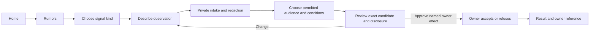

# Proposal 098: Alpha UI

Status: **Proposed**. Date: **2026-11-06**.

Current contracts are below; the canonical [delivery plan and
tracker](098-alpha-ui/delivery-plan.md) and [dependency audit
scope](098-alpha-ui/dependency-scopes.json) are separate. This proposal changes
documentation only. See [change history](#change-history).

Based on:

- [Challenge 098: Coherent Participant
  Experience](../10-challenges/098-coherent-participant-experience.md)
- [Ontological Basis](../../normative/90-supplementary/en/ONTOLOGICAL-BASIS.en.md),
  [Core Values](../../normative/30-core-values/en/CORE-VALUES.en.md),
  [Vision](../../normative/20-vision/en/VISION.en.md) and
  [Constitution](../../normative/40-constitution/en/CONSTITUTION.en.md)
- [P091: File-backed
  Configuration](091-file-backed-configuration-and-explainable-composition.md)
- [P095: Node UI Interaction Layer](095-node-ui-interaction-layer.md)
- [P057: User and Operator Notifications](057-user-and-operator-notifications.md)
- [P066: Assistant Channel](066-inquirium-assistant-channel.md) and [P073:
  Agent](073-agent-orchestration-organ.md)
- [P085: Operator-Sovereign
  Extensibility](085-operator-sovereign-extensibility-and-experiment-packages.md)
- [P013: Whisper](013-whisper-social-signal-exchange.md)
- [P015: Contextual Whisper
  Authorship](015-nym-certificates-and-renewal-baseline/contextual-whisper-authorship.md)
- [Solution 026: Pseudonym Vault and Key
  Roles](../60-solutions/026-pseudonym-vault-and-key-roles/026-pseudonym-vault-and-key-roles.md)
- [P026: Assessment
  Exposure](026-resource-opinions-and-discussion-surfaces.md#6-assessment-exposure-and-sealed-rounds)
- [P036: Memarium](036-memarium.md) and [Solution 002:
  Memarium](../60-solutions/002-memarium/002-memarium.md)
- [P024: Capability
  Passports](024-capability-passports-and-network-ledger-delegation.md), [Solution 006:
  Capability Binding](../60-solutions/006-capability-binding/006-capability-binding.md)
  and [P072: Capability Registry](072-capability-registry.md)
- [P080: Middleware Channel](080-multiplexed-middleware-channel-executor.md) and [P052:
  Desktop Host](052-tauri-hosted-node-ui.md)
- [P097: Fresh-Identity
  Onboarding](097-fresh-identity-onboarding-and-messaging-readiness.md)
- [Solution 001: Node UI](../60-solutions/001-node-ui/001-node-ui.md), [Solution 019:
  Middleware](../60-solutions/019-middleware/019-middleware.md) and [Solution 039:
  Notifications](../60-solutions/039-notifications/039-notifications.md)

## Executive Summary

Define **Alpha UI** as Orbiplex's coherent default participant experience: a calm home
organized around intentions, recognizable visual conventions, direct interaction for
everyday work and guided decisions for bounded processes. Include a real path from
attention to context, authorized action and visible result.

Ship useful defaults together with a small composition contract. Packages contribute
named entry points to a host-owned catalog; the operator places them through JSON. Later
configuration views edit those same declarations. The host provides common layout and
navigation; domain owners provide data, permitted transitions and effects.

The proposed home has five categories: **Ask or delegate**, **Message someone**, **Find
material**, **Rumors**, and **My activity**. Availability is resolved from admitted,
participant-appropriate functions. Resume and Needs attention are quiet, contextual
additions rather than competing dashboards. Find material includes a proposed Memarium
explorer over authorized memory views; it does not require a new search engine or a raw
store browser. The target includes Browse, Contribute and My rumors. Missing owner
capabilities are delivery dependencies, not reasons to remove these functions. Earlier
usable slices remain partial until the target's owner and integration gates pass.

The request to prepare this proposal establishes its scope, not acceptance of every
detail below. New identifiers and JSON shapes are contract candidates. No schemas are
registered by this document, no Node behavior changes, and no usability or release
qualification is claimed. “Alpha UI” names this experience baseline; it is not a
declaration that the Node alpha release is ready.

## Context and Problem Statement

### Dated source baseline

Inspected on `2026-11-06`: Node `0fbde320ea172908352f9f8f5b7abadd8b4c140b`; Orbidocs
`1776cf30d799acac66c74ecf25cb759c211c9fc6` before this proposal.

| Observation | Source | Design consequence |
|---|---|---|
| Participant home contains illustrative counters, a selected request and recent facts; six navigation labels share `/app`. | `node:node-ui/templates/user/index.html`, `node:node-ui/templates/user/base.html` | Replace illustrative content with owner-backed state or truthful absence; provide real destinations. |
| Onboarding, contacts, chat and a live notification rail already exist. The rail is bounded to eight items. | `node:node-ui/src/handlers/user.rs`, `node:node-ui/templates/user/` | Connect existing interactions and add complete bounded access; do not treat a rail as the whole inbox. |
| Package manifests declare surfaces, mounts, navigation groups and entries; current middleware grouping is operator-oriented. | `node:node-ui/src/ui_package.rs` | Add an explicit participant entry-point contract; a renamed group alone is insufficient. |
| P095 has a bounded implementation checkpoint for interaction continuity, private views and parsed passive module admission. | P095; `node:node-ui/docs/INTERACTION-LAYER.md` | Reuse these boundaries without claiming every P095 migration is complete. |
| Current contextual Whisper authoring requires authenticated operator proof. | `node:agora-ui/README.md` | Participant placement requires an owner-approved participant surface; it cannot inherit operator authority. |

The original UX diagnosis prioritized a central Needs attention path. The broader home
design preserves it while also making user-initiated work easy to begin. This is expert
source review and a design hypothesis, not observation of users completing tasks.
Existing notification and messaging services are antecedents, not evidence that this
complete experience exists.

### Architecture review and corrected decisions

The review uses the same repository revisions as the baseline above, including later
amendments inside the referenced proposals and current solution contracts. It checks
document consistency; it does not rerun their historical acceptance.

| Initial gap or conflict | Owning contract | Correction in this revision |
|---|---|---|
| Package suggestions, durable configuration and per-user availability were one resolution sequence; fallback was underspecified. | P091 §§4–6; Node UI startup presentation contract | Separate declaration resolution from catalog projection; pin their respective inputs, preserve activation receipts and expose refused startup independently. |
| New private home content had no explicit sensitive-view admission path. | P095 sensitive-view amendment; `node:node-ui/docs/INTERACTION-LAYER.md` | Keep the ordinary shell data-free of private models; admit protected fragments and fence restoration before rendering them. |
| Attention omitted concurrency, handled-state and assessment side-channel rules. | P057 schema-defined actions and assessment exposure; S039; P026 viewer projection | Use recipient/version-bound actions; keep notification handling distinct from domain completion; preserve polling/count/SSE exclusions. |
| Moving or hiding an entry relied on category arrays and could conflict with an inherited placement. | P091 keyed composition and omission/inheritance rules | Replace per-category entry arrays with one keyed placement/visibility override per entry. |
| Generic Publish/My submissions under-described Whisper's current versions, intake and consent. | P013/S011, P015 contextual authorship, P013-DFR-003 and disclosure conditions | Project existing owners and profiles, preserve private intake/redaction and author approval, and link to the owned My rumors view. |
| A shared guided frame could be read as permission to activate module behavior. | P095 passive fragments; P080 bridge; S019 | Keep host controllers and passive module forms distinct; require an admitted participant caller contract. |
| Resume implied global recency and arbitrary retention; baseline scope could silently shrink. | P091 runtime/configuration separation; P095 draft lifetime; domain owners | Bound owner projections and order, avoid an activity-tracking store, and make delivery gates/dependencies explicit. |
| A Memarium explorer could imply all Personal memory is visible to a logged-in participant. | P036/S002 passport and classification gates; P047; S022 | Add a bounded owner-filtered read surface; preserve owner-only journals and separate optional semantic indexing. |

The whole-scope review additionally corrects the following delivery gaps:

| Gap | Owning contract | Correction |
|---|---|---|
| Ask/delegate and activity had labels but no bounded owner delivery gate. | P066, P073, P013 and P060 | Add independent-participant inquiry/delegation tasks and owner activity outputs; P098-014/015 integrate them. |
| A verified memory passport was assumed to be obtainable. | P024/S006 | Freeze issuance/delivery policy in P024-011 and track provisioning in P024-013; S006 verifies rather than issues authority. |
| Whisper producer bindings waited for the entire memory explorer read path. | P036/P013 | Split P036-014 producer bindings from P036-013 reads; preserve intake's own custody/retention checks. |
| "Applicable outputs" of partial P095 rows obscured completion dependencies. | P095 | P095-014 names the conformance contract; new routes need their own evidence. Deferred CSS admission is P095-015. |
| Re-admission invalidation could discard durable drafts; public layout could expose private configuration. | Domain custody owners; P095 | Invalidate presentation bindings, reopen retained owner references under fresh admission, and classify configuration metadata before rendering. |

These corrections assign missing contracts and delivery gates; they do not change
Whisper disclosure rules, create issuer authority or claim owner implementation.

### Meaning and ownership across layers

| Transition | Preserved meaning and new decision |
|---|---|
| Ontological basis → values | Contextual, relational agency motivates respect for the person's process; it creates no authorization rule. |
| Values → vision → normative law | Human agency, sovereignty, privacy and relief from cognitive overload inform cooperative tools. The Constitution retains normative authority. |
| Norms and user problem → P098 | Preserve consent, disclosure and exit boundaries; choose defaults that make actions and consequences understandable. A category is a presentation decision. |
| P098 → solutions | Node UI composes representations; configuration, notifications, Messaging and Whisper retain their respective ownership. |
| Solutions → schemas | Freeze identifiers, resolution and availability semantics; display metadata cannot confer authority. |
| Schemas → implementation | Node handlers/templates render the contract; owner APIs authorize effects. Contract tests, runtime observations and usability evidence remain distinct. |

## Proposed Model and Decisions

### 1. Default home: a place to start and return

The first question is **“What would you like to do?”** / **“Co chcesz zrobić?”**. Use a
compact identity header, a small stable set of intention tiles, an optional resume card,
and a restrained attention summary. Do not show fabricated counts, generic healthy-state
assurances or an activity feed merely to fill space.

| Stable category ID | English / Polish label | Default purpose |
|---|---|---|
| `ask` | Ask or delegate / Zapytaj lub zleć | Start a question or choose an available task; explain relevant provider, scope and consequences before execution. |
| `people` | Message someone / Napisz do kogoś | Find a contact and open a conversation; reuse Messaging readiness and recovery. |
| `materials` | Find material / Znajdź materiał | Browse authorized Memarium records and other admitted sources, then inspect content, provenance and permitted relationships. |
| `rumors` | Rumors / Pogłoski | Browse provisional signals, contribute through an admitted authoring flow, and open the owner-projected My rumors view. |
| `cases` | My activity / Moje sprawy | Return to drafts, ongoing requests and results through references to their owners. This is not a new domain case type. |

Conceptual layout below shows placement, not sample runtime data:

```text
Orbiplex                                 Identity · Settings

What would you like to do?

[ Ask or delegate ]    [ Message someone ]
[ Find material   ]    [ Rumors          ]
[ My activity     ]

Resume: <one recoverable item, only when present>  [Continue]
Needs attention: <authorized actionable summary>  [Open]
All functions
```

The bundled order is the table order. Tiles have a short explanatory sentence and an
icon with a text label. They lead to a category's available functions; when there is one
unambiguous function, direct entry avoids a redundant selection page. Installed packages
do not each gain a home tile. Categories with no discoverable entries are omitted; an
authorized but temporarily unavailable entry may remain with an explanation and a
recovery path. Availability changes do not reshuffle tiles beneath the pointer or
keyboard focus; refresh at a clear navigation boundary. Identity change, revocation and
a changed privacy context take precedence over layout continuity: immediately conceal
invalid private content and refuse stale actions, even while preserving the position of
a neutral placeholder.

Resume uses one ephemeral server-side slot for the session's last explicitly active
owner reference: subject, session generation, owner/reference and binding identity only.
It is cleared on identity/session-generation change, logout, expiry and process restart;
it is never persisted or copied to browser storage. Only an explicit authenticated command may
replace it; background refresh and ordinary GET do not change the slot or create
an activity trail.
Reauthorize the reference and ask the owner whether it remains recoverable before
offering Continue. Across restarts, offer an owner-reported resumable item only when its
contract supplies that fact; use configured owner order and owner-local ordering for
ties. Do not infer global recency from unrelated clocks or create a UI usage history to
choose a card. My activity exposes bounded owner sections with independent continuation
and unavailable states; it makes no cross-owner total/order promise. Omit Resume when no
recoverable item is known. A retained reference does not prove a retained draft: report
expired or unavailable drafts truthfully.

The final baseline names its providers rather than accepting any placeholder in these
categories:

- **Ask or delegate:** P066 supplies a participant-owned Assistant conversation; P073
  supplies one named, bounded delegated-task profile. Assistant is a channel, not a
  Messaging contact. Advice does not authorize Agent spawn. Each owner's current
  provider/model, context, budget and effect admission remains explicit. Additional file
  capture, remote execution and new effect families retain their separate owner gates;
  choosing this category enables none of them implicitly.
- **My activity:** P066 conversation references, P073 delegated-task status/results,
  P060 conversation/operation references and P013 intake/contribution references form
  bounded owner sections. Whisper supplies at least one genuinely retained draft for the
  resume acceptance case. Owners expose only their admitted metadata; activity is
  neither a transcript index nor a view of raw Agent journals.

Each owner projection supplies subject-bound opaque entity/operation references, kind,
current revision/status, authorized return/result links, retention/expiry and an
explicit resumability fact when supported. Pagination and refresh belong to that owner
and bind the participant; UI does not scan a store, invent global ordering or infer
completion from a timestamp. Opening a return link reauthorizes the current object and
transition. An unavailable owner cannot hide the other sections. P098-014 integrates
these outputs; it owns no durable operation state. The local-primary slice may initially
expose P057's retained handled/history references only and omit Resume; it does not
satisfy this final activity gate.

Needs attention links to a participant-scoped, paginated list with context, permitted
actions and outcomes, reusing P057/S039. The queue owns continuation: if the existing
API lacks complete bounded pagination, extend that owner contract before claiming
complete access; never download everything and paginate in the browser. The inspected
API does lack continuation, and its state-change unread calculation uses `usize::MAX`.
P057-018/019 own bounded paging and summary semantics; the eight-item rail and an
unbounded unread scan cannot satisfy this requirement. Counts are authorized and
truthful; if only a bounded subset is known, label it or omit the total. Do not promote
all unread information into urgency. Critical operation-specific blockers appear where
the user can understand and address them.

Use P057's recipient binding, notification identity/version, expiry and registered
action reference. `read/opened`, `handled` and domain completion are separate facts:
handled means the notification no longer needs attention, not that its domain operation
succeeded. Retain handled/history access only within owner retention. State changes and
actions are explicit authenticated commands with CSRF, current domain checks and the
owner's concurrency/idempotency contract. Refresh after a version conflict or
`action-no-longer-available`; never retry stale approval intent. A `link` can open an
admitted local route; an inline command needs a registered host action. A package
entry-point ID is neither of those action authorities.

Assessment-derived attention must consume P026's current viewer projection before
ranking, limiting, counting or rendering, including previews and caches. Withheld is not
zero. Preserve P057's `resource-assessment.v1` polling-only adapter and its exclusion
from generic unread/priority counts and global SSE even after release. Hidden peer
changes must not alter home badges, ordering, freshness or event rate. Keep ordinary
rumor delivery and admitted protective notices in their existing lanes; failure of the
exposure owner must not reveal raw data or suppress authorized protective notices
through a blanket UI rule.

Settings and the All functions catalog link stay secondary. Operator administration
remains a separate, guarded surface. The header identifies the active participant; it
need not permanently display implementation details such as middleware health or
synchronization internals.

The home is not an exception to P095. Non-sensitive navigation may use ordinary
server-rendered/no-JS pages; private identity labels, personalized availability, Resume,
Needs attention and My activity models require explicit route/template classification
and separately guarded fragments. Initial document navigation must not fetch their
private owner models or embed them in hidden DOM, attributes, JSON or preload responses.
Keep public layout/configuration DTOs separate from participant models. "Configuration"
is not synonymous with "public": operator category labels, provider/installation
metadata and participant catalog choices may themselves be private. Initial shells use
bundled neutral metadata or values explicitly classified public; custom/private metadata
follows a guarded fragment. Operator provenance and source diagnostics stay on the
operator surface. Loading, locked, unavailable and genuinely empty are distinct.
Preserve current-session auth, key-context checks, no-store policy, disabled history
snapshots and the final DOM-commit fence on both browser and native paths. A shared home
layout cannot establish a new no-JS exception for sensitive content. Load identity,
personalized availability, Resume and attention through separately classified
owner-backed fragments, each with its own unavailable state. Owner I/O does not occur in
the public shell route. All fragments still share the current session/generation fence:
independent loading must not mix identities. A canary fixture places distinct private
strings in each owner model and private layout/ catalog configuration and verifies their
absence from initial/no-JS HTML, attributes, embedded JSON and preload responses.

### 2. Visual baseline shipped with the defaults

The baseline is a quiet, readable application with generous spacing and clear hierarchy.
It includes actual templates and shared style tokens; a configurable menu alone does not
satisfy P098. Initial values below are proposed defaults to validate:

| Element | Alpha default |
|---|---|
| Typography | Local system sans-serif; body `1rem` with `1.5` line height; sentence-case labels; page heading around `2rem`. Honor user font settings. |
| Geometry | Centered home up to `64rem`; guided content up to `42rem`; `1–2rem` page padding; spacing steps `0.5`, `1`, `1.5`, `2rem`; restrained `0.75rem` card corners. |
| Layout | Two home columns where content fits, one on narrow screens; row-major visual and keyboard order; no horizontal carousel or forced viewport-height canvas. |
| Color | Neutral surfaces and text with one restrained accent. Separate semantic success, warning and error tokens; text and icons convey state alongside color. |
| Themes | Bundled light and dark palettes. The operator's `system` default follows the client OS preference; a fixed operator preset applies only within its admitted scope. A durable participant override needs its own admitted P091 address/precedence; until supported, any local override is session-only. |
| Actions | Main controls at least `44 × 44` CSS pixels; one visually primary continuation or final action in guided steps, a consistent Back control and a secondary exit/pause action. |
| Motion | Minimal transition feedback, no autoplay or decorative motion; honor reduced-motion preferences. |
| Feedback | Distinct loading, empty, unavailable, refused, failed and uncertain-result presentations. Keep useful prior context while a refresh is pending. |

The initial palette uses soft green neutrals and a restrained green accent:

| Token | Light | Dark |
|---|---|---|
| Page background | `#f8faf9` | `#161c1a` |
| Card surface | `#ffffff` | `#202925` |
| Card boundary | `#7a8d85` | `#6b7f76` |
| Main text | `#20352e` | `#edf3ef` |
| Secondary text | `#52665e` | `#b1c1b8` |
| Primary action / text on it | `#285b43` / `#ffffff` | `#b6dec6` / `#153221` |

These are the versioned preset's defaults. Operators may override the bounded theme
parameters in §5; arbitrary CSS is deferred. Controls also need tested boundary, focus
and semantic-state tokens; the palette alone is not a complete accessibility result.
Reserve success labels/icons for real outcomes so that the green accent does not make an
ordinary choice look like a completed operation. Calculated from these sRGB values,
card/page contrast is only 1.048:1 light and 1.157:1 dark. The proposed opaque boundary
has contrast 3.352:1 against the light page and 3.514:1 against its card; dark values
are 4.051:1 and 3.503:1 respectively. Use the boundary wherever identifying the
interactive card requires it. Verify the actual rendered border, focus/hover/disabled
states and forced colors; arithmetic on preset values is not a browser/native
accessibility qualification.

The two-column home becomes a single readable column rather than shrinking targets.
Guided steps use the same frame and button positions. Ordinary browsing retains
orientation through title and Back/Home navigation; focused steps do not compete with a
permanent multi-panel dashboard. An optional detail view follows P095's focus and return
contract rather than stacking modal dialogs.

Accessibility targets include keyboard operation, visible unobscured focus, semantic
headings/labels, associated error messages, announced results, adequate contrast and
reflow at 320 CSS pixels. The `44 × 44` target is a deliberate default inspired by [W3C
target-size
guidance](https://www.w3.org/WAI/WCAG22/Understanding/target-size-enhanced.html); the
layout follows [W3C reflow
guidance](https://www.w3.org/WAI/WCAG22/Understanding/reflow.html). These choices do not
claim full WCAG conformance. Review both palettes and zoomed layouts in the delivered
renderer. Screen-reader announcements must avoid repeatedly reading the whole screen
during background updates.

English and Polish labels above establish initial copy for review, not a new global
locale policy. Use the host's locale selection and explicit fallback; keep IDs
language-independent. Custom labels are bounded plain text. Avoid truncating the meaning
of a choice, particularly its recipient, visibility or cost.

### 3. Two interaction modes with a shared frame

Use direct conversation, search, reading and browsing where continuous interaction is
natural. Use guided steps when a bounded operation needs several meaningful decisions.
**One decision per screen** allows several comparable options and their consequences; it
does not require one control per screen or a wizard for every click. The [GOV.UK
question-page pattern](https://design-system.service.gov.uk/patterns/question-pages/)
provides a useful reference for the latter mode.

Guided-flow contract:

1. Explain the decision in a short title and reveal supporting detail on demand.
   Selecting a choice does not advance automatically; Continue is explicit.
2. Back restores valid prior choices. Navigation does not reverse committed effects.
   Browser history and in-app Back must not resubmit an operation.
3. Show named stages; show “step n of m” only when the total is actually known. A
   changed branch revalidates dependent answers and explains invalidation.
4. Pause is offered only with an honest retention promise. Owners decide which drafts
   can persist and for how long. Sensitive transient input follows P095; do not store
   private HTML, secrets or arbitrary drafts in browser storage to simulate continuity.
5. Before a consequential effect, show a review with recipient/audience, submitted
   content, relevant cost or scope and recoverability. Change returns directly to the
   relevant decision, then to review after any necessary dependent decisions.
6. Name the final action for its effect: Send, Publish or Start task. A generic Continue
   does not authorize an undisclosed effect. The [GOV.UK check-answers
   pattern](https://design-system.service.gov.uk/patterns/check-answers/) informs this
   review interaction.
7. Present the owner's result and a meaningful next link. Distinguish accepted, queued,
   delivered, refused and outcome unknown where the owner distinguishes them. After a
   lost response, use the owner's authorized result lookup if available; a correlation
   ID alone is neither an idempotency key nor a read grant. If no reliable lookup
   exists, retain outcome unknown and the owner's recovery route. Do not issue an
   automatic duplicate effect or invent a success.

An ordinary chat send can remain a direct Send action with clear recipient context; it
need not acquire a separate review screen for every message. A workflow may have
intermediate effects, but must name and authorize each at its own boundary. GET, tile
selection and Back never create domain effects. An explicit Continue may save a draft or
request redaction when the owner contract and copy say so; the navigation frame does not
conceal those writes as GETs. HTTP method alone is not domain semantics: existing host
capabilities may expose reads through POST. Preserve their admission and audit
requirements. In-app Back is owner-provided navigation, browser Back is history
restoration, and P095 panel Back is bounded panel navigation; they share safety rules
without sharing a second router.

For new guided HTML forms, GET renders an existing owner draft/review without a domain
write. POST carries the expected draft revision and CSRF protection, then uses
Post/Redirect/Get (303 to the canonical GET); negotiated fragment navigation must
preserve the same no-repeat semantics and P095 confinement. The owner records or
deterministically derives the final effect's stable idempotency key from the
participant, operation and exact retained review revision/digest. Prefer creating that
intent in the preceding explicit review-preparation POST. GET only exposes the already
bound intent; generating a fresh key on every render would permit duplicates. A changed
review invalidates old approval, while reload/Back and a lost reply reuse authorized
readback of the original effect. Owners lacking this contract remain unavailable for
that guided effect; UI invents no parallel ledger.

P097 remains the first-run/readiness owner. Entering or rendering the home does not
create passports, grant issuer status or execute preparation. Preserve its explicit
deferral path to unrelated work and the later execution-time send gate. P098-005a first
reuses P097's local-primary preparation/recovery outputs from MSG-ONB-004/006. P098-005b
then exercises independent-participant Whisper review from P013-PA-003 using those
proven common mechanics. P097's done evidence does not qualify P/Q. Additional owner
flows require their own transition, input lifetime and result contracts.

Example, conditional on an admitted participant authoring contract:



Back is available through the decision stages. The owner supplies allowed audiences, any
required redaction/review and available next actions. The diagram chooses no new Whisper
policy and cannot bypass required owner steps.

### 4. Entry-point catalog and package contributions

Separate **category**, **entry point**, **UI surface** and **operation**. A category
groups intentions; an entry point starts an interaction; a registered surface renders
it; a domain owner authorizes effects. One package may contribute several entry points
to several categories, and several providers may serve one intention.

Candidate catalog metadata includes a stable namespaced entry ID, localized label and
description, admitted surface reference, suggested category and intended audience. Bind
the entry to its admitted package, surface, contract revision and selected module
instance; the spelling of an ID does not prove ownership. Multiple instances require an
explicit binding or a visible provider/instance choice, never first-match routing.
Host-built-in functions use the same catalog model without pretending to be middleware.
The host resolves actual audience eligibility and availability. A package's audience or
capability declaration is an assertion to check, never a grant.

Represent that binding as a value: package identity, admitted-content digest, admission
occurrence/generation, surface/contract revision and module-instance
identity/generation. The namespaced entry ID is only the configuration key. Identical
package bytes can have the same content digest after reinstall, so that digest alone
cannot expire old references. Removal/re-admission advances the host-owned admission
generation. The complete binding must never be reused after restart, reinstall or
restore: persist a monotone generation and/or bind it to a fresh host-issued
incarnation. A persisted counter alone needs restore/rollback handling; missing, corrupt
or exhausted state cannot reset to an old identity. SQLite is a possible host store, not
domain semantics. Old navigation links, in-flight fragments and pending UI transitions
must match the whole current binding and pass current authorization. Durable drafts and
results remain under their domain owner's custody/retention; a module restart or
reinstall does not erase them. Reopening requires a fresh admitted surface and
owner-authorized reference resolution, with stale review/transition intent refused and
no automatic effect resubmission. A display name or recycled entry ID never transfers
another owner's records.

Extend the current package/UI registry deliberately; do not reinterpret every existing
operator `nav_group` as participant access. Resolve surface references through the
admitted registry. Layout configuration cannot choose arbitrary URLs, filesystem paths,
HTML fragments, scripts, HTMX attributes or host commands. Package-specific views remain
possible within the existing reviewed trust boundary; executable surfaces still require
P095's separate isolation decision. Use a new manifest schema version with a separately
named, closed participant entry section and bounded fields. Legacy `nav_group` and its
`middleware` default remain operator navigation only. An absent participant section
contributes no participant entries. Freeze exact schema name/version and compatibility
refusal in P098-002; unknown executable fields cannot pass through to a template. Reuse
the current package loader/admission path rather than creating a second loader.

Existing module HTML remains a bounded passive representation: permitted links and forms
stay within the admitted mount. Placing it in a guided frame does not activate
Stimulus/HTMX hooks, shell selectors, module CSS or shared controller actions inside
that content. Host-owned guidance and controls sit outside the untrusted subtree. If a
common guided component needs module data, define a narrow validated owner DTO and host
renderer; do not smuggle executable instructions through catalog metadata.

Reuse S019/P080 lifecycle, reports and the host-mediated module HTTP bridge. The current
operator caller scope does not become participant scope by relabeling it: freeze
propagation and verification of the actual participant context before admitting such a
module surface. Add no browser-to-module listener, service discovery protocol or second
package loader. UI entry discovery remains separate from service catalog/capability
discovery; this metadata grants neither service nor native access.

Duplicate entry definitions/owners for one namespaced ID are admission errors. Multiple
instances of the same admitted definition are candidates for explicit instance
selection, not duplicate declarations. Ambiguous surface ownership still refuses
admission. Distinct providers for the same intention are allowed; expose a meaningful
choice when provider, disclosure, cost or scope differs. Do not silently pick the first
match. Filter inaccessible entries and counts before projection; unauthorized objects
must not leak through category labels, previews or diagnostics shown to participants.

Installation, admission, eligibility, readiness and execution authorization remain
distinct. Recheck authority at execution even when an entry was visible. Package removal
or permission loss invalidates pending transitions without granting a stale route. An
entry ID cannot silently transfer to another owner on reinstall; renewed admission must
verify its binding and invalidate stale navigation references. The host may explain an
authorized unavailable function without exposing another participant's or an operator's
private configuration.

### 5. File-backed composition, with a useful bundled configuration

Keep the three transformations pure and explicit:

1. `resolve_declarations(layers, schema_rules)` returns requested/resolved values,
   provenance and diagnostics under P091; it performs no activation or owner I/O.
2. `project_catalog(active_composition, admitted_packages, module_instances)` returns
   normalized, binding-aware catalog values and structural diagnostics.
3. `project_participant(catalog, participant_context, owner_witnesses)` returns eligible
   entries and bounded availability/refusal states. Collect owner I/O before this call;
   witnesses carry subject/binding, source revision, observed generation and validity,
   including explicit unavailable/unknown results.

A witness must match the catalog binding's complete admission/instance generation,
subject, purpose and validity. Reject a mismatched or expired witness; a missing witness
means `unknown`, never `available`. Keep structurally discoverable metadata separate
from permission to render a private entry. A generation change between snapshot
acquisition and DOM commit still requires the P095 commit fence; pure projection does
not remove that race. Include reinstall/stale-witness permutations in generative
fixtures.

No projection fetches, signs, changes grants or silently refreshes a witness. Execution
still checks current owner authority. Golden fixtures pin outputs; generative checks
cover deterministic composition, one placement per key, repeated move/hide,
inheritance/omission, unavailable owners and admission-generation changes. P098-001
supplies a reproducible inventory fixture, not participant secrets or a snapshot
mistaken for live authorization.

P091 owns configuration addressing, composition, provenance and activation. Node UI owns
descriptors for these presentation settings and their supported scopes. The UI bundle
supplies five category definitions, ordering and visual presets. Operators can move,
order or hide entries, rename/add categories, select an approved preset and override its
admitted theme parameters. Package suggestions cannot create new top-level categories
automatically.

Keep three inputs and results distinct:

1. P091 resolves durable declarations from the selected file/default sources for
   admitted Node UI descriptors. Preserve the source, descriptor and resolver identities
   and the owning UI instance's application acknowledgement.
2. Node UI joins the consumed layout with a bounded admitted entry catalog snapshot and
   applies placement preferences. Suggestions are catalog metadata, not a new
   late-sorting configuration source. An explicit preference overrides a suggestion.
3. The owner-authorized participant projection applies current eligibility, readiness
   and disclosure. These runtime observations do not mutate the files or manufacture a
   new P091 activation. Private projections cannot be shared across identities, scopes
   or exposure profiles.

Explain layout provenance and catalog/availability freshness separately. If a later
descriptor chooses to consume package data as configuration defaults, P091 must retain
those exact artifacts as resolution inputs; it cannot read a live registry inside the
pure resolver. Order entries by explicit numeric order, then stable ID; no usage ranking
rearranges navigation in the background.

Start with JSON files and read-only validation/effective preview. A later editor uses
the same contracts. Candidate operator override, assuming the three example entry IDs
have been admitted:

```json
{
  "node_ui": {
    "navigation": {
      "schema": "node-ui-navigation.v1",
      "home_order": [
        "ask",
        "people",
        "materials",
        "rumors",
        "cases"
      ],
      "categories": {
        "rumors": {
          "label": {
            "en": "Rumors",
            "pl": "Pogłoski"
          },
          "description": {
            "en": "Signals and observations worth checking",
            "pl": "Sygnały i obserwacje, które warto sprawdzić"
          },
          "icon": "messages"
        }
      },
      "entries": {
        "whisper.browse": {
          "category": "rumors",
          "visible": true,
          "order": 10
        },
        "whisper.compose": {
          "category": "rumors",
          "visible": true,
          "order": 20
        },
        "whisper.mine": {
          "category": "rumors",
          "visible": true,
          "order": 30
        }
      }
    },
    "appearance": {
      "schema": "node-ui-appearance.v1",
      "preset": "alpha",
      "color_scheme": "system",
      "tokens": {
        "palette": {
          "light": {
            "accent": "#245b78"
          },
          "dark": {
            "accent": "#a9d8ef"
          }
        },
        "typography": {
          "body_scale": 1.1
        },
        "shape": {
          "card_radius_rem": 1.0
        }
      }
    }
  }
}
```

Only deliberate overrides appear here: the two accent colors, body scale and card radius
differ from the Alpha defaults. Omitted text-on-accent, boundary and other values
inherit from the selected preset. The example's base palette pairs pass the stated
contrast checks; derived-state and rendered qualification still belong to P098-002/003.
Explicit overrides intentionally survive a preset change, which must be previewed and
revalidated.

The full default artifact is a tracked, versioned JSON file delivered with the UI; this
partial example is not that artifact or a currently supported configuration. Freeze its
address and schema in P098-002 before implementation. In particular:

- Category and entry-override maps compose by stable key using the descriptor's P091
  rules. `home_order` is an ordinary array replaced in full by a later source;
  duplicates are invalid. `null` is not a generic deletion instruction.
- Each entry has one primary category: its explicit `category` override, otherwise its
  admitted suggestion. The keyed override replaces the draft's per-category entry
  arrays, so moving an entry cannot leave an inherited duplicate. A suggestion naming an
  unknown category goes to All functions with a diagnostic; it does not create a home
  category. An unknown explicitly configured category is an error.
- `visible: false` excludes the entry from navigation, including All functions, across
  later package suggestions. Omission inherits an earlier declaration; only removal of
  that declaration at its writable source restores inheritance there. It does not erase
  lower-priority operator restrictions. Existing domain records can remain reachable
  through separately authorized activity/attention references.
- Removing a category from `home_order` removes its home tile, while authorized
  navigation through All functions can still reach it. Excluding an entry from
  navigation does not disable its service or revoke a capability. Preserve a host-owned
  Home, All functions, My activity and Needs attention access path even if their tiles
  are omitted. These controls expose only currently permitted data and operations; they
  cannot bypass a disabled service or refused authorization.
- Unknown schema versions/setting keys, invalid category references, duplicate JSON
  keys, unsupported icons/presets and over-limit values receive field-level refusals.
  Validate references against admitted catalog bindings during preview. Unknown or
  ambiguous entries cannot be activated by configuration. Preserve references to
  removed/inactive packages as explicitly unresolved declarations where P091 permits
  that retention; do not silently delete them or count them as validated entries.
  Re-admission rechecks ownership and current constraints. A temporary owner outage is a
  separate availability observation, not a syntax error.
- Invalid edits do not replace an acknowledged configuration. If declarations cannot
  resolve at startup, expose guarded diagnostic/recovery access with a source-refusal
  and independent recovery-launch fact, not an apparently active default layout. Never
  skip a bad layer. Selecting a different normal layout requires a fresh valid P091
  resolution and applicable approval/consumption acknowledgement; current-file repair
  cannot retroactively validate the refused launch. Reuse the established Node UI
  startup recovery contract rather than changing operator-presentation rules.
- Preserve P091's `declared`, `resolved`, `provisioned`/pending and `active` meanings;
  unavailable runtime data is separate. V1 applies navigation/appearance at UI restart
  and client reload, not daemon restart, with active-value reporting by the owning UI
  instance. Dynamic service health may refresh the participant projection without
  reapplying configuration. Preserve `node_ui.operator_presentation` and its existing
  scope; add no browser settings authority or new environment-only presentation
  override.

V1 configuration describes composition, presets and bounded theme values. It contains no
expressions, workflow graph, HTML/CSS templates or arbitrary JavaScript. The host owns
component structure and accessible rendering. A later operator view edits this data
rather than introducing a second layout model. Localization, bounded strings and
permitted icon/preset/theme values are part of the schema freeze, not ad hoc renderer
conventions.

#### JSON theme parameters

`node-ui-appearance.v1` is a proposed closed contract, not a registered schema. P098-002
must register its P091 descriptors and freeze the following finite input surface. Its
scope is the operator-managed Alpha participant shell and host-rendered components of
the owning UI instance. It does not restyle the operator console, independent
recovery/unlock shells or introduce durable participant preferences.

| Appearance path | Accepted value | Alpha default / effect |
|---|---|---|
| `preset` | Admitted preset ID; initially `alpha` | Selects a complete, versioned base theme. |
| `color_scheme` | `system`, `light`, `dark` | `system`; selects between two already validated palettes without a new configuration activation. |
| `tokens.palette.{light,dark}.<key>` | Only `page_background`, `card_surface`, `card_boundary`, `text`, `text_secondary`, `accent`, `on_accent`; opaque `#RRGGBB` strings, normalized to lower case | Defaults from the §2 table; each palette/key can be overridden independently. No alpha, functions, variables or URLs. |
| `tokens.typography.font_family` | `system-sans` or `system-serif` | `system-sans`; host-owned local font stacks, preserving semantic code/monospace styling. No font paths, downloads or free-form CSS families. |
| `tokens.typography.body_scale` | Finite JSON number from `1.0` through `1.5` | `1.0`, relative to the user's base `1rem`; preserves browser text scaling and zoom. |
| `tokens.typography.line_height` | Finite JSON number from `1.5` through `2.0` | `1.5`, unitless body line height. |
| `tokens.spacing.density` | `compact`, `comfortable`, `relaxed` | `comfortable`; respective factors `0.875`, `1.0`, `1.25` for host-defined gaps/nonessential padding. Target size and focus clearance never shrink below the baseline. |
| `tokens.shape.card_radius_rem` | Finite JSON number from `0` through `1.5` | `0.75`; card corners only, with reflow and focus geometry preserved. |

These are data values, not CSS declarations. Reject unknown keys, `null`, unsupported
units/enums, non-finite/out-of-range numbers and arbitrary custom-property names. The
host maps validated values to a closed set of CSS variables through its own
CSP-compatible stylesheet delivery. No selectors, `style` attributes, `calc()`, `var()`,
`url()` or `@import` are accepted as input. Focus, semantic warning/error states,
visibility, positioning, content and motion remain host-owned; theme input cannot
suppress a refusal, change an effect or weaken reduced-motion preferences.

[P091](091-file-backed-configuration-and-explainable-composition.md) composition applies
to the **sparse override map**: objects compose by declared key; later scalar values
replace earlier ones; omission inherits. `{}` does not clear inherited overrides and
`null` is not a reset. Remove a declaration from its writable source to restore
inheritance there. An explicit value equal to a default remains explicit, including when
the selected preset later changes.

The shipped appearance declaration selects `alpha`, `system` and `tokens: {}`. Complete
fallback values live in the versioned preset artifact, not as a competing layer of
explicit token overrides. Resolve declarations first, then purely expand the selected
preset and overlay the composed token map. Pin the exact preset artifact/digest,
descriptors and normalization/constraint revision as P091 inputs; do not consult a live
registry in the resolver. Effective preview distinguishes each preset-derived value from
an explicit source, and a preset change shows any retained overrides instead of silently
resetting them.

Validate the complete resulting theme in **both** palettes, even under a fixed color
scheme. As Alpha design gates, require at least 4.5:1 for main/secondary text against
supported page/card backgrounds and action text against its fill, and 3:1 for required
component boundaries/focus against adjacent surfaces. Include host-derived
hover/pressed/semantic-state colors in those checks; this is contrast against adjacent
backgrounds/text, not a requirement that hover differ from the normal fill by 3:1.
Freeze the deterministic derivation functions, constants, color space and rounding
together with the versioned preset artifact. Diagnostics name each failing derived pair
and the editable input tokens that produced it; never ask the operator to set an
unsupported derived token. Invalid pairs or geometry produce bounded field/pair
diagnostics, not silent color adjustment or clamping. Numeric checks do not replace
rendered font, focus, forced-color, zoom, reflow and browser/native acceptance in
P098-003.

For focus on admitted page/card surfaces, derive an inner separator from
`page_background` and an outer solid ring from `text`; reserve room for both. The outer
ring covers at least the area of a 2 CSS-pixel perimeter and replaces pixels of the
surrounding page/card surface. Since `text` must have at least 4.5:1 against both
surfaces, this supplies the color contrast without another operator token. Geometry,
clipping, forced colors and changed/derived surrounding surfaces still require rendered
checks. This is a design argument for this surface profile, not automatic WCAG
conformance; see the [W3C focus-appearance
guidance](https://www.w3.org/WAI/WCAG22/Understanding/focus-appearance.html).

Use one pure Rust pipeline for input validation, preset expansion, sparse overlay, state
derivation, contrast validation and stylesheet emission. Emit final hex values under a
content-digest URL compatible with `style-src 'self'`; keep private configuration
provenance out of the asset. Validator and browser consume the same numbers, without
browser-side `color-mix()` changing their meaning. No CSP weakening is required. P091
binds the derivation/preset version as a resolution input.

Preview has no writes or activation effects. Applying parameters retains P091's
declared/resolved/provisioned/active distinctions, UI-restart/client-reload policy,
consumption acknowledgement and guarded source-refusal recovery. Persisted values are
not active CSS merely because they were saved. The later P098-008 editor uses the same
descriptors and inheritance reset, without browser-local authority.

[P095](095-node-ui-interaction-layer.md) boundaries are unchanged: trusted shell styling
grants no style/behavior admission to passive package HTML, and no theme needs private
models in initial HTML or a relaxed CSP. Theme changes cannot bypass fragment admission,
context invalidation or native-host checks. Keep provenance inspection operator-guarded;
public style assets carry only non-sensitive presentation values.

#### Advanced custom CSS — deferred

P098-013 may later admit an operator-selected local theme package containing CSS. It is
not an extra V1 JSON escape hatch: `custom_css`, stylesheet paths and URLs remain
unsupported settings until a separate versioned descriptor/admission contract exists.
This option is outside baseline completion and does not depend on implementing an
HTML/HTMX/JS page builder.

The later contract must bind package bytes/assets and style-interface version, define
stable host styling hooks and resource bounds, and prohibit undeclared network
imports/font/image fetches. Package installation alone cannot activate it. P091 owns
selection, pinned resolution inputs, preview, approval where applicable, consumption and
rollback through a new valid resolution. Preview uses bounded synthetic content under an
admitted surface, not copied participant secrets.

P095-015 must first admit the style surface and any necessary isolation explicitly; its
deferred status is independent of the V1 conformance profile P095-014. A CSS layer,
naming prefix or operator signature is not proof of confinement; custom styles do not
inherit a right to inject scripts, native calls or passive-module CSS into the
privileged shell. Require protected recovery without custom assets, version/integrity
mismatch refusal and browser/native checks for focus, overlays, critical controls and
private-view lifecycle. Keep theme-specific accessibility evidence separate from the
bundled Alpha baseline. If the chosen style profile cannot preserve these boundaries, it
cannot be admitted as that baseline shell.

### 6. Rumors as a distinct, configurable category

Recommend a separate Rumors category in the bundled home because discovering and
offering provisional observations is a recognizable intention. The operator can omit its
tile or place its entries elsewhere. Do not make every reader learn the names of the
producing middleware packages.

The target entry points are **Browse, Contribute and My rumors**. Contribute covers
private intake, redaction/review, explicit certification when required, signing,
publication and authorized result readback. The last entry reuses
[P013-DFR-003](013-whisper-social-signal-exchange.md#dormant-fact-resonance-2026-10-27):
authored rumors and rumors explicitly confirmed as concerning the participant's records,
with owner-projected threshold/proposal/room/curation state. It is not a new UI-owned
authorship index or an inference that every matching rumor concerns the participant. Its
planned status remains explicit. My activity can reference the same owner views without
copying private link decisions into propagation.

Whisper intake remains owned by S011 and its supervised intake package: raw input,
intermediate redaction drafts and quarantine are local/private Memarium facts under
their existing retention/classification contracts. The UI neither stores them in an
independent draft database nor sends them to Agora. Owner-provided redaction, idiolect
reduction and risk review precede approval of the exact publication candidate;
provider/model assistance cannot mark that candidate approved.

Represent the active owner profile and schema version. Historical M4 `whisper-signal.v1`
behavior is not the contextual `whisper-signal.v2` source-counting contract in P015. A
`whisper-trace.v1` statement remains a separate bounded assertion; it does not enter
signal similarity/threshold counting. Display the owner's epistemic class, provenance
and consent state rather than normalizing all objects into one generic Publish
operation. Repetition, popularity or an attractive card does not establish verification
or endorsement. Do not automatically transform a Whisper submission into the separate
`public-gossip.v1` publication contract.

[Author disclosure
conditions](013-whisper-social-signal-exchange/author-disclosure-conditions.md) and
[long-lived rumors](013-whisper-social-signal-exchange/long-lived-rumors.md) retain
their own case authority, succession, retention and current-consent rules. The UI must
distinguish private preparation, author approval, acceptance, conditional release and
public publication. An expired nym does not by itself erase an old statement or
authorize a new one. Never use the private record ID in public links, telemetry or
disclosure summaries, or build a cross-nym identity index for My activity. Present
protected case metadata only through its admitted owner view.

Current operator-only contextual authoring is not the participant implementation of
these entries. The participant access contract in §8 defines the required split between
browse, intake, certification, authorship and publication. P098-010 freezes the owning
amendments; P098-006 delivers the target through separately admitted increments with the
dependencies in §9. Browse alone does not complete that row. Until then the category
appears only for actually eligible functions; the default configuration must not
advertise an executable participant publishing flow that does not exist. No task here
silently widens operator proof semantics.

### 7. Memarium explorer under Find material

Add **Browse memory / Przeglądaj pamięć** as a proposed `memarium.browse` entry in
`materials`. The primary view is a readable bounded list, then record detail. My
activity answers what can be resumed or followed up; this explorer answers what has been
retained and where it came from. It is not a raw filesystem, database or unrestricted
fact-stream browser.

Use [P036](036-memarium.md) and [S002](../60-solutions/002-memarium/002-memarium.md)
read/query projections through the host capability boundary. Entry/fact queries already
have `limit` and `offset`; fact queries also have recorded-time bounds and ordering. The
missing work is participant-scoped filtering, bounded projection and continuation
semantics under changing data/policy, not pagination from nothing. Begin with admitted
space, kind and tag/ID filters and owner-provided continuation. Show text search only
when a bounded owner API supports it; do not infer full-text or semantic search from a
method named query. Time/source filters and aggregate facets likewise need an explicit
owner projection. Complete participant-visible paging is owner work required by
P098-009, not permission to fetch/scan the store in UI.

The default scope is memory the current participant is actually authorized to read. The
four spaces (`personal`, `community`, `public`, `crisis`) are policy partitions, not
four universally visible folders. In particular, Personal space and its operator-held
seal do not establish per-participant ownership. §8 specifies the
participant-to-caller/view binding and owner-side filtering to establish before
admission; a UI session must not borrow an operator's broad passport. Missing
participant authorization keeps the entry unavailable rather than exposing node-wide
Personal memory. Community access retains its community binding.

A permitted detail view can show content, kind, source/provenance, classification,
permitted links, and retention/availability status supplied by the owner. Distinguish an
entry from an observed fact, an original from a derivative, and an observation from a
verified assertion. Unknown provenance/retention stays unknown. Links require
authorization at traversal; snippets, facets and counts cannot expose hidden targets.
Preserve selection and list position when returning from detail under P095.

Respect quarantine, classification, revocation, logical forget and current retention on
list, detail, preview, index and attachment paths. Context-free reads cannot invent
declassification; use an admitted surface-specific owner projection where required by
[P047](047-classification-label-propagation.md). Generic discovery must retain S002's
exclusion of owner-only Agent journals. Protected private intake kinds need an explicit
domain-authorized projection, not arbitrary fact listing; having a storage entry does
not authorize its display. The private explorer follows P095's guarded-fragment
contract. It creates no browser-side index of sensitive data.

The first slice is read-only. Export, promotion, retention changes, quarantine decisions
and forget are later owner-authorized operations, with explicit consequences and
separate permissions. “Forgotten” must not claim physical erasure where S002 only
guarantees exclusion from read projections. Opening a record does not refresh its
retention or trigger archival retrieval with side effects without explicit consent.

A relationship graph is an optional later representation of authorized links. [S022:
Semantic Index](../60-solutions/022-semantic-index/022-semantic-index.md) owns any later
semantic/vector retrieval; it is a policy-governed rebuildable projection, not a
prerequisite or an alternate source of memory truth. This proposal does not promote
embeddings, indexing or graph exploration to implemented status.

### 8. Participant access contract: Memarium and Whisper

This section proposes a local participant access contract; it does not register new
routes/profiles, amend issuer policy or claim deployed participant isolation. The source
inspection uses Node `0fbde320ea172908352f9f8f5b7abadd8b4c140b`. Reading the code
establishes the boundaries below, not their runtime qualification. An operator may also
be a participant: success when both identities coincide does not establish the
independent-participant path required here.

#### Existing mechanisms and missing composition

| Area | What exists at the inspected revision | What is missing for P098 |
|---|---|---|
| Local participant foundation | `operator_participant_required()` selects the sole operator participant in identity/Vault paths; the console memo explicitly defers multiple participants. See `node:daemon/src/identity_host.rs` and the console identity memo. | Real O/P/Q provisioning, explicit activation/operator role and separate credentials, Vault/key/lease/recovery ownership. P007-LP-001/002 precede independent-participant runtime acceptance; fabricated IDs are insufficient. |
| Browser/session | `ParticipantSession` carries a verified participant ID and UI trust tier; operator authentication is separate. P095 guards private rendering. See `node:node-ui/src/security.rs`. | A session is not a domain passport. The current `DaemonClient` uses the UI service's control credential; that transport identity does not convey the browser participant to every owner. A narrow, verified participant context must cross the UI/host boundary. |
| Caller and capability binding | `CallerBinding` can identify a Participant; S006 checks subject keys, admitted passport/profile, expiry and revocation. See `node:caller-binding/src/lib.rs`, `node:capability-binding/src/lib.rs`. | Bind each participant operation to that actual subject and source. Neither `Internal`, the operator label, a module credential nor an arbitrary body field may stand in for the participant. |
| Messaging | `messaging_route_binding` selects the operator and returns no binding when the requested participant differs. See `node:daemon/src/identity_host.rs`. | P060-038/039 must bind preparation, routes, mailboxes, keys and results to an independently admitted participant; existing operator readiness does not supply the `people` category for P/Q. |
| Notifications | `NotificationListOptions` has recipient/limit but no continuation, and state-change summaries use an unbounded unread list. Relationship Vault writes select the operator. See `node:notification-store/src/lib.rs`, `node:daemon/src/notifications_host.rs`. | P057-018/019 supply bounded pagination/counts; P057-020 supplies real participant recipient/action/relationship ownership. These are separate from existing P057-011 caller-matching and remaining pod-user UX. |
| Memarium admission | `MemariumHttpCaller` has only `AuthenticatedOperator` and `Module`. The `memarium-space-access@v1` profile bounds grants, spaces, optional community and entry kinds. See `node:memarium-host/src/lib.rs`, `node:capability/src/scope.rs`. | No participant-session host entry or participant-view scope. The profile's `OperationRequest::Memarium` carries neither a participant dataset nor a record ID; an entry ID in an audit target is not record-level authorization. |
| Memarium data/query | Entries/facts, classification, space policy, exact/structural queries and a rebuildable read sidecar exist. `EntryQuery` and `FactQuery` include offset/limit. See `node:memarium/src/lib.rs`, `node:memarium-read-sidecar/src/lib.rs`. | The inspected entry/fact types have no authoritative participant access binding. Tags/attributes, author text, `personal` and possession of an ID cannot establish ownership. Participant-filtered list/detail/count/attachment projection and current-policy continuation are needed. |
| Whisper intake | Intake, redaction/candidate revisions and Memarium stage synchronization exist. `IntakeItem` and its SQLite table contain raw/draft/candidate data and sync status, without a participant owner field. See `node:whisper-intake/src/lib.rs`. | Bind intake ownership and custody before sharing this surface between participants. Sealed Memarium synchronization does not establish isolation or erasure of the separate intake SQLite rows. The legacy local-primary candidate path is not participant-contextual v2 authorship. |
| Whisper certification/authorship | Protected host/Vault operations retain reviewed documents and use P015 certification/status semantics. Current Agora UI requires `AuthenticatedOperator`; applicant and authorship code select `operator_participant_required()`. See `node:agora-ui/src/authorship.rs`, `node:agora-ui/src/certification.rs`, `node:daemon/src/identity_host/nym_applicant.rs`, `node:daemon/src/identity_host/nym_authorship.rs`. | Explicit participant selection from admitted context, participant-bound operation/readback/custody, and an exact reviewed-intake-to-v2-preview handoff. Removing the UI operator guard alone cannot provide these. |
| Rumor browse/My rumors | Agora has accepted record projections and P026 exposure semantics; P013-DFR-003 defines My rumors. The current protected assessment UI resolves the operator viewer. See `node:agora-ui/README.md` and P013/S011. | An actual participant viewer projection and local owner-reference view. Public browse, private intake, authorship and My rumors are separate admissions; a public record is not proof of authorship or of relation to one's records. |

#### Shared admission sequence

Use a host-owned participant port with the following conjunction; passing one term never
substitutes for another:

```text
current authenticated UI session
  + admitted UI/host source and participant binding
  + operation-specific authority and current validity
  + owner-verified resource/view membership
  + current disclosure, retention and required key/custody state
  -> bounded representation or one explicitly requested owner transition
```

The session owner attests only its verified session through an authenticated,
purpose-limited port. The host binds that context to the participant identity,
session/instance generation, intended receiver/operation and bounded validity.
Downstream modules receive only the admitted context/reference needed for that
operation. Freeze its exact wire representation in P098-010; an ordinary forwarded
`participant_id`, `caller/scope` string or browser header is not this attestation. The
shared control credential authenticates the UI service, not the human subject.

In the Node reference design, P024-010 alone constructs an internal
`AdmittedParticipant`; participant authorship, applicant, Messaging, notification,
Assistant and Agent admission methods consume it through narrow APIs. No unchecked
deserialization or public constructor may bypass verification, and its bounded lifetime
does not replace current authority checks. Existing operator behavior uses explicit
adapters. P095-013 separates operator and participant daemon-client types and router
state; `/app` handlers have no privileged generic request method or operator client. A
syntax-aware allowlist of production implicit-operator call sites is a regression guard,
complemented by compile-time API tests and host refusals, not an authority proof based
on counting text occurrences.

The domain boundary checks the binding on reads as well as writes. Select authority for
the resolved participant and operation, not merely the proxy's caller label. A module's
execution grant is an additional ceiling; acting for a participant also requires that
participant's admitted authority/delegation and resource scope. Logout, expiry, identity
change and revocation invalidate future use and pending presentation. An operation
requiring a private key additionally checks that participant's current key context.
Browsing eligible public material does not issue a nym or unlock a key as a side effect.
UI trust tier may require stronger interaction but never grants a capability. Use the
existing issuer/admission rules: requesting a passport or nym does not make the
participant a federation issuer or an operator.

Client inputs contain selectors and intent: filters, a scoped continuation, a
record/intake/operation reference, expected revision and review digest where needed. The
owner supplies the authoritative actor, resource scope, profile/context and time.
References are lookup keys, not bearer grants. Bind all operation readback, idempotency
and continuation state to subject, owner and purpose; a reference from another
participant cannot be replayed through the current session.

Preserve distinct authenticated refusal, key-locked, stale/conflicting review, expired
consent, unavailable owner and unknown-result states. Participant-facing errors must not
reveal whether another participant's object exists. Audit retains actor, admitted
source, operation and bounded reason/reference; it does not copy raw memory, intake,
passphrases or private cross-nym links into diagnostics.

#### Memarium: a participant read view, not raw space access

The first slice exposes list and detail of **admitted participant memory views**. A view
is an owner-defined resource selection with a stable local reference and revision; it is
not an access grant or a fifth memory space. Its membership must come from trusted
producer/owner bindings, not a client-controlled query predicate.

1. **Bind resources at their owning boundary.** P036/S002 defines a local binding
   between the entry/fact reference, its producer/domain owner and the participant or
   explicitly shared collection to which it belongs. Preserve provenance and append-only
   correction/revocation without rewriting original content. New participant writes
   derive this binding from admitted context. Existing unbound records remain outside
   participant views until an explicit owner-approved attribution/migration establishes
   it; never assign all Personal history to the first or current login. A generic
   author/tag field is insufficient evidence. Record membership assertions and
   withdrawals as separate facts with producer, recorded time and binding reference. An
   unbound legacy record is excluded by construction; attribution migration is optional
   for initial delivery.
2. **Authorize the selected view.** Reuse S006 and the existing Memarium capability
   family. Propose a versioned successor to `memarium-space-access@v1` for this path,
   with a participant-view reference, definition revision and read-operation scope
   checked against a matching owner operation. The pinned definition names the subject
   and selection rule; newly bound records may enter only within that rule. Widening the
   rule or reassigning its subject requires fresh admission, while current membership
   revocation is checked on every use. Exact naming/serialization belongs to the
   P036/P024 freeze in P098-010. Preserve v1 semantics for existing callers. Do not
   issue a broad v1 Personal grant and rely on the browser to narrow it, or let a new
   view grant fall back to the generic unscoped v1 operation. The same authorizer checks
   passport subject, issuer, scope, validity and revocation; view membership is resource
   selection, not a parallel passport system. P024-011 must also name the existing
   admitted issuer/delegation and custody ports for request, issuance, delivery,
   selection, renewal and revocation; P024-013 delivers that path. S006 verifies
   supplied authority and does not issue it. Missing authority yields typed
   setup/refusal; no home/list GET provisions it, and no UI credential becomes an
   issuer. Positive acceptance must obtain P/Q grants through the supported path, not
   inject pre-signed fixture passports and call provisioning complete.
3. **Intersect policy before projection.** The owner combines the admitted view,
   space/community scope, kind, record membership, classification/quarantine,
   retention/forget state and current disclosure policy before selection, ordering,
   pagination, snippets or counts. The sidecar is only a derived acceleration path;
   rebuilding it cannot invent ownership or resurrect revoked access. Point reads, links
   and attachment reads apply the same predicate. Preserve owner-journal and
   private-intake exclusions unless their domain explicitly supplies a narrower view.
4. **Bound and bind reads.** Require a positive schema-bounded page size and a
   continuation bound to participant, view revision, query and admitted read state.
   Recheck current access on every page. If source/policy changes invalidate the
   continuation, return an explicit refresh/restart outcome; do not claim a stable
   snapshot from offsets alone. No unbounded client scan or hidden-record total. Use
   keyset continuation over `(recorded_at, record_ref)`, with a kind-qualified unique
   reference where entries/facts share the view. Bind its opaque or authenticated token
   to participant, view revision, filter digest, read context and validity. Freeze ties,
   insertion/high-water and invalidation behavior; a mismatched revision returns
   refresh, not an offset restart hidden from the user. Existing fact time/order and
   entry-attribute filters are reused only within the owner-selected view. Expose no
   filter capable of widening that selection.
5. **Materialize only permitted content.** A read grant does not grant arbitrary
   Sealer/Vault operations. The owner supplies a supported, size-bounded content
   representation through its authorized materialization path, or an honest
   unavailable/unsupported result. Do not return opaque ciphertext or secrets as a
   substitute for a readable preview. Keep read-only exploration distinct from export,
   promotion, forget, retention edits and quarantine decisions.

The sidecar may index participant/view/time, but the Memarium host decides access and
rechecks current policy. Rebuild derives membership only from owner facts. P036-014
delivers authenticated producer bindings independently of view-grant provisioning and
read runtime. P013 intake consumes that seam with its own private custody/retention
rules; it does not wait for P036-013's personal-record explorer. Binding a record never
grants a read.

Start with the participant's explicitly bound records. Shared Community/Public
collections require their own admitted view and authority; their space name grants
nothing. Crisis remains under its existing policy. This is application-level participant
isolation, not a claim of secrecy against the node operator or a compromised trusted
host. Any stronger custody claim needs separate evidence.

#### Whisper: separate admissions for separate effects

| Entry or transition | Participant contract | Required owner work |
|---|---|---|
| Browse | Read only records admitted for the participant's audience and the current P026 viewer projection; preserve private-correlation/embargo and assessment withholding. Own nym certification is not a prerequisite for eligible public reading. | Agora/Whisper participant projection and viewer selection; no reuse of the operator viewer or raw fallback when exposure is unavailable. |
| Create/read/edit intake | Local preparation under the authenticated participant; raw text, draft and candidate share an explicit ownership/custody binding and retention. No publication or certification on save. | Participant-aware intake storage, list/detail and mutation guards, including existing SQLite stages and Memarium synchronization; legacy unbound intake stays operator-only until explicitly migrated. |
| Request certification | Explicit action for the participant, adopted profile, context, epoch, issuer and exact exchange; issuer policy, transport consent and participant consent remain independent. | P015 host methods take verified participant context and retain it with the operation instead of selecting `operator_participant_required()`. Preserve the existing operator adapter as its own explicit caller path. |
| Review/sign | Approve the exact redacted candidate, provenance, audience/conditions and host-prepared v2 document. The chosen participant's current Vault/certificate/status and recovery requirements apply. A changed candidate or context invalidates review. | P013/P015 typed intake-to-preview handoff; participant-bound applicant, Vault selection, review, operation/idempotency and readback. No legacy local-primary substitution, raw signing endpoint or arbitrary client-supplied certificate/clock. |
| Publish/read result | Submit the retained signed result under the same participant/operation binding and current disclosure permission. Recheck at the network effect. Distinguish signed, locally accepted, submitted to transport and admitted/disclosed. | Preserve the host-owned result and bounded publication path; no automatic signing/publication retry after lost response, and no transfer of an operation through a guessed reference. |
| My rumors | Read local owner references to authored rumors or explicitly confirmed relevant rumors, plus permitted lifecycle state. No reverse lookup of all nyms/cases or automatic authorship inference. | P013-DFR-003 projection with participant membership; P015/LLR/ADC own continuity, consent and status. Generic Memarium discovery cannot reconstruct this private index. |

The intake package's execution permission is separate from the participant's permission
over an intake. If middleware handles the request, P080 must propagate a verified,
receiver-bound participant context while preserving the module's own identity and
allowed host calls. A module may not choose a different actor, reuse another session's
context or convert a participant call to `operator` at a proxy hop. Raw drafts remain
within the admitted redaction boundary; choosing a provider does not authorize an
undeclared remote disclosure. P013-PA-002 adds explicit intake SQLite ownership.
Existing rows with NULL owner remain legacy/operator-only; participant paths require an
attributed owner and partition idempotency, operation readback and stage cleanup
accordingly. The column alone does not establish authorization, encryption or safe
legacy attribution.

The existing operator paths and their bounded P015 evidence remain historical
antecedents. Add participant-aware owner methods and guards without weakening
`AuthenticatedOperator` on existing surfaces. Do not equate the module signature, UI
session, source certificate, case-continuity key and publication consent: each has its
own owner and purpose. Stay-ready, LLR succession and ADC operations need their own
participant admission. Their UI integration can depend on the existing owner trackers in
§9; initial browse/intake does not automatically enable them.

#### Where changes belong and in what order

The rows below assign proposed changes; they do not silently amend the listed owning
contracts. The owner contract tasks in §9 must freeze those amendments before the
dependent implementation rows can be completed. No new general-purpose authorization
engine or UI-owned memory/rumor store is required.

| Order / owner | Owning documents and schema responsibility | Node implementation seam, once authorized |
|---|---|---|
| 0. Independent local identities | P007-LP-001/002 and S026: explicit activation/operator-role distinction, per-participant credentials, Vault/key/lease/recovery and recipient ownership. The existing console memo's sole-participant constraint is a baseline limitation. | Participant identity store and `node:daemon/src/identity_host.rs`, Vault/key/recovery owners; create/import and migrate through supported owner operations. |
| 1. Identity/session and caller binding | P024/S006 and P095: verified session-to-subject context, issuer/audience/purpose, lifetime and invalidation; separate participant and operator paths. P034's primary-operator binding remains unchanged and is not required for ordinary participant access. | `node:node-ui/src/security.rs`, `node:node-ui/src/daemon.rs`, daemon admission/identity ports and `caller-binding`; adapt caller-source/audit vocabulary only through its owner. |
| 2. Memarium resource/view policy | P036/S002 and P047: authoritative resource bindings, participant read-view schema, legacy attribution and materialization policy. P024/S006 owns the versioned profile; P072 owns any affected registry admission. | `memarium`, `memarium-host`, `memarium-runtime`, `memarium-read-sidecar`, `capability/src/scope.rs`, `capability-binding`; daemon routing/wiring in `memarium_integration` and endpoint adapters. UI filtering is not the enforcement seam. |
| 3. Whisper participant operations | P013/S011: intake binding, custody and exact reviewed-candidate handoff; P015 and S026 (Pseudonym Vault): participant-specific certification, Vault and authorship operations; existing ADC/LLR owners for later controls. | `whisper-intake`, `whisper-authorship`, `node:daemon/src/identity_host/nym_applicant.rs`, `node:daemon/src/identity_host/nym_authorship.rs` and retained applicant state. Audit the operation-key namespace, local SQLite custody and stage cleanup across participants. |
| 4. Participant projections and module context | P026/S008: current viewer projection; P013-DFR-003: My rumors; P080/S019: bounded participant context in admitted module requests and host calls. | Agora host projection, `agora-ui`, existing module HTTP bridge and package admission. Preserve passive HTML and module/shell isolation. |
| 4a. Messaging and notifications | P060-038/039 owns participant routes/mailboxes/operations; P057-018/019 owns bounded inbox/counts and P057-020 recipient/action/relationship selection. | Identity-host Messaging adapters, Messaging service, notification store/host and relationship Vault writes. These are owner changes, not UI-side filtering or route guessing. |
| 4b. Inquiry, delegation and return | P066-PA-001/002 owns participant conversations; P073-PA-001/002 owns participant task admission and lifecycle. P013/P060/P066/P073 each owns its bounded activity/status/return projection. | Existing Assistant principal/session and Agent host admission/status ports; UI never selects operator authority, invents a task store or treats advice as a spawn grant. |
| 5. Presentation and acceptance | P098/P095: catalog entries, private routes/templates, copy, recovery and guarded results; canonical schemas live in Orbidocs and generated mirrors follow their established owners. | `node-ui` handlers/templates/private-view catalog; operator/participant tests at host and browser/native boundaries, then Node ledger/evidence updates. |

Readiness is per operation: public browse can be admitted before authoring; private
intake can be usable while certification is absent; a missing participant memory view
blocks the explorer without blocking Messaging. Render only the owner's actual permitted
next action and typed reason. Do not replace these states with a single “participant
ready” flag or treat a listed future entry as implemented. These are delivery stages,
not reductions of the target experience.

### 9. Integration boundaries and delivery scope

Node UI owns the common shell, catalog projection, copy and rendering. P095 owns
interaction lifecycle, private-view handling and fragment confinement. P091 owns durable
composition. P057/S039 owns notification semantics. Domain services own drafts, effects,
permission and authoritative status; P066 owns Assistant conversations and P073 owns
delegated Agent tasks. Memarium owns memory read policy and retained facts, and P097
owns onboarding/readiness. The optional native host remains within P052. Reuse these
responsibilities without waiting for every unrelated work item in those proposals.

Use two explicitly named acceptance profiles; these are delivery/evidence labels, not
new wire credentials or authority classes:

| Profile | Scope and admission | Completion boundary |
|---|---|---|
| `alpha-local-primary@v1` | Authenticated `/app` session whose subject matches the explicit local operator-role binding. P095-013 supplies the restricted adapter and current owner guards; other local identities do not disable O. The legacy cardinality branch is available only in the host-declared pre-migration model. | P098-004a supplies home/attention/people and P098-005a qualifies the P097 guided frame. P098-017 records this delivery without P024-010, P095-012 or independent domain runtimes; it proves no P/Q access. |
| `alpha-independent-participant@v1` | P007-LP-002 supplies actual O/P/Q credentials and custody; P024/P095 bind the current participant, while P060/P057/P013/P036 own their domains. | P098-004b, P098-006/009/012/014/015 and final P098-007 acceptance. Supported owner provisioning is required; manually inserted IDs or fixture-only callers are insufficient. |

Before explicit-role activation, the declared legacy model may identify the existing
sole participant as operator. P007-LP-001 freezes that migration; after activation,
cardinality never substitutes for a role, even if only one participant remains.
P007-LP-002 must preserve O's role/legacy operation lookup when it adds P/Q. P095-013
returns `independent-participant-not-supported` for authenticated P/Q until the
independent adapter is enabled; it does not impersonate O. Unknown role state refuses,
and role revocation invalidates affected contexts. A new participant must not make the
operator's existing home disappear.

Both profiles retain independent operator configuration guards. P057-011's remaining
pod-user session/auth UX is not implicitly completed by either profile. The first
profile is a useful increment, not a reduction of the final target.

HTMX/HATEOAS representations carry available links and forms from their owner. The home
JSON does not become a client workflow engine, a second operation ledger or an alternate
authorization system. My activity is a bounded projection of owner references, not a new
universal task database.

In scope: the shipped home and visual baseline, complete attention access, bounded
activity/resume projection, guided-frame reuse, participant catalog admission, operator
JSON with bounded theme parameters, the bounded Memarium explorer, the three Rumors
entries and truthful unavailable states during staged delivery, independently admitted
Messaging, Assistant inquiry and one bounded delegated Agent task with their owner
return paths. Outside the baseline: custom CSS (deferred to P098-013) and arbitrary page
building, changes to Whisper counting/disclosure/issuer rules, a redesign of every
operator tool, a frontend rewrite, automatic provider choice, a general search/graph
engine, and release qualification.

#### Target scope and cross-proposal gates

Preserve required user outcomes even when their owner has unfinished work. A dependency
names a **task, required output and consuming P098 gate**. Reuse the owner's tracker and
evidence rather than creating a competing implementation task or making all of another
proposal a prerequisite. A partial owner task can satisfy only a separately accepted and
evidenced output within its stated scope. This does not close that owner's remaining
work; if no such output can be isolated, wait for the task to complete.

The table records source statuses on `2026-11-06`, not a second status authority.
Recheck the owning tracker before scheduling or closing a consumer. A `done` row proves
only its recorded profile: it cannot supply the missing participant binding by analogy
with an operator or module path.

| P098 outcome / consumer | Owning tasks and inspected status | Required output or remaining owner gap |
|---|---|---|
| Multiple local participants / 010a and independent runtime | [P007-LP-001/002](007-pod-identity-and-tenancy-model.md#multiple-local-participants-prerequisite-tracker-2026-11-06), `todo` | Freeze explicit local activation/operator roles, then provision real O/P/Q credentials, Vaults, key/lease/recovery and recipient ownership. P024-009 consumes the contract; P024-010 requires its runtime. Full pod portability is not required, and sole-participant MVP assumptions do not qualify P/Q. |
| Initial local-primary client / 004a | [P095-013](095-node-ui-interaction-layer.md#separate-daemon-clients-and-the-initial-local-primary-profile), `todo` | Separate client/state interfaces and a role-aware O=subject adapter with versioned legacy migration; P095-012 later supplies independent participant context. No operator method is exposed to `/app`. |
| Ask or delegate / 015 | [P066-PA-001/002](066-inquirium-assistant-channel.md#participant-channel-access-tracker-2026-11-06), [P073-PA-001/002](073-agent-orchestration-organ.md#participant-delegation-tracker-2026-11-06), `todo` | Independent participant conversation and one bounded delegated task, with current provider/context/budget/effect admission and authorized status/result. Reuse existing owner profiles; Assistant advice is not an Agent grant or Messaging send. |
| My activity and Resume / 014 | P066-PA-002, P073-PA-002, P060-039 and P013-PA-002/003, `todo` | Bounded owner references/status/continuation and truthful retention/resumability. At least one real retained Whisper draft resumes; an aggregate UI store or arbitrary existing function does not satisfy the target. Local-primary P057 history alone is partial. |
| Guided reuse / 005a, 005b | [MSG-ONB-004/006](097-fresh-identity-onboarding-and-messaging-readiness.md#implementation-tracker), `done` for its bounded profile; P013-PA-003 `todo` | Reuse the P097 local-primary preparation/recovery contract, qualify common PRG/idempotency in 005a first, then independent Whisper review in 005b. No inference of P/Q readiness from P097's operator evidence. |
| Message someone / 012 | [P060-038/039](060-messaging-middleware.md#independent-local-participant-tracker-2026-11-06), `todo` | Participant-owned preparation, routing, keys, contacts, mailboxes and results through real P/Q identities. Existing P097/operator readiness may serve the initial profile only; it cannot qualify independent Messaging. P098-004a explicitly admits the existing contacts/chat/readiness functions as built-in people entries for the local-primary profile; it does not wait for P060-039. |
| Complete attention / 004a, 004b | [P057-018/019/020](057-user-and-operator-notifications.md#bounded-participant-inbox-tracker-2026-11-06), `todo` | 018/019 freeze and deliver bounded recipient cursors/counts, usable in the initial profile. 020 then qualifies independently owned recipient/action/relationship paths. Neither limit-only lists nor `usize::MAX` summaries satisfy complete bounded attention. |
| Participant context / 010a, 004b, 006, 009 | [P024-009/010](024-capability-passports-and-network-ledger-delegation.md#participant-access-tracker-2026-11-06), [P080-048/049](080-multiplexed-middleware-channel-executor.md#participant-context-carriage-tracker-2026-11-06), [P095-012](095-node-ui-interaction-layer.md#participant-session-adapter-tracker-2026-11-06), all `todo` | P024-009 and P080-048 freeze semantics/carriage; P024-010, P080-049 and P095-012 deliver verifier, module bridge and session producer. P057-011 recipient binding and P080-011 operator evidence are antecedents, not independent-participant proof. Pod-user session UX remains separate. |
| Memory membership and scoped reads / 010b, 009 | [P036-012/013/014](036-memarium.md#participant-memory-view-tracker-2026-11-06), [P024-011/012/013](024-capability-passports-and-network-ledger-delegation.md#participant-access-tracker-2026-11-06), [P047-001](047-classification-label-propagation.md#participant-read-surface-tracker-2026-11-06), all `todo` | P036-012 freezes membership before P024-011 freezes read scope and grant provisioning policy. P036-014 delivers producer bindings; P024-012 verifies and P024-013 provisions scoped grants. P036-013 delivers filtered reads/materialization; P047-001 qualifies classification. Neither a membership fact nor a fixture passport supplies the full access path. |
| Personal records and retention context / 009 | [P036-004–007](036-memarium.md#fact-retention-horizons-and-personal-records-2026-10-27), all `todo` | Consume the bounded personal-record/attachment representation (007), retention decisions (004), ordinary expiry (005) and derived-artifact invalidation (006). An earlier generic entry/fact browser is a partial slice; it cannot claim this personal-record and retention coverage. UI does not implement a second expiry engine. |
| Participant Contribute / 010c, 006 | [P013-PA-001–003](013-whisper-social-signal-exchange.md#participant-access-tracker-2026-11-06), [P015-009/010](015-nym-certificates-and-renewal-baseline.md#participant-applicant-and-authorship-tracker-2026-11-06), all `todo` | PA-001 defines intake/candidate custody and handoff; P015-009 freezes participant actor/Vault operations. PA-002 and P015-010 implement their respective paths; PA-003 composes the real workflow. Existing P015-001–003/006 and operator Gates A/B remain bounded antecedents. |
| Browse and rumor assessment state / 010c, 006 | [P026-014/015](026-resource-opinions-and-discussion-surfaces.md#participant-viewer-tracker-2026-11-06) and P013-PA-003 `todo` | P026-014 freezes actual participant viewer/continuation; P026-015 delivers its projection using the accepted local contracts and P026-006. PA-003 qualifies the real Whisper consumer; its results feed the still-partial P013-AE-001/P026-007/008 matrices. Those aggregate statuses are not reverse dependencies. No raw fallback or sealed-round prerequisite. |
| My rumors / 006 | [P013-DFR-003](013-whisper-social-signal-exchange.md#dormant-fact-resonance-2026-10-27) and [P036-008](036-memarium.md#fact-retention-horizons-and-personal-records-2026-10-27) `todo` | DFR-003 now explicitly depends on P036-008, P013-PA-003 and P095-012: both authored references and confirmed record–rumor links, bound to the participant. P036-007/004 remain transitive prerequisites. An authored-only early view does not complete this outcome. |
| Follow-on attention for record/rumor lifecycle | [P057-015/016](057-user-and-operator-notifications.md#tracking) `todo` | Add resonance and retention notices when those owner events are delivered; reuse their upstream P078/P036 dependencies. These extend the general inbox from 004 and are not prerequisites for that baseline. Their UI availability waits for their owner gates; the current absence of those events does not remove the planned integrations. |
| Guarded rendering and recovery / 003–007, 009 | [P095-014](095-node-ui-interaction-layer.md#alpha-surface-conformance-and-advanced-styling-tracker-2026-11-06), `todo`; existing P095 privacy/confinement/lifecycle contracts | Freeze exact route/representation cases and accepted contract inputs, then exercise them on each new Alpha surface in P098-003/007. P095-007/008/010/011 remain partial; unrelated migrations are not completion prerequisites, and old evidence does not qualify new routes. Deferred P095-015 owns advanced CSS admission separately. |
| Follow-on condition editor and case continuity | [P013-ADC-008](013-whisper-social-signal-exchange/author-disclosure-conditions.md) `todo`; [P013-LLR-007/008/009](013-whisper-social-signal-exchange/long-lived-rumors.md) `todo` | Preserve these as owner-tracked extensions, with P057-017 and the ADC/LLR dependency chains, including P015-005 and P013-PEX-001 where required. Their views consume owner decisions and case authority; UI must not approximate them. They do not block ordinary browse/contribute unless the selected publication profile requires their outputs. |

P098-010 owns cross-owner coordination and the contract freeze, not implementation of
every dependency. Its completion record must name the accepted upstream task IDs,
required outputs and applicable evidence gates. The task IDs above assign the identified
work; their contracts and runtime outputs remain to be delivered.
P098-006/009/012/014/015 then track UI integration and end-to-end acceptance against
those outputs; owner runtime work remains in its owner tracker and the Node ledger. No
upstream status is changed by this dependency map.

Deployment can omit an unavailable entry or expose an accurate recovery action. That is
a runtime projection of capability, not permission to mark its target outcome complete.
Dependency delay leaves the consumer open. Removing a required outcome needs an explicit
scope amendment; a deployment-specific omission or an earlier acceptance profile cannot
silently redefine the Alpha UI baseline.

#### Dependency audit scope and reproducibility

Earlier one-off counts used incompletely stated root sets; the [review
report](098-alpha-ui/dependency-review.md) retains the last historical result and
supersedes prose totals with named scopes.

[dependency-scopes.json](098-alpha-ui/dependency-scopes.json) declares exact roots, edge
rules and read-only delivery views. Keep the local-primary, independent-profile,
follow-on and full-review closures separate. P098-011 will generate their counts, edge
provenance and view status from the trackers; no count in this prose is an acceptance
gate. Source links, consumer columns, examples and retired task IDs are not
prerequisites. Accepted-contract inputs remain typed boundary data.

The temporary review audit is documentation evidence, not the repository checker.
P098-011 remains `todo`: it must supply Make/CI integration, refuse ambiguous or
unresolved prerequisites and cover full IDs such as `MSG-ONB-001c-04`, qualified
outputs, ranges, legacy shorthand and false consumer edges. Canonical P098 task rows now
use full IDs. The audit must pin the scope-file digest, extraction-rule version, source
revision/content digests and evidence qualifications.

Keep owner tasks independent of P098 delivery records. The initial profile and P098-005a
do not wait for independent participant runtime. Whisper producer bindings precede
read-view provisioning; authoring does not wait for the explorer. Coordination records
consume actual outputs, while delivery-lane summaries derive status and create no
additional mutable task or execution gate.

## Trade-offs

| Option | Benefit | Cost / decision |
|---|---|---|
| Keep a fixed dashboard and add package links | Small immediate change | Leaves orientation, default content and package growth unresolved; rejected as the target experience. |
| Configurable catalog plus curated default shell | Stable UX with bounded extension and operator choice | Requires a maintained default and explicit admission/resolution contracts; **proposed choice**. |
| Bounded JSON theme parameters | Operator control of palette, typography, spacing and shape | Closed typed inputs, pinned preset expansion and cross-field/rendered checks; included in Alpha V1. |
| Advanced custom CSS | Broader branding and experiments | Separately admitted/versioned styling with recovery and its own evidence; deferred to P098-013, outside baseline completion. |
| Operator-authored HTML/HTMX/JS templates | Broad freedom | Transfers accessibility, private-view and interaction correctness to each deployment; outside Alpha UI. |
| Wizard for every activity | Superficially uniform | Repetitive clicks obstruct conversation/exploration; use guided mode only for meaningful bounded decisions. |
| Reuse operator routes or broad v1 Personal grants for participant browsing | Less immediate owner work | No participant resource boundary; UI filters and session labels cannot repair it. Rejected for participant access. |
| Versioned participant-view scope using existing passport enforcement | Explicit caller, resource selection and operation boundaries | Requires P036/P024 owner amendments and legacy-attribution rules; proposed in §8, not a new authorization engine. |

Five categories are a testable starting point, not a cognitive law. Separate Rumors
improves discoverability but consumes home space; configurable placement permits
different deployments without making taxonomy a domain authorization rule.

## Failure Modes and Mitigations

| Failure | Required behavior / evidence |
|---|---|
| Empty or misleading home | Omit sample content; distinguish no work from failed reads; expose useful setup/recovery where authorized. |
| Attention beyond the rail is unreachable | Bounded pagination reaches older authorized items without implying unknown totals; action results return to the correct context. |
| Home leaks private data before guards load | Initial/no-JS shell contains no private models; identity/key changes and delayed results are fenced before DOM admission. |
| Hidden assessments influence attention | Change hidden peer inputs while keeping own/exempt inputs fixed; visible ordering, counts, freshness and event emission remain unchanged under P026/P057. |
| Package installation changes privilege | Participant guard and execution-owner refusal remain effective after placement changes; negative admission tests cover operator-only surfaces. |
| Back loses answers or repeats an effect | Preserve valid draft input under its retention contract; browser Back/reload and delayed response scenarios never resubmit effects. |
| A lost response appears as success | Display unknown/pending and reconcile through the owner; retries obey its idempotency contract. |
| A valid session cannot obtain a scoped memory grant | P024 owns explicit issuance/delivery and typed setup/refusal; fixture authority does not qualify provisioning. |
| Re-admission strands retained work | Invalidate stale presentation, then resolve the retained owner reference under fresh admission; no deletion, ownership transfer or effect replay. |
| Advice or an activity link becomes authority | Agent/host admits task, budget and effects independently; return links reauthorize current owner state. |
| Theme overrides break readability or reset unexpectedly | Validate the composed result in both palettes, retain preset/explicit provenance, and refuse invalid pairs; empty maps and null do not erase lower declarations. |
| Configuration becomes executable markup | Schema and parsed rendering reject active content/attributes/URLs; retain P095 confinement and independent native authority checks. |
| Identity or availability changes mid-flow | Reauthorize, clear private presentation as required, reject stale responses, and explain valid recovery; never expose another identity's drafts. |
| Visual polish hides epistemic uncertainty | Keep rumor status/provenance and operation outcome text explicit; no popularity-to-truth conversion. |
| JSON or a package update breaks navigation | Diagnostics identify the field/owner; preserve guarded recovery and distinguish requested from active configuration. |
| Memarium becomes a confused deputy | A second participant cannot list/read another participant's records using the UI's or operator's credentials; quarantine, classification and owner-journal exclusions survive filters/detail/links. |
| An index resurrects forgotten or hidden material | Enforce current owner policy at read; stale/unavailable projections do not fall back to raw data or invent physical-erasure claims. |

## Open Questions

1. **UX validation:** do the five labels, especially My activity / Moje sprawy and
   Rumors / Pogłoski, match participants' expectations? Test realistic tasks before
   freezing copy; do not infer this from our internal package taxonomy.
2. **Participant access freeze:** §8 chooses the access model and identifies the current
   missing composition. P098-010 must freeze the trusted context carrier,
   participant-view profile/version and owner operation schemas, using the task
   assignments in §9. Those assignments do not yet freeze wire shapes or grant
   participant access. Choose delivery order within the target; no existing operator
   route becomes a participant route by changing its label.
3. **Owner profiles and return contract:** §1 fixes the Assistant, Agent, Whisper and
   Messaging providers. Their new owner gates must pin concrete bounded operations,
   schema versions, continuation and retention limits. P073-PA-001 selects the existing
   delegated-task profile; P066-PA-001 pins inquiry runtime admission. Until delivered,
   missing outputs remain explicit, not inferred.
4. **Contract freeze:** finalize entry/package/instance identity, numeric catalog/text
   bounds, locale fallback and admitted setting addresses in P098-002. UI-restart
   activation and refusal/recovery separation are the chosen V1 direction above.
5. **Legacy attribution and intake custody:** which existing producers can provide
   sufficient evidence to bind old memory/intake to a participant, and what reviewed
   migration/retention applies to local intake SQLite stages? Default to excluded or
   operator-only records until their owner resolves this; never infer attribution from a
   login, a memory-space label or a raw author field.

## Implementation Recommendations

These are recommendations for future Node work, with ownership and completion in the
[delivery tracker](098-alpha-ui/delivery-plan.md). They do not register schemas or claim
implementation. Local source inspection confirms Axum 0.8 in Node UI, `proptest` in
existing Node crates, and a SQLite notification event/queue store.

1. **Keep the core value-oriented.** Freeze the three pure configuration/catalog/
   participant projections before wiring handlers. Acquire bounded owner snapshots
   beforehand; reject stale-binding witnesses and keep missing authority unknown. Reuse
   `proptest` conventions for move/hide, inheritance and reinstall races; add a test
   dependency only in the owning crate that actually needs it.
2. **Separate router state by authority.** Under P095-013, build
   `Router<ParticipantState>` and `Router<OperatorState>`, supply each state, then
   compose the resulting stateless services. Participant state contains no operator
   client, privileged transport escape hatch or `FromRef` conversion to operator state.
   Public rendering dependencies may be shared without sharing authority. Axum requires
   compatible outer state when merging routers; see its [state/substate
   documentation](https://docs.rs/axum/latest/axum/extract/struct.State.html).
3. **Protect validated types and test the actual seam.** P024 owns private-field
   `AdmittedParticipant`, verifier-only construction and no `Deserialize`, `Default` or
   unchecked conversion. Use [rustdoc compile-fail
   tests](https://doc.rust-lang.org/rustdoc/write-documentation/documentation-tests.html#attributes)
   with positive compilation controls for forbidden construction and operator
   extraction. Confirm the tests are discovered: current Node UI is a binary target, so
   private binary-only code cannot be assumed to have runnable doctests. Use a suitable
   owner-library seam or existing compiler harness; no `trybuild` dependency or public
   authority constructor is required solely for testing.
4. **Preserve the role migration boundary.** P007 owns the explicit operator-role lookup
   and declared legacy mode. P095 consumes it through a restricted adapter. Adding P/Q
   does not change O's role or break O's home. Unsupported participants receive a typed
   refusal; missing role state cannot activate a cardinality fallback. The independent
   adapter later uses P024's verifier. Keep role revocation, key state and
   operation-specific authority current at use.
5. **Make identity non-reuse explicit.** P098-002 owns catalog binding identity; P080
   owns module/context carriage. Persist a monotone admission generation and/or a
   never-reused incarnation, including restart, backup restore and counter-exhaustion
   behavior. SQLite is a candidate host mechanism. Project only matching witnesses and
   retain the final DOM-commit fence; old durable domain records reopen through fresh
   admission rather than being discarded.
6. **Use one theme pipeline and one artifact.** Validate inputs, expand the pinned
   preset, apply sparse overrides, derive states, check contrast and emit final hex CSS
   under a content-digest URL. Pin derivation/rounding and diagnostics with the preset.
   Focus uses the text/page pair and admitted geometry described in §5; check clipping,
   forced colors and reflow separately. P091 owns activation; public assets contain no
   private provenance or models.
7. **Keep notification maintenance at its owner.** P057-018 freezes continuation and
   temporal summary semantics; P057-019 implements transactional event/queue/ counter
   projections. Prefer the existing `delivered_at` field plus notification ID after
   freezing its ordering meaning. Include bounded expiry/snooze maintenance,
   exclusion-policy partitions and rebuild checkpoints; return typed unknown when
   maintenance falls behind. Neither a full unread scan nor a stale exact counter is
   acceptable. No duplicate counter store belongs in Node UI.
8. **Test common navigation early.** P098-005a proves P097 GET/POST/303 and stable
   intent/readback before independent Whisper integration in 005b. P098-004a admits
   existing contacts/chat/readiness to `people` through the restricted client. A missing
   owner primitive gets an owner task, not a UI operation ledger.
9. **Bound transient presentation state.** Resume keeps one server-side slot per session
   generation with an opaque owner reference, no content and no durable writes. Clear it
   on switch/logout/expiry/restart; query owner recoverability at use. P098-022 tests
   return links against exact delivered destinations, without waiting for unrelated My
   rumors or explorer completion.
10. **Keep evidence and status with their owners.** P098-018 records compatibility of
    actual owner versions and only missing integration seams. The former P098-019–021
    become report views; P098-023 consumes P098-007's acceptance and links owner/Node
    records. P098-011 derives graph/view output from the declared scopes, including
    dirty-source digests. A temporary audit does not complete the repository Make/CI
    task or qualify runtime behavior.

## Next Actions

Use the canonical [delivery plan and tracker](098-alpha-ui/delivery-plan.md) for
implementation work, subgates and acceptance records. The [dependency scope
file](098-alpha-ui/dependency-scopes.json) is the input for P098-011; its [review
report](098-alpha-ui/dependency-review.md) distinguishes temporary audit evidence from
future repository tooling.

## Change History

All amendments below are dated **2026-11-06**. They record design evolution;
current contracts and the delivery tracker supersede earlier wording.

| Amendment | Preserved decision / correction |
|---|---|
| Initial architecture review | Separate declaration/catalog/participant projections, private fragments, owner actions and package confinement. |
| Participant access | Distinguish existing mechanisms from missing Memarium/Whisper participant authority and custody. |
| Owner dependency mapping | Preserve target features with explicit owner tasks and separate contract/runtime acceptance. |
| Identity/inbox follow-up | Add real local identities, Messaging and bounded inbox gates; introduce two acceptance profiles and repeatable inventory/audit tasks. |
| Theme contract | Include bounded JSON parameters; defer arbitrary CSS to a separately admitted profile. |
| Whole-scope review | Add Assistant/Agent and activity providers, split memory binding/read work, track grant provisioning and P095 conformance. |
| Delivery sequencing | Add delivery records and parallel work guidance; initially use lane aggregation tasks. |
| Delivery review | Preserve operator-role continuity; supply local-primary people entries; split 005a/005b; retire lane-only 019–021; name transient Resume state; pin theme derivation and audit scopes; move the canonical tracker to its subdocument. |

No amendment establishes runtime completion. Active implementation tasks remain
`todo`; deferred extensions and historical evidence retain their stated scope.
