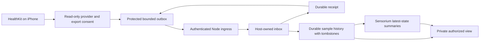

# Proposal 099: Companion App and Device-to-Node Bridge

Status: **Proposed**. Date: **2026-11-07**.

Based on:

- `doc/project/10-challenges/099-private-companion-device-access.md`
- [Core Values](../../normative/30-core-values/en/CORE-VALUES.en.md),
  [Vision](../../normative/20-vision/en/VISION.en.md) and
  [Constitution](../../normative/40-constitution/en/CONSTITUTION.en.md)
- [P001: Licensing](001-licensing-proposal.md),
  [P006: Thin Clients](006-pod-access-layer-for-thin-clients.md)
- [P045: Sensorium](045-sensorium-local-enaction-stratum.md),
  [S030: Sensorium](../60-solutions/030-sensorium/030-sensorium.md),
  [P082: Interfaces](082-sensorium-interfaces.md) and
  [S046: Interfaces](../60-solutions/046-sensorium-interfaces/046-sensorium-interfaces.md)
- [P096: BrainFlow](096-sensorium-brainflow-connector.md),
  [P091: Configuration](091-file-backed-configuration-and-explainable-composition.md),
  [P047: Classification](047-classification-label-propagation.md),
  [P072: Capabilities](072-capability-registry.md) and
  [S019: Middleware](../60-solutions/019-middleware/019-middleware.md)
- [P066: Assistant Channel](066-inquirium-assistant-channel.md),
  [P036: Memarium](036-memarium.md),
  [S016: Bounded Server Runtime](../60-solutions/016-bounded-local-server-runtime/016-bounded-local-server-runtime.md) and
  [S028: Temporal Storage](../60-solutions/028-temporal-storage-convention/028-temporal-storage-convention.md)

## Executive Summary

Provide a companion app and a narrow device-to-Node bridge for pairing, scoped
consent, bounded delivery and diagnostics. The first provider is a native iOS
client that reads explicitly selected HealthKit data and synchronizes it to one
paired Orbiplex Node on the user's computer.
The phone owns OS permissions, export choices and a bounded durable outbox.
The Node admits batches into a host-owned inbox, keeps sample history with
deletions under one named durable owner and admits only bounded latest-state
summaries into Sensorium. Use existing host services and contracts; do not embed
a second Node in the app.

The first slice is read-only HealthKit ingestion, authenticated device pairing,
incremental synchronization including deletions, and a participant-scoped view
of admitted samples, summaries and sync status. It excludes inference, federation,
HealthKit writes, direct Watch acquisition and a general mobile command executor.
It does not enlarge the existing Node alpha release scope.

Pulso and HealthSync are concrete reuse candidates. The bounded upstream review
below found no licensing blocker for the inspected Swift sync components under
their MIT and Apache-2.0 grants. This is not clearance of whole upstream products,
Apple distribution terms, or a new license grant for Orbiplex code.
All tracker work remains proposed; no schema, capability or runtime is added here.

## Context and Problem Statement

Health observations can help a participant review their own activity and wellbeing,
but a local desktop Node cannot treat Apple's private Health store as a remote
filesystem. The supported integration point is HealthKit on an authorized device.
Native iCloud synchronization is distinct from exporting health data to iCloud
Drive. Neither iCloud nor a third-party hosted backend is required by this design.

Human agency, privacy and local-first operation become three separate boundaries:
OS read permission, permission to export to this particular Node, and Node-side
permission to retain or use the data. None implies the next. Sensorium summaries
compress device-specific samples without promoting them to diagnoses, verified
physiology or model conclusions. Sample provenance remains in durable history.

Apple's [observer queries](https://developer.apple.com/documentation/healthkit/executing-observer-queries)
and [anchored queries](https://developer.apple.com/documentation/healthkit/hkanchoredobjectquery)
support change notifications and incremental additions/deletions. They do not
promise a continuously running phone service or a delivery deadline. Apple's
[authorization contract](https://developer.apple.com/documentation/healthkit/authorizing-access-to-health-data)
also hides read-permission denial: an empty query is not evidence of zero values,
absence of activity, revoked permission or complete coverage.

## Proposed Model / Decision

### 1. Scope and alternatives

The bridge is the reusable boundary; HealthKit is its first consumer profile.
Keep provider-specific sample semantics and cursors outside the sync core. This
proposal does not require a universal mobile plugin runtime or a generic schema
for every future sensor; a second implemented provider must justify those changes.

Choose native Swift/SwiftUI for the first phone edge, with HealthKit as its only
data provider. Use iOS 17+ as the initial engineering baseline, subject to the
entitlement/toolchain check in P099-001. Start with steps, resting heart rate and
sleep samples; missing device support or data is an honest state, not a failure
to manufacture readings. Every type starts disabled and is independently selected.

Manual XML import remains a useful fixture source, but does not prove incremental
sync. A third-party exporter can validate demand; it does not establish our consent
or receipt contract. A continuously reachable HTTP server on the phone conflicts
with opportunistic iOS execution. Direct iCloud scraping and database credentials
on the phone are outside the design. An existing hosted pod is not required:
P006's thin-client boundaries inform this companion without importing hosted
tenancy or recovery-key responsibilities.

### 2. Ownership and reusable boundaries

| Layer / owner | Responsibility | Reuse boundary |
| --- | --- | --- |
| iOS HealthKit provider | Read selected types/sources, normalize additions and tombstones, retain opaque anchors | Adapt inspected upstream readers and tests; do not reproduce Apple's permission logic |
| Companion sync core | Immutable batches, bounded persistence, retry, receipt matching, consent fences | One outbox and pairing/session implementation; separate provider-specific cursor semantics |
| Node ingress adapter | Authenticate device and participant, enforce size/rate/scope, validate payload, commit accepted batches to the inbox before the receipt | Reuse admitted host HTTP, credential, Schema Gate and journal facilities after P099-001 identifies exact owners |
| Sample-sync owner | Own inbox replay, checkpoints, sample history, retention and erasure; apply accepted changes in stream order and serve authorized reads | Existing S028 persistence primitives chosen in P099-002; one domain owner, history as a rebuildable read model, no raw database writes from the adapter |
| Hosted Sensorium connector | Derive bounded latest-state summaries from history and replace them after changes or deletions | Reuse `sensorium.observe.submit` and S019 lifecycle; host-bound producer/participant scope, sensitivity, TTL and revision checks (P099-008); never mirror raw samples |
| Participant view | Show actual imported data, freshness, backlog and allowed actions | History reads plus Sensorium summaries; P082 only if an interface is needed, never a second acquisition authority |

Sensorium's observation store expires entries, evicts under a cap shared by all
connectors and has no public retraction operation, so it holds summaries rather than the synchronized
record, as P045 section 11 and P096 already separate them. The inbox is the only
replay authority; history and summaries are rebuildable read models of it. After
authorized compaction, that authority is its verified checkpoint plus retained
suffix, following S028. Do not create an independent history write authority.

P099-001 starts from `node:docs/development/reuse-index.v1.json`, verifies candidates
in code and records intentional separations. `node:sensorium-core`,
`node:sensorium-interface-core`, `node:configuration-core` and host module-store
contracts are starting points, not claims that a phone ingress already exists.
Do not port their AGPL implementation into an Apache/MIT mobile package by copying
it. Share cleared contract material and cross-language conformance vectors instead.

### 3. Pairing, consent and confidentiality

Pair one app installation with one Node and one authenticated participant context.
A candidate QR invitation binds a short-lived, single-use pairing challenge to
the Node's authenticated identity and endpoint. Both sides confirm the intended
peer. An arbitrary scanned URL or self-asserted certificate is not authority.
Issue a revocable device-scoped credential with only the selected ingest/status
scope; never store the participant's root key, an operator token or Apple ID
credentials in the app. Use Keychain for secrets and protected local storage.

Use authenticated TLS with a defined trust bootstrap and rotation/re-pairing path;
never disable certificate checking or add a global ATS exception. Prefer outbound
phone-to-Node transfers on an explicitly reachable local network. Remote access
through an existing private route is a later qualification, not a requirement to
open a public port. LAN discovery, if later used, suggests endpoints only.

HealthKit read scope is primarily per data type. Source selection, history window,
destination and export consent are additional app policy. The Node independently
checks its bound participant/device, its own ingest-grant revision and allowed
types before admission; the phone's export-profile digest is recorded, never
trusted as authority. Reuse P066 for the approval interaction, not as a grant
store: its answer must be checked and applied idempotently by the existing host
admission owner named in P099-002. The durable ingest grant binds participant,
device, scope and revision. Node operator approval does not replace the data
subject's consent. Serialize grant revocation with inbox admission so that the
commit rechecks current authority, not just the earlier question response.
Device-supplied identity, classification or authority cannot widen scope.
Changes that broaden export require explicit approval; address-only reconnects
cannot silently change the authenticated recipient.

App-level export revocation stops collection/export and invalidates pending sends
under that consent. Enforce Node revocation at the admission commit, including
in-flight requests; report a race already durably admitted as such. Apple alone
does not expose a reliable read-revocation signal: do not promise immediate purge
of previously authorized queued data after a Health-settings change the app cannot
observe. Provide an explicit stop/purge control and explain this distinction.
Deleting local data cannot retroactively recall previously admitted copies.

Health payloads remain private to the bound participant and admitted owners; a
Personal label alone is not an ACL. No Agora publication, Room exposure, telemetry,
model invocation or third-party upload is implied. Keep payloads and credentials
out of logs, notification text and backups not explicitly approved for this purpose.
Use no automatic hosted destination or app-managed iCloud health mirror.

### 4. Synchronization contract candidates

The following are design shapes to freeze in P099-002, not registered schema names.
Use namespaced keys, closed control enums and existing classification/provenance
types. Do not transmit arbitrary HealthKit metadata dictionaries.

| Candidate | Minimal content and meaning |
| --- | --- |
| `healthkit-sync-batch.v1` | `pairing/ref`, `ingest-grant/revision`, `export-profile/digest`, `stream/id`, `stream/epoch`, `batch/id`, `batch/sequence`, predecessor receipt, selected type/window/filter revision, bounded changes |
| Sample change | `operation: upsert`, source-scoped `sample/id`, HealthKit type, start/end instants, typed quantity/unit or category, allowlisted source/device provenance; preserve offsets where needed |
| Deletion change | `operation: delete`, same scoped sample identity; no invented measurement or zero placeholder |
| `healthkit-sync-receipt.v1` | Exact batch identity/digest, stream/epoch/sequence and admission outcome (`accepted`, `already-present`, `rejected`, `retryable`); accepted/duplicate outcomes require the durable acceptance reference, refusals carry a typed reason without inventing that reference; no health values in receipt |
| `healthkit-sync-status.v1` | Separate collection, delivery and projection state; last successful timestamps, backlog, explicit gaps and typed next action; never a boolean "fully synced" inferred from an empty query |

Scope sample UUIDs by authenticated pairing/store context; they are private lookup
keys, not public participant identifiers. Bind the batch identity to its content;
the same identity with different content is a refusal. Bound strings, items,
uncompressed bytes, nesting and expansion if compression is supported. Reject
unknown control versions/types, non-finite numbers and invalid units/timestamps.
Start with uncompressed bounded JSON unless measurements justify compression.

Freeze retryable versus terminal refusal classes (authentication, stale grant,
schema/type, sequence conflict, quota, temporary unavailable) and an explicit
backpressure response. A generic HTTP 2xx is insufficient acknowledgement.
The contract must distinguish durable admitted, duplicate-of-admitted and refusal;
quarantined data must not be presented as an admitted observation.

Maintain two distinct checkpoints: the local scan anchor and the remote durable
receipt. Advancing the scan anchor requires atomic durable retention of all changes
it covers. If that cannot be guaranteed, keep the old anchor and tolerate replay.
Never infer completeness from the newest measurement timestamp: late samples,
deletions and a restored phone defeat that shortcut. Bind anchors to the actual
store/type/filter epoch; reset or widening requires explicit bounded backfill.

For v1, use one ordered stream per paired store, participant and selected type,
with at most one unacknowledged batch per stream. Bind epochs and filter revisions
to Node-approved scope; a client cannot reset a replay fence by inventing an epoch.
A missing predecessor is retryable; conflicting content at an admitted sequence
is terminal. A restored/re-paired installation requires bounded reconciliation,
not automatic identity equivalence with the old store.

Delivery is at least once, with ordered application per stream. Retrying after an
ACK loss returns the same durable result without duplicating a sample or
resurrecting a deleted one. A receipt follows the durable inbox commit, not merely
receipt of bytes. History and summaries are rebuilt idempotently from the inbox
after a crash; projection completion is not part of the receipt. P099-002 must
name the existing persistence owners and crash windows before implementation.

Record an accepted source revision with each durable batch. History and summaries
carry their applied revision. A current read may return values only when that
revision matches the owner's accepted revision; otherwise return `pending` or
`dependency_unavailable`, without obsolete values. Apply this fence to all read
paths, including direct Sensorium reads, caches and optional P082 publication,
not just the participant screen. If the owner cannot establish freshness, withhold
the value. The v1 fence can cover the whole participant/type stream, avoiding a
per-sample dependency graph; a coherent historical view must be explicitly requested.

The owner applies tombstones and recomputes summaries. Replace a summary under
its producer/participant-scoped id with an increasing source revision and an
expected predecessor; an old retry cannot overwrite a newer summary. No remaining
data means unavailable, not zero. TTL bounds storage, not deletion correctness:
an unrecomputed summary is withheld immediately after the batch is accepted.
Receipt replay also checks current read authority; it does not re-admit a revoked
operation or disclose its receipt to a newly unauthorized caller.

P099-002 defines finite retention for inbox payloads, checkpoints, history and
backups together. Erasure must prevent a rebuild from resurrecting removed bytes;
retain only the minimal replay-floor metadata for the accepted retry window.
After that window, reject old epochs and require bounded reconciliation. Do not
promise replay from physically erased history or treat Memarium `forget` as
physical erasure.

### 5. Lifecycle, limits and participant experience

Use observer notifications as triggers, anchored reads for changes, and manual /
foreground synchronization as recovery. Finish the HealthKit completion handler
after bounded local processing; do not wait for the desktop to become reachable.
Consider file-backed background `URLSession` transfers, but test their interaction
with file protection and revocation. A locked phone may defer reading or transfer;
do not weaken protection or misuse location/workout privileges to keep it awake.

Freeze finite batch, outbox byte/count/age, backfill and retry budgets in P099-002.
When full, pause collection before advancing its anchor and report the reason.
Expiry/purge creates an explicit gap and a consent-checked resync path, never silent
completion. Node policy is file-backed through P091; credentials are references.
Phone settings remain local OS/app state with an inspectable export profile; this
does not require mirroring Node's config filesystem onto iOS. Health values, anchors
and receipts are operational data, not configuration.

UI shows the recipient, selected types/sources and history window before consent;
then last read, last durable admission, projection readiness and queued work.
Offer Sync now, Pause, Revoke pairing and clear explanations of local versus Node
deletion. Missing/locked/unavailable data is not zero. Phone/watch source overlap
is not deduplicated by timestamp or silently summed. Preserve source samples;
any derived aggregate needs a separately declared source-selection rule.

## Trade-offs

A native client costs signing, device qualification and platform maintenance, but
avoids cloud-account credentials and gives direct control over consent and delivery.
One recipient reduces routing and authority complexity; it postpones multi-Node
fan-out. Opportunistic sync favors battery and privacy over guaranteed immediacy.
An outbox adds sensitive local state, so finite retention and explicit cleanup are
part of the feature. A reusable companion shell is justified by pairing, consent
and delivery today; future providers do not justify a speculative plugin framework.

## Failure Modes and Mitigations

| Failure | Required behavior / evidence |
| --- | --- |
| Empty query, read denial or locked store | Distinguish known lock/error from unknown visibility; no zero/completeness inference |
| Node asleep, queue full or expired | Bounded retry; pause or explicit gap; manual consent-checked recovery |
| Crash around anchor, admission or ACK | No lost acknowledged changes; deterministic replay and duplicate receipt |
| History or summary projection unavailable or behind | Inbox stays the replay authority; status reports lag or `dependency_unavailable`; no stale summary presented as current |
| Stale consent, revoked device or wrong recipient | Refuse at admission; no fallback upload; scoped diagnostic |
| Late addition, deletion, restore or changed source filter | Source-aware reconciliation and new epoch where needed; no latest-timestamp shortcut |
| Old upsert replayed after deletion | Ordered/idempotent projection and bounded replay fence prevent resurrection |
| Malformed or oversized batch | Refuse before expensive work; bounded parsing and no health data in errors |
| Background task delayed or app terminated | Honest freshness and pending state, no continuous-stream claim |
| Upstream updates or distribution restrictions | Requalify selected files/dependencies and distribution separately; do not silently broaden the grant |

## Open Questions

1. **Mobile code license and distribution.** P001 remains authoritative; this
   proposal creates no Apache exception. Default: keep Node owners under their
   existing licenses and qualify a minimal mobile source set separately. Resolve
   App Store/TestFlight obligations before the corresponding distribution; do not
   infer compatibility from MIT/Apache upstream alone. An unresolved distribution
   gate cannot be reported as release-ready.
2. **Reusable Swift base.** Prefer adapting the smallest qualified Pulso sync
   core and HealthSync test seams over retaining two engines. P099-001 may choose
   the reverse if crash/consent tests show a better fit; record exact files/reasons.
3. **Private endpoint bootstrap.** Default: explicit pairing with authenticated
   Node identity and no automatic discovery. Select the existing credential/TLS
   owner after code inspection; QR is an encoding, not a new identity protocol.
4. **Resource budgets.** Default: conservative finite limits and a short user-chosen
   initial history window. Measure the three selected types before freezing numbers;
   no unlimited backfill or queue defaults may reach implementation.
5. **Sample-sync persistence.** Default: one owner under S028, reusing an existing
   journal/checkpoint primitive and projecting authorized history. First inspect
   whether Memarium (P036) already meets the same windowed-read, tombstone and
   physical-erasure laws; reuse it if so. Qualify the chosen path with a synthetic
   year of the three types. A second prototype is needed only if a measured gap
   warrants it, not merely to compare two storage stacks. P099-002 names the
   physical-erasure owner; Memarium `forget` alone is insufficient.

## Next Actions

Close P099-001, freeze P099-002 and land P099-008 with the Sensorium owner, then
implement the device and Node edges against the same synthetic corpus. Close
offline acceptance before a separately authorized physical-iPhone qualification.
No model, federation or Apple Watch app is required.

## Implementation Recommendations

### Upstream reuse and licensing checkpoint

Inspected on `2026-11-07`, pinned independently of moving branches:

| Upstream / revision | Inspected scope | Grant and disposition |
| --- | --- | --- |
| [Pulso](https://github.com/lenilsonjr/pulso/tree/9676cf77040205d1b0c8b7308f99a3135a0a2006) | `LICENSE`, Xcode project, `Pulso/Sync/Outbox.swift`, `SyncEngine.swift`, `PulsoTests/OutboxTests.swift`, `docs/PROTOCOL.md` | [MIT](https://github.com/lenilsonjr/pulso/blob/9676cf77040205d1b0c8b7308f99a3135a0a2006/LICENSE), copyright 2026 Lenilson Dos Santos. Reuse candidate for anchored reads, durable queue and replay tests. Preserve copyright and permission notice. |
| [HealthSync](https://github.com/megabyte0x/healthykit/tree/eaa53fe1e6e9bbc5749b69194b8fcf4ff2f849c1) | `LICENSE`, Xcode project, `HealthSync/Services/SyncEngine.swift`, `Tests/HealthSyncTests/SyncEngineTests.swift`, README | [Apache-2.0](https://github.com/megabyte0x/healthykit/blob/eaa53fe1e6e9bbc5749b69194b8fcf4ff2f849c1/LICENSE). Reuse candidate for persistence/uploader seams and negative-ack tests. Preserve license/attribution, mark modified files and carry applicable NOTICE content. |

The inspected trees contain no standalone NOTICE or `Package.resolved`; the Xcode
projects declare no third-party Swift package products. Selected source headers
showed no conflicting per-file grant. This is a bounded compatibility finding,
not a complete asset or backend dependency audit. Apache's
[v3 compatibility guidance](https://www.apache.org/licenses/GPL-compatibility)
and the [GNU compatibility guidance](https://www.gnu.org/licenses/license-compatibility.en.html)
support considering these grants alongside the existing v3 baseline; they do not
license project-owned code or clear an App Store distribution.

P099-001 must inventory the final copied files, their dependencies and bundled
material, pin revisions/digests and retain notices before copying. Exclude upstream
branding, backend/web stacks and unrelated features by default. Preserve upstream
authorship; copying does not make those files exclusively project-authored.
No upstream code is copied by this proposal.

Do not inherit Pulso's optional token / broad ATS exception, bare-2xx ACK contract,
unbounded retry policy or latest-timestamp bootstrap shortcut. Do not inherit
HealthSync's hosted destination or assume independently persisted anchors and
batches are atomic. Reuse concrete mechanisms only after they pass this proposal's
contract laws; do not import both complete applications.

Apple's [App Review Guidelines](https://developer.apple.com/app-store/review/guidelines/)
sections 2.5.1 and 5.1.3 constrain HealthKit purpose, disclosure and iCloud storage.
The first product purpose is participant-controlled health/fitness observation;
generic assistant access is not implied. Track Apple entitlements, signing and
distribution as a separate gate from open-source license compatibility.

### Node-side reuse and Sensorium integration

Checked on `2026-11-07` against Node `bde21987`. P099-001 re-verifies the current
owners before P099-002 freezes contracts.

- **Fact.** `sensorium.observe.submit` keeps no observation idempotency. Each
  admission gets a fresh time-ordered `obs:` id unless the candidate supplies
  `observation/id`. A supplied id is not namespaced by connector and silently
  replaces a stored observation with the same id. Idempotency exists only for
  directives.
- **Fact.** Default expiry is calculated from ingestion with a one-day TTL,
  but `freshness.ttl_sec` has no upper bound and supplied freshness fields can
  survive construction. These fields need host derivation, not just a new default.
- **Fact.** All connectors share one observation store capped by
  `max_observations` (default 50,000). Overflow removes the smallest ids in key
  order, which approximates the oldest only for host-generated ids, and records
  no gap.
- **Fact.** Sensorium has no public observation retraction operation; internal
  removal serves expiry and cap enforcement.
- **Fact.** The sensitivity class is read from the candidate. P045 gives
  `health-wearable` the `sensitive-personal` baseline: fail closed, visible UI
  state and explicit consent. P045 section 11 keeps short-lived observations in
  Sensorium and durable ones in Memarium.
- **Inference.** The observation store therefore cannot hold the sample history
  this proposal synchronizes. Step samples alone can number hundreds per day;
  mirroring them there would expire them, evict other connectors' observations
  and leave deletions unexpressed.

The model's owners map onto existing Node owners as follows:

| Concern | Recommended owner and reuse |
| --- | --- |
| Phone-facing ingress | A separate bounded listener (S016) with its own certificate and a narrow route set. Never bind the loopback operator API to the LAN. Do not reuse the peer WSS listener identity: its authority is node-to-node and its certificate subject may expose the node id |
| Device and pairing identity | P006 `client-instance-id` for the app installation, distinct from the pairing grant, the participant and `node-id`. Caller identity comes from the authenticated session, as in `channel-caller-context`, never from the payload |
| Node-side approval and revocation | P066 presents the question; an existing host admission owner validates the answer and durably issues/revokes the scoped grant. No ingress-private consent store. Enforce the Node-issued ingest-grant revision and only record the phone's export-profile digest |
| Inbox and receipt | Reuse candidate `owner-checkpoint-journal` is the index entry for `storage::owner_checkpoint::Journal`, not a new crate; its caller owns locking, replay and monotonic fences. Compare it with `temporal-event-log` under S028. Reuse AD's four outcome meanings, not its transport/authority envelope |
| Durable sample history with tombstones | A read model owned with inbox/checkpoint retention; inspect Memarium personal-record seams (P036-004–007, provenance `observed-source`) against the same laws before selecting storage. Name the physical-erasure owner |
| Sensorium | Host-built `latest-state` summaries, with authenticated registered producer/participant binding, sensitivity and TTL. Reuse P045-OBS-001's scoped identity, ordered replacement and current-read fence; never trust phone-supplied authority fields |
| Participant view | Reads the history owner's projection; P082 publication stays explicit and optional |

P099-002 declares effect recovery classes under DEV-GUIDELINES rule 15:

| Effect | Class | Point of no return |
| --- | --- | --- |
| Batch acceptance into the Node inbox | `transactional-withheld` | Durable inbox commit; the receipt follows it |
| Export, seen from the phone | `irreversible-external` | The Node's durable acceptance; a local purge cannot recall it |
| Pairing credential issuance | `compensatable` | Revocation stops later admission; earlier admissions remain facts |

Projection writes are effects too: declare their idempotent replay and revision
fences; being rebuildable is not exemption from rule 15. External disclosure is a
separate irreversible effect. Default for rule 16: grant validation and durable
inbox persistence are required admission dependencies; downstream projections
may lag while the inbox accepts within its budget. Withhold stale reads and report
`dependency_unavailable`; capacity exhaustion or a missing required dependency
returns `retryable` before mutation. Never bypass a declared required dependency.
Share
contract-law vectors between Swift and Rust for sequence/epoch fences, the
anchor/receipt crash table and delete-after-upsert ordering, instead of sharing
code across the license boundary.

### First-slice acceptance

P099-006 owns one report with distinct `offline-contract` and `physical-ios` scopes,
exact source/schema/policy revisions and synthetic-versus-personal data provenance.
Offline success does not qualify HealthKit permissions, background scheduling or
device protection. Do not place personal health captures in public evidence.

Offline fixtures must cover all failure-table rows, plus source overlap, units and
sleep interval boundaries, foreign-participant reads, consent narrowing during a
send, receipt/content mismatch, queue expiry, rejected type, backfill interruption
and Node restart between durable admission and projection. Verify no inference,
publication or outbound third-party service is triggered. Use existing schema,
host admission, retention and test harnesses rather than another campaign framework.

Explicitly exercise deletion followed by unavailable projection: history reads,
Sensorium get/query and any enabled interface must withhold the old value before
TTL expiry. Cover reversed summary completion order, duplicate-without-TTL-renewal,
two participants under one connector, a failed freshness lookup, full inbox,
compaction/restart and erasure/replay. The same source revision must govern both
history and summaries; the offline report maps each assertion to its owner.

The physical gate demonstrates explicit consent, selected-type export, actual
reads of admitted history and its Sensorium summary, phone lock/unlock, a
disconnected/sleeping Node, reconnect, deletion, revoke and visible freshness.
Report measured delays rather than an invented real-time SLA. The test uses a
bounded approved history window; it requires explicit device/data authorization
at execution time.

### Future companion functions

Share-sheet import, notifications, assistant questions and other phone sensors are
future profiles, not first-slice dependencies. They may share pairing, secure
storage, delivery and diagnostics, but have separate schemas, permissions and
retention. Reuse P057/S039 for notification semantics and P006 for thin-client
roles. No arbitrary remote code, automatic capability enablement or generic access
to Health is introduced. A retrospective convergence review precedes closeout.

## Implementation Tracker

Statuses: `todo`, `partial`, `blocked`, `done`. All entries are planned; `done`
requires the row's evidence and reconciliation with its implementation owner.

| ID | Task / owner | Depends on | Status | Completion gate |
| --- | --- | --- | --- | --- |
| P099-001 | Reuse, rights and platform baseline / companion + Node owners | — | todo | Pin selected upstream files/dependencies/notices; record adapt/reuse/separate decisions, exact Node auth/ingress/storage/read seams and licensing/distribution boundaries; no unresolved grant on imported code; signing/entitlement path identified. |
| P099-002 | Freeze sync, pairing and privacy contracts / Node + companion | P099-001 | todo | Schema Gate contracts and Swift/Node vectors, finite budgets, receipt/anchor crash table, revocation/read/deletion rules and owner mapping accepted; single sample-sync owner and Sensorium `latest-state` role chosen; checkpoint/erasure/replay-floor contract and accepted/applied revisions fixed; receipt outcome vocabulary reused or its separation recorded; P066 interaction separated from durable host grant authority; effect recovery classes declared; no claim that transport grants authority. |
| P099-003 | Native read-only provider and durable sync / companion | P099-002 | todo | Three opt-in types, source/window selection, atomic anchor/outbox rule, scoped secrets, bounded recovery and manual status work against fake HealthKit/receiver; no write entitlement or hosted fallback. |
| P099-004 | Paired ingest, durable history and Sensorium summaries / Node | P099-002, P099-008 | todo | Existing owners admit authenticated scoped batches into the inbox, recover receipts, rebuild history and summaries from it, apply deletions to both, withhold stale views before TTL expiry, fence reversed summary writes and deny foreign reads/replay resurrection; new host capabilities pass P072 registration and the capability-registry checks; update Node ledger, license inventory and relevant S030 status only for delivered scope. |
| P099-005 | Participant pairing/consent/status flow / companion + Node UI | P099-003, P099-004 | todo | User confirms recipient and scope, observes actual admission/freshness, pauses/revokes and understands purge effects; Node policy uses P091; no display-only permission check. |
| P099-006 | Offline and physical first-slice acceptance / integration | P099-003, P099-004, P099-005 | todo | All offline cases pass, followed by separately authorized device evidence; scopes remain separate; one report links trackers/ledger, carries no private health data, and includes convergence review and retention cleanup. |
| P099-007 | Distribution qualification / release + licensing owners | P099-001, P099-006 | todo | Explicit project license decision and dependency/notices package; approved signing/distribution route, privacy disclosures and Apple purpose review; development/device evidence is not store approval. |
| P099-008 | Qualify companion summary admission binding / Sensorium + companion owners | P099-002, P045-OBS-001 | todo | Consume, do not reimplement, the P045-OBS-001 boundary. Synthetic host-built summaries prove registered producer/participant binding, sensitive-personal handling, TTL/replay laws, ordered replacement, capacity refusal and stale/deleted-source withholding through direct get/query. Completion requires consumer evidence beyond the generic task; phone fields cannot widen authority and the pure core has no HealthKit-specific branch. |

P099-001–006 and P099-008 form the first functioning slice; their `done` does not
require a public App Store release. P099-007 gates that distribution and cannot be
bypassed by presenting upstream permissive licensing as clearance of the complete
app.
