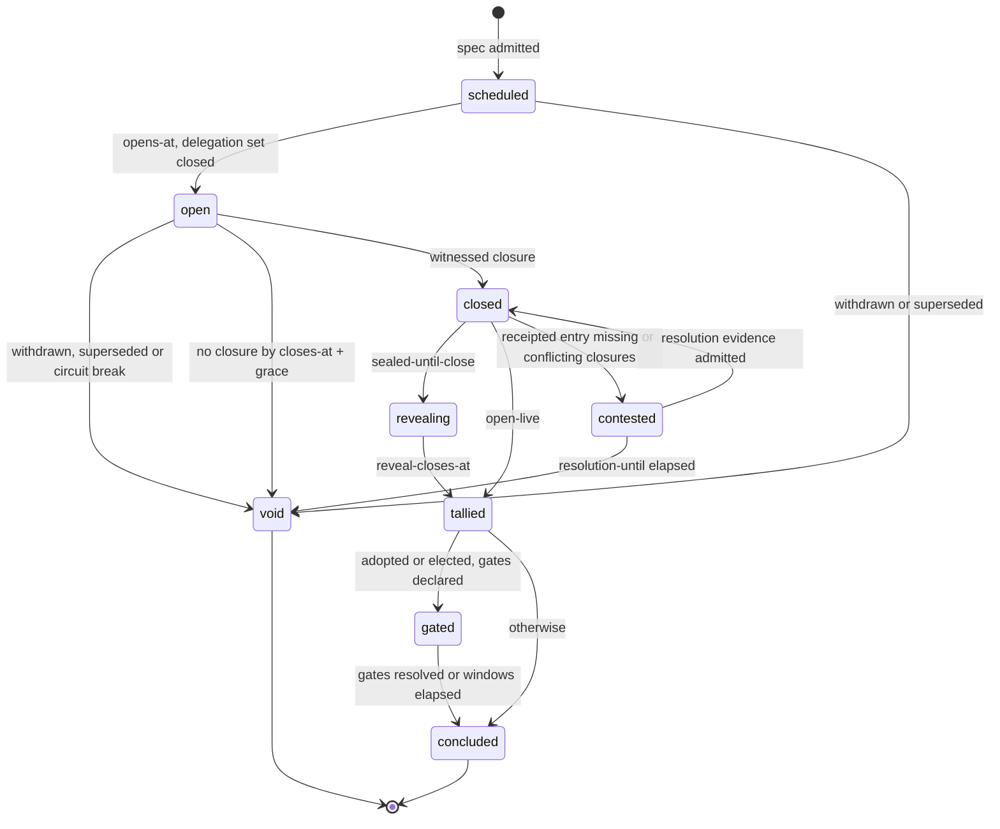
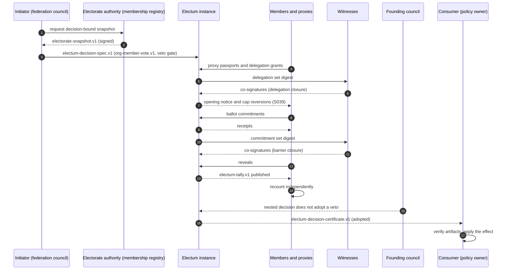

# Proposal 103: Electum Decision and Voting Substrate

Status: **Proposed (Draft)**. Date: **2026-11-28**.

Based on:

- [Constitution](../../normative/40-constitution/en/CONSTITUTION.en.md):
  Art. VII (procedural governance, `policy-as-code`, role separation,
  `multisig`), Art. VIII.4 (economic advantage never converts into governance),
  Art. XIII.7–12 and XVI.13 (founding period), Art. XVI.6 (procedure, quorum
  and automation do not remove human responsibility). This proposal creates no
  voting right; it executes rights defined by normative acts and charters.
- [`DIA-FED-001` Federation Membership and Quorum](../../normative/50-constitutional-ops/en/FEDERATION-MEMBERSHIP-AND-QUORUM.en.md)
  §2 and §7–11: one active federation one vote, electorate snapshot, voting
  blocks, decision classes, vote windows, silence semantics.
- [`DIA-ENTRENCH-001` Entrenchment Clause](../../normative/50-constitutional-ops/en/ENTRENCHMENT-CLAUSE.en.md)
  §2.2, [`DIA-PANEL-SEL-001` Panel Selection](../../normative/50-constitutional-ops/en/PANEL-SELECTION-PROTOCOL.en.md)
  §4–6, [`DIA-FIP-QUORUM-001`](../../normative/50-constitutional-ops/en/FIP-MEMBERSHIP-AND-QUORUM.en.md)
  §5 and [`DIA-SUFF-001` Swarm-Economy Sufficiency](../../normative/50-constitutional-ops/en/SWARM-ECONOMY-SUFFICIENCY.en.md)
  §8.
- Weights and eligibility:
  [Core Values: Reputation as Leverage, Not Power](../../normative/30-core-values/en/CORE-VALUES.en.md#reputation-as-leverage-not-power),
  [Core Values: Creator Credits](../../normative/30-core-values/en/CORE-VALUES.en.md#creator-credits-royalties-without-licenses-distribution-based-on-impact-and-contribution),
  [Root Identity and Nyms](../../normative/50-constitutional-ops/en/ROOT-IDENTITY-AND-NYMS.en.md)
  §2.6–2.7, §7.3 and §8.2,
  [Role-to-IAL Matrix](../../normative/50-constitutional-ops/en/ROLE-TO-IAL-MATRIX.en.md)
  §2, [Procedural Reputation](../../normative/50-constitutional-ops/en/PROCEDURAL-REPUTATION-SPEC.en.md)
  §5–7 and
  [Reputation Validation](../../normative/50-constitutional-ops/en/REPUTATION-VALIDATION-PROTOCOL.en.md)
  §4.
- [Challenge 002: Sybil](../10-challenges/002-sybil.md) for open electorates.
- [P026 shared commitment and barrier contract](026-resource-opinions-and-discussion-surfaces.md#shared-commitment-and-barrier-contract),
  [P051](051-swarm-membership-and-reputation-bootstrap.md),
  [P054](054-user-maintained-federated-seed-directory.md),
  [P076 §6](076-federation-identity-and-network-selector.md#6-sovereign-operator-identity-and-official-service-endorsement),
  [P016](016-supervised-prepaid-gateway-and-escrow-mvp.md),
  [P037](037-generic-signing-service.md)
- [S020](../60-solutions/020-scheduler/020-scheduler.md),
  [S028](../60-solutions/028-temporal-storage-convention/028-temporal-storage-convention.md),
  [S039](../60-solutions/039-notifications/039-notifications.md)
- Source gap: a documentation review on 2026-11-27 found voting arithmetic in
  normative acts and one panel-local vote implementation, but no protocol for
  federation, council or community decisions.

## Executive Summary

Electum is a shared substrate for opening, collecting, closing, tallying and
certifying decisions: federation votes, council approvals, panel decisions,
member votes and consultations, and open community polls. It has two layers: a
pure `decision-core` library and a node-attached Electum service announced in
the Seed Directory like other services.

Electum may compute and present a verdict, but the verdict is authoritative
only because anyone who can read the published artifacts can recompute it.
Electorates come from their owners as signed snapshots; effects stay with the
consumers that own them. A decision is composed from four orthogonal axes:
electorate, secrecy, counting method and post-tally gates. Normative acts and
charters become versioned profiles over those axes.

On the electorate side, a profile may add typed eligibility criteria
(attestation level, earned reputation, roles, contribution facts), weights
bounded by the normative reputation and attestation rules, and non-transitive
delegation to a member who accepted the proxy role in advance. Weighted and
delegated votes stay attributable. No weight and no eligibility derives from
economic balances.

A binding decision requires a pinned, finite electorate. An open electorate
yields only an advisory poll result, served under a separate capability that
federation-endorsed instances refuse. Stage 1 delivers `open-live` and
`sealed-until-close` secrecy on the P026 commitment primitive. Stage 2 adds a
secret-ballot proxy with declared trustees and recounters. Anonymous
credentials need a separate proposal. Everything here is planned; nothing is
implemented.

## Context and Problem Statement

Facts as of 2026-11-28:

1. `DIA-FED-001` defines who votes, participation quorum, adoption thresholds,
   vote windows, silence semantics and common-control blocks. Its
   `electorate_snapshot` exists only as a YAML example. No schema, ballot,
   closure, tally or publication contract exists for federation, council or
   community decisions.
2. `DIA-ENTRENCH-001` §2.2 requires a permanently archived, publicly accessible
   trace of proposal, arguments, votes and rationales. No artifact family holds
   that trace.
3. The only implemented vote is inside `node:panel-procedure-core` (pure core,
   ledger status `partial`, draft local fixtures). A proposal is bound to the
   panel composition revision; a yes/no vote is bound to the proposal id,
   revision and digest; a composition change clears current votes.
4. P026 designs a shared commitment and barrier primitive with
   `eligibility = open | enumerated` (P026-009, `todo`). It states that quorum
   requires a pinned, finite eligibility set, and it treats distinct
   commitments by one author in one round as equivocation.
5. P051 lists `review-round.v1` and `review-vote.v1` as future work.
6. P016 defers multi-approver community-pool disbursement to a later phase.

**Inference.** Without a shared substrate, each consumer would reinvent
ballots, deadlines, closure, counting and certificates with drifting semantics.
Legitimacy would rest on a server's word instead of recomputable artifacts.
Mixing "anyone may ask anything" with binding governance on one surface would
also invite plebiscitary pressure on procedural bodies and Sybil-dominated
numbers.

## Proposed Model / Decision

### 1. Scope, layering and naming {#scope}

Electum owns:

- admission of a decision specification;
- admission of delegations and ballots, and issuance of receipts;
- deadline evaluation under its declared clock policy;
- witnessed closure of the admitted delegation and ballot sets;
- tally computation, as a convenience;
- collection of gate outcomes;
- assembly and publication of the result artifact.

Electum does **not** own:

- membership, eligibility evidence or reputation, which belong to electorate
  authorities and their evidence sources;
- effects, which belong to consumers;
- sanctions;
- key shares or unsealing, which belong to the Federation of Sealed Chambers;
- deliberation, which belongs to Rooms, Agora or the panel procedure;
- the meaning of options.

```text
L3  consumers: federation and council governance, P016 community pool,
    P051 panels, appeal and opinion review, member votes, open polls
L2  Electum service: specification, delegation and ballot admission, receipts,
    windows, witnessed closures, publication, result assembly
L1  decision-core (pure, no I/O): validation, eligibility and weight
    evaluation, counting-method adapters, quorum, thresholds, gate composition
L0  existing primitives: canonical JSON/JCS, P037 signing, P026 commitment-core,
    S028 append-only facts, durable outbox, S020 scheduler, panel-draw entropy
```

Consumers may use L1 in-process, for example inside an existing state machine,
or L2 when several parties must interact. In this document, the **instance** is
a node running the Electum service; its human **operator** remains accountable
for it (Art. XVI.6).

**Naming.** *Electum* is Latin for "the chosen". The name follows the organ
naming used by Memarium, Sensorium and Inquirium. It deliberately avoids
*quorum*, which remains a normative parameter meaning minimum participation.

**Non-goals.** Electum does not:

- decide membership or compute reputation;
- execute effects;
- weight votes or grant eligibility by tokens or credits;
- claim coercion resistance;
- support transitive delegation chains in this proposal;
- replace the panel draw, COI and veto procedure;
- provide anonymity in stage 1.

### 2. Four orthogonal axes {#axes}

| Axis | Question | Values (initial) |
|---|---|---|
| Electorate | Who may vote, with what weight, through whom? | `federation-blocks`, `org-members`, `enumerated-group`, `panel-composition`, `open`; criteria, weights and delegation per §4 |
| Secrecy | Who sees a ballot, and when? | `open-live`, `sealed-until-close`; stage 2 `proxy-secret`; stage 3 `anonymous` |
| Counting method | How do ballots become a result? | `yes-no-threshold.v1`, `plurality.v1`, `approval.v1`, `schulze.v1`; later `ranked-pairs.v1`, `stv.v1` |
| Gates | Who may block or must approve after the tally? | none, `veto`, `ratify`, in declared order |

A separate field `decision/binding` is either `binding` or `advisory`.

There is no enumeration of named voting "modes". For example, "a member vote
with a founding council's veto" is a composition: method + participation
quorum + adoption threshold + `gates: [veto(founding-council)]`. A new variant
is new data, not new code. Profiles (§11) give common compositions stable names
and refuse combinations that make no sense.

### 3. Electorate snapshots {#electorate}

An `electorate-snapshot.v1` is signed by its **electorate authority**: the
owner of federation membership, an organization registry, the panel procedure
or a council roster. Electum never computes, edits or extends an electorate.
Whoever controls an electorate controls the vote; keeping the authority outside
Electum keeps the service from becoming that centre.

```json
{
  "schema": "electorate-snapshot.v1",
  "snapshot/id": "elect-snap-2026-11-28-0007",
  "snapshot/scope": "decision-bound",
  "decision/id": "fed-2026-11-28-0042",
  "authority/ref": "org:did:key:z6Mk...",
  "electorate/kind": "federation-blocks",
  "electorate/revision": 7,
  "created-at": "2026-11-28T10:00:00Z",
  "members": [
    {
      "member/ref": "federation:did:key:z6Mk...",
      "block/ref": "block-01",
      "signer/policy": {"kind": "threshold", "keys": ["..."], "required": 2}
    }
  ],
  "blocks": [{"block/ref": "block-01", "weight": 1}],
  "basis/refs": ["DIA-FED-001 §7", "DIA-FED-001 §11"],
  "signatures": []
}
```

Rules:

1. `snapshot/scope = decision-bound` binds one `decision/id`. Binding profiles
   require it, so the authority's signature also expresses its initiation
   policy (`DIA-FED-001` §2.4 leaves internal procedure to local policy).
2. A `reusable` roster snapshot may serve advisory consultations only. It
   carries an `initiation/policy` reference, and Electum admits a consultation
   only from an initiator that the policy allows.
3. Members carry a `signer/policy`. A federation's external vote is signed by
   its proper role or roles, as `DIA-FED-001` §2.4 requires.
4. Common-control grouping is resolved by the authority and recorded as
   blocks; Electum counts blocks and never infers grouping.
5. Weights default to `1`. A member entry may carry weight inputs and
   eligibility evidence references under §4. When criteria filter the
   electorate, the snapshot also attests `electorate/base-count`, the
   membership count before criteria.
6. A status change after the snapshot affects later processes only
   (`DIA-FED-001` §7).

### 4. Eligibility criteria, weights and delegation {#weights}

All three live on the electorate side, in four steps:

1. **Evidence** comes from its own owners: attestation records, the
   procedural-reputation snapshot of the federation that computes reputation,
   role and membership registries, attribution records.
2. The electorate **authority** references that evidence in the snapshot. It
   does not recompute it.
3. The **specification** freezes criteria, the weight function and the
   delegation policy.
4. **`decision-core`** evaluates them, and a verifier recomputes the result.

Economic balances are never an input (`DIA-SUFF-001` §8, Art. VIII.4).

#### 4.1 Eligibility criteria {#criteria}

A specification lists `eligibility/criteria` as typed criterion adapters. Each
kind declares its parameters, `economic: false` and a verifiability class:

- `signed-fact`: backed by signed, independently checkable evidence;
- `host-asserted`: a host-local account parameter that others cannot check.

Initial kinds: `membership`, `ial-min`, `reputation-min` (domain and
threshold), `role`, `contribution-fact`, `activity-status` and `tenure-min`.
New kinds enter only through the profile catalogue with normative review.

Rules:

1. Binding profiles accept only `signed-fact` criteria. `host-asserted`
   criteria are limited to advisory consultations and carry that label in the
   specification and the result.
2. No criterion may read balances of service credits, creator credits, tokens
   or other economic rewards, nor payments, donations, node count, traffic,
   compute or infrastructure position (`DIA-SUFF-001` §8, Art. VIII.4,
   `DIA-FED-001` §2.2). Creator Credits are exchangeable tokens, so their
   balance is excluded. A **contribution fact** from the attribution graph,
   for example "authored component X", is a domain membership fact and may be
   used through `contribution-fact`.
3. `ial-min` follows the Role-to-IAL Matrix; federations may tighten it.
4. **Reputation gates** are admitted in domain profiles and in general member
   votes (D6), because some questions may properly be decided only by members
   who meet stated criteria. Safeguards:
   - the reputation domain is declared;
   - only earned score counts, so bootstrap credit does not pass a gate, and
     only nodes active for reputation purposes qualify (Procedural Reputation
     §5, §7.3);
   - `criteria/rationale` is mandatory and explains why the question is
     restricted;
   - the specification and the result publish the eligible count against
     `electorate/base-count`, so the exclusion ratio stays visible to the
     federation's health review;
   - **circuit break.** During a reputation circuit break in the federation
     whose reputation is used, reputation has no operational power
     (Reputation Validation §4.4). A reputation-gated decision does not open
     during a break, and a break before closure makes it `void` with reason
     `reputation-circuit-break`. The electorate is never silently widened.
     (Inference from §4.4.)
5. For gate-only criteria, the snapshot publishes the eligible set; the
   evidence is retained for authorized auditors rather than published.
6. **Open electorates** admit only admission filters (`ial-min`, `membership`
   of a named body). Electum evaluates them at ballot admission against
   evidence presented with the ballot. One ballot per authenticated participant
   identity (Assumption). Open polls refuse weights and delegation.

#### 4.2 Weight sources {#weight-sources}

Uniform weight is the default. Two non-economic sources are admitted:

| Source | Function | Normative bounds |
|---|---|---|
| `ial-fixed-bonus` | the federation's `fixed_power_bonus`, not a per-decision parameter | at most 1%, fixed per federation, disableable; IAL is a gate, never a multiplier (Root Identity §2.7, §7.3; Role-to-IAL Matrix §2) |
| `reputation-domain` | `w = 1 + min(cap, g(r))`, with `g` a concave piecewise-linear table over rational breakpoints | domain equals `decision/domain`; cap is a federation parameter (Core Values gives +50% as an example); earned score of active, post-bootstrap nodes; `IAL2` minimum (Root Identity §8.2) |

Rules:

1. **No IAL multiplier.** A configurable IAL multiplier is not admissible.
   Attestation strength measures identity anchoring, not judgement, and a
   multiplier would reward civil disclosure over operational pseudonymity
   (Root Identity §2.6).
2. **Frozen, exact function.** The weight function is frozen at opening and
   evaluated in exact arithmetic. A concave table keeps returns diminishing and
   recomputation deterministic.
3. **Secrecy.** Any non-uniform weight requires an attributable secrecy mode,
   `open-live` or `sealed-until-close`. An unlinked `proxy-secret` ballot
   cannot carry a voter-specific weight without linking back to its voter.
4. **Accountability.**
   - A ballot carrying reputation leverage or delegated weight carries a
     `coi-declaration.v1`, and a profile may require a rationale.
   - Its voter holds a public-trust role with asymmetric accountability
     (Procedural Reputation §6; Core Values: missing COI disclosure is a
     violation).
   - The uniform `ial-fixed-bonus` alone does not trigger this rule.
     Assumption: a fixed, federation-wide bonus of at most 1% is not leverage
     in the Core Values sense.
5. **Publication.** Weights and their inputs are published to the decision
   audience, because a recount needs them. This discloses the reputation bands
   of weighted voters, which is accepted for a public-trust role.
6. **Circuit break.** The decision records the breaker state at opening and at
   closure. A break before closure tallies the decision with equal weights.
   For weights, the safe degradation is equalizing; for gates, it is voiding.
7. **Refused profiles.** Weights are refused in `dia-*` profiles: one
   federation has one vote, and reputation in panels is an eligibility gate,
   not a weight.

#### 4.3 Delegation {#delegation}

Delegation is opt-in and admitted only in `org-member-vote.v1` and
`consultation.v1` (§11). It is refused:

- in `dia-fed-*` and `dia-entrenched-core`, where delegation between
  federations would multiply influence through facades (`DIA-FED-001` §11);
- in panel profiles, where it would defeat personal draw and COI checks;
- in council profiles, where seats are personal mandates.

Delegation requires an attributable secrecy mode (§4.2 rule 3).

- **Proxy passport.** A proxy issues `electum-proxy-passport.v1` in advance.
  It states:
  - the scope: one decision, or one profile under one electorate authority;
  - `valid-until`;
  - a maximum number of delegations;
  - consent to ballot attribution.
- **Delegation grant.** A delegator issues `electum-vote-delegation.v1`: the
  proxy, a scope of the same kinds and a mandatory `valid-until`, so standing
  delegations expire instead of lingering.
- **Delegation window.**
  - Passports and grants are admitted until `delegation-closes-at`, which
    precedes `opens-at`.
  - At that moment Electum checks validity, eligibility and caps, then closes
    the delegation set (`closure/kind = delegations`) with witnesses.
  - Standing delegations are evaluated at that moment. A later expiry does not
    affect a decision that is already open.
- **Concentration caps.**
  - The effective limit is the minimum of the passport maximum, the profile's
    `max-delegations` and its relative `max-share` of total electorate weight.
  - The proxy's own bonus counts toward the same cap.
  - Excess delegations revert in reverse admission order (latest first), and
    S039 notifies their delegators before opening.
- **Same electorate, own eligibility.** Proxy and delegator are both members
  of the electorate and pass its criteria in their own right. Delegation never
  creates eligibility.
- **Non-transitive** (D5). A proxy cannot pass received delegations on.
- **Direct ballot overrides.**
  - A delegator may vote directly until closure.
  - In `sealed-until-close`, any admitted direct commitment overrides the
    delegation whatever its reveal outcome. A delegator therefore cannot decide
    after seeing the proxy's reveal.
  - The proxy's effective weight is its own weight plus one base weight per
    valid delegation without a direct ballot or commitment. This is
    recomputable from the delegation and ballot closures.
- **Bonuses are personal.** Only base weight transfers; reputation and IAL
  bonuses never do.
- **Accountability.** A proxy holds a public-trust role:
  - `IAL2` minimum;
  - asymmetric accountability;
  - a COI declaration on its ballot (§4.2 rule 4);
  - ballots attributable at least to its delegators, and by default to the
    decision audience after closure, as consented in the passport.
- **Reversion.**
  - If the proxy declares a conflict of interest or withdraws its passport
    after opening, its delegations revert for that decision. S039 notifies the
    delegators, who may vote directly until closure.
  - Before closure, delegators whose proxy has not voted are warned.
  - Silence remains no vote.

Delegation is a signed, transferable vote, which makes vote buying easier.
Direct override, caps, delegations visible to the electorate (for cartel
detection) and Art. VIII.4 reduce that risk. High-stake profiles should keep
delegation disabled.

### 5. Decision specification and lifecycle {#lifecycle}

An `electum-decision-spec.v1` is frozen when the decision opens. Before
closure, the initiating role may withdraw it or supersede it with a new
decision that names it in `decision/supersedes`. The earlier decision then
becomes `void` with the reason recorded. After closure, a decision can only be
followed by a new, independent one.

```json
{
  "schema": "electum-decision-spec.v1",
  "decision/id": "member-2026-11-28-0017",
  "decision/profile": "org-member-vote.v1",
  "decision/binding": "binding",
  "decision/domain": "community-governance",
  "decision/question": "Adopt the revised onboarding policy?",
  "decision/options": [{"option/id": "yes"}, {"option/id": "no"},
                       {"option/id": "abstain"}],
  "decision/basis-refs": ["orbidocs:doc/..."],
  "electorate/snapshot": {"id": "elect-snap-2026-11-28-0011",
                          "digest": "sha256:..."},
  "method": {"id": "yes-no-threshold.v1",
             "params": {"adopt-if": "yes>no"},
             "tie-break": {"rule": "no-resolution"}},
  "quorum": {"participation": "floor(N/2)+1", "unit": "member",
             "abstain-counts": true},
  "secrecy": "sealed-until-close",
  "revote": "forbidden",
  "eligibility/criteria": [{"kind": "ial-min", "level": "IAL1"}],
  "weight/function": {"kind": "uniform"},
  "delegation": {"policy": "allowed", "max-delegations": 5,
                 "max-share": "1/20"},
  "windows": {"delegation-closes-at": "2026-11-30T00:00:00Z",
              "opens-at": "2026-12-01T00:00:00Z",
              "closes-at": "2026-12-15T00:00:00Z",
              "reveal-closes-at": "2026-12-17T00:00:00Z",
              "closure-grace": "PT6H",
              "resolution-until": "2027-01-15T00:00:00Z"},
  "clock/policy": "electum-clock.v1",
  "gates": [{"kind": "veto", "holder": "org:did:key:z6Mk...",
             "window": "P7D",
             "basis": "federation charter: founding phase",
             "valid-until": "2027-06-30T00:00:00Z",
             "decided-by": {"kind": "nested",
                            "profile": "council-ordinary.v1"}}],
  "service/node-id": "node:did:key:z6Mk...",
  "closure/witnesses": {"refs": ["node:did:key:z6Mk...",
                                 "node:did:key:z6Mk..."],
                        "required": 1},
  "publication/channel": "electorate-channel:...",
  "visibility": "electorate",
  "retention/class": "decision-record",
  "responsibility": {"initiator/ref": "participant:did:key:z6Mk...",
                     "initiator/role": "federation-council"},
  "signatures": []
}
```

All names, shapes and values are illustrative sketches; P103-001 freezes them.



Possible outcomes in `concluded`: `adopted`, `rejected`, `elected` (a winner
list), `vetoed`, `not-ratified`, `insufficient-quorum` and `tie-unresolved`.
`void` produces no outcome. Silence is not a vote. `abstain` exists only as an
explicit option; whether it counts toward participation is a profile parameter
(`DIA-FED-001` §8.1).

### 6. Ballots, receipts and closure {#ballots}

- **Ballot.** `electum-ballot.v1` binds `decision/id`, `decision/spec-digest`,
  the voter or block member reference, `ballot/revision` and a method-specific
  body. Its signature satisfies the member's `signer/policy` over a
  domain-separated JCS preimage
  (`orbiplex-electum-ballot-v1\x00 || JCS(payload_without_signatures)`, frozen
  by P103-001).
- **Receipt.** `electum-ballot-receipt.v1` is the instance's signed
  acceptance of a ballot, commitment or delegation artifact: digest, admission
  time and log position. A participant who depends on inclusion needs a
  receipt; `authored/at` and relay timestamps are not admission evidence (the
  P026 rule).
- **Closure.** `electum-closure.v1` reuses the P026 barrier form: an exact,
  bounded, sorted, distinct list of admitted entry ids, the count and a
  domain-separated JCS set digest. `closure/kind` is `delegations`, `ballots`
  or `commitments`. The instance signs it, at least `required` of the declared
  witnesses co-sign it (§12), and it is published to `publication/channel`.
- **Omission.** A receipted entry missing from a closure invalidates counting
  pending resolution (`contested`). The same applies to two conflicting signed
  closures. A verifier never picks the first version it saw.
- **Revote.**
  - Revote is admitted only when declared, and only in `open-live` (and in
    stage-2 `proxy-secret`).
  - The closure lists every admitted revision; the tally counts the highest
    revision per voter.
  - In `sealed-until-close`, a second distinct commitment by one voter is
    `equivocation` under P026, so revote is refused.
- **Deadlines.**
  - Deadlines belong to the Electum owner. `clock/policy` names the time source
    and the uncertainty bound.
  - `closure-grace` bounds witness collection after `closes-at`.
  - An uncertain cutoff never silently counts an entry.
  - S020 may wake work; it does not own deadline truth.

### 7. Secrecy modes {#secrecy}

1. **`open-live`.** Signed ballots are visible as soon as they are admitted.
   This is simple, but it lets later voters follow earlier ones.
2. **`sealed-until-close`** (stage 1). A round on P026 `commitment-core` with
   `eligibility = enumerated` and domain
   `orbiplex.electum.ballot-commitment.v1`.
   - Commitments are admitted before the barrier; reveals bind the barrier and
     arrive by `reveal-closes-at`.
   - P026's closed per-commitment outcomes apply: `counted`, `missing-reveal`,
     `invalid-reveal`, `outside-barrier`, `equivocation`, `round-void`.
   - A missing reveal is neither a zero nor a `no`.
   - Revote is refused (§6).
   - Selective-abort bias remains and is disclosed; stage 2 removes the voter's
     control over reveals.
3. **`proxy-secret`** (stage 2). Electum acts as a secret-ballot proxy.
   - A public **participation list** holds signed records stating that a voter
     voted, without the ballot content. It is verifiable against the snapshot.
   - A public **ballot list** holds unlinked ballots, each with a tracking code
     known only to its voter.
   - Invariants: the number of ballots equals the number of participation
     records; each voter can find their code; anyone can recount.
   - Effect: stuffing would require forging participation signatures.
     Substitution is detectable by the affected voter, so the detection is
     statistical. What remains trusted is **privacy and liveness only**.
   - The specification may declare **trustees**, who hold a k-of-n threshold
     decryption key so that the proxy never sees ballot content, and
     **recounters**. Both are frozen at opening, so voters know whom they trust.
   - Tracking codes let a voter prove how they voted, which enables vote buying
     and coercion. Declared revoting until closure raises the cost but does not
     remove the risk.
   - Non-uniform weights and delegation are refused (§4.2 rule 3).
4. **`anonymous`** (stage 3, separate proposal). Unlinkable eligibility
   credentials with per-decision linkable tags, built on the nym layer.
   Inference: this is research-grade work, and remote voting cannot cheaply
   provide coercion resistance.

Recommendation (inference from Art. XVI.6): councils and panels vote
`open-live` or `sealed-until-close`, so that a decision author stays
identifiable. Elections of persons should wait for stage 2, where secrecy
protects against retaliation. `dia-*` profiles refuse `proxy-secret` and
`anonymous` (§11).

### 8. Counting methods {#methods}

Every method is a pure, versioned adapter:

- `validate-ballot(spec, body) -> ok | refusal`;
- `tally(spec, counted-ballots) -> result + transcript`.

For example, the Schulze transcript contains the pairwise preference matrix and
the strongest-path matrix, so a verifier can check each step.

- **Exact arithmetic only.** Integers and bounded rationals, no floating point.
  STV transfers use exact rationals. Every method accepts exact rational ballot
  weights (§4.2) and effective proxy weights (§4.3).
- **Golden vectors.** Each method ships language-neutral golden vectors and
  cross-implementation fixtures.
- **Tie-break.** The rule is declared at opening:
  - `no-resolution` yields `tie-unresolved` (the panel rule: no casting vote);
  - `beacon` derives order from entropy committed before the decision opened
    and revealed after closure (the `DIA-PANEL-SEL-001` §4 commit/reveal
    pattern), bound to the closure digest, so no one can grind after seeing
    ballots.
- **Quorum and threshold stay outside methods.** `decision-core` evaluates them
  over snapshot units, separately from the method.
  - Participation quorum counts **represented units**: a voter, a block, or a
    proxy ballot's proxy plus its effective delegators. Weight bonuses never
    count toward participation.
  - Adoption thresholds and method results use weights.

### 9. Gates {#gates}

| Gate | Default without action | Effect |
|---|---|---|
| `veto` | silence means no veto | holder may turn `adopted` or `elected` into `vetoed` within its window |
| `ratify` | silence means not ratified | `adopted` or `elected` becomes final only after explicit approval; otherwise `not-ratified` |

Rules:

1. Gates apply only to `adopted` or `elected`; other outcomes conclude
   directly.
2. Gates run in declared order after the tally, and each binds the tally
   digest. A gate's window opens when the previous gate resolves. `vetoed` or
   `not-ratified` ends the evaluation.
3. Gates are **monotone restrictive**: they never alter a tally and never turn
   a rejected decision into an adopted one.
4. `decided-by` is one of:
   - `signature` (one subject);
   - `threshold` (k-of-n keys, e.g. org custody);
   - `nested`: another Electum decision, under a named profile, on whether to
     exercise the gate over the bound tally digest. Only its `adopted` outcome
     exercises the gate; any other outcome counts as silence. Nesting depth is
     bounded (Assumption: at most 2).
5. In a binding decision, every gate cites its `basis` and carries
   `valid-until`:
   - a DIA founders' veto cites Art. XIII.7–12 or XVI.13, applies only to
     constitutional and institutional changes, and lapses with the public act
     ending the founding period (Art. XIII.12);
   - a federation's founding council or another body cites the federation's or
     organization's charter, with the sunset that the charter defines.
6. In `dia-fed-*` profiles, only constitutionally based gates are admissible.
   A gate held by one federation or body would otherwise break "one active
   federation one vote" (`DIA-FED-001` §2.2).
7. Gate holder validity is checked at gate time, against the active trust
   anchors.
8. The panel party veto of `DIA-PANEL-SEL-001` §6 is a composition veto before
   deliberation. It stays in the panel procedure and is not a post-tally gate.

### 10. Results, certificates and consumers {#certificates}

- **`electum-decision-certificate.v1`** covers finite electorates, binding or
  advisory.
  - It references the specification, snapshot, closures, tally and gate
    outcomes, and states the outcome.
  - A `responsibility` block names the initiator, electorate authority,
    instance and its operator, witnesses, trustees and gate holders
    (Art. XVI.6).
- **`electum-poll-result.v1`** covers open electorates.
  - It is never a certificate.
  - Counts are broken down by participant assurance class (federation member,
    IAL band, other authenticated participant), because a raw total in an open
    system mostly measures Sybil capacity (CORE-VALUES, Challenge 002).

Consumer verification:

1. Verify schema and signatures.
2. For an effect, check that the profile id and version are accepted for it,
   and that `decision/binding = binding`.
3. Fetch the specification, snapshot, closures, counted ballots (or
   commitments and reveals), tally and gate outcomes.
4. Verify the snapshot authority and the evidence sources against the
   consumer's own trust anchors.
5. Recompute, in order:
   - eligibility from the evidence available to the verifier (restricted
     evidence under §4.1 rule 5 is checked by authorized auditors);
   - weights from the snapshot inputs;
   - effective proxy weights from the delegation and ballot closures;
   - the tally with the declared method version.

   Any mismatch invalidates the certificate. In `proxy-secret`, the recount
   runs over unlinked ballots, and trustees matter only for decryption.
6. Verify gate outcomes, their bases and holder validity.
7. Apply the effect under the consumer's own admission rules and record the
   certificate reference.

Electum emits no commands. A poll may be cited in `decision/basis-refs` of a
new binding specification opened by an authorized initiator. A poll never turns
into a decision.

### 11. Profiles derived from normative acts {#profiles}

A profile is a versioned data bundle with normative or charter references. A
changed norm yields a new profile version; an open decision keeps its profile.

| Profile | Source | Electorate | Participation quorum | Adoption | Secrecy | Notes |
|---|---|---|---|---|---|---|
| `dia-fed-ordinary.v1` | `DIA-FED-001` §8.2, §9 | `federation-blocks`, decision-bound | `floor(N/2)+1` blocks | more `yes` than `no` | `open-live` or `sealed-until-close` | window default 14 d, minimum 7 d |
| `dia-fed-high-stake.v1` | `DIA-FED-001` §8.2, §9 | same | `ceil(2N/3)` blocks | at least `ceil(2N/3)` explicit `yes` | `open-live` or `sealed-until-close` | window default 30 d, minimum 14 d |
| `dia-entrenched-core.v1` | `DIA-FED-001` §8.2; `DIA-ENTRENCH-001` §2.2 | same | `N` of `N` | every block explicit `yes` | `open-live` | preconditions checked from referenced artifacts: submission record ≥ 90 d before `opens-at`, red-team rationale, impact analysis; `public`, `permanent`; window per high-stake minimum (Assumption) |
| `dia-panel-majority.v1` | `DIA-PANEL-SEL-001` §5 | `panel-composition` at a revision | `ceil(n/2)+1` active members | simple majority | `open-live`, or `sealed-until-close` with P051-017 | tie → `tie-unresolved`, request alternate; no casting vote |
| `council-approval.v1` | consumer policy (e.g. P016 next phase) | `enumerated-group`, decision-bound | `k` | `k` approvals | `open-live` | candidate first binding consumer |
| `council-ordinary.v1` | council charter | `enumerated-group`, decision-bound | charter | charter | `open-live` or `sealed-until-close` | usable as a nested gate decision |
| `org-member-vote.v1` | organization or federation charter | `org-members`, decision-bound | charter | charter | stage-1 modes | binding member vote; may add §4 criteria, weights and delegation |
| `consultation.v1` | authority policy | any finite, decision-bound or reusable | declared | declared | stage-1 modes | `advisory`; may add §4 criteria, weights and delegation |
| `open-poll.v1` | none | `open` | none | result only | `open-live` or deadline barrier | `electum-poll-result.v1`; capability `electum-poll` only; admission filters only (§4.1 rule 6) |

Profile-wide rules:

- **Weights and delegation** are admitted only in `org-member-vote.v1` and
  `consultation.v1`. Council profiles refuse delegation, because their seats
  are personal mandates.
- **`dia-*` profiles refuse `proxy-secret` and `anonymous`.** `DIA-FED-001`
  §2.4 requires a signed, traceable external vote, and unanimity cannot be
  secret.
- **Eligibility criteria** appear only where the profile source permits them.

FIP thresholds (`DIA-FIP-QUORUM-001` §5) are consent thresholds over key
shares, not Electum votes. A chamber-run **private** instance may later record
such decisions. Electum never carries key shares or unsealing material. The
existence of a vote can itself reveal a case, so such instances must not use
shared infrastructure.

### 12. Service, discovery and official status {#service}

- **Runtime.** A node-attached role hosted as a middleware service: append-only
  S028 facts, durable outbox, S020 wake-ups, P037 signing and S039 notices for
  delegation close, opening, closing, reversion and gate windows.
- **Discovery.** Two capability ids (Assumption: final names frozen by
  P103-001): `electum-decision` for finite electorates and `electum-poll` for
  open ones. Instances announce them with `capability-passport.v1` in the Seed
  Directory (P054). The passport scope lists supported profiles, methods and
  secrecy modes.
- **Official status.** It comes only from `federation-service-endorsement.v1`
  (P076 §6) binding `capability_id = electum-decision`. An endorsed node MUST
  refuse `open-poll` profiles and MUST NOT serve `electum-poll`. Discovery
  shows availability; it never confers legitimacy.
- **Legitimacy.** It comes from the specification, the snapshot authority and
  recomputable artifacts. The specification names `service/node-id` and its
  witnesses; a replacement instance can host a superseding decision.
- **Visibility.** Values are `public`, `electorate` or `audience` (an
  organization's members). Independent verifiability holds for whoever can read
  the artifacts; for restricted visibility, that is the declared audience.
  `dia-entrenched-core.v1` requires `public`.
- **Witnesses.**
  - A binding decision declares closure witnesses independent of the instance,
    with `required` of them (k ≥ 1). The instance never witnesses its own
    closure.
  - If too few witnesses sign by `closes-at + closure-grace`, the decision is
    `void`. Declaring more witnesses than `required` keeps one unavailable
    witness from voiding it.

### 13. Relationship to existing components {#relations}

- **P026.** Electum reuses `commitment-core` and the barrier rules; it does not
  build a second primitive. P026 stays the owner of opinions about a subject
  (ratings, tags). Electum owns questions with options. A poll may reference an
  Agora subject in `poll/about`; its result never becomes a resource opinion.
- **P051 and `panel-procedure-core`.**
  - The panel keeps its draw, COI, party veto, replacement and deliberation
    state machine.
  - Once `decision-core` exists, vote binding (proposal digest plus
    composition revision) and majority evaluation may delegate to it. No forced
    migration.
  - `review-vote.v1` should be reconciled with `electum-ballot.v1` (P103-011).
- **P016.** Multi-approver community-pool disbursement is the natural first
  binding consumer through `council-approval.v1`.
- **`DIA-FED-001`.** Federation decisions get their first protocol. A
  certificate is the "trace, owner of the process, and signature" that §2.4
  requires for an external vote.
- **Procedural reputation and attestation.** Electum consumes their signed
  outputs as evidence and never computes reputation or IAL.
- **FIP.** See §11: no key material; private instances only.

### 14. Scenario: member vote with a founding council's veto {#scenario}

A federation council opens a binding `org-member-vote.v1` with delegation and
`sealed-until-close`. During its founding phase, the federation charter gives
its founding council a veto, which the council exercises only through its own
nested decision.



If a member holds a receipt for a commitment missing from the barrier closure,
the decision moves to `contested`, and no consumer may apply its effect until
resolution evidence is admitted. If the founding council's nested decision
adopts the veto, the outcome is `vetoed` and the consumer applies nothing.

## Invariants

1. A verdict is authoritative only through recomputation from artifacts. A
   mismatch between the presented and recomputed result invalidates the
   certificate.
2. `binding` implies a decision-bound, pinned, finite snapshot signed by its
   electorate authority.
3. An open electorate implies `advisory`, no gates, no weights, no delegation,
   `electum-poll-result.v1` and capability `electum-poll`, never a certificate.
4. The specification is frozen at opening: method and version, tie-break,
   quorum, thresholds, gates, secrecy, revote, eligibility criteria, weight
   function, delegation policy, windows, witnesses, trustees, visibility and
   retention.
5. Silence is not a vote; `abstain` is only explicit.
6. At most one counted ballot per represented unit. Revote only when declared
   and never in `sealed-until-close`; the highest revision counts. Equivocation
   stays visible.
7. A receipted entry absent from a closure, or conflicting closures, yields
   `contested`, never a first-seen choice.
8. No weight and no eligibility derives from economic balances. IAL
   contributes at most the federation's fixed bonus. Reputation weight is
   domain-bound, capped, concave and never delegable.
9. Participation quorum counts represented units, never weight bonuses.
10. Gates apply only to `adopted` or `elected`, are monotone restrictive, bind
    the tally digest, cite a basis and expire.
11. Electum emits no effects and holds no key shares, unsealing material or
    sanction authority.
12. Certificates name the responsible roles, including the instance's operator
    (Art. XVI.6).
13. Counting methods are pure, versioned, exact and golden-vector tested.
14. A federation-endorsed `electum-decision` node never serves `electum-poll`.
15. Non-uniform weights and delegation require `open-live` or
    `sealed-until-close`. Ballots carrying reputation leverage or delegated
    weight carry a COI declaration.
16. Delegation is non-transitive, requires a proxy passport and a grant
    admitted before the delegation set closes, stays inside the electorate,
    and yields to any admitted direct ballot or commitment.
17. A reputation circuit break equalizes weights and voids reputation-gated
    decisions; it never widens an electorate.
18. Binding profiles evaluate only `signed-fact` eligibility criteria.
19. `dia-*` ballots are always attributable.

## Trade-offs

### Decision record {#decision-record}

Status: accepted for this draft. Date: 2026-11-28. Context: the gap described
in "Context and Problem Statement" and the design review of 2026-11-27/28.

| ID | Decision | Options considered | Consequences |
|---|---|---|---|
| D1 | Electum is a verifiable bulletin board; it may tally and act as a secret-ballot proxy with declared trustees and recounters | trusted tallier; bulletin board with a recomputable verdict | legitimacy without trusting the instance; more artifacts and verification work; trust in `proxy-secret` limited to privacy and liveness |
| D2 | Stage-1 secrecy is `open-live` and `sealed-until-close` | anonymity now; anonymity deferred | ships on P026 primitives; no post-close secrecy; elections of persons wait for stage 2 |
| D3 | Open polls use a shared core with a separate profile and capability (option B) | A: one service and one instance; B; C: P026 rounds in Agora | type-safe separation and an isolated attack surface; two capabilities and more UI explanation; easy to relax later, unlike A |
| D4 | *Electum* replaces the working name *Quorum* | Quorum; Electum | no clash with the normative term quorum |
| D5 | Delegation inside the electorate, non-transitive, with a prior proxy passport | no delegation; transitive chains; non-transitive | bounded concentration and clear accountability; no delegation chains |
| D6 | Reputation gates admitted in general member votes, not only in domain profiles | domain profiles only; general votes too | questions reserved for qualified members become possible; a visible voting class (Art. VII.4 "not class status"), mitigated by rationale, published exclusion ratio, earned-score gates and circuit-break voiding |
| D7 | Normative weight and eligibility limits accepted rather than reopened | configurable IAL multiplier and Creator-Credit eligibility; normative limits | no IAL multiplier beyond the fixed bonus (at most 1%); no eligibility or weight from economic balances |

Notes on D3:

- **Option A** mixes legitimacy (official-looking advisory results). It shares
  the attack surface between Sybil-prone polls and binding decisions, and it
  spreads "if open" exceptions through the core. It is hard to reverse once
  poll results circulate as "the community's voice".
- **Option C** would force P026, whose `resource-opinion.v1` rates subjects,
  to grow option ballots. Escalation from poll to decision would also cross
  two subsystems.

### Further trade-offs

- **Library plus service.** Enables in-process consumers and offline
  verifiers, at the cost of maintaining two artifacts.
- **Reusing P026.** One audited commitment primitive, at the cost of a schedule
  dependency on P026-009 and of P026's one-commitment rule (no revote in
  sealed rounds).
- **Orthogonal axes.** Flexible, but a profile catalogue is needed to keep the
  UX simple and to reject meaningless combinations.
- **Artifact volume.** Recomputability costs storage and verification work for
  consumers. This is the price of not trusting the instance.
- **Attributable weighting and delegation.** Weighted and delegated votes stay
  verifiable and accountable, but cannot use `proxy-secret`.
- **Stage 1 offers no post-close secrecy.** Retaliation risk is real for
  elections of persons.

## Failure Modes and Mitigations

| Failure | Effect | Mitigation |
|---|---|---|
| Instance omits an entry | Outcome skewed | Signed receipts; receipted omission → `contested`; independent witnesses |
| Instance equivocates closures | Different audiences see different sets | Witness co-signatures, publication, conflicting closures → `contested` |
| Witnesses unavailable | Decision voided | More declared witnesses than `required`; superseding decision with another witness set |
| Authority inflates or prunes the electorate | Captured result | Authority signature, basis refs and `electorate/base-count`; snapshot published with the spec; consumers check authority against their own anchors |
| Sybil participation in open polls | Meaningless totals | No certificate; breakdown by assurance class; one ballot per authenticated identity (Assumption); rate limits |
| Plebiscitary pressure on procedural bodies | Polls compete with procedure | Separate capability and result type; endorsed instances refuse polls; escalation only by explicit citation |
| Selective abort in `sealed-until-close` | Bias from withheld reveals | Missing reveals reported, short reveal windows; trustee-held reveal in stage 2 |
| Strategic override after seeing the proxy's reveal | Delegation used selectively | Any admitted direct commitment overrides, whatever its reveal outcome |
| Vote buying via tracking codes | Coerced or sold votes | Declared revote; disclosed limit; elections of persons wait for stage 2 |
| Proxy leaks ballot links | Loss of secrecy | Declared k-of-n trustees so the proxy never sees content |
| Method implementations diverge | Disputed results | Exact arithmetic, golden vectors, cross-language fixtures, transcripts |
| Tie manipulation | Chosen winner | Tie rule frozen at opening; beacon committed before opening |
| Few heavy voters satisfy quorum | Thin legitimacy | Quorum counts represented units, never weight bonuses |
| Expired or unfounded gate holder | Illegitimate veto | `valid-until`, basis check, holder validity checked against active anchors |
| One body gates an inter-federation decision | Breaks one federation one vote | `dia-fed-*` admit only constitutionally based gates |
| Consumer accepts an advisory result | Unauthorized effect | Distinct result types; profile and `binding` checks in the verifier algorithm |
| DoS on the official instance | Missed deadlines | No open polls on endorsed nodes; bounded inputs; superseding decision on a replacement instance |
| Metadata leakage (sensitive case) | The vote reveals the matter | Restricted visibility; private instances; FIP outside shared infrastructure |
| Norm changes mid-decision | Inconsistent rules | Profile pinned at opening; new norms yield new profile versions |
| Delegation concentrates votes | Super-voters | Non-transitive delegation; absolute and relative caps; one combined cap with own bonus |
| Vote buying via delegation | Sold votes | Direct ballot overrides; delegations visible to the electorate; caps; disabled in high-stake profiles |
| Proxy abandons or conflicts | Delegators silently lose voice | Reversion on COI or withdrawal; S039 notices; warning before closure |
| Reputation gate hardens into a class | Members excluded from their community's decisions | Mandatory rationale; published exclusion ratio; earned score only; health review; circuit-break voiding |
| Weight function gamed or opaque | Hidden oligarchy | Frozen concave table with cap; exact arithmetic; attributable weighted ballots with COI declaration |
| Circuit break during a vote | Leverage without legitimacy | Breaker state at opening and closure; equal weights or `void` |
| Host-asserted criteria used for binding votes | Unverifiable electorate | Binding profiles accept only `signed-fact` criteria |

## Open Questions

1. Who is the electorate authority for inter-federation decisions?
   `DIA-FED-001` defines the electorate but does not name the snapshot signer
   (root custodians under `DIA-ROOT-001`, a rotating registrar, or another
   role).
2. Should large electorates use a sorted set digest (P026) or a Merkle tree
   with inclusion proofs?
3. Should a fallback admission path through witnesses count entries when
   receipts are withheld, or only prove misbehaviour?
4. Stage-2 cryptography: which threshold encryption scheme and tracking-code
   format, and which receipt-freeness compromise?
5. Retention: how to reconcile permanent archives (entrenched core) with
   erasure expectations for consultations and polls?
6. Normative ambiguity: does the `fixed_power_bonus` limit ("never above `1%`
   of the total decision power", Root Identity §2.7; "`<= 1%`", Role-to-IAL
   Matrix §2.3) apply per identity or to the aggregate bonus mass? The answer
   changes `ial-fixed-bonus`; the owning normative acts should resolve it.
7. Default values for delegation caps (absolute and relative), the minimum gap
   between `delegation-closes-at` and `opens-at`, and the maximum lifetime of
   standing delegations.
8. Should willing proxies be discoverable (a proxy directory), or reachable only
   through existing contact surfaces?
9. Should `review-vote.v1` (P051) become an Electum profile or remain a
   separate schema?
10. **Speculation:** an initiative mechanism as a consultation with a support
    threshold that obliges an authority to open a binding decision.

## Next Actions

1. Freeze artifact contracts, signing domains and refusal codes, then derive
   the profile catalogue from the normative acts, with golden vectors.
2. Build `decision-core` and an independent verifier before any network
   service, so recomputation exists from day one.
3. Implement stage-1 secrecy on P026 `commitment-core`, then the L2 service and
   discovery, then the first binding consumer.
4. Add eligibility criteria first; weights and delegation follow the working
   stage-1 service.
5. Keep stage 2 and stage 3 separately gated.

## Implementation Tracker

All rows are planned. Documentary adoption is not runtime completion.

| ID | Task | Status | Depends on | Acceptance / owners |
|---|---|---|---|---|
| P103-001 | Freeze Electum artifact contracts | todo | P026 §shared commitment; P076 §6 | `electorate-snapshot.v1`, `electum-decision-spec.v1`, `electum-ballot.v1`, `electum-ballot-receipt.v1`, `electum-closure.v1` (`delegations`, `ballots`, `commitments`), `electum-tally.v1`, `electum-gate-outcome.v1`, `electum-decision-certificate.v1`, `electum-poll-result.v1`, `electum-proxy-passport.v1`, `electum-vote-delegation.v1`; windows, clock policy, criterion, weight-input and delegation extension points; JCS signing domains, typed refusals, capability ids |
| P103-002 | Freeze the profile catalogue from normative acts | todo | P103-001 | §11 profiles as versioned data with normative or charter refs; golden vectors per profile; meaningless axis combinations refused, including weights or delegation in `dia-*` and `proxy-secret` in `dia-*` |
| P103-003 | Pure `decision-core` library | todo | P103-001; P103-002 | Spec and ballot validation, represented-unit quorum and weighted thresholds, gate composition including nested semantics; `yes-no-threshold.v1`, `plurality.v1`, `approval.v1`, `schulze.v1` with exact arithmetic, transcripts and cross-language vectors |
| P103-004 | Independent verifier | todo | P103-003 | Offline recomputation of eligibility, weights, effective proxy weights and tally from published artifacts; detects omission, equivocation, transcript mismatch, invalid gates; usable by consumers and third parties |
| P103-005 | `sealed-until-close` on `commitment-core` | todo | P026-009; P103-003 | Electum commitment domain, barrier binding, reveal window, P026 per-commitment outcomes, revote refusal, disclosed selective-abort bias |
| P103-006 | Electum service (stage 1) | todo | P103-003; P103-005 | Middleware-hosted owner with S028 facts, outbox, S020 wake-ups, P037 signing, S039 notices; receipts, k-of-n witnessed closures, publication, withdrawal and supersession, `contested`, resolution window and `void` handling |
| P103-007 | Discovery and official status | todo | P103-006 | `capability-passport.v1` announcements in P054; `federation-service-endorsement.v1` verification; endorsed nodes refuse `open-poll` and never serve `electum-poll`; capability registry entries when implemented |
| P103-008 | First binding consumer | todo | P103-006; P103-004 | `council-approval.v1` for P016 community-pool disbursement, or `dia-fed-ordinary.v1`; consumer-side verification per §10; local acceptance report |
| P103-009 | Open polls under `electum-poll` | todo | P103-006 | `open-poll.v1`, admission filters, assurance-class breakdown, rate limits, no gates, weights or delegation, no certificate, escalation only by citation |
| P103-010 | Stage 2 `proxy-secret` | deferred | P103-006; Open Question 4 | Participation and ballot lists, tracking codes, declared trustees and recounters, revote policy, refusal of weights and delegation, disclosed coercion limits |
| P103-011 | Reconcile panel votes and P051 `review-vote.v1` | deferred | P103-003; P051-017 | Optional delegation of panel vote binding and majority evaluation to `decision-core` without changing the panel state machine |
| P103-012 | Stage 3 anonymous voting proposal | deferred | P103-010; nym layer | Separate proposal: unlinkable eligibility credentials, linkable per-decision tags, explicit limits |
| P103-013 | Eligibility criterion adapters | todo | P103-003; signed attestation and procedural-reputation evidence | `membership`, `ial-min`, `role` first; then `reputation-min`, `contribution-fact`, `activity-status`, `tenure-min`; `signed-fact` vs `host-asserted` enforcement; economic sources refused; `electorate/base-count`, reputation-gate rationale, exclusion ratio and circuit-break voiding |
| P103-014 | Weight functions | deferred | P103-013 | `ial-fixed-bonus` from federation policy only; `reputation-domain` concave rational tables with cap; attributable secrecy only; COI declaration for reputation leverage; breaker equalization; refusal in `dia-*` profiles |
| P103-015 | Non-transitive delegation | deferred | P103-006; P103-013 | Proxy passport and grant admission until `delegation-closes-at`, witnessed delegation closure, cap reversion in reverse admission order, override by any admitted direct ballot or commitment, base-weight-only transfer, reversion and S039 notices; refusal in `dia-*`, panel and council profiles |
